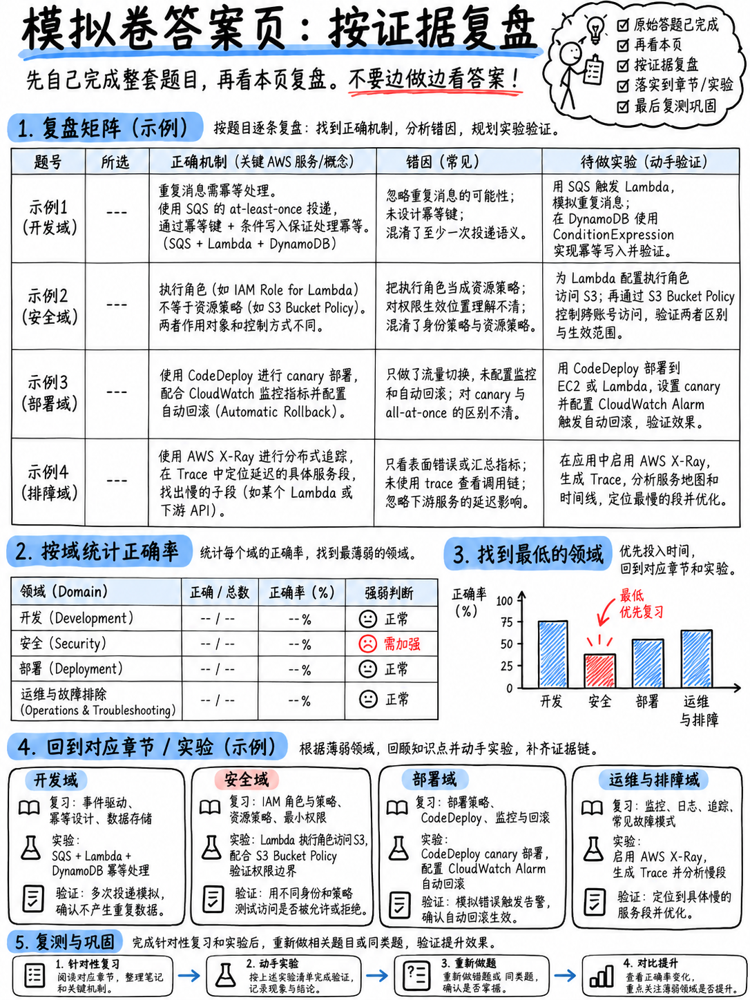

# 7.4 全真模考答案、逐题详解与诊断评估 (Mini-Mock Answers, Reasoning, and Diagnostic)

:::{warning}
在严格限时完成 {doc}`03-mini-mock-65-questions` 之前，切勿提前阅读本页内容。
:::

## 7.4.1 答案速查表 (Answer Key)

| 题号 | 答案 | 领域 | 题号 | 答案 | 领域 | 题号 | 答案 | 领域 | 题号 | 答案 | 领域 | 题号 | 答案 | 领域 |
|---|---|---|---|---|---|---|---|---|---|---|---|---|---|---|
| 1 | C | 开发 | 14 | A | 开发 | 27 | C | 安全 | 40 | C | 部署 | 53 | C | 部署 |
| 2 | D | 开发 | 15 | B | 开发 | 28 | D | 安全 | 41 | D | 部署 | 54 | A | 部署 |
| 3 | D | 开发 | 16 | B | 开发 | 29 | BE | 安全 | 42 | D | 部署 | 55 | B | 部署 |
| 4 | D | 开发 | 17 | D | 开发 | 30 | C | 安全 | 43 | B | 部署 | 56 | A | 排错 |
| 5 | D | 开发 | 18 | D | 开发 | 31 | C | 安全 | 44 | A | 部署 | 57 | B | 排错 |
| 6 | D | 开发 | 19 | A | 开发 | 32 | C | 安全 | 45 | A | 部署 | 58 | C | 排错 |
| 7 | C | 开发 | 20 | A | 开发 | 33 | B | 安全 | 46 | D | 部署 | 59 | D | 排错 |
| 8 | C | 开发 | 21 | B | 开发 | 34 | A | 安全 | 47 | D | 部署 | 60 | B | 排错 |
| 9 | A | 开发 | 22 | A | 安全 | 35 | A | 安全 | 48 | B | 部署 | 61 | B | 排错 |
| 10 | B | 开发 | 23 | A | 安全 | 36 | B | 安全 | 49 | B | 部署 | 62 | D | 排错 |
| 11 | A | 开发 | 24 | A | 安全 | 37 | AD | 安全 | 50 | C | 部署 | 63 | D | 排错 |
| 12 | A | 开发 | 25 | C | 安全 | 38 | B | 安全 | 51 | B | 部署 | 64 | C | 排错 |
| 13 | C | 开发 | 26 | B | 安全 | 39 | C | 部署 | 52 | A | 部署 | 65 | C | 排错 |

注意：第 **29** 题和第 **37** 题为多选题（Multiple Response）——必须同时选对两个选项方可得分。

---

## 7.4.2 逐题深度解析 (Reasoning)

**1 — C.** *(开发)* **部分批次响应** (`ReportBatchItemFailures`) 允许函数仅返回处理失败的消息 ID，SQS 仅会重试这些失败消息，而成功处理的消息会被自动从队列删除。调大批次大小只会让重复处理更严重；FIFO 改变的是顺序语义，而非故障隔离；预置并发与消息批次隔离无关。

**2 — D.** *(开发)* **异步调用 (Asynchronous invocation)** 在遇到错误时会自动重试 2 次（共调用 3 次），全部失败后才将事件丢弃或发送到配置的死信队列 (DLQ) 或失败目标 (On-failure Destination)。同步调用错误会直接返回给调用方，Lambda 不会自动重试；事件源映射则遵循数据源自身的重试规则。

**3 — D.** *(开发)* 1 个 WCU 覆盖最多 1 KB 的写入，且数据项大小向上取整：2.5 KB 向上取整为 **3 KB**，即每次写入消耗 **3 WCU**。每秒 40 次写入：$3 \times 40 =$ **120 WCU**。

**4 — D.** *(开发)* **本地二级索引 (LSI) 只能在创建表的同时定义**，无法在已有表上追加；因此 **全局二级索引 (GSI)** 是唯一可以在表创建后随时新增的索引类型。

**5 — D.** *(开发)* **最终一致性读取 (Eventually Consistent Read)** 的容量消耗只有强一致性读取的**一半**。事务性读取的消耗则是强一致性读取的 2 倍。

**6 — D.** *(开发)* 挂载了 VPC 的 Lambda 函数默认失去了访问公网 AWS 服务端点的路由。为 DynamoDB 配置**网关型 VPC 终端节点 (Gateway VPC Endpoint)** 无需通过公网、流量保留在 AWS 骨干网且完全免费。移除 VPC 会导致无法访问同一 VPC 内的 RDS；添加互联网网关 (IGW) 并不能直接为私有子网内的 Lambda 提供出站访问。

**7 — C.** *(开发)* SQS 标准单条消息最大有效载荷限制为 **256 KB**。对于更大的载荷，最佳实践是将对象存入 Amazon S3，在消息中仅传递 S3 指针（对象键），或使用官方提供的 SQS Extended Client Library 自动处理。

**8 — C.** *(开发)* **AWS Step Functions** 原生提供状态机编排、支持配置 `Retry`（包含 `BackoffRate` 带抖动的指数退避）以及 `Catch` 错误捕获分支。EventBridge 属于无共享状态的反应协作系统；SQS 仅提供消息解耦，不具备编排逻辑；AWS Batch 用于运行容器化批量计算作业。

**9 — A.** *(开发)* **S3 Intelligent-Tiering（智能分层）** 专为访问模式未知、不规律或发生变化的数据设计，可全自动在频度和低频等层级间转移对象以优化成本。其余存储类均要求提前预知访问模式。

**10 — B.** *(开发)* **预签名 URL (Presigned URL)** 允许在有限有效时间内临时借用生成者的权限执行上传，客户端无需持有任何 AWS 访问凭据。对于 3 GB 的大文件，底层还可结合分段上传。其余选项要么公开暴露存储桶，要么泄露了 IAM 凭据。

**11 — A.** *(开发)* SQS 标准队列保证的是**至少一次传递 (At-least-once delivery)**，要实现恰好一次处理的业务效果，必须依靠消费端的**幂等性处理 (Idempotent processing)**——常见做法是对去重键执行条件写入。轮询模式、保留时长和并发控制均无法杜绝重试引发的重复消息。

**12 — A.** *(开发)* **Amazon Kinesis Data Streams**：数据记录在配置的保留期内持久化保存，分片 (Shard) 内严格保证处理顺序，且多个独立消费者可按各自的检查点位置独立读取与重放数据。SQS 在消费者处理后即删除消息，不支持历史回溯重放。

**13 — C.** *(开发)* **DynamoDB Accelerator (DAX)** 是专为 DynamoDB 打造的全托管内存缓存，提供微秒级读取性能，且与 DynamoDB API 100% 兼容，应用程序仅需更换 SDK 客户端即可无缝接入，改动量最小。ElastiCache 虽然可行，但需要重写数据访问层的读写缓存逻辑。

**14 — A.** *(开发)* **15 分钟 (900 秒)** 是 Lambda 函数单次执行时长的硬性服务配额 (Hard Quota)。耗时更长的任务应迁移至 ECS Fargate 或拆解到 Step Functions 工作流中分步执行。

**15 — B.** *(开发)* **`AWS_PROXY`（Lambda 代理集成）** 会将原始 HTTP 请求的所有细节完整透传给 Lambda，且要求函数响应必须包含规范的 `statusCode`、`headers` 以及字符串格式的 `body`。`AWS` 传统集成使用 Velocity 映射模板，`MOCK` 集成无需后端直接返回固定模拟响应。

**16 — B.** *(开发)* **`MOCK` 集成** 可在无需调用任何后端服务的情况下直接返回预设的模拟响应，这是 API Gateway 处理模拟接口以及处理 CORS OPTIONS 预检请求的官方标准机制。

**17 — D.** *(开发)* **TTL（生存时间）** 配合基于 Unix 时间戳（秒）的属性，可在数据过期后由 DynamoDB 后台异步自动删除，**完全不消耗读写容量单位且完全免费**。通过定时任务执行 Scan 然后批量 Delete 会消耗天量读取和写入容量。

**18 — D.** *(开发)* **Lambda 层 (Layer)** 允许将公共依赖库、SDK 或自定义运行时从函数部署包中抽离，并在多个函数间共享复用，大幅缩减部署包体积——这与官方样题第 10 题的考点完全一致 [18]。

**19 — A.** *(开发)* 只有配置为 **`NEW_AND_OLD_IMAGES`** 的 DynamoDB Streams 才能在单条流记录中同时携带修改前的旧镜像与修改后的新镜像，这是比对前后差异并计算差值的唯一流视图类型。

**20 — A.** *(开发)* DynamoDB 单个 Item（数据项）的最大大小限制为 **400 KB**（包含所有属性名与属性值的大小总和）。超出该限制的超大属性应存入 S3，并在 Item 中记录 S3 对象指针。

**21 — B.** *(开发)* **AWS AppSync** 是托管型 GraphQL 服务，原生支持 **Subscriptions（订阅）** 实现与前端客户端的实时 WebSocket 消息推送，且开箱即用支持 DynamoDB 作为原生数据源 [18]。

**22 — A.** *(安全)* **实例配置文件 (Instance Profile)** 将 IAM 角色安全挂载给 EC2 实例，实例内部的 SDK 会通过 IMDS 自动获取短效临时凭据并自动轮换。将凭据硬编码或存入配置文件的选项均属于安全严重违规，且生产应用绝对严禁使用根凭据。

**23 — A.** *(安全)* `kms:Encrypt` API 单次直接加密数据的上限仅为 **4 KB**，因此大于该体积的数据必须采用**信封加密 (Envelope Encryption)**——利用 KMS 生成数据密钥 (Data Key)，用明文数据密钥在本地加密数据，随后丢弃明文密钥，将**加密后的数据密钥密文**与数据密文一并存储 [18]。存储明文数据密钥会导致加密体系形同虚设。

**24 — A.** *(安全)* **Cognito 身份池 (Identity Pools)** 负责将外部身份认证令牌（或未认证身份）通过 AWS STS 交换为具有特定 IAM 角色权限的临时 AWS 访问凭据。用户池 (User Pools) 仅负责用户注册与登录认证并签发 JWT，JWT 本身并非 AWS 访问凭据。

**25 — C.** *(安全)* **显式拒绝一票否决 (An explicit deny always wins)**。在同一账户内部策略评估中，只要有任何一条策略包含匹配的 Deny，最终判定必为 Deny；资源策略无法覆盖身份策略的显式拒绝；在跨账户场景下，双方策略都必须显式 Allow 且均不能存在 Deny。

**26 — B.** *(安全)* 读取经过 SSE-KMS 加密的 S3 对象不仅需要 S3 的 `s3:GetObject` 权限，还需要针对该 KMS 密钥的 **`kms:Decrypt`** 权限，且**KMS 密钥策略 (Key Policy)** 必须显式授权给该调用者主体。这是生产环境中最常见且最具考查性的 KMS 鉴权失败场景。

**27 — C.** *(安全)* **AWS Secrets Manager** 是这些服务中唯一原生内置基于 Lambda 的自动密钥轮换 (Automatic Rotation) 能力的服务——这正是官方样题第 1 题的正确答案 [18]。

**28 — D.** *(安全)* **4 KB**。这一物理上限正是 AWS 架构中全面推行信封加密的根本动因。

**29 — BE.** *(安全)* 每一个 IAM 角色本质上必须具备两个独立策略：**信赖策略 (Trust Policy)**（定义谁可以扮演该角色）以及**权限策略 (Permissions Policy)**（定义该角色被扮演后拥有何种操作权限）。存储桶策略、SCP 与会话策略均属于其他维度的策略载体。

**30 — C.** *(安全)* 在 API Gateway 的**资源策略 (Resource Policy)** 中配置 `aws:SourceVpce` 条件键，可以精确限制仅允许来自特定 VPC 终端节点的请求访问该 API。API 密钥和使用计划仅用于流量计费与限流；Cognito 授权方校验的是最终用户身份。

**31 — C.** *(安全)* **认证后触发器 (Post authentication trigger)**：在用户成功登录认证后由 Cognito 自动触发执行 Lambda 函数，将最后登录时间等元数据写入 DynamoDB——与官方样题第 3 题的题眼完全一致 [18]。

**32 — C.** *(安全)* **AWS 托管密钥 (AWS managed keys)** 由 AWS 平台负责**每年自动轮换底层密钥材料，且轮换计划与周期由系统固定无法更改**。编辑密钥策略、跨账户共享以及导入外部密钥材料均为客户托管密钥 (Customer managed keys) 的专属能力。

**33 — B.** *(安全)* **使用客户托管密钥的加密助手 (Encryption helpers with a CMK)** 可以在控制台或部署时将环境变量直接加密存储，在运行时需要执行 `kms:Decrypt` 才能读取其解密内容；函数代码在冷启动初始化时进行解密。默认的静态加密仍会在控制台界面明文展示变量值。

**34 — A.** *(安全)* **`dynamodb:LeadingKeys`** 条件键配合 Cognito 身份标识使用，可确保客户端只能对其自身 User ID 对应的分区键执行读写，实现行级细粒度安全隔离。

**35 — A.** *(安全)* **AWS Certificate Manager (ACM)** 为 CloudFront、ALB 及 API Gateway 提供免费的公网 SSL/TLS 证书，并在到期前提供全自动续订服务。私有证书颁发机构 (Private CA) 专用于内部证书签名且按月计费。

**36 — B.** *(安全)* **在写入日志条目之前主动对 PII 个人敏感信息进行脱敏净化 (Redact/Sanitize)**——这是 DVA 考纲明确要求的“净化敏感数据”核心开发技能 [1]。其余选项都会扩大敏感信息泄漏风险。

**37 — AD.** *(安全)* 在**存储桶策略 (Bucket Policy)** 中显式允许合作伙伴账户的主体访问，或者在**本账户内创建 IAM 角色并由合作伙伴通过 AssumeRole 扮演**。共享访问密钥和关闭公开访问阻止均属于严重安全误配置；生命周期规则与权限控制无关。

**38 — B.** *(安全)* STS 签发的临时凭据包含三部分：Access Key ID、Secret Access Key 以及一个**安全会话令牌 (Session Token)**，有效期最短 15 分钟、最长可达 12 小时。

**39 — C.** *(部署)* CodeBuild `buildspec.yml` 标准执行阶段序列为：**`install` → `pre_build` → `build` → `post_build`**。特别注意即使 `build` 阶段失败，`post_build` 阶段依然会被触发执行。

**40 — C.** *(部署)* **`ApplicationStop` 钩子运行的是上一次部署成功时所部署的版本脚本**，因为当前新版本的修订包此时尚未下载解压——这也是脚本编写错误会导致后续所有部署持续被卡死失败的根本原因。

**41 — D.** *(部署)* 在 CodeDeploy 针对 Lambda 与 ECS 的部署中，生命周期钩子仅暴露两个：**`BeforeAllowTraffic`** 与 **`AfterAllowTraffic`**。诸如 Install 等钩子仅存在于 EC2 / 本地物理机部署模式下。

**42 — D.** *(部署)* **`Linear10PercentEvery2Minutes`**——请直接按字面拆解语义：每隔 2 分钟平移 10% 流量直到全部完成。而 `Canary10Percent5Minutes` 则是初始先切 10%，等待 5 分钟健康检查通过后立即将其余 90% 一次性切入。

**43 — B.** *(部署)* 在 SAM 模板中配置 **`AutoPublishAlias`** 会在每次执行发布时自动生成新版本，并将该别名指向新版本。随后配合 `DeploymentPreference` 控制流量渐进平移策略。

**44 — A.** *(部署)* **`!GetAtt`**。对大多数资源执行 `!Ref` 仅返回其物理 ID——对于 S3 存储桶而言返回的是 Bucket Name，获取 ARN 必须显式使用 `!GetAtt MyBucket.Arn`。

**45 — A.** *(部署)* **更改集 (Change Sets)** 可以在实际执行前预览 CloudFormation 将要对基础架构执行的具体变更（包含资源的添加、修改与重新创建/替换）。漂移检测 (Drift Detection) 汇报的是在模板外部发生的带外手动变更。

**46 — D.** *(部署)* **`DeletionPolicy: Retain`**。终止保护 (Termination Protection) 保护的是整个堆栈防止被误删，而不是针对单个资源；`UpdateReplacePolicy: Delete` 与期望目标完全背道而驰。

**47 — D.** *(部署)* **手动审批操作 (Manual approval action)** 会暂停 CodePipeline 流水线，并支持向指定的 **SNS 主题** 发布待审批通知邮件——与官方考纲规范直接对应 [1]。

**48 — B.** *(部署)* **AWS CodeArtifact** 是托管型通用工件存储库服务，支持配置上游存储库自动缓存并受控审查 npm、PyPI 等公共仓库依赖。ECR 专用于存储 Docker 容器镜像。

**49 — B.** *(部署)* **分批滚动更新 (Rolling with an additional batch)** 会先启动一组额外的新实例，确保在整个更新周期内服务总容量绝对不低于预期的健康实例数，无容量缩减风险。普通滚动更新会先下线旧实例从而降低即时容量；一次性部署会引发严重服务中断。

**50 — C.** *(部署)* Elastic Beanstalk 的 `.ebextensions` 中配置 **`leader_only: true`** 可将 `container_command` 严格限定在主实例（单一实例）上执行——这是执行数据库迁移（Database Migration）的业界官方标准解决方案。

**51 — B.** *(部署)* **`cdk bootstrap`** 会在目标账户与区域初始化配置 CDKToolkit 基础支持堆栈（如 S3 存储桶与 ECR 仓库），在每个账户和区域初次使用 CDK 部署前必须且仅需执行一次。

**52 — A.** *(部署)* **AWS Amplify 基于 Git 分支的多环境管理机制 (Amplify branches)**——与 Lambda 别名、容器镜像标签并列为官方考纲推荐的现代环境隔离手段 [1]。

**53 — C.** *(部署)* **任务执行角色 (Task Execution Role)** 负责由 ECS 代理拉取 ECR 镜像并向 CloudWatch Logs 写入日志。任务角色 (Task Role) 的权限问题通常表现为任务启动成功后，应用代码内部调用 AWS API 时抛出的 `AccessDenied`。

**54 — A.** *(部署)* **`sam local invoke`** 可以在本地 Docker 环境模拟调用单个函数。`sam build` 用于编译构建，`sam package` 用于打包上传，`sam deploy` 用于向云端部署。

**55 — B.** *(部署)* 在 API Gateway 阶段上启用 **金丝雀发布 (Canary Release)** 可以将指定百分比的生产流量分流至新部署版本，并提供**完全独立的 CloudWatch 指标与访问日志**以便健康验证。

**56 — A.** *(排错)* 检查 Lambda **执行角色的 CloudWatch Logs 写入权限**（缺少 `logs:CreateLogGroup`、`CreateLogStream`、`PutLogEvents`）。日志保留期控制的是日志保存时长，不影响是否能写入。

**57 — B.** *(排错)* X-Ray 中 **注解 (Annotations)** 会建立索引，支持使用筛选表达式进行高维检索；元数据 (Metadata) 虽被持久化保存但不建索引，不支持查询过滤。

**58 — C.** *(排错)* **CloudWatch Logs Insights** 支持对已归档的历史日志执行交互式语法检索。指标筛选器 (Metric Filters) **无法追溯历史日志**（仅对创建之后的新日志生效）；CloudTrail 记录的是 AWS API 调用审计；X-Ray 跟踪的是分布式请求链路。

**59 — D.** *(排错)* **502 Bad Gateway**。当采用 Lambda 代理集成时，若函数返回的对象缺少 `statusCode` 或 `body` 非规范字符串，API Gateway 无法正确解析格式，必向客户端返回 502。

**60 — B.** *(排错)* **29 秒**是 API Gateway 同步集成的硬性超时限制（无法调大）。执行耗时更长的任务必须改为异步处理模式（如推入 SQS 后立即返回 202 Accepted）。

**61 — B.** *(排错)* **`ConditionalCheckFailedException`**——通常表示乐观并发锁的条件判断未被满足，说明存在并发冲突且机制正如设计初衷般正常发挥拦截作用。

**62 — D.** *(排错)* **`ValidationException`** 属于客户端请求语法或参数格式错误，盲目立即重试必然会完全一致地再次报错。而 429、503 及 `ThrottlingException` 属于瞬态限流/容量压力错误，必须采用带抖动的指数退避进行重试。

**63 — D.** *(排错)* **嵌入式指标格式 (Embedded Metric Format, EMF)** 通过输出规范格式的结构化日志条目，由 CloudWatch 异步自动提取为高保真自定义指标，无需执行同步 `PutMetricData` API 调用，实现零附加网络延迟。

**64 — C.** *(排错)* **AWS CloudTrail** 专门审计“谁、在何时、从何处、调用了哪个 AWS API”，是定位资源非预期变更或被删的根因追踪利器。CloudWatch 侧重运行性能指标与应用输出日志。

**65 — C.** *(排错)* **懒加载缓存模式 (Lazy loading / Cache-Aside)**：应用先查询缓存，未命中时回源读取数据库，并将结果填充回写至缓存以供后续请求命中 [18]。

---

## 7.4.3 诊断分析与备考建议 (Diagnostic Guidance)

计算你的原始正确题数（满分 65 题）：

| 得分区间 | 评估状态 | 建议行动方案 |
|---|---|---|
| **52–65 题 (80–100%)** | **准备充分 (Ready)** | 知识体系扎实。重点复盘错题，重读 {doc}`../60-exam-technique/01-how-aws-questions-work` 与 {doc}`../80-toolkit/03-numbers-and-limits` 巩固记忆，按计划参加考试。 |
| **43–51 题 (66–79%)** | **边缘临界 (Borderline)** | 具备基本知识但核心考点掌握不够严谨。按四域错题分布统计薄弱领域，针对性专项精读第 20–50 模块对应章节，3 天后重测。 |
| **0–42 题 (0–65%)** | **暂未就绪 (Not Ready)** | 核心概念存在明显漏洞。务必按 {doc}`../00-foundations/06-priority-triage` 重新梳理 Tier S 与 Tier A 核心服务，并通读 {doc}`../80-toolkit/02-cheat-sheets`。 |
