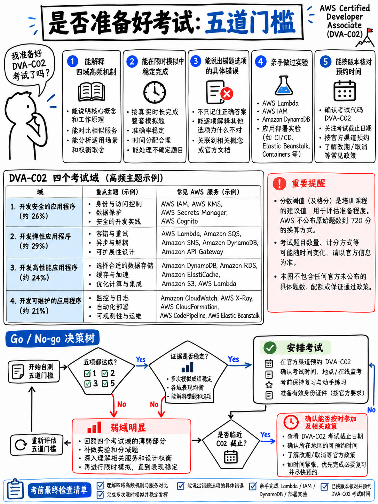

# 7.5 考前就绪评估标准与报考/退改决策矩阵 (Readiness Benchmarks and Go/No-Go Decision)



## 7.5.1 AWS 官方公布的客观事实

官方公开的数据极为精简，正视这些边界至关重要：

- **及格线为 100–1,000 分制下的 720 分** [1][17]。官方**从未公布**卷面原始正确题数与量表分数的具体换算公式，且不同考卷版本因难度平衡设计会有微调 [1]。
- **官方从未公布官方通过率**，从未建议官方备考周期，也从未发布“50 道计分题需答对 N 题”的硬性换算标准。
- 本考试采用**补偿性计分模型 (Compensatory scoring)**——各知识域之间无最低单项分数门槛要求 [1]。

以下全部评估体系与阈值指标均为**本课程的深度战略分析**，秉持严谨保守原则构建。

---

## 7.5.2 考前就绪五道门禁 (The Five Readiness Gates)

必须同时通过全部五道门禁，而非“五选三”：

```
 门禁 1  知识覆盖率 (COVERAGE)
         已完整精读第 20–50 模块的每一个章节，并能准确说出考纲涉及的全部
         44 项服务在架构中的具体职责与定位。
 ─────────────────────────────────────────────────────────────────────────────
 门禁 2  解题方法论 (METHOD)
         面对从未见过的陌生难题，仅凭架构行为合理性与限定词约束，每次都能
         稳定且自信地排除掉至少两个错误干扰项。
 ─────────────────────────────────────────────────────────────────────────────
 门禁 3  模拟测试分 (SCORE)
         在间隔至少 4 天的时间里，完成两套全真长度模考，成绩均达到或超过
         §7.5.3 规定的基准阈值。
 ─────────────────────────────────────────────────────────────────────────────
 门禁 4  答题配速感 (PACE)
         完成上述全真模拟后，剩余时间不少于 15 分钟用于检查标记题目，
         并且全卷零空题。
 ─────────────────────────────────────────────────────────────────────────────
 门禁 5  动手肌肉感 (HANDS-ON)
         亲手部署过一次 SAM 应用程序、因故障而在 CloudWatch Logs 中排查过报错原因、
         并至少由 Git Commit 触发并观察过一次 CodePipeline 运行全过程。
```

:::{important}
**门禁 5 是最多考生试图偷懒跳过、却也是 DVA 考场严厉惩罚的死穴。**
DVA-C02 考查极其具体的运维操作细节——`appspec.yml` 钩子顺序、阶段变量如何配置传递、DynamoDB 到底抛出哪种具体异常类。仅通过纸面阅读的考生在考场遇到稍加变形的真实题干时，答对概率与纯瞎猜无异。
请参阅 {doc}`../80-toolkit/01-hands-on-lab-plan`，内含 9 个均可在 1 小时内完成、且 100% 运行在 AWS 免费套餐 (Free Tier) 内的微型实战实验。
:::

---

## 7.5.3 各数据源模拟成绩达标阈值

市面上各类练习题难度悬殊，因此脱离来源谈正确率毫无意义：

| 练习题来源 | 达标阈值 | 设定依据与建议 |
|---|---|---|
| **知名商业全真模拟题库** (标明 DVA-C02) | **≥ 75%** (两次) | 高质量题库的考查难度普遍比真实考场略难 5%–10% |
| **免费或来源不明的网络题库** | **≥ 85%** (且勿轻信) | 题目往往过于直白、过时甚至包含严重误导性错误答案 |
| **本手册全真迷你模考** ({doc}`03-mini-mock-65-questions`) | **≥ 80%** | 针对考纲核心难点精准编写并附带详尽题眼解析；略易于考场真实题干长度 |
| **四个领域的专项实战演练集** | 第二次做达到 **≥ 80%** | 初次刷题已包含记忆效应，二次重做需检验错因是否彻底吸收 |
| **AWS 官方公布的 10 道样题** [18] | **10/10 且能讲清原委** | 全网最具权威性的官方样题；不仅要选对，更要能讲清每道题排除其他项的逻辑 |

:::{warning}
**必须是在间隔 4 天以上的两次独立测试中，成绩均稳定在线上。**
单次高分极易受运气和题型偏好的随机噪声干扰。最典型的备考失败惨剧就是考前 3 天单次模考刷出 80 分便盲目乐观，几天后走进考场遭遇全面滑铁卢。

请牢记数学逻辑：若 720/1000 在 100–1000 区间为简单线性映射，对应的原始得分率约为 **69%**。但实际算分非线性且模考普遍比真题简单，**将目标定在 75–80% 才能为这两大不确定性预留充足的安全缓冲垫。**
:::

---

## 7.5.4 决断决策树：结合 2026 年 11 月 30 日考制截止期

此时需要综合衡量两个硬性约束：你的实际就绪状态，以及 **2026 年 11 月 30 日 DVA-C02 停考截止日** ({doc}`../00-foundations/03-the-dva-c03-deadline`)。官方规定考前 24 小时以上可免费改期（每个预约最多 2 次）[19]；但一旦未通过，必须等待 **14 个自然日** 才能重考 [17]。

```
 当前时间 ────────────────────────────────────────────────── 2026年11月30日
                                  ▲
                       11月16日：首次参加考试的最迟安全防线
                       (为 14 天重考等待期预留出最后窗口)

 距离备考截止还有 3 周以上时间
     ├─ 门禁 1–2 未通过 ──► 立即报名锁定 11 月中旬考位（临近退役考位极速耗尽），继续死磕核心知识
     └─ 门禁已全部通过  ──► 立即预约最早能约到的考位，趁热打铁一举通关
 ───────────────────────────────────────────────────────────────────────────
 距离截止已不足 3 周
     ├─ 仅门禁 3 稍有欠缺 ─► 只要预约日期在 11 月 16 日前，坚决如期赴考！真实考场出分往往好于预期，
     │                        且万一失利仍有最后一次重考机会。
     └─ 门禁 1–2 严重不达标 ─► 需果断理性决策：是要带着重考兜底机会裸考冲刺 DVA-C02，
                              还是战略转战 DVA-C03（已有备考成果有 ~85% 可完全平移，详见 §0.3.4）。
 ───────────────────────────────────────────────────────────────────────────
 距离开考不足 24 小时
     └─ 此时已无法改期。无论如何必须准时赴考！缺考不仅白白损失报名费，
        而且去考场至少能获得一份官方各域成绩诊断单 [1]。
```

:::{tip}
**值得注意的战略非对称性：**
在 11 月 16 日参加 DVA-C02，即便万一未过，你花费了 150 美元，但换取到了考场真实体感、详尽的分域成绩诊断单，并且依然拥有一张在 11 月 30 日前再次逆袭重考的合法门票。
反之，*如果选择弃考或退考*，你将彻底丧失 DVA-C02 的考试机会。
**当处于及格边缘且日期足够安全时，坚决赴考！**
:::

---

## 7.5.5 门禁全达标考生的考前最后一周策略

- **全面封板，严禁学习任何全新服务。** 考前最后 5 天学到的任何新服务都无法沉淀为可用直觉，反而会严重扰乱已有知识框架。
- 重点重温 {doc}`../60-exam-technique/01-how-aws-questions-work`、{doc}`../60-exam-technique/02-keyword-to-service-map` 与你个人的错题笔记本。
- 完整重刷一遍**安全 (Security)** 与**部署 (Deployment)** 练习题——二者合力贡献整整半壁江山的分数。
- 仔细复读两遍 {doc}`../80-toolkit/03-numbers-and-limits` 中的硬性配额表，送分题绝不可失分。
- 每天做一组 20–30 题的小题集以保持做题手感与节奏，不再纠结分数。
- **考前 48 小时内，严禁进行高强度 65 题全真模考。**
- 考前前夜完整阅读 {doc}`../80-toolkit/06-exam-day-checklist` 考场全流程清单。

---

## 7.5.6 门禁未达标考生的考前最后一周抢分急救法

1. 清醒认识现状：目标是**及格压线通过 (720分)**，而非完美无瑕。
2. 将全部精力投入到 **解题技法 + Lambda + IAM + 核心关键词映射** 上（参见 {doc}`../00-foundations/06-priority-triage` §0.6.6）。
3. 每天通读 {doc}`../80-toolkit/02-cheat-sheets`，高密度记忆是短期提分性价比最高的救命稻草。
4. 考场守则：绝不留空白题、单题耗时坚决不超过 2 分钟、牢记 **65 题中有 15 题纯属不计分测试题** [1]，心态稳健方能逆风翻盘。
5. 即使结果不尽人意，成绩单会精确标明你最薄弱的领域；只要在 11 月 16 日前赴考，窗口期内还有最后一次复仇重考的机会。
