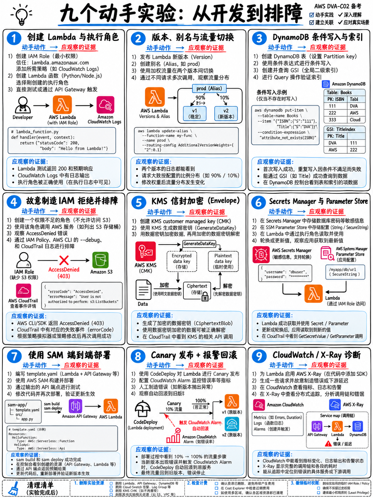

# 8.1 考前九大极速动手实战实验指南 (Nine Hands-On Labs)



:::{important}
**动手实战是区分“高分通关”与“饮恨惜败 (差几分及格)”的关键分水岭。**
DVA-C02 考查极其具体的运维操作与代码配置细节，官方大纲明确指出目标考生应具备“1 年或以上的 AWS 服务实际开发与维护经验” [1]。你无法在三周内凭空制造一年的工龄，但你可以通过花费约 **6 个小时** 集中完成以下 9 个实战实验，迅速建立考场所检验的肌肉记忆。
:::

---

## 8.1.1 实验前置准备 (Before You Start)

- **一个已启用 AWS 免费套餐 (Free Tier) 的 AWS 账户**。只要你在实验结束后严格执行环境清理（每个实验末尾均附有清理指令），所有内容均能完全保持在免费额度以内。
- **开工前务必配置账单预算告警**：进入 Billing $\to$ Budgets，创建一个每月 5 美元的微型预算并绑定邮箱告警。在开始实验 1 前完成此步。
- **绝对严禁使用 Root 根用户凭据进行日常操作**。创建一个具备 Admin 权限的 IAM 用户或配置 IAM Identity Center，并强制开启 MFA 多因素认证。
- 安装 **AWS CLI** 与 **AWS SAM CLI**，或者直接使用控制台右上角的 **AWS CloudShell**（免安装直接内置 CLI 和 SAM CLI，开箱即用绑定当前登录凭据，是考纲范围服务 [1] 且启动最快）。

```bash
aws --version && sam --version
aws sts get-caller-identity          # 首先确认当前所扮演的身份
export AWS_REGION=eu-west-1          # 选择一个就近区域并在所有实验中保持一致
```

---

## 8.1.2 实验 1：手工创建与调试 Lambda 函数 (30 分钟)

**覆盖核心考点：** 执行角色 (Execution Role)、处理程序 (Handler)、环境变量、内存配置、超时时间、CloudWatch 日志流。

```bash
# 1. 创建信赖策略文件：定义谁可以扮演此角色 (lambda.amazonaws.com)
cat > trust.json <<'JSON'
{"Version":"2012-10-17","Statement":[{"Effect":"Allow",
 "Principal":{"Service":"lambda.amazonaws.com"},"Action":"sts:AssumeRole"}]}
JSON

aws iam create-role --role-name dva-lab-role \
  --assume-role-policy-document file://trust.json

# 2. 附加权限策略：定义角色被允许做什么（此处仅赋予基础日志写入权限）
aws iam attach-role-policy --role-name dva-lab-role \
  --policy-arn arn:aws:iam::aws:policy/service-role/AWSLambdaBasicExecutionRole

# 3. 编写函数代码并打包
mkdir -p fn && cat > fn/app.py <<'PY'
import json, os
def handler(event, context):
    print("event:", json.dumps(event))
    return {"statusCode": 200,
            "headers": {"Content-Type": "application/json"},
            "body": json.dumps({"stage": os.environ.get("STAGE", "unset")})}
PY
(cd fn && zip -q ../fn.zip app.py)

# 4. 创建 Lambda 函数
aws lambda create-function --function-name dva-lab \
  --runtime python3.12 --handler app.handler --zip-file fileb://fn.zip \
  --role arn:aws:iam::$(aws sts get-caller-identity --query Account --output text):role/dva-lab-role \
  --environment "Variables={STAGE=dev}" --memory-size 256 --timeout 10

# 5. 调用函数并查看实时日志流
aws lambda invoke --function-name dva-lab out.json && cat out.json
aws logs tail /aws/lambda/dva-lab --since 5m
```

**必做的考点反向验证实验：**

1. **解绑日志权限策略** (`detach-role-policy`) 后再次调用。观察到：函数依然成功执行返回 200，**但 CloudWatch Logs 中完全不再产生新日志**——这就是考场高频题眼（排查函数执行日志丢失）的物理真相。
2. 将超时配置修改为 `--timeout 1`，并在代码中加入 `time.sleep(3)`。观察执行抛出的 `Task timed out after 1.00 seconds` 错误特征。
3. 将环境变量 `STAGE` 修改为 `prod` 并直接调用。体会对 `$LATEST` 的改动是实时无延迟生效的。

**资源销毁：** `aws lambda delete-function --function-name dva-lab`

---

## 8.1.3 实验 2：版本管理、别名与渐进式流量平移 (30 分钟)

**覆盖核心考点：** `$LATEST` 可变版本、发布不可变版本、别名 (Aliases)、加权流量路由 (Weighted Routing)。

```bash
# 基于当前代码发布版本 1
aws lambda publish-version --function-name dva-lab           # → 输出 Version: 1
# 创建名为 live 的别名指向版本 1
aws lambda create-alias --function-name dva-lab --name live \
  --function-version 1

# 修改代码，发布版本 2
sed -i 's/unset/v2/' fn/app.py && (cd fn && zip -q ../fn.zip app.py)
aws lambda update-function-code --function-name dva-lab --zip-file fileb://fn.zip
aws lambda publish-version --function-name dva-lab           # → 输出 Version: 2

# 配置加权路由：将别名 10% 的生产流量平移给版本 2
aws lambda update-alias --function-name dva-lab --name live \
  --function-version 1 --routing-config '{"AdditionalVersionWeights":{"2":0.1}}'

# 循环调用该别名 20 次，亲眼观察版本 1 与版本 2 的交替响应比例
for i in $(seq 1 20); do
  aws lambda invoke --function-name dva-lab:live /dev/stdout --query 'null' --output text
done
```

**核心应试真理：** 如果客户端直接调用的是具体的**版本号 ARN**（而非别名 ARN），加权平移配置将被**完全忽略**。

---

## 8.1.4 实验 3：DynamoDB 键设计、条件写入与查询分页 (40 分钟)

**覆盖核心考点：** 分区键与排序键、`ConditionExpression`、乐观锁与幂等性、`LastEvaluatedKey`、在线添加 GSI。

```bash
# 1. 创建按量付费模式的复合主键表
aws dynamodb create-table --table-name dva-orders \
  --attribute-definitions AttributeName=customerId,AttributeType=S \
  --attribute-definitions AttributeName=orderId,AttributeType=S \
  --attribute-definitions AttributeName=status,AttributeType=S \
  --key-schema AttributeName=customerId,KeyType=HASH \
               AttributeName=orderId,KeyType=RANGE \
  --billing-mode PAY_PER_REQUEST

# 2. 执行带条件的写入：仅当订单不存在时插入
aws dynamodb put-item --table-name dva-orders \
  --item '{"customerId":{"S":"c1"},"orderId":{"S":"o1"},"status":{"S":"NEW"}}' \
  --condition-expression "attribute_not_exists(customerId)"

# 3. 再次执行相同命令 → 立即捕获 ConditionalCheckFailedException！这就是幂等性与并发控制的底层机制。

# 4. 执行 Query 查询（仅扫描特定分区键，效率极高）
aws dynamodb query --table-name dva-orders \
  --key-condition-expression "customerId = :c" \
  --expression-attribute-values '{":c":{"S":"c1"}}'

# 5. 在已有表上在线动态追加 GSI（全局二级索引）——而 LSI 绝不可能在建表后添加！
aws dynamodb update-table --table-name dva-orders \
  --attribute-definitions AttributeName=status,AttributeType=S \
  --global-secondary-index-updates '[{"Create":{"IndexName":"status-index",
     "KeySchema":[{"AttributeName":"status","KeyType":"HASH"}],
     "Projection":{"ProjectionType":"KEYS_ONLY"}}}]'
```

**资源销毁：** `aws dynamodb delete-table --table-name dva-orders`

---

## 8.1.5 实验 4：故意破坏 IAM 策略以掌握评估机制 (30 分钟)

**覆盖核心考点：** 策略评估顺序、显式拒绝一票否决、最小特权原则。

1. 为 `dva-lab-role` 附加 `AmazonDynamoDBReadOnlyAccess` 策略，让函数调用 `put_item`。观察控制台抛出的 `AccessDeniedException`。
2. 移除只读策略，换为自定义客户托管策略，精确授权仅允许对特定表 ARN 执行 `dynamodb:PutItem`。写入成功。
3. 在第二条附加策略中增加对该表 `dynamodb:PutItem` 的**显式拒绝 (Effect: Deny)**。再次调用，操作立即失败！**亲身体会“显式拒绝永远压倒任何允许”，胜过死记硬背十遍规则**。
4. 在 CLI 中运行 `aws iam simulate-principal-policy` 模拟策略判分结果。

---

## 8.1.6 实验 5：KMS 信封加密全流程实战 (25 分钟)

**覆盖核心考点：** `kms:GenerateDataKey`、4 KB 物理物理加密上限、密文数据密钥持久化。

```bash
# 1. 创建客户托管密钥并绑定别名
KEY=$(aws kms create-key --query KeyMetadata.KeyId --output text)
aws kms create-alias --alias-name alias/dva-lab --target-key-id $KEY

# 2. 生成信封加密数据密钥：获取明文密钥与加密后的密文密钥
aws kms generate-data-key --key-id alias/dva-lab --key-spec AES_256 \
  --query '{plain:Plaintext,encrypted:CiphertextBlob}' --output json > dk.json

# 3. 故意尝试直接使用 KMS Encrypt 加密超过 4 KB 的大文件 — 观察物理报错！
head -c 5000 /dev/urandom > big.bin
aws kms encrypt --key-id alias/dva-lab --plaintext fileb://big.bin || \
  echo "^ 亲眼看到超过 4 KB 报错，彻底理解为什么云架构必须推行信封加密！"
```

**资源销毁：** `aws kms schedule-key-deletion --key-id $KEY --pending-window-in-days 7`

---

## 8.1.7 实验 6：Secrets Manager 自动轮换与 Parameter Store 差异 (20 分钟)

**覆盖核心考点：** Parameter Store SecureString vs Secrets Manager 原生轮换。

```bash
# 在 SSM Parameter Store 存储安全字符串
aws ssm put-parameter --name /dva/lab/apikey --type SecureString --value "abc123"
aws ssm get-parameter --name /dva/lab/apikey --with-decryption \
  --query Parameter.Value --output text

# 在 Secrets Manager 存储凭据
aws secretsmanager create-secret --name dva/lab/db \
  --secret-string '{"username":"admin","password":"p@ss"}'
aws secretsmanager get-secret-value --secret-id dva/lab/db \
  --query SecretString --output text
```

打开控制台，在 Secrets Manager 界面查看醒目的 **Rotation（密钥轮换）** 配置标签页，并核实 Parameter Store 中根本没有这个功能。这个直观认知能直接秒杀官方样题第 1 题 [18]。

---

## 8.1.8 实验 7：端到端部署 SAM 无服务器应用 (50 分钟)

**覆盖核心考点：** SAM 模板语法、本地离线模拟 `sam local`、API Gateway 与 Lambda 集成、全自动化发布流水线。

```bash
sam init --runtime python3.12 --name dva-sam --app-template hello-world --no-interactive
cd dva-sam
sam build
# 本地生成 API Gateway 代理事件并测试执行
sam local generate-event apigateway aws-proxy > ev.json
sam local invoke HelloWorldFunction -e ev.json
# 本地启动微型 API 网关模拟服务
sam local start-api &           # 随后测试 curl http://127.0.0.1:3000/hello
# 引导式一键部署到云端
sam deploy --guided
sam logs -n HelloWorldFunction --stack-name dva-sam --tail
```

逐行精读生成的 `template.yaml` 文件。在 `Globals` 中添加 `Tracing: Active` 开启 X-Ray 跟踪，重新部署后调用接口，并在控制台打开 **X-Ray Service Map（服务拓扑图）**。

**资源销毁：** `sam delete --stack-name dva-sam`

---

## 8.1.9 实验 8：基于 CodeDeploy 的金丝雀渐进式发布与自动回滚 (40 分钟)

**覆盖核心考点：** `AutoPublishAlias`、`DeploymentPreference`、CodeDeploy 与 CloudWatch 告警联动自动回滚机制。

在 SAM 的 `template.yaml` 函数定义中追加配置：

```yaml
      AutoPublishAlias: live
      DeploymentPreference:
        Type: Linear10PercentEvery1Minute
        Alarms:
          - !Ref ErrorAlarm
```

定义一个监控该函数 `Errors` 指标的 `AWS::CloudWatch::Alarm`。执行 `sam deploy` 发布成功后，**故意在新版本代码中抛出未捕获异常**并再次部署。打开 CodeDeploy 控制台，亲眼观察流量开始平移、触发 CloudWatch 告警、并全自动将流量 100% 回滚至健康旧版本的完整链路。

---

## 8.1.10 实验 9：全链路观测、EMF 与日志交互式分析 (35 分钟)

**覆盖核心考点：** Logs Insights 语法查询、EMF 嵌入式指标格式、指标筛选器与 SNS 告警。

1. 打开 CloudWatch Logs Insights，对函数的日志组运行结构化分析查询：

```
fields @timestamp, @duration, @billedDuration, @maxMemoryUsed, @initDuration
| filter @type = "REPORT"
| stats avg(@duration), max(@duration), max(@maxMemoryUsed) by bin(5m)
```

2. 观察报告中的 `@maxMemoryUsed` 真实内存消耗，与函数配置值比对以评估资源是否浪费（Right-sizing）。
3. 在 Lambda 函数代码中打印一行符合规范的 **EMF 结构化 JSON** 日志，刷新 CloudWatch Metrics 界面，确认在没有发起任何同步 `PutMetricData` API 的情况下，自定义业务指标已自动生成。
4. 针对日志中的 `ERROR` 关键字创建指标筛选器，并配置阈值告警绑定 SNS 邮件通知。

---

## 8.1.11 实验结束后的环境清理自查清单 (Teardown Checklist)

- [ ] 删除所有创建的测试 Lambda 函数与别名
- [ ] 删除测试 DynamoDB 数据表
- [ ] 彻底删除 SAM / CloudFormation 堆栈 (`sam delete`)
- [ ] 将测试 KMS 密钥设定为 7 天后计划删除
- [ ] 删除创建的 Secrets Manager 机密与 SSM 参数
- [ ] **手动删除 CloudWatch 日志组**（删除 Lambda 函数后日志组默认会被保留）
- [ ] 删除测试用 SNS 主题与告警规则
- [ ] 48 小时后进入 Billing 控制台确认费用账单无异常扣费

---

## 8.1.12 只有一个晚上的极简实验路线

**重点完成实验 1、2 与实验 7。**
亲手写一个带角色的 Lambda 函数、体会版本别名加权路由、并用 SAM 部署一个 API Gateway + Lambda 应用。这两小时的实操将直接打通 56% 的考分骨架！
