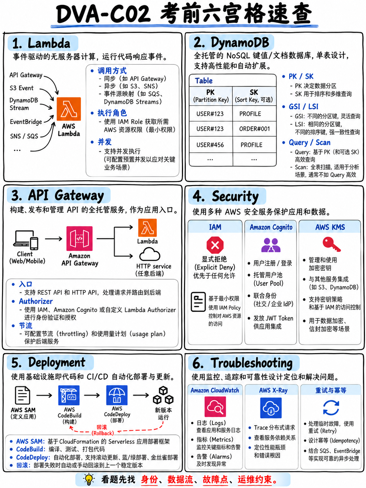

# 8.2 考前极速高密速记小抄 (Exam Cheat Sheets)



专为考前最后一周设计的高密度速记小抄。考前前夜完整精读两遍，胜过一个月前的泛读。

---

## 8.2.1 考试核心规格一览箱

```
 DVA-C02 · 全卷 65 题（50 道计分题 + 15 道不计分测试题）· 130 分钟 · 150 美元
 量表分区间 100–1,000 · 及格线 = 720 分 · 补偿性计分（各知识域无单科最低分门槛）
 无倒扣分机制 —— 绝不留任何一道空白题
 开发 (Dev) 32% · 安全 (Sec) 26% · 部署 (Deploy) 24% · 排错优化 (Trbl) 18%
 ★ DVA-C02 停考截止日：2026 年 11 月 30 日（考制重大换代日）
```

---

## 8.2.2 AWS Lambda 核心速记

```
 内存分配      128 MB – 10,240 MB (10 GB)     CPU 算力与内存严格线性绑定
 超时上限      最大 900 秒 (15 分钟)          硬性物理限制无法调大
 /tmp 磁盘     512 MB – 10,240 MB (10 GB)
 环境变量      总计不超过 4 KB，静态加密，属于不可变版本配置的一部分
 部署代码包    压缩包 50 MB · 解压后 250 MB · 容器镜像 10 GB
 函数层 Layer  最多挂载 5 个层，解压总体积计入 250 MB 上限
 有效载荷      同步调用 6 MB · 异步调用 256 KB
 并发配额      单区域默认 1,000 并发（软性配额可工单调大）

 执行角色 (Execution Role)  = 该函数拥有什么操作权限
 资源策略 (Resource Policy)  = 允许谁来调用此函数

 同步调用 → 无自动重试，错误直接原样抛给调用方
 异步调用 → 自动重试 2 次（共调用 3 次），全部失败后转入 DLQ 或失败目标 (Destination)
 事件源映射 (ESM) → 依源而定；数据流 (Kinesis/DynamoDB) 失败会阻塞整个分片

 死信队列 DLQ = 仅捕获失败事件，仅保留原始 Payload
 目标 Destinations = 成功与失败均可捕获，包含完整的请求与响应上下文信息

 版本不可变 · 别名可移动 · 加权别名支持生产流量平移切流
 冷启动突破 → 预置并发 (Provisioned Concurrency)（Java 栈可开 SnapStart）
 保护下游负载 → 配置保留并发 (Reserved Concurrency) · 紧急熔断 → 保留并发设为 0
 挂载 VPC → 私有子网默认失去公网访问能力，必须配置 NAT 网关或网关型 VPC 终端节点
```

---

## 8.2.3 Amazon DynamoDB 核心速记

```
 单数据项 400 KB · Query/Scan 单次物理响应上限 1 MB → 必须通过 LastEvaluatedKey 循环分页

 本地二级索引 (LSI)  建表时必须定义 · 相同分区键 · 共享表读写容量 · 支持强一致性 · 最多 5 个
 全局二级索引 (GSI)  任何时候均可追加 · 任意键设计 · 拥有独立容量 · 仅支持最终一致 · 最多 20 个
                     → 已有表新增查询维度 = 必须新建 GSI
                     → GSI 写入限流会连带反压阻塞主表的写入！

 1 WCU = 1 次 1 KB 的数据写入
 1 RCU = 1 次 4 KB 的强一致性读取 = 2 次 4 KB 的最终一致性读取（数据大小向上取整）
 事务性读写 = 2 倍容量消耗 · 最终一致性读取 = 0.5 倍容量消耗

 过滤器表达式 (FilterExpression) 绝对无法减少读取容量的消耗！
 ConditionExpression（条件表达式）→ 支撑乐观并发锁与幂等性校验
 TransactWriteItems = 全成或全败原子性事务（最多 100 项）· BatchWriteItem 不具备原子事务性
 DynamoDB Streams: KEYS_ONLY · NEW_IMAGE · OLD_IMAGE · NEW_AND_OLD_IMAGES
 TTL = 基于 Unix 秒时间戳的免费后台异步删除 · DAX = 微秒级内存加速读缓存
 ProvisionedThroughputExceededException → 遭遇热点分区或容量打满超限
```

---

## 8.2.4 Amazon API Gateway 核心速记

```
 REST API   Velocity 映射模板 · 请求参数校验 · API 密钥与使用计划 · 阶段缓存 · 金丝雀 · WAF · 私网 API
 HTTP API   低延迟、低成本、原生 JWT 授权
 WebSocket  双向持久连接、近实时双向通信

 集成类型：AWS_PROXY（默认代理，极力推荐）· AWS · HTTP_PROXY · HTTP · MOCK（模拟测试与 CORS 预检）
 代理集成响应必须包含合规的 statusCode 与字符串格式的 body，否则直接报错 502

 阶段 (Stages) + 阶段变量 (Stage Variables) → 指向不同的 Lambda 别名 = 优雅的多环境隔离
 任何配置修改后必须显式执行一次“部署 (Deploy)”方能生效

 授权方：AWS_IAM (SigV4 签名) · COGNITO_USER_POOLS (校验 ID Token) ·
         Lambda 自定义授权方 (TOKEN/REQUEST 校验) · 资源策略 (按 VPCe、IP、跨账户限制)
 API 密钥 = 仅用于流量计费与限流管理，绝不可用作身份认证鉴权！

 阶段级缓存，默认 TTL 300 秒 · 触发限流返回 429 Too Many Requests
 集成超时硬性上限 29 秒 → 超过直接抛出 504 Gateway Timeout
```

---

## 8.2.5 安全与身份认证 (Security) 核心速记

```
 策略判定优先级：显式拒绝 (Explicit Deny) > 显式允许 (Explicit Allow) > 默认拒绝 (Implicit Deny)
 IAM 角色 = 信赖策略 (Trust Policy，谁能扮演) + 权限策略 (Permissions Policy，能做什么)
 STS AssumeRole → 签发短效凭据：Access Key + Secret Key + Session Token（15 分钟 – 12 小时）
 跨账户访问：基于资源的策略授权，或目标账户内建角色由调用方 AssumeRole 扮演
 权限边界 (Permissions Boundaries) 与 SCP 均属权限天花板 —— 永远无法主动赋予权限
 S3 存储桶策略通常需同时覆盖存储桶自身 (arn:...:bucket) 与桶内对象 (arn:...:bucket/*)

 Cognito 用户池 (User Pool) = 身份认证 (Authentication) → 签发 ID / Access / Refresh 令牌
 Cognito 身份池 (Identity Pool) = 授权换权 (Authorization) → 借由 STS 换取临时 AWS 凭据
 关键触发器：注册前校验 · 认证后触发 (POST AUTHENTICATION 记录元数据) · 生成令牌前扩展 Claims

 KMS 单次直接加密物理上限 4 KB → 大数据强制采用信封加密 (Envelope Encryption)
   调用 GenerateDataKey → 得到明文数据密钥（加密数据后立即从内存抹除）+ 密文数据密钥（持久化存储）
 KMS 访问控制：KMS 密钥策略 (Key Policy) 与调用方 IAM 策略必须双向显式放行
 仅有 s3:GetObject 无法读取 SSE-KMS 对象 —— 必须同时拥有该 KMS 密钥的 kms:Decrypt 权限
 AWS 托管密钥：平台每年全自动轮换，不可手动调整
 客户托管密钥 (CMK)：支持自定义策略、开启自动轮换、跨账户共享、导入外部密钥材料
 ACM：提供免费公网 SSL/TLS 证书并全自动续订；CloudFront 证书必须存放在 us-east-1

 Secrets Manager → 原生支持基于 Lambda 的全自动密码轮转。
 Parameter Store → 轻量免运维、4 KB 标准参数免费、不支持开箱即用自动轮转。
 AppConfig → 支持配置灰度下发、预制验证规则、并在 CloudWatch 告警触发时全自动秒级回滚。
 铁律：严禁在代码、AMI 或配置中硬编码明文凭证。统一使用 IAM 角色赋权。
```

---

## 8.2.6 部署与 CI/CD 流水线核心速记

```
 buildspec.yml 阶段顺序：install → pre_build → build → post_build
                        支持读取 Parameter Store 与 Secrets Manager、输出工件 (artifacts) 与缓存 (cache)

 appspec.yml EC2 钩子顺序：ApplicationStop → BeforeInstall → AfterInstall → ApplicationStart → ValidateService
                          特别注意：ApplicationStop 钩子运行的是上一个历史版本的脚本！
 appspec Lambda/ECS 钩子：仅暴露 BeforeAllowTraffic 与 AfterAllowTraffic 两个钩子

 Canary10Percent5Minutes      = 先切 10%，等待 5 分钟健康校验，通过后一次性切入剩余 90%
 Linear10PercentEvery2Minutes = 每隔 2 分钟平移 10% 流量直到 100%
 EC2 原生更新策略：AllAtOnce（一次性）· HalfAtATime（每次一半）· OneAtATime（每次一台）

 SAM：AutoPublishAlias + DeploymentPreference{Type, Alarms, Hooks} 实现全自动蓝绿/金丝雀发布
      sam build / sam local invoke / sam local start-api / sam deploy --guided
 CDK：初次使用必须在目标账户+区域执行 cdk bootstrap 一次 · cdk synth · cdk diff · cdk deploy

 CloudFormation：Resources（资源定义）是模板中唯一强制必需的段落
   !Ref = 获取物理 ID · !GetAtt = 获取对象专有属性（如 ARN）· !ImportValue = 引用跨堆栈导出值
   更改集 (Change Sets) 可在执行前完整预览资源的“替换重建 (Replacement)”风险
   DeletionPolicy: Retain 防止误删核心数据库 · 堆栈进入 ROLLBACK_COMPLETE 状态必须删除后重建

 CodePipeline 手动审批操作 (Manual Approval) + SNS 邮件通知 = 生产发布的人工卡点
 CodeArtifact = 企业级私有软件包仓库 · CodeGuru Reviewer = 静态代码审查，Profiler = 运行时性能剖析

 Elastic Beanstalk：零停机蓝绿发布 = 交换环境 CNAME (Swap Environment CNAMEs)
                   .ebextensions 配合 leader_only: true 确保数据库脚本仅在单台主节点执行一次
 容器 ECS：任务角色 (Task Role) = 容器内应用业务权限 · 任务执行角色 (Task Execution Role) = ECS 代理拉取镜像与打日志
```

---

## 8.2.7 故障排查与全链路观测核心速记

```
 状态码：403 鉴权拒绝 · 429 遭遇限流 · 502 Lambda 代理响应结构非法 · 504 触碰 29 秒超时硬限
 重试策略：对 429 与所有 5xx 采用带抖动的指数退避重试；绝不自动重试其余 4xx 客户端语法错误

 ProvisionedThroughputExceededException  DynamoDB 遭遇热点分区或容量被打穿
 ConditionalCheckFailedException         乐观并发锁生效，条件未达成
 ValidationException                     请求参数语法错误（Bug），重试毫无意义
 ExpiredIteratorException                Kinesis 分片迭代器超时过期，需重新获取 Iterator
 AccessDeniedException                   检查身份策略、资源策略以及 KMS 密钥策略放行情况

 Lambda 无日志输出        → 检查执行角色缺少 logs:CreateLogGroup / logs:PutLogEvents 权限
 收集 EC2 内存与磁盘指标  → 必须在虚机内部安装并运行 CloudWatch Agent
 指标筛选器 (Metric Filter) → 从日志流中提炼指标并联动告警（特别注意：无法溯及既往历史日志）
 Logs Insights            → 针对历史日志进行交互式语法查询（@maxMemoryUsed、@initDuration）
 EMF 嵌入式指标格式       → 通过结构化日志零延迟输出自定义业务指标，无需同步 PutMetricData 调用
 AWS X-Ray                → 追踪微服务调用拓扑；注解 (Annotations) 会建立索引支持过滤，元数据 (Metadata) 不建索引
 AWS CloudTrail           → 审计“谁、在何时、从何处调用了什么 API”

 缓存模式：懒加载 Cache-Aside（查缓存 → 未命中 → 查数据库 → 写回缓存）· 写入直写 Write-Through
 DAX（DynamoDB 专有内存加速）· Redis（高可用副本与持久化）· Memcached（纯内存水平扩展）
 CloudFront 缓存键：决定哪些请求头、查询参数或 Cookie 会触发回源生成独立缓存副本
```

---

## 8.2.8 考场绝对不可违背的硬性物理配额

```
 Lambda 单次执行超时上限       900 秒 (15 分钟)
 Lambda 临时磁盘 /tmp 上限     10,240 MB (10 GB)
 Lambda 解压后代码包上限       250 MB (超限改用层或容器镜像)
 Lambda 异步调用载荷上限       256 KB
 SQS 单条标准消息上限         256 KB
 SNS 单条发布消息上限         256 KB
 KMS Encrypt 单次直接加密     4 KB (超限必须信封加密)
 DynamoDB 单数据项体积        400 KB
 DynamoDB 单次查询物理响应     1 MB
 API Gateway 同步集成超时      29 秒 (硬性上限无法调大)
 Lambda 环境变量总大小         4 KB
```

**如果在选项中看到试图突破上述物理上限，或者声称“提工单申请调大”上述硬限的方案，直接无脑排除！**

---

## 8.2.9 考场 60 秒极速通关心法

> **先读题干最后一句。找出大写限定词。秒杀凭证泄露、公开资源、触碰硬限与手写轮子的选项。在剩余选项中，选择限定词所精准指向的那一项。全卷绝对不留白，15 道测试题不计分，稳住心态必通关！**
