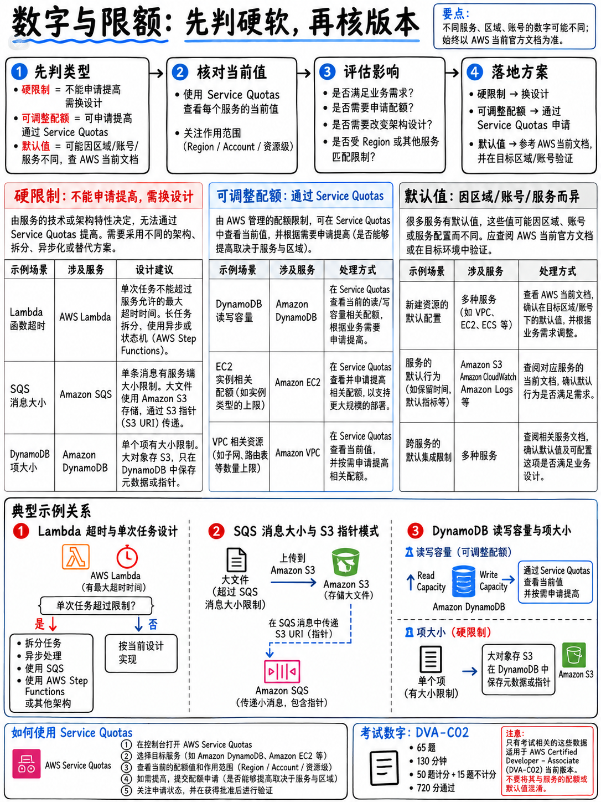

# 8.3 考场必背硬性配额与关键数值速查 (Numbers and Limits Worth Memorising)

**这绝非一份事无巨细的全量配额字典**——那将包含数千个考场根本不考的冷门数字。本篇仅收录在 DVA-C02 考场场景题中高频出现的核心数值，并明确区分**硬性限制 (Hard Limits)** 与**可调软性限制 (Soft Limits)**，因为这一分类本身就是一道经典的考点设计题眼 ({doc}`../50-troubleshooting/04-errors-limits-and-retries` §5.4.3)。

---

## 8.3.1 硬性物理配额（不可调大，必须通过重构架构解决）

| 硬性配额项 | 具体数值 | 考场对应的典型题眼与破题方案 |
|---|---|---|
| **Lambda 执行超时上限** | **900 秒 / 15 分钟** | 题干出现“25 分钟批处理” $\to$ 架构重构为 Fargate 或 Step Functions |
| **Lambda 临时磁盘 `/tmp`** | **512 MB – 10,240 MB (10 GB)** | 题干出现“解压或缓存需要 8 GB 暂存空间” $\to$ 在函数配置中将 `/tmp` 调大 |
| **Lambda 压缩包代码上限** | 压缩包 **50 MB** / 解压后 **250 MB** | 题干出现“第三方依赖过大无法打包” $\to$ 抽取为 **Lambda 层 (Layer)** 或构建为容器镜像 |
| **Lambda 容器镜像体积上限** | **10 GB** | 解决解压后 250 MB 限制的终极替代方案 |
| **Lambda 层数量上限** | 单个函数最多挂载 **5 个层** | 超过时需合并打包依赖 |
| **Lambda 环境变量总大小** | 所有键值总和不超过 **4 KB** | 题干出现“配置过大” $\to$ 迁移至 Parameter Store 或 AppConfig |
| **Lambda 调用有效载荷** | 同步调用 **6 MB** / 异步调用 **256 KB** | 题干出现“传递 8 MB 事件数据” $\to$ 写入 S3，仅传递 S3 对象指针 |
| **SQS 消息单条最大载荷** | **256 KB** | 超出限制 $\to$ 存入 S3 并结合 SQS Extended Client Library |
| **SNS 消息单条最大载荷** | **256 KB** | 同上 |
| **KMS `Encrypt` API 单次加密** | **4 KB** | 超出 4 KB $\to$ 必须采用 **信封加密 (Envelope Encryption)** |
| **DynamoDB 单条 Item 最大体积** | **400 KB** (含属性名与值) | 超出限制 $\to$ 大字段存入 S3，Item 中仅存 S3 URL 指针 |
| **DynamoDB Query/Scan 单次响应** | **1 MB** (物理分页上限) | 必须在应用中通过 `LastEvaluatedKey` 进行循环分页 |
| **DynamoDB 事务处理上限** | 单次事务最多 **100 个 items / 4 MB** | 超过时需拆分业务事务 |
| **API Gateway 集成超时上限** | **29 秒** (硬性上限无法调大) | 后端耗时超过 29 秒 $\to$ 必须改为异步架构 (推入 SQS 并返回 202) |
| **API Gateway 单次请求载荷** | 10 MB | 超大文件上传 $\to$ 使用 S3 预签名 URL 直传 |
| **S3 单个对象最大体积** | 5 TB；单次 PUT 上传最大 **5 GB** | 超过 100 MB 建议、超过 5 GB **强制**采用分段上传 (Multipart Upload) |
| **S3 分段上传每分片大小** | 5 MB – 5 GB (最后一片可小于 5 MB) | 分片上传参数规范 |
| **Kinesis 单分片 (Shard) 容量** | **写入 1 MB/s 或 1,000 条/s；读取 2 MB/s** | 流量增加 $\to$ 增加分片，或开启增强型扇出 (Enhanced Fan-Out) |
| **Kinesis 单条记录最大大小** | 1 MB | 超大消息采用分块或 S3 指针 |
| **Step Functions 执行时长** | 标准工作流最长 **1 年**；快速工作流最长 **5 分钟** | 长周期业务选标准，高并发低延迟选快速 |

---

## 8.3.2 软性配额（可通过 Service Quotas 申请调大）

| 软性配额项 | 默认配额 | 备考重点备忘 |
|---|---|---|
| **Lambda 区域并发执行数** | 单个区域默认 **1,000** | 业务突增触发 429 / `TooManyRequestsException` 的主因，可提工单调大 |
| **DynamoDB 全局二级索引 (GSI)** | 每张表默认最多 **20 个** | 可申请调大 |
| **DynamoDB 本地二级索引 (LSI)** | 每张表最多 **5 个** | 硬性设计约束，**且必须在建表时定义，后续无法追加** |
| **API Gateway 默认限流配额** | 区域稳态速率与突发容量 | 可在阶段、方法或使用计划级别覆盖自定义 |
| **CloudFormation 堆栈数量** | 单个账户单区域数千个 | 达到上限可申请提升 |
| **S3 存储桶数量** | 单个账户默认 100 个 | 可向 AWS 申请提升至更大配额 |

---

## 8.3.3 考场必问高频默认配置 (Defaults)

| 关键配置项 | 默认取值 | 合法配置区间 |
|---|---|---|
| **SQS 可见性超时 (Visibility Timeout)** | **30 秒** | 0 秒 – **12 小时** |
| **SQS 消息保留期 (Message Retention)** | **4 天** | 60 秒 – **14 天** |
| **SQS 接收等待时长 (Receive Wait Time)** | **0 秒 (短轮询)** | 0 – **20 秒 (长轮询)** |
| **SQS 消息传递延迟 (Delivery Delay)** | 0 秒 | 0 – **15 分钟** |
| **Lambda 默认超时时间** | **3 秒** | 1 秒 – 900 秒 |
| **Lambda 默认分配内存** | 128 MB | 128 MB – 10,240 MB (10 GB) |
| **DynamoDB Streams 数据保留时长** | **固定 24 小时** | 不可调整 |
| **Kinesis Data Streams 数据保留时长** | **默认 24 小时** | 可延长配置至最多 **365 天** |
| **API Gateway 缓存默认 TTL** | **300 秒 (5分钟)** | 0 – 3,600 秒 (1小时) |
| **API Gateway 缓存容量范围** | 默认不开启 | **0.5 GB – 237 GB** |
| **Lambda 自定义授权方缓存 TTL** | **300 秒** | 0 – 3,600 秒 |
| **CloudWatch Logs 日志默认保留期** | **永久不过期 (Never expire)** | 1 天 – 10 年，需主动配置生命周期以省成本 |
| **EC2 基础监控间隔** | **5 分钟** | 开启详细监控后为 **1 分钟** |
| **Cognito ID 令牌 / Access 访问令牌有效期** | **默认 1 小时** | 5 分钟 – 24 小时 |
| **Cognito Refresh 刷新令牌有效期** | **默认 30 天** | 60 分钟 – 10 年 |
| **STS AssumeRole 临时凭据有效期** | **默认 1 小时** | 15 分钟 – **12 小时** |
| **X-Ray 默认采样率** | **每秒第 1 个请求 + 超出部分的 5%** | 可通过自定义采样规则调整 |
| **S3 CLI 预签名 URL 默认有效期** | 3,600 秒 (1小时) | 使用 SigV4 认证最长可配置至 7 天 |

---

## 8.3.4 核心数字关联关系（比单纯死记数字更重要）

| 核心关联法则 | 为什么在考场上具有决定性意义 |
|---|---|
| **SQS 可见性超时 $\ge 6 \times$ Lambda 超时** | 官方强烈推荐配比；若可见性超时短于函数处理耗时，会导致消息在尚未处理完时重回队列被重复消费 |
| **Lambda CPU 算力与内存大小严格线性挂钩** | 提高内存不仅扩大内存空间，更直接线性增加 CPU 核心算力与网络带宽，是降低计算密集型延迟的唯一开关 |
| **1 RCU = 1 次 4 KB 强一致性读 = 2 次最终一致性读** | 计算容量时 Item 大小必须**向上取整到 4 KB 整数倍** |
| **1 WCU = 1 次 1 KB 写入** | Item 大小必须**向上取整到 1 KB 整数倍** |
| **最终一致性读成本减半；事务性读成本翻倍** | 最终一致性消耗 0.5 RCU，强一致性消耗 1 RCU，事务性读取消耗 2 RCU |
| **API Gateway 29 秒硬限 $<$ Lambda 900 秒** | 挂载在同步 API 后面的 Lambda 即使配置了 15 分钟超时，一旦执行超过 29 秒客户端必定收到 504 Gateway Timeout |
| **Kinesis 标准消费者共享 2 MB/s 出站带宽** | 当消费者增多导致读取争抢限流时，必须开启 Enhanced Fan-Out（为每个专属消费者提供独立的 2 MB/s 管道） |
| **三点估算法公式：$(O + 4M + P) / 6$** | 偶发项目管理计算题速算公式 |

---

## 8.3.5 考试基本参数速记

| 考试维度 | 官方标准数据 |
|---|---|
| **试题总数** | **65 题**（50 道计分题，**15 道不计分测试题**） |
| **答题总时间** | **130 分钟**（平均每题约 120 秒） |
| **量表分数区间** | **100–1,000 分** |
| **及格基准线** | **720 分**（助理级；基础级 700 分；专业级与专项级 750 分） |
| **未通过重考等待期** | **14 个自然日** |
| **通过后再次报考同考试等待期** | **2 年** |
| **成绩公布时间** | 通常在考后 **5 个工作日内**（大多考完当天或次日即可查到） |
| **证书有效期** | **3 年** |
| **考试费用** | **150 美元** |

---

## 8.3.6 本篇复习指南

请重点精读 §8.3.1 直至对各项硬性配额形成肌肉记忆。在真实考试中，硬性配额是排查错误选项最锋利的武器——因为任何违背硬性物理配额的选项，无论其描述得多么合情合理，在技术层面上都是绝对错误的。
