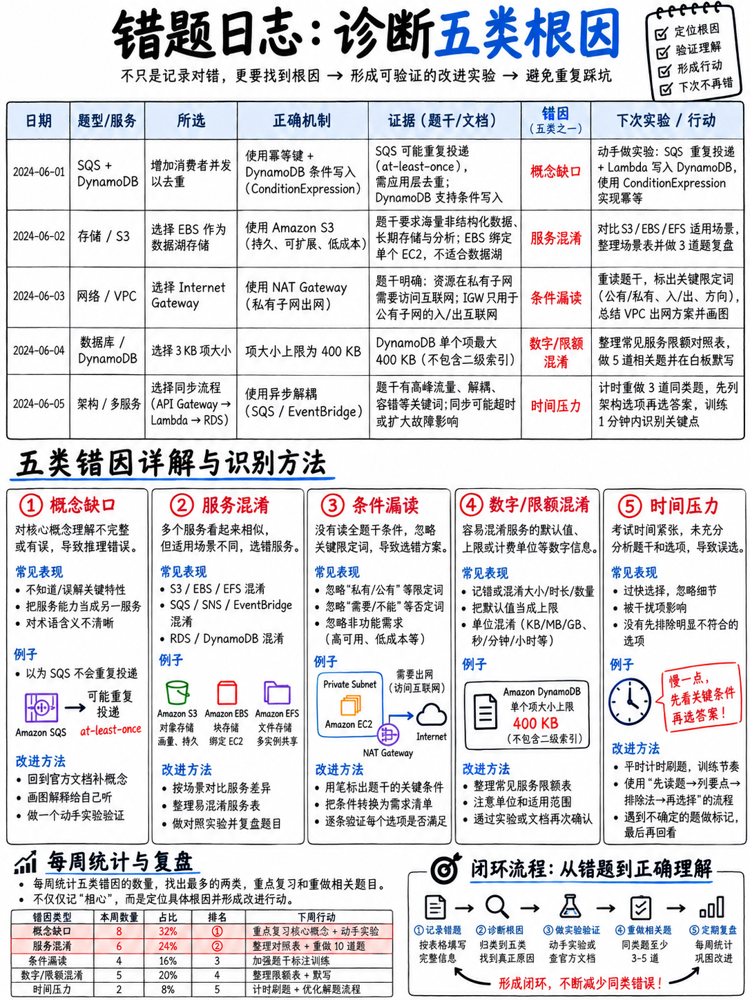

# 8.4 错题复盘闭环 SOP 与归因分析法 (The Error Log Method)



绝大多数考生在刷题后的“复盘”，仅仅是看一遍题目解析然后频频点头。这种被动复盘只会产生虚假的“熟悉感”，无法带来实质提分。建立错题本的唯一根本原因在于：**几乎所有人做错题的原因都可以归结为相同的五大根因**，如果你无法准确定位并命名它，你就绝不可能根治它。

---

## 8.4.1 错题五大根因分类 (The Five Causes)

```
 KNOWLEDGE  知识盲区：我根本不知道这个服务、这项硬性配额或该机制的具体实现。
 METHOD     方法偏差：我知道相关知识，但没有先读尾句需求，或者漏看了大写限定词。
 READING    审题失误：看错题干，忽略了 "LEAST"、漏看 "Select TWO"、没注意负载已在 VPC 内部。
 TRAP       落入陷阱：被典型的干扰项原型（D1–D9）诱导，误选了看似高大上的方案。
 TIME       时间失控：答题节奏混乱，考场超时被迫慌乱盲猜。
```

:::{important}
**对于绝大多数有一定开发经验的考生而言，KNOWLEDGE（知识盲区）往往并不是最大的失分元凶。**
很多人备考时自以为“我对 CodeDeploy 还不够了解”，但详细记录后才震惊地发现“我原来一直在死磕生造的自研方案，忽视了题干限定词 `LEAST operational overhead`”。这一认知觉醒的提分价值，远胜过盲目多看十个小时书。
:::

---

## 8.4.2 错题日志五列记录规范

每道做错或靠猜蒙对的题目，仅需记录一行，单条耗时严格控制在 90 秒内：

| 编号 | 题目来源 | 大写限定词 | 归因分类 | 考点提炼（必须用自己的语言写一句话） |
|---|---|---|---|---|
| 1 | 2.9 第11题 | — | KNOWLEDGE | Lambda 层解决共享依赖**与**大文件打包；解压后 250 MB 是硬限 |
| 2 | 3.6 第4题 | — | KNOWLEDGE | 访问 SSE-KMS 加密对象仅有 `s3:GetObject` 不够，必须同时拥有 `kms:Decrypt` 且密钥策略放行 |
| 3 | 4.7 第3题 | — | KNOWLEDGE | CodeDeploy 的 `ApplicationStop` 钩子运行的是**上一个历史版本**的脚本 |
| 4 | 6.4 第12题 | MOST cost-effective | METHOD | NAT 网关在技术上可行；但**网关型 VPC 终端节点完全免费**——我忽视了大写限定词 |
| 5 | 迷你模考 42题 | — | READING | 混淆了 `Linear...Every2Minutes` 与 `Canary...5Minutes`——扫读选项名称太仓促 |
| 6 | 5.6 第15题 | — | TRAP (D3) | Lambda 900 秒是硬限；“调大超时时间至 20 分钟”绝对不可选 |
| 7 | 2.9 第23题 | Select TWO | READING | 题目明确要求选两项，我顺手只选了一项就跳过了 |
| 8 | 4.7 第22题 | — | KNOWLEDGE | 任务**执行**角色负责拉取镜像和写日志；任务角色是赋权给我自己的代码业务逻辑的 |
| 9 | 3.6 第16题 | — | TRAP (D2) | Lambda 默认环境变量静态加密在控制台仍然是明文可见的 |
| 10 | 迷你模考 58题 | — | TRAP (D6) | 指标筛选器**不具备溯及既往能力**——查询历史日志必须用 Logs Insights |

:::{tip}
**第五列是整套复盘练习的灵魂所在。** 如果你无法在不抄袭原题解析的前提下用自己的一句话讲清这个事实，说明你根本没有真正掌握。必须立即回到第 20–50 模块对应章节彻底搞懂该知识点。
:::

---

## 8.4.3 每周错题根因直方图与靶向突破

每周结束时统计各大根因的数量分布：

```
 第二周复盘归因统计
 KNOWLEDGE (知识盲区)  ███████████████        15
 METHOD    (方法偏差)  ███████                 7
 READING   (审题失误)  █████████               9
 TRAP      (误入陷阱)  ███████████            11      D3 ×4  D2 ×3  D6 ×2  D4 ×2
 TIME      (时间失控)  ██                      2
                                              ──
                                              44
```

**只集中攻克数量最多的第一大短板：**

| 最大失分根因 | 本周唯一靶向行动指南 |
|---|---|
| **KNOWLEDGE** | 精读错题最集中的那**一个**模块，并**亲手完成其对应的动手实验**。这是最容易解决的短板。 |
| **METHOD** | 在接下来的 20 道题中，强制自己在草稿纸上手写画出尾句需求，并圈出大写限定词。 |
| **READING** | 在看任何选项之前，强制在心里默念题型特征：“第一步 / 哪个服务 / 选两项”。 |
| **TRAP** | 熟记经常绊倒你的那两个干扰项原型名称（如 D2 张冠李戴、D3 触碰硬限），提交答案前做反向拦截。 |
| **TIME** | 将大题集拆为 20 题一组的小模块限时演练，在视线内放置倒计时时钟，坚决执行 60 秒放弃决断。 |

---

## 8.4.4 双周闭环实战演练范式

以下是一套经过真实验证的高效提升路径：

**第 1 周：** 完成 120 道练习题，错 44 题。统计：KNOWLEDGE 15、METHOD 7、READING 9、TRAP 11、TIME 2。知识盲区高度集中在 **部署 (Deployment)** 领域——`buildspec` 各阶段顺序、`appspec` 钩子行为、部署策略命名规则。

**行动：** 精读 {doc}`../40-deployment/03-cicd-pipeline-services`，然后**完成实验 7 和 8** ({doc}`01-hands-on-lab-plan`)——约耗时 3 小时，亲眼在控制台观察一次金丝雀发布如何自动触发回滚。

**第 2 周：** 重新进行 120 题测试，错 27 题。统计：KNOWLEDGE 6、METHOD 5、READING 8、TRAP 7、TIME 1。

得分率从 63% 跃升至 78%。**整整三分之二的成绩提升，来源于针对单一薄弱领域投入的一个下午的针对性动手实验**，这是基于数据统计而非直觉摸索达成的必然结果。

:::{warning}
这是教学示范模式，而非保证数据——AWS 官方及本手册均不对提分速率做任何机械承诺。但核心结论坚如磐石：**对于绝大多数人而言，做错题总是聚集在某一两个明确的根因上**，找出它们比从头到尾重学一遍要快十倍。
:::

---

## 8.4.5 顽固性经验偏见的克服 (Fossilised Errors)

某些错误极难纠正，因为它们在资深传统软件工程师的直觉里“感觉是对的”：

- 习惯性地**堆砌更多计算算力**，而考场正确答案是**加一个消息队列解耦**。
- 习惯性选择自己平时在生产中喜欢自研编写的组件，而忽视官方推荐的**全托管云原生服务**。
- 默认认为所有配额都可以工单调大，因为在自建私有机房里一切皆可调。
- 习惯性回答“行业最佳实践”，而题目问的是“**最便宜**但满足需求的方案”。

针对这些顽固偏见，简单的解析纠错是不够的。请将这些反向规则写在卡片上，在每次做练习前朗读一遍。它们是旧习惯，而非知识漏洞。

---

## 8.4.6 空白错题本模板

```
 ┌────┬────────────┬─────────────┬────────────┬──────────────────────────────┐
 │ #  │ 题目来源   │ 大写限定词  │ 归因分类   │ 核心考点提炼（自己的一句话） │
 ├────┼────────────┼─────────────┼────────────┼──────────────────────────────┤
 │    │            │             │            │                              │
 │    │            │             │            │                              │
 └────┴────────────┴─────────────┴────────────┴──────────────────────────────┘

 周度统计：KNOWLEDGE ___  METHOD ___  READING ___  TRAP ___  TIME ___
 本周最大短板：______________  本周针对性突破动作：___________________________
```

无论记在纸质笔记本上还是电子表格中均可。唯一至关重要的是：最后一列必须用自己的话总结，且每周必须完成一次归因统计。
