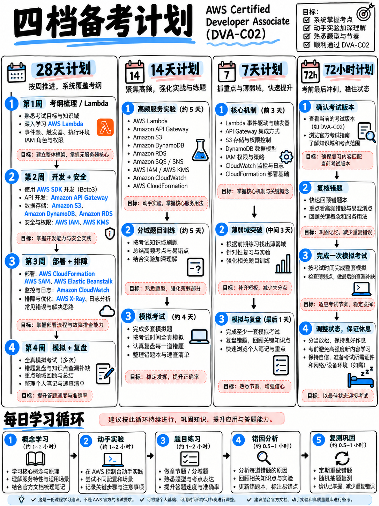

# 8.5 分阶段通关备考排期：28 天、14 天、7 天与 72 小时应急计划 (Study Plans)

:::{danger}
**以下所有计划的前提，均默认你能够在 2026 年 11 月 30 日或之前参加 DVA-C02 考试**
({doc}`../00-foundations/03-the-dva-c03-deadline`)，且最理想的是在 **11 月 16 日或之前** 参加首次考试，以便为 14 天的重考等待期预留出最后安全窗口。
**开始备战的第一件事：立即锁定考位并完成报名缴费**——只有确定的考期才能让短期备考计划真正严肃落地，而在认证即将退役的最后一个月，考位通常会以惊人速度被抢订一空。
:::

---

## 8.5.1 计划选型矩阵 (Which Plan to Use)

| 你的可用时间 | 推荐计划 | 预期达成的实战状态 |
|---|---|---|
| **4 周时间，每天约 1.5 小时** | **28 天标准计划** (累计约 45 小时) | 节奏从容；考前就绪五道门禁均可扎实通过 |
| **2 周时间，每天约 2.5 小时** | **14 天攻坚计划** (累计约 35 小时) | 适合有一定实际 AWS 使用经验的现职开发者 |
| **1 周时间，每天约 4 小时** | **7 天极速冲刺** (累计约 28 小时) | 极限分诊：聚焦解题技法 + Lambda + IAM + CI/CD |
| **仅剩 3 天** | **72 小时急救方案** | 止损应急；请务必详读相关警示与裁决规则 |

---

## 8.5.2 28 天标准备考计划 (The 28-Day Plan)

### 第 1 周：考试大纲、解题方法论与 Lambda 核心底座

| 天数 | 核心任务与产出 |
|---|---|
| **第 1 天** | 精读 {doc}`../00-foundations/01-the-aws-certification-series`、{doc}`../00-foundations/02-dva-c02-at-a-glance`、{doc}`../00-foundations/03-the-dva-c03-deadline`。**下载官方考试大纲 [1] 并通读全部 16 页。立即报名锁定考位。** |
| **第 2 天** | 精读 {doc}`../00-foundations/04-exam-mechanics-and-scoring`、{doc}`../00-foundations/05-booking-policies-and-exam-day`、{doc}`../00-foundations/06-priority-triage`。**非英语母语者立即申请 ESL +30 延时**。 |
| **第 3 天** | 连续精读两遍 {doc}`../60-exam-technique/01-how-aws-questions-work`，掌握尾句需求与大写限定词；精读 {doc}`../60-exam-technique/03-distractor-taxonomy` 九大干扰项原型。 |
| **第 4 天** | 限时完成 {doc}`../60-exam-technique/04-technique-drill-bank`（20 题）并逐题复盘。**正式建立个人错题本** ({doc}`04-error-log-method`)。 |
| **第 5 天** | 精读 {doc}`../20-development/01-domain-overview` 与 {doc}`../20-development/02-lambda-deep-dive`（前半部分：执行环境生命周期与并发）。 |
| **第 6 天** | 精读 {doc}`../20-development/02-lambda-deep-dive`（后半部分：事件源映射、层与错误重试）。**亲手完成实验 1 和实验 2** ({doc}`01-hands-on-lab-plan`)。 |
| **第 7 天** | 闭卷盲测做完 AWS 官方公布的 10 道全真样题，随后对照 {doc}`../70-practice/02-official-sample-questions-walkthrough` 深度复盘。 |

### 第 2 周：开发领域攻坚与安全深度推进

| 天数 | 核心任务与产出 |
|---|---|
| **第 8 天** | 精读 {doc}`../20-development/03-api-gateway`（阶段变量、自定义授权方与 Lambda 代理集成）。 |
| **第 9 天** | 精读 {doc}`../20-development/04-dynamodb`（分区键/排序键、GSI/LSI、容量计算与 Streams）。**完成实验 3**。 |
| **第 10 天** | 精读 {doc}`../20-development/05-s3-and-storage`（智能分层与预签名 URL）与 {doc}`../20-development/06-messaging-sqs-sns-eventbridge-kinesis`（解耦与扇出架构）。 |
| **第 11 天** | 精读 {doc}`../20-development/07-step-functions-and-appsync` 与 {doc}`../20-development/08-sdks-cli-and-patterns`（指数退避与分页）。 |
| **第 12 天** | 限时完成 {doc}`../20-development/09-development-practice-set`（30 题）并全面复盘，更新错题本。 |
| **第 13 天** | 精读 {doc}`../30-security/01-domain-overview` 与 {doc}`../30-security/02-iam-policies-and-roles`（显式拒绝、信赖策略与 AssumeRole）。**完成实验 4**。 |
| **第 14 天** | 精读 {doc}`../30-security/03-cognito-and-federation`（用户池 vs 身份池）与 {doc}`../30-security/04-kms-and-encryption`（信封加密与密钥策略）。**完成实验 5**。 |

### 第 3 周：配置安全、部署 CI/CD 与全链路排错

| 天数 | 核心任务与产出 |
|---|---|
| **第 15 天** | 精读 {doc}`../30-security/05-secrets-and-config`。**完成实验 6**。限时完成 {doc}`../30-security/06-security-practice-set`（24 题）。 |
| **第 16 天** | 全面复盘安全练习题，查漏补缺。精读 {doc}`../40-deployment/01-domain-overview`。 |
| **第 17 天** | 精读 {doc}`../40-deployment/02-cloudformation-sam-cdk`（内置函数、SAM 别名发布）。**完成实验 7**。 |
| **第 18 天** | 精读 {doc}`../40-deployment/03-cicd-pipeline-services`（`buildspec` 与 `appspec` 钩子全流程）。 |
| **第 19 天** | 精读 {doc}`../40-deployment/04-deployment-strategies`（金丝雀、线性平移与蓝绿）。**完成实验 8**。 |
| **第 20 天** | 精读 {doc}`../40-deployment/05-containers-ecs-ecr-eks` 与 {doc}`../40-deployment/06-elastic-beanstalk-and-amplify`。 |
| **第 21 天** | 限时完成 {doc}`../40-deployment/07-deployment-practice-set`（26 题）并全面复盘，记录错题根因。 |

### 第 4 周：排错优化、全真模考与考前封板

| 天数 | 核心任务与产出 |
|---|---|
| **第 22 天** | 精读 {doc}`../50-troubleshooting/01-domain-overview` 与 {doc}`../50-troubleshooting/02-cloudwatch-logs-metrics-alarms`（EMF 与 Insights）。**完成实验 9**。 |
| **第 23 天** | 精读 {doc}`../50-troubleshooting/03-x-ray-and-tracing`（注解与采样规则）与 {doc}`../50-troubleshooting/04-errors-limits-and-retries`。 |
| **第 24 天** | 精读 {doc}`../50-troubleshooting/05-optimization-and-caching`，限时完成 {doc}`../50-troubleshooting/06-troubleshooting-practice-set`（20 题）。 |
| **第 25 天** | 严格限时 130 分钟独立完成 {doc}`../70-practice/03-mini-mock-65-questions`，并对照 {doc}`../70-practice/04-mini-mock-answers` 逐题深度复盘。 |
| **第 26 天** | 根据诊断得分，专项重读最薄弱领域的一到两个章节。精读两遍 {doc}`03-numbers-and-limits` 关键配额表。 |
| **第 27 天** | 进行**第二次全长模拟演练**（来自正规商业题库），严格按考场节奏答题并完成分析。 |
| **第 28 天** | 通读 {doc}`02-cheat-sheets` 与 {doc}`../60-exam-technique/02-keyword-to-service-map`，翻阅个人错题本，通读 {doc}`06-exam-day-checklist`。**傍晚全面停笔休息，保证睡眠**。 |

---

## 8.5.3 14 天攻坚备考计划 (The 14-Day Plan)

| 天数 | 攻坚任务安排 |
|---|---|
| **第 1 天** | 通读基础篇 02–06。**下载考纲大纲，立即报名锁定考位**。 |
| **第 2 天** | 精读 {doc}`../60-exam-technique/01-how-aws-questions-work`（两遍）、{doc}`../60-exam-technique/03-distractor-taxonomy`，做完专项演练题并建立错题本。 |
| **第 3 天** | 精读 {doc}`../20-development/02-lambda-deep-dive`。**亲手动手完成实验 1 和实验 2**。 |
| **第 4 天** | 精读 {doc}`../20-development/03-api-gateway` 与 {doc}`../20-development/04-dynamodb`。**动手完成实验 3**。 |
| **第 5 天** | 精读 {doc}`../20-development/05-s3-and-storage`、{doc}`../20-development/06-messaging-sqs-sns-eventbridge-kinesis`、{doc}`../20-development/08-sdks-cli-and-patterns`。 |
| **第 6 天** | 限时完成开发领域练习题（30 题）并复盘。 |
| **第 7 天** | 精读 {doc}`../30-security/02-iam-policies-and-roles` 与 {doc}`../30-security/04-kms-and-encryption`。**完成实验 4 和 5**。 |
| **第 8 天** | 精读 {doc}`../30-security/03-cognito-and-federation`、{doc}`../30-security/05-secrets-and-config`，完成安全练习题。 |
| **第 9 天** | 精读 {doc}`../40-deployment/02-cloudformation-sam-cdk` 与 {doc}`../40-deployment/03-cicd-pipeline-services`。**完成实验 7**。 |
| **第 10 天** | 精读 {doc}`../40-deployment/04-deployment-strategies`。**完成实验 8**。做完部署领域练习题并复盘。 |
| **第 11 天** | 通读排错与优化模块（第 50 模块全量）。**完成实验 9**。 |
| **第 12 天** | 完成排错练习题 + 闭卷做完官方 10 道样题并阅读精析。 |
| **第 13 天** | 严格限时 130 分钟完成 65 题全真迷你模考并全面复盘。 |
| **第 14 天** | 针对薄弱点查漏补缺，精读 {doc}`03-numbers-and-limits`、{doc}`02-cheat-sheets`、{doc}`06-exam-day-checklist`。早睡备战。 |

---

## 8.5.4 7 天极速冲刺计划 (The 7-Day Plan)

| 天数 | 极速冲刺排期 |
|---|---|
| **第 1 天** | 精读 {doc}`../00-foundations/02-dva-c02-at-a-glance`、{doc}`../00-foundations/04-exam-mechanics-and-scoring`、{doc}`../00-foundations/06-priority-triage`，精读两遍 {doc}`../60-exam-technique/01-how-aws-questions-work`。 |
| **第 2 天** | 精读 {doc}`../20-development/02-lambda-deep-dive`，**亲自动手跑通实验 1 和 2**。完成 {doc}`../60-exam-technique/04-technique-drill-bank` 技法演练。 |
| **第 3 天** | 精读 {doc}`../20-development/03-api-gateway`、{doc}`../20-development/04-dynamodb`，限时刷完开发练习题。 |
| **第 4 天** | 精读 {doc}`../30-security/02-iam-policies-and-roles`、{doc}`../30-security/04-kms-and-encryption`、{doc}`../30-security/05-secrets-and-config`，做完安全练习题。 |
| **第 5 天** | 精读 {doc}`../40-deployment/03-cicd-pipeline-services`、{doc}`../40-deployment/04-deployment-strategies`，**完成实验 7**，做完部署练习题。 |
| **第 6 天** | 精读排错模块 02 与 04 文件，完成排错练习题，精做官方 10 道全真样题。 |
| **第 7 天** | 限时完成迷你模考 65 题，熟读 {doc}`02-cheat-sheets` 与 {doc}`03-numbers-and-limits`，通读考前清单 {doc}`06-exam-day-checklist`。早点休息。 |

**7 天计划的主动战略放弃项：** Step Functions、AppSync、EKS、Elastic Beanstalk、Amplify、Kinesis 深度细节、CDK 深度细节。这是知情且理性的战略取舍——这些知识点加起来全卷仅占 4–5 道计分题，放弃它们以确保拿下占比 80% 的核心主力服务。

---

## 8.5.5 72 小时应急急救方案 (The 72-Hour Plan)

:::{danger}
**启动此方案前请务必三思。** 考前 24 小时以上改期是完全免费的（每次预约最多 2 次）[19]；而未通过考试不仅损失 150 美元，而且强制等待 14 天的冷却期 [17] 可能会直接让你错过 11 月 30 日考制退役的最后期限。
如果考期已经锁定且无法更改，请严格执行以下止损分诊：
:::

- **第 1 天（约 6 小时）：** {doc}`../00-foundations/02-dva-c02-at-a-glance` $\to$ {doc}`../00-foundations/04-exam-mechanics-and-scoring` $\to$ 精读两遍 {doc}`../60-exam-technique/01-how-aws-questions-work` $\to$ {doc}`../60-exam-technique/03-distractor-taxonomy` $\to$ 限时完成 {doc}`../60-exam-technique/04-technique-drill-bank` 并复盘 $\to$ 精读 {doc}`../20-development/02-lambda-deep-dive`。
- **第 2 天（约 6 小时）：** 精读 {doc}`../30-security/02-iam-policies-and-roles` $\to$ {doc}`../30-security/04-kms-and-encryption` $\to$ {doc}`../30-security/05-secrets-and-config` $\to$ {doc}`../20-development/04-dynamodb` $\to$ {doc}`../20-development/03-api-gateway` $\to$ {doc}`../40-deployment/03-cicd-pipeline-services` $\to$ {doc}`../40-deployment/04-deployment-strategies`。
- **第 3 天（约 5 小时，下午 4 点前必须停笔）：** 研读官方 10 道样题与解析 $\to$ 上午限时完成 {doc}`../70-practice/03-mini-mock-65-questions` 并快速复盘 $\to$ 熟记 {doc}`03-numbers-and-limits` $\to$ 通读 {doc}`02-cheat-sheets` 与 {doc}`06-exam-day-checklist`。**下午 4 点坚决放下所有复习资料**，充足的睡眠对高强度 130 分钟决策思维的收益，远胜过最后一小时的焦虑翻书。

---

## 8.5.6 贯穿所有计划的八大通用铁律

1. **先报名锁定考位。** 没有确切的考期死线，任何复习计划都无法挺过一个忙碌的工作周。
2. **动手实验不是可有可无的调味品。** 计划中明确排布实验，是因为考卷高度奖励对配置细节和报错现象的实操敏锐度。
3. **复盘用时必须大于或等于答题用时。** 彻底复盘 20 道错题带来的认知升级，远胜过盲目刷 60 道不复盘的新题。
4. **从第一套练习题开始就必须记录错题本。** 考前几天你根本无法凭记忆还原真实的失分归因。
5. **优先死磕 Lambda，其次是 IAM。** 这两个服务横跨全部四个知识领域，贯穿全卷。
6. **考前最后 3 天内，严禁接触任何全新服务。**
7. **考前 48 小时内，严禁进行全长模考。**
8. **保证睡眠。** 130 分钟连续进行高强度布尔逻辑推理；考场疲倦引发的误判损失，比任何单一知识漏洞都更致命。
