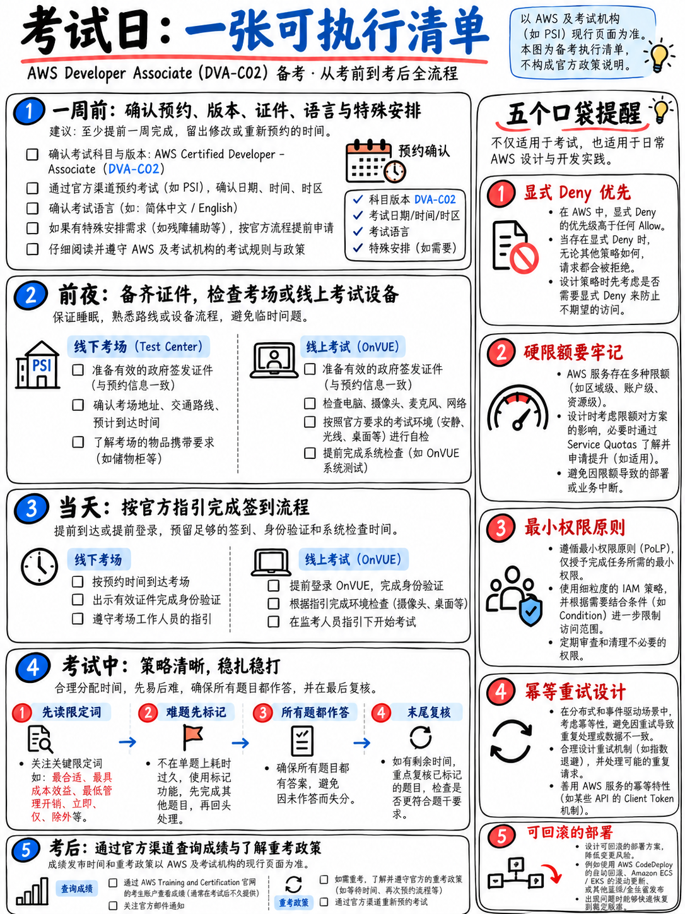

# 8.6 考前全流程 Checklist 与考场一页纸速查卡 (Exam-Day Checklist)



本篇政策严格引述自 AWS 官方认证政策手册 [17][19] 与 DVA-C02 官方考试主页 [2]。

---

## 8.6.1 考前一周必查清单 (The Week Before)

- [ ] **核对身份证件姓名与考试注册姓名 100% 一致。** 若入场签到时姓名拼写有误，考官将拒绝入场且报名费直接作废。
- [ ] 确认准备好**两张有效身份证件**：一张政府签发的**主要身份证件**（带照片和签名，如护照、二代身份证、驾照），以及一张**次要身份证件**（带姓名和签名，如签名信用卡、社保卡等）[19]。
- [ ] 如果你在**护照签发国以外的地区**参加考试，证件必须包含**罗马拼音/英文字符**，否则必须携带有效护照 [19]。
- [ ] **参加线上监考 (Online Proctored)？** 提前几天在**考试当天所用的同一台电脑和同一局域网**环境下完整跑通 Pearson VUE 系统网络兼容性测试。
- [ ] **线下考点？** 提前确认考点准确地址与交通路线，预留充足路程时间。
- [ ] 牢记考前 24 小时硬规则：距开考不足 24 小时禁止改期或退考；且每次预约最多仅允许改期 **2 次** [19]。
- [ ] 考前 **48 小时内**，全面停止进行任何 65 题全长模考。
- [ ] **是否已申请 ESL +30？** 若非英语母语者且报考英文试卷，请务必提前在后台申请；开考后无法追加 ({doc}`../00-foundations/05-booking-policies-and-exam-day` §0.5.4)。

---

## 8.6.2 考前前夜清单 (The Night Before)

- [ ] **仅通读两篇速查文档**：{doc}`02-cheat-sheets` 与 {doc}`../60-exam-technique/02-keyword-to-service-map`。
- [ ] 快速翻阅一遍你自己的**错题日志**，不要再盲目翻看大篇幅理论。
- [ ] 整理好随身物品：主要证件、辅助证件、确认邮件打印件/电子凭证、饮用水、保暖外套。
- [ ] 设定两个独立闹钟。
- [ ] **晚上尽早封笔休息。** 今晚死记硬背的任何新琐碎知识点，明天考场上都无法形成可用的直觉反应。

---

## 8.6.3 考试当天早晨 (The Morning)

- [ ] 正常享用清淡早餐。**130 分钟无固定休息**的高强度布尔逻辑辨析，极其消耗血糖。
- [ ] **线下考点：提前 30 分钟到达考场。** 线上考试：**提前 30 分钟开启 Check-in 签到流程**（证件拍照、房间 360 度环视扫描耗时往往远超预期）。
- [ ] 线上监考环境清理：桌面除电脑和鼠标外完全清空，独立私密房间、无外接显示器、无手机、无智能手表、无草稿纸笔，且中途绝不允许任何人推门进入。

### 15 分钟考前热身操（实战提分建议）

在离开家出门前或进入考场签到前 15 分钟执行：

```
 5 分钟   速读 {doc}`02-cheat-sheets` §8.2.8 — 考场必背硬性配额
 5 分钟   速读 {doc}`../60-exam-technique/03-distractor-taxonomy` §6.3.1 — 九大干扰项原型
 5 分钟   在心中默念两遍“四步做题法”与题干尾句抓取直觉
```

热身的目的不是重新学知识，而是确保你在面对第 1 题时就能瞬间调动出成熟的应试策略，而不是做到第 30 题才进入状态。

---

## 8.6.4 考场答题节奏与双轮循环策略 (In the Exam)

```
 ┌──────────────────────────────────────────────────────────────────────┐
 │ 第一轮 (PASS 1)  通刷全部 65 题，每题必选答案，疑难题打上 Flag 标记后继续   │
 │                  每题耗时 60–120 秒 · 坚决不留空白 · 执行 60 秒决断放弃规则  │
 │                  时间检查锚点：第 20 题 ≈ 剩余 90 分钟                    │
 │                               第 40 题 ≈ 剩余 50 分钟                    │
 │                               第 65 题 ≈ 剩余 20 分钟                    │
 ├──────────────────────────────────────────────────────────────────────┤
 │ 第二轮 (PASS 2)  利用剩余的约 20 分钟，集中排查打 Flag 标记的题目          │
 │                  只有在能明确讲出原答案错在何处时才修改答案，切勿盲目改动  │
 └──────────────────────────────────────────────────────────────────────┘
```

**单题破题四步流程：**

1. **先看题干最后一句，再读提问。** 核心业务需求与大写限定词百分之百隐藏在此处。
2. **快速扫视四个选项**，迅速定位选项间的核心分歧维度（如解耦服务选型 vs 缓存方案）。
3. **带着明确的排查意图回读题干背景**，寻找前置约束条件。
4. **迅速排除两个明显干扰项**，最后根据限定词从剩余两项中决断。

**考场心态护甲：全卷 65 题中整整有 15 题是不计分的测试题** [1]。如果遇到一道题干极其怪异、前所未见或晦涩难懂的题目，它在统计学上有极高概率属于不计分题。给它 60 秒，排除能排除的，蒙一个最靠谱的，打上标记果断前进，绝不要让一道怪题破坏你的答题节奏与心态！

---

## 8.6.5 考场一页纸神准速记卡 (Five One-Page Cards)

### 卡片 1 —— 永远错误的绝对死穴

将 Access Key 写入代码或配置中 · 将存储桶或资源设为公开 · 赋予 `*` 或 `AdministratorAccess` · 违背硬性物理配额 · 宣称通过“提工单提升”硬性配额 · 重试非 429 的 4xx 客户端错误 · 使用 Parameter Store 做全自动密码轮换 · 试图使用 FilterExpression “降低 DynamoDB 读成本” · 在已有表上新增 LSI · 期望 GSI 支持强一致性读取 · 当已有托管功能时在 EC2 上手写 Cron 定时脚本。

### 卡片 2 —— 通常正确的黄金特征

使用 IAM **角色 (Role)** · 需要自动轮换时选择 **Secrets Manager** · 大文件直接上传使用 **预签名 URL (Presigned URL)** · 依赖复用使用 **Lambda 层 (Layer)** · 异步解耦使用 **DLQ 或失败目标 (On-failure Destination)** · 重试机制使用 **带抖动的指数退避 (Exponential backoff with jitter)** · 支撑新查询维度选择 **GSI** · 多环境部署使用 **阶段变量 + 别名** · 跨微服务链路定位瓶颈使用 **X-Ray** · 统计错误日志频次使用 **Logs Insights** · 无延迟自定义指标使用 **EMF** · 出现 `least operational overhead` 时优先选择 **全托管原生服务**。

### 卡片 3 —— 四大领域核心边界

**开发 32%**：Lambda · API Gateway · DynamoDB · S3 · SQS/SNS/EventBridge/Kinesis · Step Functions/AppSync · SDK 开发范式。  
**安全 26%**：IAM 策略评估与角色 · Cognito 用户池与身份池 · KMS 与信封加密 · Secrets Manager / Parameter Store / AppConfig · 敏感数据脱敏。  
**部署 24%**：CloudFormation/SAM/CDK · Code 系列流水线与 CodeArtifact · 金丝雀/线性/蓝绿/滚动部署 · 容器 ECS/ECR · Beanstalk/Amplify。  
**排错 18%**：CloudWatch 日志/指标/告警/EMF · X-Ray 跟踪与注解 · 状态码与 SDK 异常 · 缓存与容量并发优化。

### 卡片 4 —— 绝对不可违背的硬限

Lambda **900 秒**、`/tmp` **10 GB**、解压包 **250 MB**、环境变量 **4 KB**、异步载荷 **256 KB** · SQS 与 SNS 消息 **256 KB** · KMS `Encrypt` 单次 **4 KB** · DynamoDB 数据项 **400 KB**、单次响应 **1 MB** · API Gateway 集成超时 **29 秒** · Kinesis 单分片 **写入 1 MB/s、读取 2 MB/s**。

### 卡片 5 —— 考场极易混淆的概念对

CloudWatch（系统指标与日志）vs **CloudTrail（谁、在何时调用了什么 API）** · Secrets Manager（自动轮换）vs **Parameter Store（轻量免费）** · 用户池（注册登录签发 JWT）vs **身份池（STS 临时凭证授权）** · LSI（建表时定义）vs **GSI（随时创建、仅最终一致）** · 任务角色（业务代码权限）vs **任务执行角色（ECS 代理拉取镜像与写日志）** · 执行角色（Lambda 能做什么）vs **资源策略（谁可以调用该 Lambda）** · DLQ（仅捕获失败）vs **Destinations（成功与失败均可捕获上下文）** · 金丝雀（先切小部分然后一次性全切）vs **线性（按固定周期等比平移）** · 注解（建立索引支持过滤）vs **元数据（不建索引无法过滤）** · `!Ref`（物理 ID）vs **`!GetAtt`（ARN）** · 502（后端返回值格式不合规）vs **504（29 秒硬限超时）**。

---

## 8.6.6 关于非英语语种考试的特别提醒

DVA-C02 支持**简体中文、日语、韩语、葡萄牙语、西班牙语以及英语** [2]。

- 考试语言在**报名时确定**，后续无法在考场临时切换。
- 考虑到大家平时查阅的官方文档、API 与 SDK 均为英文原版，在考前一周请对照 {doc}`../00-foundations/07-glossary-and-service-shortnames` 熟记关键术语的中英文对照。
- 如果你的核心痛点是英语阅读速度而非术语理解，**申请 ESL +30 延时** 往往是更好的策略：既能保留熟悉的英文原生技术语料，又能多获得 30 分钟的充裕答题时间。

---

## 8.6.7 考场 60 秒终极心法

> **先读题干最后一句。揪出大写限定词。秒杀凭证泄露、公开资源、触碰硬限与自建轮子的选项。在剩余选项中，选择限定词所精准指向的那一项。全卷绝对不留白，15 道测试题不计分，稳住心态必通关！**

---

## 8.6.8 考后必知事项

- 交卷后屏幕通常会立即显示 Pass / Fail 的非正式结果；**正式成绩单将在 5 个工作日内同步至你的 AWS 认证账户后台** [17]。
- 官方成绩单（Exam History $\to$ Score Report）会提供 **100–1,000 分量表分以及四大领域的详细诊断**。
- **严禁在公开社交媒体讨论考题具体内容**，考生在开考前已签署保密协议 (NDA)。
- **通过之后**：证书有效期为 **3 年**；后续考取 **DOP-C02 (DevOps Engineer Professional)** 会自动顺延刷新本证书有效期 [2][3]。
- **万一未通过**：需等待 **14 个自然日** 冷却期方可重新报考 [17]——请务必密切结合 **2026 年 11 月 30 日退役截止日** 规划你的重考时间窗口。
