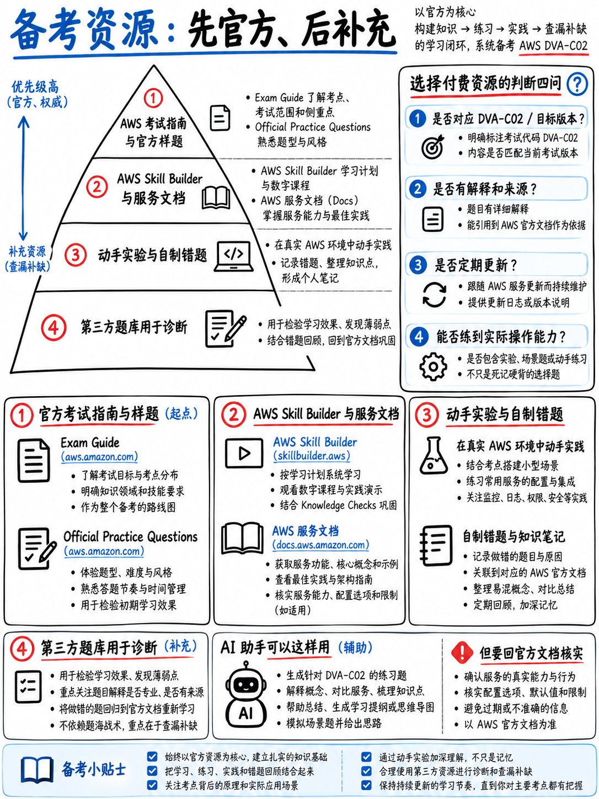

# 8.7 权威资料推荐：官方免费资源、付费题库选型与避坑参考 (Resources: Free, Paid, and What to Avoid)

## 8.7.1 官方免费核心资源清单 (Free and Official)

| 官方资源名称 | 核心价值与内容定位 |
|---|---|
| **DVA-C02 考试大纲指南 (PDF, v1.3)** [1] | **终极备考总纲。** 16 页完整篇幅：逐条列出所有 Task 与 Skill 考点陈述、计分规则以及划定的考查服务范围与出纲服务黑名单。 |
| **DVA-C02 官方样题 (PDF)** [18] | **10 道官方全真题型与原厂解析。** 考前必须逐题研究，详见 {doc}`../70-practice/02-official-sample-questions-walkthrough`。 |
| **AWS Skill Builder 免费套餐** | AWS 官方在线学习平台；提供完全免费的 DVA-C02 “Exam Prep” 冲刺视频课程。 |
| **AWS 官方开发者指南 (Developer Guides)** | Lambda、DynamoDB、API Gateway、CodeDeploy 等核心服务的官方技术文档；考题事实与判分依据的最终权威来源。 |
| **AWS 认证政策官方指南** [17][19] | 重考等待期、退改期规则、考场证件要求与成绩公布政策。 |
| **AWS Free Tier（免费套餐）** | 支撑完成 {doc}`01-hands-on-lab-plan` 中全部 9 个实战动手实验的免费云资源。 |
| **AWS CloudShell** | 浏览器内置终端，免安装直接内置 AWS CLI 与 SAM CLI，已自动关联控制台凭证。 |

:::{important}
**如果你在本手册之外只打算读一份参考资料，请务必完整精读官方考试大纲 [1]。**
这份 16 页的官方 PDF 完全免费，且从根本上界定了 DVA-C02 的真实考试边界。它所列出的在册服务清单是你的核心考点，而其排除在外的服务清单更是你放下不必要焦虑的法定凭据。
:::

---

## 8.7.2 付费资源投入优先级 (Worth Paying For)

1. **考试报名费**：150 美元（若之前考过其他 AWS 认证，可使用半价 50% 折扣券抵扣）[2][3]。
2. **一套权威且明确标注 DVA-C02 的全真模拟题库**：请对照 {doc}`../70-practice/01-how-to-practice` §7.1.6 提出的五项标准进行甄选——最核心的是必须讲清**错误选项究竟为什么错**。
3. **AWS Skill Builder 付费订阅（可选）**：如果希望体验官方全真模拟题以及官方动手实验沙箱；此外也是后续通过学习维护直接更新证书的通道 [3]。
4. **其他资料**：在没有通过模拟测试定位出明确短板之前，**严禁盲目购买任何其他资料**。

在短期冲刺中极不推荐购买的物品：购买多家重复的题库、报第二门冗长视频课程、购买纸质单词卡片，以及任何宣称“真题回忆题库 (Dumps)”的侵权资料。

---

## 8.7.3 理性利用 AI 辅助备考 (Using AI Assistants Sensibly)

| 极度推荐让 AI 辅助的场景 | 坚决严禁轻信 AI 的场景 |
|---|---|
| 深度解释某项半懂不懂的底层架构机制 | **询问具体的考试题量、各领域权重或截止退役日期** |
| 将一段官方晦涩的考纲陈述改写为通俗白话 | 盲目相信 AI 生成的模拟题作为判分基准 |
| 针对你提供的技术术语设计针对性抽查问答 | 让 AI 猜测及格线或推算及格率 |
| 将你的错题日志分类并生成复习大纲 | 让 AI 主观评估“你是否已经准备就绪” |
| 解释一段 CLI 命令、SAM 模板或策略 JSON | 查询具体的服务硬性配额与限制（必须查官方文档） |

:::{danger}
**当前利用 AI 备考 DVA 面临的两大核心致命陷阱：**

**1. 大模型训练数据滞后。** 很多通用大模型的知识库并未及时更新 DVA-C02 向 **DVA-C03** 的换代公告，会误以为 DVA-C02 将永久延续，甚至仍在输出早已过时的 DVA-C01 老题型。更有甚者会自信地将 **CodeCommit** 当作核心必考项详细讲解——而在官方 DVA-C02 大纲中，CodeCommit 出现的次数是 **整整 0 次** [1]。

**2. 幻觉与煞有介事的编造。** AWS 拥有数百个名称极其相似的服务；当向 AI 询问“能实现某某功能的 AWS 服务是什么”时，大模型极易凭空捏造出一个听起来非常专业、但在现实中根本不存在的服务名词。而真实的考场干扰项正是这样设计的。

**铁律：凡涉及考试架构、考查大纲、关键考期及服务物理配额的结论，未经官方大纲 [1]、官方政策页 [17][19] 或服务官方文档背书，绝不可盲从信奉。**
:::

---

## 8.7.4 真正有价值的高质量免费素材

- **AWS 官方 Developer Guides**：针对 {doc}`../00-foundations/02-dva-c02-at-a-glance` §0.2.6 列出的五大核心服务，重点精读其中的“Best practices（最佳实践）”与“Quotas（服务配额）”页面——试题题眼高度集中于此。
- **AWS re:Invent 深度演讲与 re:Post 官方精选问答**：重点关注 Lambda 底层并发机制、DynamoDB 单表数据建模与蓝绿/金丝雀部署策略。
- **你所在公司的真实 AWS 生产账户（如有权限）**：在受限权限下阅读一份真实的生产 `buildspec.yml`、IAM 权限策略与 CloudFormation/SAM 模板，其学习效果胜过观看数小时空洞的视频演示。
- **本课程附带的完整原创题库**：30 道开发题 + 24 道安全题 + 26 道部署题 + 20 道排错题 + 20 道技法演练题 + 65 道全真模考题 = **共计 185 道全原创精选试题及逐题深度解析**，外加官方 10 道样题拆解。

:::{warning}
**公网免费资料中最大风险源是老旧的录播视频与网络盗版 PDF 指南。**
相当多的资料是在 **DVA-C01** 时代录制的，仅仅简单修改了标题便重新发布。阅读前请先运行 {doc}`../90-references/02-outdated-advice-red-flags` 中的“十秒鉴别测试”，避免将宝贵的时间浪费在早已废弃的过时考制上。
:::

---

## 8.7.5 成功通关后的证书管理

- 认证有效期限为 **3 年** [2]。
- **续期与进阶**：在 3 年内考取最新版的该认证，或通过考取更高阶的 **AWS Certified DevOps Engineer – Professional (DOP-C02)** 专业级认证，可自动刷新顺延本开发者证书的有效期 [2][3]。
- **在线学习维护机制**：在证书到期前 90 天内，通过购买 AWS Skill Builder 订阅完成官方指定学习路径，可免考直接顺延 1 年有效期 [3]。
- 通关后将获得下一场考试的 **50% 半价报考折扣券** [2][3]——请务必将其用在费用最昂贵的专业级（Professional 300 美元）或专项级（Specialty 300 美元）考试上 ({doc}`../10-other-exams/05-choosing-your-path` §1.5.4)。
- 请将证书编号和到期日记录在个人日历中，规划好 3 年后的续期节点。

---

## 8.7.6 极简经济型通关装备包

适合备考预算有限且冲刺周期在 3 周以内的学习者：

1. **DVA-C02 官方考试大纲** 与 **官方 10 道样题** [1][18] —— 完全免费
2. **本通关手册全套教程与实战题库** —— 随手可查，完全免费
3. **一个已绑定账单告警的 AWS 免费套餐账户** —— 实操演练，近乎零成本
4. **一套** 标注 DVA-C02 的权威模拟测试题库 —— 投入适度
5. 一个用于记录五列归因的**错题日志笔记本** —— 成本最低，提分杠杆最高
