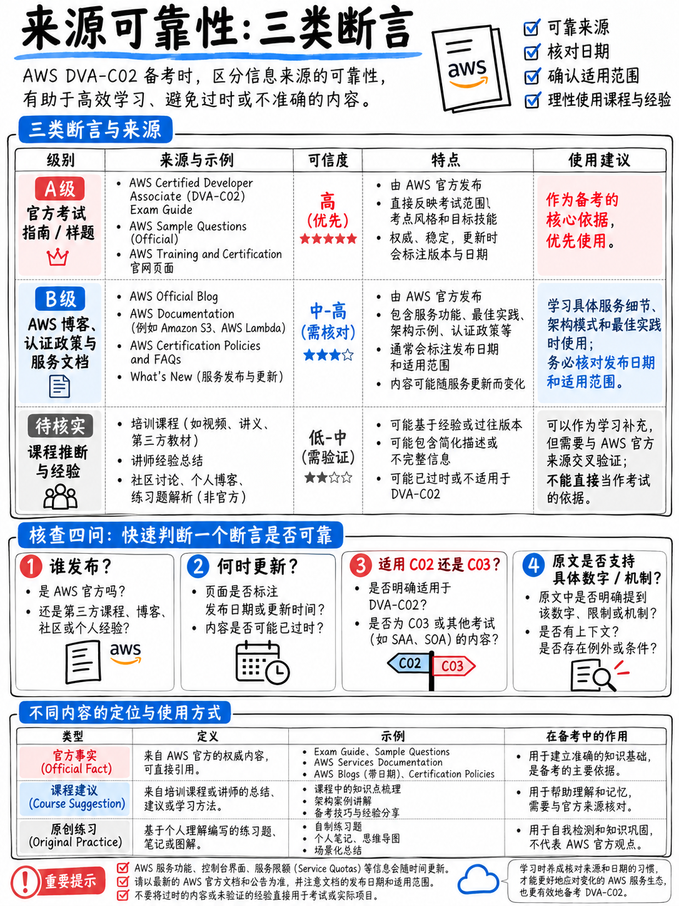

# 9.1 数据来源、可靠性评级与原创归属声明 (Sources, Reliability, and Provenance)

本手册编撰于 **2026 年 10 月**。关于考试机制的每一个事实陈述，均严格锚定于文末带有数字编号的权威来源，或明确标注为**本手册的逻辑推演**，或显式打上 **[未经官方核实]** 标签。

---

## 9.1.1 证据可靠性评级体系 (Reliability Grades)

| 等级 | 评级含义 | 适用范围与采信规则 |
|---|---|---|
| **A 级** | AWS 原厂顶级公开标准文件（官方考纲指南 PDF、官方政策规范文档），附带明确官方版本号与发布时间戳 | 考查范围、各领域权重、考试题型、计分算法、考场官方政策的标准基准 |
| **B 级** | AWS 官方官方主页、原厂工程博客文章、Skill Builder 官方页面 | 考试关键时间线、产品功能发布、考期变动公告 |
| **C 级** | 知名度高、带有明确发布日期的第三方权威机构文章（且与 A/B 级事实完全吻合） | 仅作交叉求证核验。**本手册没有任何核心考点与结论单独建立在 C 级来源上** |
| **D 级** | 无日期的网络博客、SEO 流量站文章、AI 自由生成的复习指南、培训机构营销软文 | **坚决严禁采信与引用** |

---

## 9.1.2 核心权威数据源索引 (The Sources)

### [1] AWS Certified Developer – Associate (DVA-C02) 官方考试大纲指南 · **A 级来源**

**版本号：Version 1.3**，共 16 页。PDF 元数据创建时间为 **2025 年 2 月 13 日**。

官方直达地址：`https://d1.awsstatic.com/training-and-certification/docs-dev-associate/AWS-Certified-Developer-Associate_Exam-Guide.pdf`

**$\to$ 权威佐证事实：** 四大核心考查领域及其权重（32% / 26% / 24% / 18%）；第 20–50 模块引述的全部 Task 与 Skill 考点陈述；全卷 65 题结构（**50 道计分题 + 15 道不计分测试题**）；量表分 **100–1,000 分** 与 **720 分** 及格基准线；**补偿性计分模型 (Compensatory scoring)**；“无倒扣分”机制；单选与多选两类题型；服务缩略语出题规范与考场内建 Help 检索功能；目标考生画像；**明确列为超纲的任务列表**；以及最核心的**在册考查服务全量清单与明确排除服务清单**。

**这是本考试的终极大纲宪章。** 如果本手册任何分析与该文件存在出入，必须以该官方考纲文件为准。

### [2] AWS Certified Developer – Associate 官方认证主页 · **B 级来源**

官方地址：`https://aws.amazon.com/certification/certified-developer-associate/`

**$\to$ 权威佐证事实：** 考试总时长 130 分钟 · 65 题 · **报名费 150 美元** · Pearson VUE 线下考点或线上监考 · 考试语言（简体中文、英语、日语、韩语、葡萄牙语、西班牙语）· **证书有效期 3 年** · 重新认证规则（考取最新版或考取 **DevOps Engineer – Professional**）· 下一场考试 50% 折扣券 · 以及核心考期横幅公告：**DVA-C03 报名于 2026 年 10 月 27 日开放；DVA-C02 最后一批考试场次截止于 2026 年 11 月 30 日。**

### [3] AWS Certification 重新认证官方政策页 · **B 级来源**

官方地址：`https://aws.amazon.com/certification/recertification/`

**$\to$ 权威佐证事实：** 考取最新版续期顺延 **3 年**，通过在线维护通道顺延 **1 年**；在线维护需在证书到期前 **90 天内** 且拥有有效的 **AWS Skill Builder** 订阅；高级别证书覆盖刷新低级别证书的对应关系；**50% 考试折扣券** 政策。

### [4] AWS Certification 认证总目录主页 · **B 级来源**

官方地址：`https://aws.amazon.com/certification/`

**$\to$ 权威佐证事实：** 现行全部认证级别目录；ML Engineer – Associate、Solutions Architect – Professional 以及 Developer – Associate 的重大换代升级公告；AI Business Strategist Beta 测试；以及“**AWS Certified Advanced Networking – Specialty 将于 2026 年 12 月 31 日正式退役**”的官方公告。

### [5] AWS Training & Certification 官方博客 2026 年 9 月刊 · **B 级来源**

官方地址：`https://aws.amazon.com/blogs/training-and-certification/september-2026-new-offerings/`

**$\to$ 权威佐证事实（引述官方原话）：** “新版考试 (DVA-C03) 报名将于 2026 年 10 月 27 日正式开放，全量交付将于 2026 年 12 月 1 日开始”；“现行版本考试 (DVA-C02) 的最后赴考日期为 2026 年 11 月 30 日”。
同时权威证实了在 {doc}`../00-foundations/03-the-dva-c03-deadline` §0.3.5 引述的 **DVA-C03 考纲重大变化增量**——新增 AI 安全任务、全领域渗透的 AI 辅助开发能力、容器技术比重大幅扩张、新纳入考纲的核心服务（Amazon Bedrock、Amazon Bedrock AgentCore、Amazon Q、Amazon Data Firehose、AWS PrivateLink 等）、考查技能合并、新退役超纲主题，以及 C03 的四大领域最新权重分布（30% / 26% / 22% / 22%）。

### [6]–[16] 其余各认证官方考试指南 PDF · **A 级来源**

全量下载并核对版本时间戳：

| 编号 | 考试名称 | 指南版本 | 证实的核心数据 |
|---|---|---|---|
| **[6]** | Cloud Practitioner | **CLF-C02** v1.0 | 领域权重 24/30/34/12；50 计分 + 15 测试题 |
| **[7]** | AI Practitioner | **AIF-C01** v1.4 | 领域权重 20/24/28/14/14 |
| **[8]** | Solutions Architect – Associate | **SAA-C03** v1.1 | 领域权重 30/26/24/20 |
| **[9]** | **CloudOps Engineer – Associate** | **SOA-C03** HTML 规范 | 领域权重 22/22/22/16/18；50 计分 + 15 测试题；及格线 720 |
| **[10]** | Data Engineer – Associate | **DEA-C01** v1.0 | 领域权重 34/26/22/18 |
| **[11]** | ML Engineer – Associate | **MLA-C01** v1.0 | 领域权重 28/26/22/24 |
| **[12]** | 官方“即将上线”考制变动追踪页 | — | SOA-C02 于 **2025 年 9 月 29 日** 退役；SOA-C03 于 **2025 年 9 月 30 日** 上线 |
| **[13]** | Solutions Architect – Professional | **SAP-C02** v1.2 | 领域权重 26/29/25/20；**65 计分 + 10 测试题** |
| **[14]** | DevOps Engineer – Professional | **DOP-C02** v1.6 | 领域权重 22/17/15/15/14/17；65 计分 + 10 测试题 |
| **[15]** | Security – Specialty | **SCS-C02** v1.1 | 领域权重 14/18/20/16/18/14 |
| **[16]** | Advanced Networking – Specialty | **ANS-C01** v2.0 | 领域权重 30/26/20/24 |

### [17] AWS 认证考试后续官方政策页 · **B 级来源**

官方地址：`https://aws.amazon.com/certification/policies/after-testing/`

**$\to$ 权威佐证事实：** “正式成绩单将在**五个工作日内**发布至你的 AWS 认证账户后台”；及格基准线标准（基础级 **700 分**、助理级 **720 分**、专业级与专项级 **750 分**）；“如果未通过考试，必须等待 **14 个自然日** 冷却期方可重新报考”；“考试重考次数**无上限**”；“每次重考必须支付**全额报名费**”；“通过考试后，**两年内**禁止再次参加同一门考试”。

### [18] AWS Certified Developer – Associate (DVA-C02) 官方精选样题 · **A 级来源**

官方地址：`https://d1.awsstatic.com/training-and-certification/docs-dev-associate/AWS-Certified-Developer-Associate_Sample-Questions.pdf`

**$\to$ 权威佐证事实：** **官方提供的 10 道全真格式样题及原厂出题人解析。** 在 {doc}`../70-practice/02-official-sample-questions-walkthrough` 中进行了逐题拆解，是全网唯一公开且合法保真的 DVA-C02 全真试题样本。

### [19] AWS 认证考试考前官方政策页 · **B 级来源**

官方地址：`https://aws.amazon.com/certification/policies/before-testing/`

**$\to$ 权威佐证事实：** 必须注册 AWS 认证统一账户；“开考前 **24 小时以上** 可随时免费改期”；“每次预约最多允许改期 **2 次**”；缺考或不足 24 小时退考将扣除全部费用；证件规定（含拼音/英文的要求与次要有效证件要求）；特别考场便利支持（包含非英语母语者申请后可永久适用的 **ESL +30 延时** 机制）。

---

## 9.1.3 本手册原创归属与推演边界声明

严格区分“AWS 官方原声明”与“本手册独家研发分析”：

| 本手册独家原创研发成果 | 对应章节 |
|---|---|
| 各知识域 50 道计分题的数学比例推算（约 16 / 13 / 12 / 9 题） | {doc}`../00-foundations/02-dva-c02-at-a-glance` |
| 将 Lambda、IAM、DynamoDB、API Gateway 与 CloudWatch 确立为横穿全卷的核心底座，并构建 Tier S/A/B/C 精力分诊模型 | {doc}`../00-foundations/06-priority-triage` |
| 严谨核实并指出 **CodeCommit 在现行 DVA-C02 大纲中出现次数为整整 0 次** 的重要事实 | {doc}`../00-foundations/02-dva-c02-at-a-glance` §0.2.5, {doc}`02-outdated-advice-red-flags` |
| 试题“题干尾句抓取法”、大写限定词解构与四步扫读排除做题法 | {doc}`../60-exam-technique/01-how-aws-questions-work` |
| 九大经典干扰项原型分类学 (D1–D9) | {doc}`../60-exam-technique/03-distractor-taxonomy` |
| 关键词到服务映射表与 15 组极易混淆概念辨析矩阵 | {doc}`../60-exam-technique/02-keyword-to-service-map` |
| 将“硬性限制 vs 可调软性配额”构建为做题排除法利刃 | {doc}`../80-toolkit/03-numbers-and-limits` |
| 对官方全部 10 道样题的底层命题意图与干扰项原型逐题拆解 | {doc}`../70-practice/02-official-sample-questions-walkthrough` |
| 考前就绪五道门禁体系与分源成绩校准模型 | {doc}`../70-practice/05-readiness-benchmarks` |
| 五列归因错题本复盘 SOP 与周度失分直方图统计法 | {doc}`../80-toolkit/04-error-log-method` |
| **全部 185 道原创实战练习题**、标准答案及其逐题排除解析 | 第 20, 30, 40, 50, 60, 70 模块 |
| 九大端到端极速动手实战实验与 CLI 执行流 | {doc}`../80-toolkit/01-hands-on-lab-plan` |
| 全部分阶段备考计划、考场清单与速记小抄 | 第 80 模块 |

**本手册中的所有练习题绝对不是非法题库回忆题 (Dumps)。** 所有 185 道试题均由专家依据官方大纲指南 [1] 中公开的 Task 和 Skill 陈述严格编写。

---

## 9.1.4 标注为 [未经官方核实] 的推论清单

| 编号 | 具体推论与观点 | 对应位置 | 为何属于未核实推论 |
|---|---|---|---|
| 1 | **多选题是否存在部分得分 (Partial Credit)** | {doc}`../00-foundations/04-exam-mechanics-and-scoring` §0.4.2 | AWS 官方从未对此作任何公开陈述。本手册采取最为保守严谨的假设：必须全对才计分。 |
| 2 | **原始卷面正确题数到量表分的精确换算公式** | {doc}`../70-practice/05-readiness-benchmarks` | 官方仅公开不同考卷存在平衡换算 [1]。本手册提出的 75–80% 达标线为严谨保守的推演建议。 |
| 3 | **AIP-C01 的题量、考试时长与具体价格** | {doc}`../10-other-exams/03-professional-sap-c02-dop-c02-aip-c01` §1.3.3 | 编撰时尚处于发布早期，第三方爆料存在分歧，待官方进一步披露。 |
| 4 | **50% 折扣券的具体使用细则与过期限制** | {doc}`../10-other-exams/05-choosing-your-path` §1.5.4 | 折扣券存在是确定的 [2][3]，但其细致的用户条款随时间微调。 |
| 5 | **DVA-C03 在 AWS 正式公告之外的超前细节** | {doc}`../00-foundations/03-the-dva-c03-deadline` §0.3.5 | 官方明确大纲 PDF 将于 **2026 年 10 月 27 日** 开放报名时上线。此处所有推论仅基于原厂博客公告 [5]。 |

---

## 9.1.5 数据核验指南

凡涉及考查范围、各领域权重与在册服务，请查验 **[1] 官方考试大纲 PDF**；凡涉及考前报名、证件与改期政策，请查验 **[19]**；凡涉及成绩发布与重考规则，请查验 **[17]**；凡涉及考试价格与关键考期，请查验 **[2]**。
若 AWS 官方未曾明确表述，请一律视为未经验证的推论——**这也包括本手册中的所有个人推演观点**。
