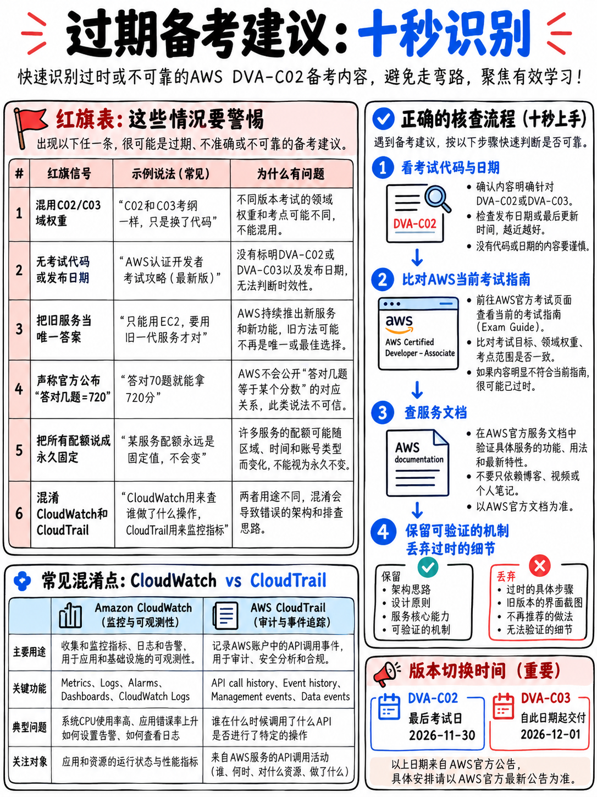

# 9.2 警惕民间过时复习建议与常见误区红线 (Outdated Advice Red Flags)

AWS 认证体系处于持续演进与更新中——新考试上线、旧考试更名、过时考试退役、考制版本升级。**截至 2026 年 10 月，整整有四门核心考试正处于新老交替的改版窗口期** ({doc}`../00-foundations/01-the-aws-certification-series` §0.1.4)。本篇是帮助你过滤网络过时噪声的终极防毒面具。

---

## 9.2.1 十秒极速鉴伪测试 (The Ten-Second Test)

打开任何关于 AWS 开发者认证的备考资料，首先在正文中搜索**考试代码 (Exam Code)**：

| 搜索结果 | 真实判定与处理动作 |
|---|---|
| **DVA-C01** | 早在 2023 年便已退役。版本严重落后，**立即丢弃，切勿阅读**！ |
| **DVA-C02** | 现行最新标准——**窗口期截止于 2026 年 11 月 30 日**。 |
| **DVA-C03** | 下一代新版标准——将于 2026 年 12 月 1 日起交付。 |
| 完全没有标注代码，仅泛称“AWS 开发者助理级” | **按最坏情况判定为过时资料并严格核实。** 这是网络低质搬运资料最常见的致命红线。 |

接下来核实关键参数：**65 题、130 分钟、720 分及格**。若资料给出的参数与之不符，描述的必定是其他过时产物。

---

## 9.2.2 十二大过时标志清单 (Staleness Markers)

1. 将 **"AWS CodeCommit"** 作为核心重点大书特书——在现行 DVA-C02 考纲指南中，CodeCommit 出现的次数是 **整整 0 次** [1]。
2. 仍称呼“AWS Certified **SysOps Administrator** – Associate”为现行考试——官方已于 2025 年 9 月将其正式更名为 **CloudOps Engineer (SOA-C03)** [12]。
3. 仍在推荐备考“AWS Certified **Machine Learning – Specialty**”——该专项级考试已被官方废止退役。
4. 推荐“Database / Data Analytics / Big Data Specialty”——全部已被官方宣布退役。
5. 声称“S3 对覆盖写入是**最终一致性**”——早在 2020 年 12 月起，S3 针对所有 PUT 和 DELETE 就已全面支持**强读写一致性 (Strong Consistency)**。
6. 声称“Lambda 最大执行超时是 **5 分钟**”——早在 2018 年起超时上限就已提升至 **15 分钟 (900秒)**。
7. 声称“Lambda 最大内存配置为 **3,008 MB**”——现行上限为 **10,240 MB (10 GB)**。
8. 声称“Lambda 临时磁盘 `/tmp` 固定为 **512 MB**”——现行已支持自由配置扩容至最高 **10,240 MB**。
9. 仍称呼 **"Kinesis Data Firehose"** 而不知道官方已正式更名为 **Amazon Data Firehose**。
10. 将 **"CloudWatch Events"** 当作当前服务讲解，而不知道其底层已被 **Amazon EventBridge** 全面取代。
11. 在助理级与基础级列表中完全未提及 **AI Practitioner (AIF-C01)**、**Data Engineer (DEA-C01)** 或 **ML Engineer (MLA-C01)**。
12. 在 2026 年 9 月之后的备考计划中，**对 2026 年 11 月 30 日 DVA-C03 换代死线只字不提**。

---

## 9.2.3 考场具有实质杀伤力的十一条致命错误建议

这些不仅是过时，如果你在考场照搬执行，会导致失分、浪费资金或延误考期：

| 网络流传的错误建议 | 为何在技术和战略上是完全错误的 |
|---|---|
| “必须深入死磕 CodeCommit，它是流水线的源头” | DVA-C02 大纲中彻底删除了 CodeCommit [1]，考纲原文要求的是“基于 Git 的版本控制工具（例如 Git）”。 |
| “卷面必须答对约 72% 的题目才能及格” | **720 分是 100–1,000 分制下的量表分，绝对不是百分比** [1]。由于存在不计分测试题与难度平衡，原始正确率映射官方从未公开。 |
| “必须确保每一个 Domain 都达到及格线” | 本考试采用**补偿性计分模型 (Compensatory)**；全卷只看综合总分，无单项小分淘汰制 [1]。 |
| “全卷 65 道题目每一道都计入总分” | **整整有 15 道题是不计分的实验测试题** [1]。遇到生僻怪题不必恐慌。 |
| “深入研读 VPC 架构设计与复杂子网划分” | 考纲明确将“设计 AWS 网络基础架构”列为**明确超纲任务 (Out-of-scope)** [1]。 |
| “必须具备从零设计完整 CI/CD 流水线的能力” | 考纲明确将“设计和创建完整 CI/CD 流水线”列为**明确超纲任务**；考纲考查的是**使用与接入流水线** [1]。 |
| “必须把所有 AWS 服务的配额全部死记硬背下来” | 只有十余项核心硬限在考场起决定性作用，详见 {doc}`../80-toolkit/03-numbers-and-limits`。 |
| “为开发者考试深入学习 SageMaker、Rekognition 或 Snow 系列” | 上述服务均在官方考纲附录中明确列入**超纲服务黑名单** [1]。 |
| “花钱购买考场真题回忆题库 (Dumps)” | 严重违背考前保密协议 (NDA)，且市面题库充斥着过时的 DVA-C01 题目，训练的是死记硬背而非解题判断力。 |
| “必须先考过 Cloud Practitioner (CLF-C02) 才能考开发者认证” | 任何 AWS 认证之间均**无任何强制前置依赖**；对于在职工程师完全可以直接报考助理级。 |
| “将考试预约到最后一天，以便争取最多的复习时间” | 鉴于 DVA-C02 于 **2026 年 11 月 30 日** 退役，若预约在 11 月底，一旦失利将彻底丧失 14 天后的重考兜底机会。**11 月 16 日才是首次赴考的真正安全死线** ({doc}`../00-foundations/03-the-dva-c03-deadline` §0.3.2)。 |

---

## 9.2.4 鉴别声称“2026 最新资料”的四道灵魂拷问

网络资料常在旧封面上打上“2026 最新版”字样。对其提出以下四个问题即可瞬间辨伪：

1. **“65 道题中有多少道是计分题？”** $\to$ 正解：**50 道计分，15 道不计分**。不知道 15 道测试题的资料，作者连考纲都没有读过 [1]。
2. **“请随口列举一个官方明确排除在外的超纲服务。”** $\to$ 正解：QuickSight、Rekognition、Snow Family、DMS、Shield、Storage Gateway 等 [1]。含糊其辞者说明从未看过考纲附录。
3. **“取代 SOA-C02 的是哪门考试？”** $\to$ 正解：**SOA-C03，CloudOps Engineer – Associate**，于 2025 年 9 月正式换代 [12]。
4. **“DVA-C02 何时停考退役？”** $\to$ 正解：**2026 年 11 月 30 日** [2][5]。任何在 2026 年 9 月后发布却对该截止日茫然无知的资料，均脱离了官方动态。

---

## 9.2.5 各类资料来源的风险等级评估

| 资料类型 | 风险评级 | 权威说明与使用建议 |
|---|---|---|
| **官方考纲大纲与官方 10 道样题** [1][18] | **零风险 (None)** | 官方公开标准基准 |
| AWS 官方开发者指南与政策页 | 极低风险 | 需核对 PDF 文件的具体版本时间戳 |
| AWS Skill Builder 官方平台 | 极低风险 | AWS 原厂培训出品 |
| 传统出版社出版的纸质技术图书 | **高风险** (除非封面标明 DVA-C02) | 实体图书出版周期漫长，普遍滞后考制 6–12 个月 |
| 商业付费模拟测试题库 | 中等风险 | 需核对题库版本号与解析质量 |
| YouTube 视频教程与网络录播课 | **高风险** | 大量内容仅是将 DVA-C01 课程换皮重投 |
| 免费网络 PDF 指南或速记卡 | **极高风险** | 绝大多数来源于旧材料洗稿 |
| AI 智能助手自由问答 | **极高风险且极具迷惑性** | 见下文特别警示 |
| 网络真题回忆题库 (Dumps) | **极高风险且违规** | 充斥大量早已废弃的过时考点 |

:::{danger}
**为什么当前利用 AI 回答本考试问题尤其危险？**

许多主流大模型的预训练数据截止时间早于 **2026 年 9 月 DVA-C03 的换代公告**，有的甚至落后于 DVA-C02 的发布。当你向 AI 询问 AWS 开发者认证时，它极可能会自信地输出 DVA-C01 的考点、咬定 CodeCommit 是必考重点、声称 Lambda 超时只有 5 分钟，或者笃定告诉你 DVA-C02 是长久有效的考试。
这种回答在历史上确实真实存在过，因此听起来极具说服力，比荒谬的逻辑错误更难察觉。

**铁律：绝不可无条件采信 AI 关于考试大纲、分值权重、截止考期以及服务物理配额的言论。** AI 适合用于解释底层技术原理，而不适合用于判定考试政策事实。
:::

---

## 9.2.6 常见误解终极纠偏 (False Beliefs Corrected)

1. *“720 分意味着卷面答对 72%。”* $\to$ 错！这是 100–1,000 分的量表分，原始换算未公开 [1]。
2. *“考场每一道题都算分。”* $\to$ 错！**整整 15 题属于不计分测试题** [1]。
3. *“必须考过所有 Domain 才能及格。”* $\to$ 错！采用补偿性计分模型，只看综合量表总分 [1]。
4. *“DVA 只是加了写代码题目的 SAA。”* $\to$ 错！SAA 侧重服务选型与整体架构，DVA 侧重服务内部具体配置、API 调用与运维报错，且明确将基础架构设计排除在考纲外 [1]。
5. *“CodeCommit 是考试的核心代码库。”* $\to$ 错！考纲大纲中完全删除了该服务 [1]。
6. *“必须有一年以上全职 AWS 工作经验才能报名。”* $\to$ 错！这是官方的**推荐画像**而非硬性准入资格，本手册的动手实验足以弥补大部分实操直觉。
7. *“必须先考过 Cloud Practitioner 才能考 DVA。”* $\to$ 错！AWS 全系认证之间无任何强制前驱依赖。
8. *“挂科后会被长期禁考。”* $\to$ 错！**仅需等待 14 个自然日**，重考次数无上限，每次支付全额报名费 [17]。
9. *“只要一直在用 AWS，证书就永不过期。”* $\to$ 错！证书有效期固定为 **3 年** [2]。
10. *“现在考 C02 的含金量低于以后考 C03。”* $\to$ 错！获得的证书称号完全一致，且在有效期内效力完全平稳等价 [5]。
