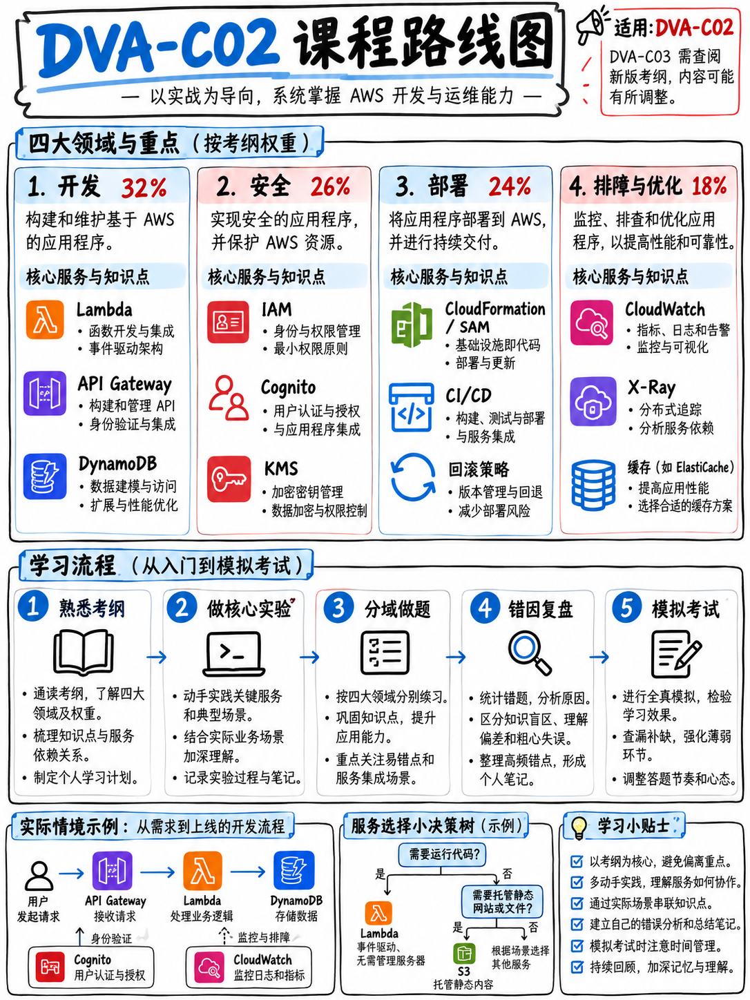

# AWS 助理级开发者认证极速通关指南：零基础到高分通过手册 (AWS Certified Developer – Associate DVA-C02 Crash Course)

> **课程定位**：专为**备考时间紧迫（数周内冲刺）**、追求**“以最少时间精力斩获高分通过（720+ 及格线）”**的开发者量身打造的战略级实战手册。  
> **核心破局哲学**：AWS 认证绝非死记硬背服务概念，而是一场**以限定词（Qualifiers）为锚点、以硬性物理配额为边界、以全托管和最小运维开销为导向的工程决策测试**。50 道计分题分布于 44 项服务，但 **Lambda、IAM、DynamoDB、API Gateway 与 CloudWatch** 五大核心底座贯穿四大领域。抓大放小，方能极速通关。  
> **考制版本与时效性（重大换代窗口期）**：全手册基于官方最新现行 **DVA-C02（Version 1.3）** 标准编撰，同时深度对齐 **2026 年 11 月 30 日 DVA-C02 停考截止期** 与 **DVA-C03 换代升级演变规律**。

:::{danger}
**DVA-C02 最终考试截止日为 2026 年 11 月 30 日。** 其换代版本 **DVA-C03** 报名将于 **2026 年 10 月 27 日** 开放，DVA-C03 考场交付将于 **2026 年 12 月 1 日** 正式开始 [2][5]。

在购买或阅读任何备考材料之前，请务必先精读 {doc}`00-foundations/03-the-dva-c03-deadline`。
**请立即预约报名锁定考位**，且强烈建议将考期锁定在 **11 月 16 日或之前**，以便在万一失利时仍能在 11 月 30 日考制退役前为 14 天的重考等待期预留出最后安全窗口 [17]！
:::



---

## 🧭 五行速览考试核心事实 (The Exam in Five Lines)

以下数据全部引述自官方最新公布的 **DVA-C02 考试大纲指南（Version 1.3）** [1] 与 AWS 官方认证主页 [2]：

| 核心维度 | 官方标准数据与实战规则 |
|---|---|
| **试题规模** | **全卷 65 题**：其中 **50 道计分题**，**15 道不计分测试题**（考场随机穿插，无法肉眼识别） |
| **考试时长与费用** | **130 分钟** · **150 美元**（支持 Pearson VUE 线下考点或线上远程监考） |
| **及格基准分** | **量表分 100–1,000 分；及格线为 720 分**。采用**补偿性计分模型 (Compensatory)**——各领域无单科最低分门槛 |
| **四大知识领域权重** | **开发 (Development) 32% · 安全 (Security) 26% · 部署 (Deployment) 24% · 排错与优化 (Troubleshooting) 18%**（对应约 16 / 13 / 12 / 9 道计分题） |
| **猜题原则** | “未作答题目计 0 分；**猜题绝无倒扣分惩罚**”——**全卷坚决不留任何空白！** |

---

## 🎯 适合人群 (Who This Is For)

本手册专为希望在**最短时间内**高效通关的开发者设计：既希望全面掌握 AWS 认证体系的全景地图，又需要将宝贵的精力聚焦在提分杠杆最高的考点上——**DVA-C02 核心应用开发、服务安全鉴权、CI/CD 自动化部署以及全链路排错优化**。

模块 {doc}`10-other-exams/01-foundational-clf-c02-aif-c01` 会简明扼要地梳理 AWS 认证体系中的其他全部考试代号；第 20–50 模块则是针对 DVA-C02 四大知识领域的深度攻坚。

---

## 🚀 从何处开始 (Start Here)

| 如果你当前的状态是… | 请立即前往… |
|---|---|
| **尚未预约考位** | {doc}`00-foundations/03-the-dva-c03-deadline` —— **读完后立即报名锁定考位** |
| **刚接触 AWS 认证体系的新手** | {doc}`00-foundations/01-the-aws-certification-series` |
| **希望用一页纸速览考试全貌** | {doc}`00-foundations/02-dva-c02-at-a-glance` |
| **希望立即开始高效复习** | {doc}`00-foundations/06-priority-triage`，随后直奔核心 {doc}`20-development/02-lambda-deep-dive` |
| **仅有一周的极限突击时间** | {doc}`00-foundations/06-priority-triage` §0.6.6 以及 {doc}`80-toolkit/05-study-plans` 中的 7 天突击计划 |
| **想要评估自己是否已经就绪** | {doc}`70-practice/05-readiness-benchmarks` 考前就绪五道门禁 |
| **明天就要走进考场** | {doc}`80-toolkit/06-exam-day-checklist` 考前 Checklist 与一页纸速记小抄 |

---

## 📊 本手册知识观点与证据可靠性声明

| 内容类型 | 采信标准与处理原则 |
|---|---|
| **引述自 AWS 官方**（标有文献 [1]–[19]） | **权威基准。** 文献出处与证明力说明详见 {doc}`90-references/01-sources-and-reliability` |
| **本手册深度逻辑推演**（显式标注） | 基于 AWS 官方公开数据推演而得的严谨备考策略。属于合理建议，非 AWS 官方原话 |
| **[未经官方核实]**（行内显式打标） | AWS 官方从未对此作公开说明（共计 5 条，汇总列于 §9.1.5） |
| **全真原创实战练习题** | **全部 185 道试题均为本手册基于大纲 Task 陈述原创编写**。绝非盗版题库；官方 10 道样题在 {doc}`70-practice/02-official-sample-questions-walkthrough` 单独剖析 |

---

## 📖 全课程模块导航目录 (Curriculum Modules)

```{toctree}
:maxdepth: 2
:caption: 0 · 基础底座篇 — 考试机制与改版关键死线 (Foundations)

00-foundations/01-the-aws-certification-series
00-foundations/02-dva-c02-at-a-glance
00-foundations/03-the-dva-c03-deadline
00-foundations/04-exam-mechanics-and-scoring
00-foundations/05-booking-policies-and-exam-day
00-foundations/06-priority-triage
00-foundations/07-glossary-and-service-shortnames
```

```{toctree}
:maxdepth: 2
:caption: 1 · AWS 全系认证全景图谱 (The Rest of AWS Certifications)

10-other-exams/01-foundational-clf-c02-aif-c01
10-other-exams/02-associate-saa-c03-soa-c03-dea-c01-mla-c01
10-other-exams/03-professional-sap-c02-dop-c02-aip-c01
10-other-exams/04-specialty-scs-c02-ans-c01
10-other-exams/05-choosing-your-path
```

```{toctree}
:maxdepth: 2
:caption: 2 · 域 1 — 基于 AWS 服务的应用开发 (32%)

20-development/01-domain-overview
20-development/02-lambda-deep-dive
20-development/03-api-gateway
20-development/04-dynamodb
20-development/05-s3-and-storage
20-development/06-messaging-sqs-sns-eventbridge-kinesis
20-development/07-step-functions-and-appsync
20-development/08-sdks-cli-and-patterns
20-development/09-development-practice-set
```

```{toctree}
:maxdepth: 2
:caption: 3 · 域 2 — 云上安全性深度攻坚 (26%)

30-security/01-domain-overview
30-security/02-iam-policies-and-roles
30-security/03-cognito-and-federation
30-security/04-kms-and-encryption
30-security/05-secrets-and-config
30-security/06-security-practice-set
```

```{toctree}
:maxdepth: 2
:caption: 4 · 域 3 — 部署与自动化流水线 (24%)

40-deployment/01-domain-overview
40-deployment/02-cloudformation-sam-cdk
40-deployment/03-cicd-pipeline-services
40-deployment/04-deployment-strategies
40-deployment/05-containers-ecs-ecr-eks
40-deployment/06-elastic-beanstalk-and-amplify
40-deployment/07-deployment-practice-set
```

```{toctree}
:maxdepth: 2
:caption: 5 · 域 4 — 故障排查与性能优化 (18%)

50-troubleshooting/01-domain-overview
50-troubleshooting/02-cloudwatch-logs-metrics-alarms
50-troubleshooting/03-x-ray-and-tracing
50-troubleshooting/04-errors-limits-and-retries
50-troubleshooting/05-optimization-and-caching
50-troubleshooting/06-troubleshooting-practice-set
```

```{toctree}
:maxdepth: 2
:caption: 6 · 考场应试技法与题干破题直觉 (Exam Technique)

60-exam-technique/01-how-aws-questions-work
60-exam-technique/02-keyword-to-service-map
60-exam-technique/03-distractor-taxonomy
60-exam-technique/04-technique-drill-bank
```

```{toctree}
:maxdepth: 2
:caption: 7 · 实战演练与全真模考 (Practice Material)

70-practice/01-how-to-practice
70-practice/02-official-sample-questions-walkthrough
70-practice/03-mini-mock-65-questions
70-practice/04-mini-mock-answers
70-practice/05-readiness-benchmarks
```

```{toctree}
:maxdepth: 2
:caption: 8 · 备考工具箱与工业化 SOP (Toolkit)

80-toolkit/01-hands-on-lab-plan
80-toolkit/02-cheat-sheets
80-toolkit/03-numbers-and-limits
80-toolkit/04-error-log-method
80-toolkit/05-study-plans
80-toolkit/06-exam-day-checklist
80-toolkit/07-resources-free-and-paid
```

```{toctree}
:maxdepth: 2
:caption: 9 · 权威文献与避坑参考 (References)

90-references/01-sources-and-reliability
90-references/02-outdated-advice-red-flags
```

---

## ⚡ 今天必须立即完成的三件事 (Three Things to Do Today)

1. **立即预约报名考试**，建议日期定在 **2026 年 11 月 16 日或之前**（{doc}`00-foundations/03-the-dva-c03-deadline` §0.3.2）。
2. **下载官方考纲大纲 [1] 与 10 道全真样题 [18]**——二者完全免费且均为 AWS 原厂出品，共同定义了通关的核心标靶。下载地址见 {doc}`90-references/01-sources-and-reliability`。
3. **若英语非母语，预约前申请 ESL +30 延时**。零成本增加 30 分钟答题时间，且永久适用于未来所有 AWS 考试注册 [19]（{doc}`00-foundations/05-booking-policies-and-exam-day` §0.5.4）。

---

## 🌙 如果你今晚只有一个晚上的备考时间 (Crash Plan)

1. {doc}`00-foundations/02-dva-c02-at-a-glance` —— 5 分钟搞清真实考制、计分规则与四域权重。
2. {doc}`60-exam-technique/01-how-aws-questions-work` —— 认认真真精读两遍，掌握尾句抓取与限定词破题法。
3. {doc}`20-development/02-lambda-deep-dive` —— 贯穿全卷所有领域的单一核心王牌服务。
4. {doc}`80-toolkit/02-cheat-sheets` —— 重点精读 §8.2.8 考场硬性物理配额，掌握秒杀干扰项利刃。
5. {doc}`60-exam-technique/04-technique-drill-bank` —— 刷完 20 道技法专项演练题并逐题研究解析。

全程耗时约 4 小时，这是你在有限时间内能达成的最高性价比提分组合：应试解题方法论能直接赋能全卷所有 50 道计分题，而死记硬背任何一个生僻单一服务在考场仅值一到两分。
