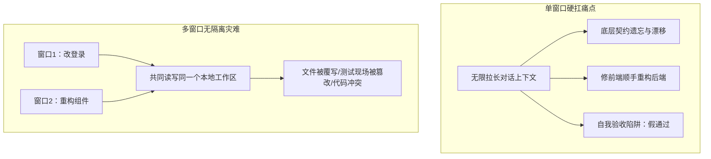
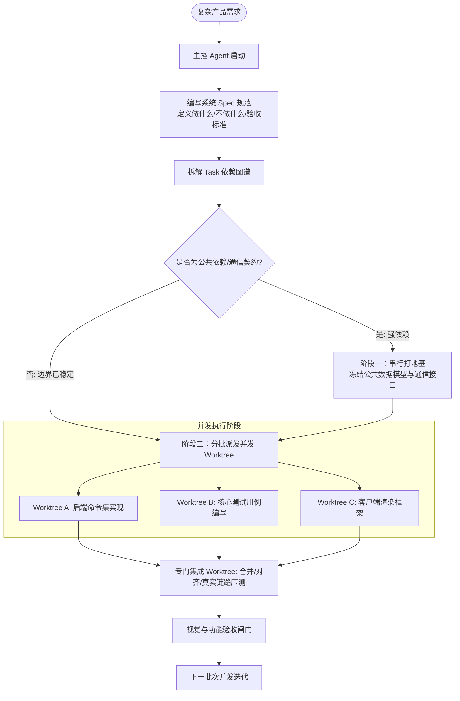

# 【案例精选】一个人指挥一群 Codex：多窗口 Worktree 并行工程流（李香君）

> **案例作者**：李香君（资深工程师 / 独立开发者）  
> **项目定位**：全栈桌面级工程工具从 0 到 1 交付  
> **核心标签**：`Git Worktree` `多窗口并发` `主控 Agent` `Spec 拆解` `收口验收`  
> **关键洞察**：**多窗口不等于并行开发；先拆依赖和公共边界，Worktree 物理隔离才有价值。一个人指挥一群 Codex，本质上不是在同时开很多聊天框，而是在经营一支小型软件团队。**

---

## 1. 案例背景与工程痛点

在很多开发者的设想中，Vibe Coding 就是坐在屏幕前随口一句“帮我做个 App”，然后等 AI 吐出一个完整可用的产品。但在实际工程中，这种方式最多只能生成一个**看起来能跑的单页 Demo**：首页能打开、按钮能点击，演示没问题；但一旦接入真实后端数据、补充异常边界、切换运行环境、进行跨端兼容测试，脆弱性便暴露无遗。

一个完整的产品研发远不止写几行代码：
- 前端交互、后端服务、本地状态管理、数据持久化；
- 权限隔离、隐私边界、系统调用；
- 单元测试、端到端集成测试、回归修复。

这些任务中，有些**可以完全并行**，有些**必须严格串行**，有些完成后必须**由独立的验收角色重新审核**。

当工程规模变大，如果把所有需求塞进单个聊天窗口，会引发三个严重瓶颈：
1. **长上下文遗忘与漂移**：对话进行到几十轮后，最早立下的底层约束被压缩遗忘；
2. **职责扩散与交叉污染**：Agent 修着前端交互，顺手跑去“重构”后端数据接口；
3. **“既当运动员又当裁判员”**：同一个窗口既负责设计实现，又负责证明自己没问题，极易出现自我假验收。

---

## 2. 概念辨析：多轮、多窗口与 Worktree

要建立高吞吐的多 Agent 并行工程流，必须严格区分三个概念：

| 协作维度 | 核心定义 | 物理现场 | 解决的核心问题 | 潜在风险 |
| :--- | :--- | :--- | :--- | :--- |
| **多轮对话（Multi-turn）** | 单任务沿时间向前推进 | 同一上下文窗口 | 理解 $\to$ 实现 $\to$ 测试 $\to$ 修正的渐进式深入 | 上下文超长导致早期硬约束遗忘与幻觉 |
| **多窗口（Multi-window）** | 多任务沿空间横向展开 | 多个独立的会话窗口 | 同时推进不相干的任务（多长出几双手） | 若共享同一代码目录，会引发文件踩踏与代码冲突 |
| **Worktree（Git 隔离现场）** | Git 物理工作区隔离 | 独立的工作副本与独立分支 | 给每个窗口分配一张独立物理工位，互不干扰 | 无法自动解决逻辑依赖与架构设计冲突 |

> [!IMPORTANT]
> **黄金法则**：多窗口只是**多了几双手**，Worktree 才是**给每双手分了一张独立工作台**。

---

## 3. 并行工程的核心：主控 Agent 拆 Spec 与 Task

并行开发最反直觉的一点是：**并行开发的第一步，不是找能并行的部分，而是先找出“不能并发的部分”。**

共享数据模型、前后端通信契约、核心全局状态结构，如果这些公共地基还在频繁变动，后面的窗口开得越多，返工代价就呈指数级爆发。

### 3.1 主控 Agent 与执行 Agent 的职责边界

- **主控 Agent（项目经理 / 架构师）**：
  - 维护全局一致性，负责拆解 Spec（系统规范：明确目标、技术栈、保留项、明确不做的事项、最终交付形态）；
  - 从 Spec 中梳理 Task 依赖拓扑（明确哪个任务改动公共契约、哪个任务只动独立模块、哪些可以并行、哪些必须排队）；
  - 负责监督批次收口，绝不亲自动手写细碎模块。
- **执行 Agent（模块开发工程师）**：
  - 只关注局部任务，读清当前 Task 相关的 Spec 约定，在限定目录与边界内开发；
  - 跑通当前模块的单元测试，产出交接材料；
  - 严禁随意跨越边界修剪未授权的公共代码。

---

## 4. 全栈桌面项目的实际推进节奏

该案例为一个具备前端、后端、本地桌面运行环境，并涉及数据安全与跨平台兼容的全栈桌面工具。实际开发节奏如下：

$$\text{主控拆解} \longrightarrow \text{串行打地基} \longrightarrow \text{第一批并发} \longrightarrow \text{主线集成} \longrightarrow \text{第二批并发} \longrightarrow \text{主线集成} \longrightarrow \text{第三批并发} \longrightarrow \text{最终验收}$$

### 4.1 阶段推演与多套界面实操

1. **第一批：串行地基与基础骨架**
   - 先用主控窗口把底层数据结构、通信协议、基础接口规范定义清楚并冻结，形成契约文档。
2. **第二批：并发推进与真实链路修正**
   - 前端根据契约构建状态管理；后端完善命令与本地环境适配；另一窗口并发补齐异常场景测试用例。
   - 合并至主线后，进行真实链路联调（修复假数据能跑但真后端跑不通、开发模式正常但生产构建中断、异常状态无法恢复等真实暗坑）。
3. **第三批：三套完整界面方案并行探索**
   - 项目需要覆盖三套不同结构、信息密度与交互语言的完整 UI 方案（非简单的配色切换，而是整套页面布局与体验流派）。
   - **Worktree 爆发核心威力**：开辟 3 个独立 Worktree，3 个执行窗口各自挂载一个 Worktree。此时公共控制器、数据流和后端契约已完全冻结，严禁为了界面便利改动底层代码。
   - 3 个窗口各自在完全隔离的环境中深耕视觉与交互，杜绝了“先做完一套，后续方案退化为换皮”的惯性。
4. **集成与收口 Worktree**
   - 设立专门的**集成 Worktree**：不负责新增任何功能，只专注于合并冲突、检查三套界面是否正常调用同一套真实底层逻辑、响应式布局溢出检测、键盘无障碍支持与生产打包构建。
   - 生成不同界面方案的多分辨率对比截图，作为逐项验收的证据材料。

---

## 5. 独立 Worktree 任务选型准则

| 维度 | 适合放入独立 Worktree 的任务画像 | 不适合并发（必须串行打地基）的任务 |
| :--- | :--- | :--- |
| **模块边界** | 修改局限在自己的独立目录与文件内（如某套独立 UI 主题、某个独立适配器） | 核心数据模型、全局状态管理结构频繁重构 |
| **接口契约** | 输入输出与通信 API 已经冻结（按约消费、按约返回） | 前后端通信契约正在设计中，双方还在探索数据结构 |
| **测试与审查** | 独立的单元测试编写、安全审查、文档整理（干净上下文能避免思维惯性） | 跨越全局的基础库重构，涉及大量文件级联修改 |
| **冲突风险** | 单独完成之后能够单点测试并输出独立 PR | 多个任务同时争抢修改公共路由、全局 Config 或数据库迁移脚本 |

> [!TIP]
> **选型心法**：并发任务不是越多越好。每多开一个窗口，就多一份理解同步成本、多一次验收交付负担。**边界不清时，盲目多开窗口只是在批量生产冲突。**

---

## 6. 防范 Codex 团队“集体跑偏”的四项机制

单窗口跑偏尚能通过对话拉回；多窗口同时跑偏，最终会得到好几套**各自逻辑自洽、但拼在一起完全不兼容的垃圾代码**。

### 6.1 剥夺“自由猜测权”
执行窗口的上下文必须极其干净。只给它完成当前 Task 所需的最小 Spec 约定、输入输出定义与禁止触碰清单。信息并非越多越好，过多无关全局上下文反而诱发幻觉。

### 6.2 将“顺手改”视为危险警报
人类在指令中顺口一句“把那个公共组件也顺手改一下”，往往是多 Agent 崩溃的起点。执行 Agent 会顺理成章打破隔离边界，修改其他 Worktree 正在依赖的代码。
- **铁律**：发现新问题必须记录到 Backlog 或由主控开辟新 Task，严禁在当前分支横向扩张。

### 6.3 “说完成了”不等于“真正完成”
执行 Agent 的“任务完成”仅仅代表它在自身局部 Worktree 内的代码编写与自我声明。
- 必须强制要求执行 Agent 交付：**改动文件清单、单元测试运行报告、已知风险声明**；
- 交付物必须拉回专门的集成环境中重新跑全量回归测试。

### 6.4 设立专职“集成与验收 Agent”
在团队资源有余量时，**最先设立的绝不是更多业务功能窗口，而是一个专职负责集成、测试与合并审查的独立窗口**。
并发会放大代码产出，但也成倍放大了逻辑偏差。没有严密的收口机制，开发者只是在极速制造不可维护的工程废料。

---

## 7. 核心总结：拆、隔、并、收

| 步骤 | 核心动作 | 对应角色 | 达成目标 |
| :---: | :--- | :--- | :--- |
| **拆** | 梳理依赖拓扑，剥离核心公共契约与独立模块 | 主控 Agent + 架构师（人类） | 明确哪些串行打地基，哪些独立并发 |
| **隔** | 使用 Git Worktree 为各任务分配独立工作目录与分支 | Git 基础设施 + 执行窗口 | 物理级现场隔离，杜绝文件覆写与假测试通过 |
| **并** | 在契约稳定后，多窗口针对独立模块并行极速开发 | 多个执行 Agent 深度推进 | 充分释放多 Agent 并行带宽，解决单线程卡顿 |
| **收** | 回到主线集成 Worktree，全量回归、消除冲突、交叉验收 | 专职集成 Agent + 人类验收人 | 确保三方拼装严丝合缝，产出可交付工程成果 |

> [!NOTE]
> **Vibe Coding 的终极形态**：不再是拿着聊天框向 AI 祈祷一段完美代码，而是人类扮演**产品负责人、架构协调者与终审裁判**，指挥多个 Agent 按照精密工程规范完成软件交付。AI 放大的是执行带宽，但也把人类的**系统拆解与工程组织能力**推向了最关键的核心地位。
