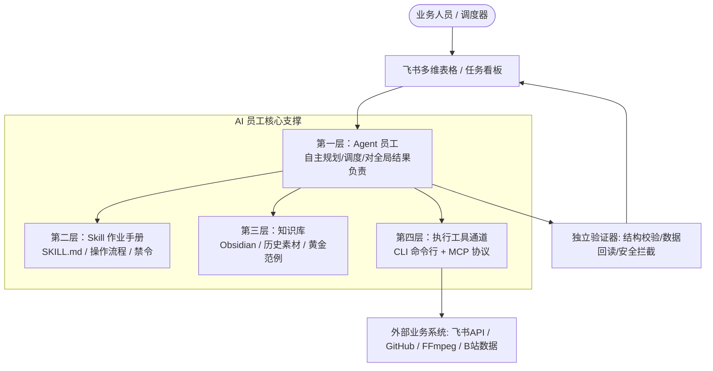
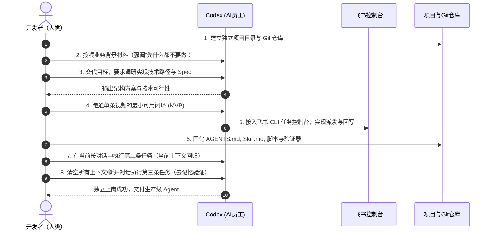

# 【案例精选】业务流程做成 AI 员工：8 步法与 4 层工业化架构（鹿书野）

> **案例作者**：鹿书野（B 站好物深海圈教练 / AI Agent 架构师航海教练 / 00后创业者）  
> **业务战绩**：月均带货 GMV 500W+，单月商单/佣金达 6 位数，覆盖 4 大赛道、60+ 细分品类、合作上百家品牌  
> **核心标签**：`AI员工八步法` `Agent四层架构` `Skill沉淀` `飞书控制台` `语义与脚本解耦`  
> **关键洞察**：**Agent 不是聊天机器人，而是由作业手册（Skill）、资料库（知识库）和外部工具（CLI/MCP）共同支撑的业务员工。确定性动作交给脚本，语义判断交给大模型，底线验收交给验证器。**

---

## 1. 业务痛点：复杂业务为什么必须告别聊天框？

在 B 站好物等高客单电商内容业务中，一条视频的制作涉及十多个环节（选品、对标采集、字幕提取、文案拆解、脚本重构、分镜渲染、配音剪辑、上架挂车、复盘），每个环节下又有数十个细分步骤。新手人工制作一条带货视频往往需要 **10 小时以上**。

当业务跨入多赛道扩张阶段，靠“人记流程、盯细节、反复口头培训”根本无法实现规模化复制。而如果仅仅把 AI 当成聊天框里的写文案工具，会立刻陷入**三重大坑**：
1. **失忆与重复培训**：每次开启新窗口，都要从头解释“我是谁、业务是什么、合格标准是什么”；
2. **输出漂移不一致**：同一个任务今天做得极好，明天风格大变，规则越聊越长，上下文越来越乱；
3. **上下文截断导致规则失效**：对话拉长后，最早立下的业务禁令被模型上下文压缩机制遗忘，原本纠偏过的问题死灰复燃，人变成了全天候的修补工。

解决这一死循环的唯一出路，是**把临时对话固化为具备独立执行力、标准操作规范与自动化防线的“AI 员工体系”**。

---

## 2. 核心基石：AI 员工的 4 层工程架构



| 架构分层 | 核心定义与隐喻 | 物理承载物 | 承担的核心职责 |
| :--- | :--- | :--- | :--- |
| **1. Agent（员工个体）** | 拥有目标、工作边界与工具的独立执行主体 | 独立的项目工程目录 + `AGENTS.md` | 负责理解任务、分步规划、调度工具、处理异常与最终交付 |
| **2. Skill（作业手册）** | 员工执行特定动作的标准 SOP 集合 | `SKILL.md` + 专项脚本与模板 | 明确触发条件、执行次序、分支逻辑、禁止项与交付标准 |
| **3. 知识库（知识大脑）** | 支撑判断的结构化业务资料与事实库 | 本地 Obsidian / Markdown 知识库 | 提供对标素材、品牌资料、历史复盘、语料范例 |
| **4. CLI / MCP（手脚通道）** | 连接外部软硬件与服务的标准执行通道 | `lark-cli`、GitHub CLI、FFmpeg、MCP Server | 将 Agent 的决策指令转化为真实系统的读写操作 |

### 2.1 一份工业级 Skill 的标准目录拓扑

```text
produce-bilibili-video-archive/
├── SKILL.md                 # 核心总入口：定义触发条件、流程、禁令与完成条件
├── references/              # 详细规则与参考手册
│   ├── output-structure.md  # 产物结构与字段定义
│   ├── content-rules.md     # 业务规则与边界
│   └── exception-handling.md# 异常类型与降级预案
├── scripts/                 # 确定性执行脚本（无状态、可重复）
│   ├── fetch_subtitles.py   # 数据拉取
│   ├── create_archive.py    # 目录创建与格式化
│   └── validate_archive.py  # 产物完整性校验
├── templates/               # 输出模版
│   ├── video-index.md       # 视频元数据索引模版
│   └── content-section.md   # 内容分段模版
└── examples/                # 黄金正例与反例库
    ├── successful-case.md   # 优秀达标案例
    └── failed-case.md       # 典型踩坑反例
```

### 2.2 生产级 `SKILL.md` 规范范本

```yaml
---
name: produce-bilibili-video-archive
description: 当用户要求获取 B 站视频信息和官方字幕，并结构化整理到 Obsidian 知识库时自动触发。
---

# 目标
将一条 B 站对标视频完整拆解并沉淀为可回溯、可验证的 Obsidian 结构化笔记。

# 执行流程
1. 静默检查本地环境中的登录凭证（Cookie/Token）。
2. 若凭证失效，立即中断报警，严禁继续领取并污染任务流。
3. 从飞书控制台领取一条状态为“待处理”的视频任务。
4. 调用脚本获取视频元数据、高清封面与原始官方字幕。
5. Agent 通读全文字幕，基于上下文语义判断“痛点铺垫”与“产品种草”的语义分界线。
6. 调用模板分别生成：视频全局索引页、铺垫分析片段、产品种草片段。
7. 运行本地归档验证脚本（validate_archive.py）。
8. 验证完全通过后，调用 CLI 回写飞书任务状态为“已完成”。

# 禁止事项（防线）
- 严禁在任何日志、终端或生成文档中打印原始 Cookie 或敏感密钥。
- 严禁使用固定句式、价格硬编码或行号数字来切分文章。
- 严禁擅自修改或清洗原始字幕的真实字句。
- 验证脚本报错或未执行前，严禁提前回写“已完成”。

# 完成条件（验收标准）
- 要求生成的文件齐全（1 个索引 + 2 个切片）。
- 目录结构符合 references/output-structure.md 规范。
- 必须通过 Agent 真实语义复核，且无空白占位符。
- 验证脚本退出码必须为 0。
- 飞书任务状态已完成二次回读校验。
```

---

## 3. 业务做成 Agent 的实战“八步法”

鹿书野在实战中将传统敏捷开发改造为针对 AI Agent 的标准制作 SOP：



### 步骤详解与核心 Prompt 指令集

#### 第一步：建立独立项目文件夹与 Git 仓库
- **为什么做**：每个 Agent 必须有完全干净的工作目录，Git 负责追踪文件变化与回退。
- **操作指令**：
  ```bash
  mkdir -p bilibili-video-agent && cd bilibili-video-agent
  git init
  ```
- **关键认知**：一个项目文件夹对应一名专职员工。严禁在一个项目里塞入多个无关业务，避免职责漂移。

#### 第二步：投喂背景材料，观察与执行严格物理隔离
- **为什么做**：直接让 AI 编码会导致大量脱离业务常识的臆测。先让 Agent 充分感知业务上下文，并强制锁定其执行动作。
- **Prompt 模板**：
  ```markdown
  先什么都不要做！请仔细通读我们项目目录中的全部文件。
  如果包含 Markdown、PDF、数据表格或图片，请完整解析其中的文字与结构，理解我们的业务背景与目标。
  读完后告诉我你的理解，不要编写或修改任何代码！
  ```

#### 第三步：交代业务目标，先验证技术可行性
- **为什么做**：防止 Agent 凭空发明不可行的接口，促使其主动搜索开源方案与成熟 CLI。
- **Prompt 模板**：
  ```markdown
  先不要写代码！
  我的目标是：输入一个 B 站视频链接，自动获取视频元数据与完整官方字幕，解析清洗后存入 Obsidian 知识库。
  请去 GitHub 检索高星开源项目与可复用工具。仔细研究后与我讨论可行的技术路径，等我确认后再动手写代码。
  ```

#### 第四步：跑通一条端到端真实链路（MVP 极速闭环）
- 挑选一条最典型的真实视频链接，让 Agent 编写最小可运行脚本，跑通“拉取 $\to$ 解析 $\to$ 生成文件”全流程。
- 在真实运行中揪出隐藏陷阱（如 B 站防爬机制、WBI 签名、Cookie 鉴权失效、字幕为空等真实问题）。

#### 第五步：接入飞书任务控制台（实现生产解耦）
- **为什么做**：业务人员不需要碰代码，只需在飞书多维表格中贴链接；Agent 作为后台 Worker 轮询执行并更新进度。
- **飞书 CLI 安装核心指令**：
  ```bash
  # 全局安装飞书官方 CLI
  npm install -g @larksuite/cli
  
  # 安装飞书相关 Skills
  npx skills add https://github.com/larksuite/cli -y -g
  
  # 初始化配置
  lark-cli config init --new
  ```

#### 第六步：固化阶段——沉淀 4 大工程资产（重中之重）
在 MVP 跑通后，绝不继续拉长对话，立刻执行资产沉淀：
1. `AGENTS.md`：全局最高准则（安全防线、不可侵犯红线）；
2. `SKILL.md`：标准作业手册与执行次序；
3. `scripts/`：确定性执行脚本（下载、切分、转换）；
4. `validate_archive.py`：兜底验证器。

> [!CAUTION]
> **绝对禁忌：严禁用脚本硬编码替代 AI 语义判断！**  
> 刚跑通案例时，开发者往往偷懒在 Python 脚本里写：
> ```python
> # 危险反例：脆弱的硬编码规则
> if "我们先看2000元以内这个区间" in line:
>     start_product_section()
> ```
> 换一个 UP 主，文案可能是“接下来聊聊入门款”、“废话不多说看第一款”甚至没有转折词，脚本立刻报废。  
> **正确架构分工**：
> - **脚本（机械手）**：只负责无歧义的确定性动作（HTTP 请求、文件写入、正则结构匹配）；
> - **Agent（大脑）**：负责复杂的上下文理解与语义切分；
> - **验证器（质检员）**：只负责底线校验（文件是否存在、字段是否缺失、字数是否异常）。

#### 第七步：当前对话执行真实任务（当前上下文回归测试）
- 在完成 Skill 与脚本沉淀后，立即在当前会话中跑第二条不同作者的视频任务，验证新沉淀的脚本没有改坏既有链路。

#### 第八步：新开无上下文对话执行新任务（去记忆严格回归）
- **决定 Agent 能否真正上岗的关键一步**：
  - 关闭旧对话，新开一个完全空白的会话；
  - 仅给出一句简短指令：“`请阅读本项目文件，执行飞书任务表中的第 3 条任务`”；
  - **验收核心**：如果 Agent 能完全依靠目录中的 `AGENTS.md` 和 `SKILL.md` 自主完成任务并回写状态，说明它已经彻底从“依赖人类投喂的单次会话”蜕变为“能够随时重新上岗的数字员工”。

---

## 4. 高阶扩展：Hermes 24 小时常驻与飞书机器人

当需要让数字员工脱离本地桌面、实现 24 小时全天候值守时，可通过 Hermes 部署为飞书专属机器人：

```markdown
# Hermes 部署与 Profile 隔离指令
请帮我在本项目中部署 Hermes，配置使用我的大模型 API。
将其接入飞书，单独创建一个专属应用机器人，后续我通过飞书直接与该 Agent 沟通。
```

- **多 Agent 隔离机制**：Hermes 单机通过 `Profile` 隔离不同 Agent 的配置、记忆与权限上下文，多个项目目录各司其职，互不污染。
- **总控与子 Agent 模式**：在 Primary 根目录配置总控 Agent，负责解析全局飞书任务，按需唤醒不同子目录内的专业 Agent 员工协同作业。
