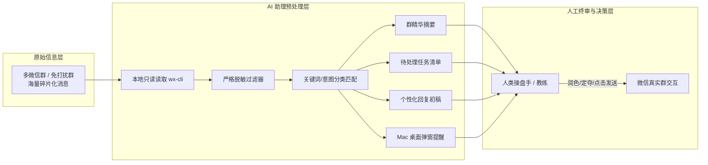

# 【案例精选】微信群 AI 助理：重要消息抓取与观点蒸馏实战（轩辕）

> **案例作者**：轩辕（10年+ 深圳产研团队高管 / 生财首届航海家 / OpenClaw 实践者）  
> **业务战绩**：视频号与公众号均跑通 6 位数变现，生财首届黑客松铜奖，多群 AI 答疑效率提升 10 倍  
> **核心标签**：`wx-cli` `微信群助理` `信息预处理` `人工确认闭环` `个人对话蒸馏` `数据脱敏`  
> **关键洞察**：**微信群 Agent 最有价值的不是自动回复，而是替人完成盯群、翻上下文和起草初稿，把最终判断与发送权留给人。聊天记录本身不是资产，被脱敏、蒸馏、写进长期系统后，才是数字资产。**

---

## 1. 核心定位：是“信息助理”，绝非“自动回复机器人”

微信社群是商业连接的核心场域，但也是注意力消耗的最大黑洞。群一多，很多人只能全部开启免打扰；可一旦免打扰，又极度焦虑会错过老板呼叫、重要客户咨询、合作意向或学员的核心卡点。

许多人尝试将 AI 接进微信群做“自动聊天机器人”，但这往往是灾难的开端：
- 社群答疑绝非标准客服问答，往往夹杂着提问者的具体处境、情绪状态、社群规则、业务承诺以及微妙的人际关系；
- AI 幻觉或生硬的“AI 味”回复，极易在群内造成信任崩塌，甚至触发微信官方严格的风控封号。

轩辕提出的设计原则是：**信息预处理与最终决策严格物理隔离**。



---

## 2. 核心应用场景与交付物矩阵

| 场景类型 | 监控触发条件 | Agent 产出结构 | 实际业务价值 |
| :--- | :--- | :--- | :--- |
| **1. 航海教练答疑** | `#举手`、`卡住了`、`报错`、`求助` | 翻阅提问者前后 20 条上下文，提炼核心矛盾点，并生成一条**不带 AI 腔、直指行动**的回复草稿 | 省去教练爬楼翻记录时间，响应速度提升 80% |
| **2. 免打扰群摘要** | 每日定时 / 满 200 条消息触发 | 按“核心通知、工具推荐、实战进展、外部机会”分门别类生成结构化日报 | 5 分钟通晓多群动态，彻底摆脱群消息爬楼负担 |
| **3. 商业线索与异常拦截** | `@我`、`合作`、`付款`、`退款`、`投诉`、`打不开` | 标注紧急程度、客户诉求、订单背景，生成待处理清单并通过 Mac 弹窗提醒 | 杜绝客诉升级与高价值商务合作遗漏 |
| **4. 个人对话资产蒸馏** | 指定重要合作伙伴或客户的长期对话 | 脱敏后提取 5-8 条**长期商业判断、行业世界观与方法论金句**写入 Obsidian | 将散落的即兴聊天转化为可复用的知识库资产 |
| **5. 群聊问答提炼** | 沉淀学员群中教练的大量即兴解答 | 剔除闲聊，提炼“常见异议库”、“产品优化建议”与“营销表达素材” | 为后续公众号文章、新课研发与销售话术持续供血 |

---

## 3. Mac 本地环境搭建 SOP（保姆级指令）

该套方案基于本地运行环境，采用 Codex 调度底层的 `wx-cli` 开源工具实现微信本地数据库的安全只读访问。

### 步骤 1：新建独立工作目录
在 Mac 终端中创建独立工程目录，并由 Codex 打开：
```bash
mkdir -p ~/wechat-ai-agent && cd ~/wechat-ai-agent
```

### 步骤 2：向 Codex 交代边界，审查工具安全性
将以下指令投喂给 Codex，严禁其未经验证直接扫描聊天记录：
```markdown
请帮我评估在当前 Mac 系统下使用 wx-cli 读取本地微信群消息的技术可行性与权限边界。
要求：
1. 先阅读 wx-cli 的工作原理并向我汇报；
2. 明确指出读取本地微信消息所需的系统权限与潜在限制；
3. 在此阶段不要直接开始采集我的聊天记录；
4. 评估完成后，给出下一步“验证微信消息是否可读”的安全步骤方案。
```

### 步骤 3：Mac Hardened Runtime 签名权限破解
Mac 微信官方版本开启了苹果的 Hardened Runtime（强化运行时签名），普通权限无法通过 `task_for_pid` 机制读取内存数据库密钥。Codex 无法代为输入管理员密码，必须在**本机真实终端**中手动执行一次重签名：

```bash
# 1. 彻底退出微信及小程序扩展进程
killall WeChat 2>/dev/null || true
killall WeChatAppEx 2>/dev/null || true

# 2. 对本地微信应用进行自签名替换（绕过强化运行时限制）
sudo codesign --force --deep --sign - /Applications/WeChat.app

# 3. 重新拉起微信并正常扫码登录
open /Applications/WeChat.app

# 4. 执行 wx 初始化命令（路径根据本地 node_modules 实际位置确定）
sudo ./node_modules/.bin/wx init
```

> [!CAUTION]
> **安全与系统说明**：
> - 上述重签名仅作用于本机已安装的二进制文件，不篡改微信代码逻辑；
> - 微信版本更新后，可能需要重新执行上述重签名流程；
> - 执行时终端输入密码不显示字符为正常现象。

### 步骤 4：微信消息可读性与脱敏验证
完成终端授权后，回到 Codex 执行安全只读测试，**强制锁定数据脱敏红线**：
```markdown
我已经按要求在终端完成重签名授权与 wx init。请验证当前环境是否能成功读取微信消息。

强制约束条件：
1. 本轮仅验证“微信数据通道是否连通并可读”；
2. 严禁创建定时任务，严禁调用任何自动发送接口；
3. 严禁在终端或返回结果中展示任何原始未脱敏数据；
4. 输出给我的测试结果必须严格脱敏：隐藏群成员昵称、手机号、外部链接、二维码、实际地址、订单与转账金额等敏感信息；
5. 结果仅允许保存在本地 markdown 文件中，不得上传至任何云端。
```

### 步骤 5：构建微信群 AI 助理核心 Agent
当连通性验证通过后，下发业务监控与提炼提示词：

```markdown
现在微信数据通道已就绪，请帮我构建微信群 AI 助理监控流水线。

【监控目标群】：
- [填写需要重点监控的微信群完整名称]

【核心监控关键词】：
- #举手
- @我
- 我的名字或昵称：[填入你的昵称]
- 重点业务词：[退款 / 合作 / 报价 / 报错 / 作业打不开 / 怎么提交]

【要求执行的处理流程】：
1. 增量读取指定群的最新未读消息；
2. 针对普通群聊，按“核心动态、工具分享、问题求助”整理结构化摘要；
3. 针对包含关键业务词或 @我的消息，提取为“高优先级待办清单”；
4. 针对 #举手 的学员求助，结合上下文生成 1 条语气自然、针对痛点、推动下一步行动的回复初稿；
5. 所有产物写入本地 `daily_summary_YYYYMMDD.md`；
6. 严格执行脱敏规范，不得泄露成员隐私。
```

---

## 4. 高阶延伸：群聊与私聊的“商业观点蒸馏法”

散落在聊天框里的碎片对话，不仅是沟通记录，更是未经提炼的商业知识富矿。

### 4.1 个人深度对话蒸馏模型
与核心合作伙伴、高净值客户或导师的私聊中，往往碰撞出未成文的高阶思考。

```text
指定对话导出 ──> 本地只读读取 ──> 隐私脱敏过滤 ──> 语义提炼 ──> 归档进入长期知识库
```

- **脱敏案例实录**：在对 491 条深度对话进行分析时，过滤掉 11 条包含账号、手机号与财务信息的敏感记录，最终提炼出 8 条涵盖“商业壁垒、SaaS 选型、团队激励”的系统性世界观，并分类沉淀至个人知识体系中。

### 4.2 社群碎片提炼成“观点库”
社群现场答疑是检验真需求的最好熔炉。将学员群 625 条对话（其中教练本人发言 369 条）进行聚类分析，可以自动化产出：
1. **真实用户痛点集**：提问频次最高的前 5 个具体卡点；
2. **销售异议应对库**：学员对课程价格、投入时间、技术门槛的真实顾虑；
3. **金句与方法论**：现场即兴回答中结构严密、逻辑生动的表达语段。

---

## 5. 常见问题与风控防线

```markdown
> [!WARNING]
> **风控防线与道德底线**：
> 1. **严禁自动回复**：坚决不向微信客户端反向注入消息发送接口，所有回复必须经过人类在官方客户端手动确认后发出；
> 2. **权限最小化**：仅监听与自身工作、教学、业务直接相关的群聊，不滥用数据访问权限；
> 3. **本地物理隔离**：抓取到的聊天数据只留存本地，绝不入公共仓库，更不得用于商业化转卖。
```

- **Q：必须使用 Codex 吗？**  
  A：不局限，Claude Code 或其他能够直接读写本地文件、执行 Shell 脚本的 Agent CLI 均可平替，核心在于模型具备本地工具调用能力。
- **Q：监控的关键词应该设多少个？**  
  A：第一版**切忌贪多**！建议严格限制在 5-10 个高信噪比核心词（如 `#举手`、`退款`、`合作`）。关键词过多会导致信噪比雪崩，让 Agent 重新退化为产生大量无用总结的干扰源。
