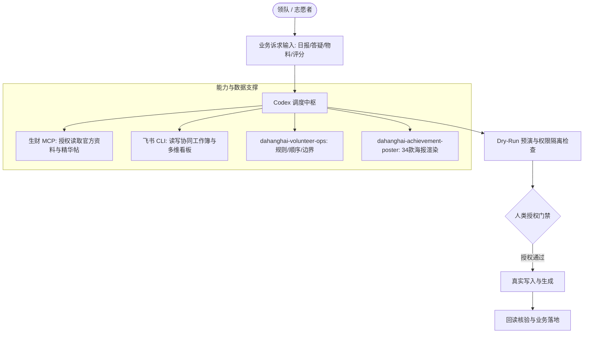

# 【案例精选】从后端研发到大航海领队：运营 SOP 沉淀为 24 项全能 Skill（阿喂）

> **案例作者**：阿喂（10年后端研发工程师 / OPC 创业者 / AI 出海探索者）  
> **运营实战**：8月航海「海外热词游戏站」4群领队，连续支援 20+ 个航海群自动日报与物料生产  
> **核心标签**：`dahanghai-volunteer-ops` `运营方法Skill化` `生财MCP` `飞书CLI` `反假闭环` `3:6:1志愿者评分`  
> **关键洞察**：**运营经验只有写成规则、交付标准和授权边界，才会从个人偶发能力变成可复制的 Skill。工具说成功不等于事情真正做成，必须坚持 dry-run 预演与回读核验。**

---

## 1. 痛点：琐碎繁杂的社群运营为什么必须工程化？

社群领队工作极其碎裂：
- 领队大群里下发了最新排期，需要迅速拆解成志愿者今天能执行的任务；
- 微信群消息滚屏飞逝，需要把通知、高分经验、工具推荐与船员求助分拣出来；
- 船员举手提问，需要跟踪确认该问题是否已获得实质性解决，而非被一句“收到”掩盖；
- 到了作业点评节点，需要通读几十份作业筛选种子学员，设计阶梯激励海报；
- 靠岸前夕，还要面对严苛的志愿者 3:6:1 绩效分档。

如果完全依赖人工临场发挥，领队每天都会陷入被动救火的疲惫状态。阿喂凭借 10 年后端工程师的职业敏感度意识到：**只要某件事反复出现两次以上，背后必然存在确定性流程；确定性流程必须交给工具与 Skill，人类的精力才能真正解放出来陪伴人、连接人。**

由此诞生的 `dahanghai-volunteer-ops`，是一套包含 **20+ 核心动作入口、15 份专项运行手册（Runbook）与 31 个 Python 脚本** 的工业化运营 Skill 体系。



---

## 2. 破除社群协作的“假闭环”与任务 5 要素

在多角色协同中，最常见的虚假繁荣就是群里一排“收到”。**收到只能证明看见，绝不代表任务完成。**

### 2.1 任务拆解的“5 要素”黄金法则
领队群里的通知通常混杂着背景描述、领队动作和平台要求。直接转发给志愿者会造成极大的理解摩擦。进入协作包前，必须重构为标准 5 要素：

| 要素维度 | 规范定义 | 反例（模糊不可行） | 正例（高确定性交付） |
| :--- | :--- | :--- | :--- |
| **1. 谁负责** | 精确到具体责任人编号 | “大家有空的帮忙看一下” | “@志愿者小张（编号 102）主责” |
| **2. 对谁做** | 明确受众与对象范围 | “多去关心一下落后船员” | “针对前 3 天未提交作业的 12 位船员” |
| **3. 截止时间** | 精确到分钟的时间节点 | “尽快完成” | “今晚 21:00 前” |
| **4. 交付标准** | 可量化、可核验的物理产物 | “看看大家有什么问题” | “整理出未获实质回应的 #举手 原始记录清单” |
| **5. 向谁反馈** | 提交路径与复核角色 | “做完在群里说一声” | “填入 03 协作表指定 Sheet，并向领队交付链接” |

### 2.2 飞书数据写入的“五步防御 SOP”
在调用飞书 CLI（`lark-cli`）改写多维表格或文档时，阿喂制定了严格的防止数据污染 SOP：
1. **核对现状**：读取目标 Sheet、表头、公式、现有下拉选项与 revision 版本号；
2. **生成 Dry-Run**：生成改动预览差异（Diff），绝不直接盲写；
3. **获取明确授权**：向领队展示即将变动的行与单元格，人工确认无误；
4. **最小范围写入**：严格限定更新范围，杜绝批量覆写历史数据；
5. **逐行回读验证**：写入后立即发起只读请求，重新核对数据类型、公式引用是否发生错位。

---

## 3. 核心运营功能模块精解

### 3.1 航海时间表：排期与日常状态解耦
- **时间表结构**：梳理开船日期、每日关卡、必做/选修作业、教练点评与靠岸时间；
- **更新原则**：全量排期初次核定后整体冻结。每日例行刷新**仅允许更新“今天走到哪里”的状态指示器**，严禁顺手修改已锁定的整体关卡时间。

### 3.2 每日事实底稿与增量日报流水线
多群日报生产极易出现串群与疲劳。系统采用“事实底稿分离”机制：
- **通知类信息**：必须明确告知船员“在什么时间前该采取什么动作”；
- **工具推荐**：必须保留作者使用该工具解决的真实问题与限制；
- **对标经验**：必须明确适用的前置条件，杜绝断章取义；
- **增量处理机制**：已审阅的聊天历史自动冻结，每次仅拉取截止时间点前的新增消息，大幅节省 Token 并防止重复总结。

### 3.3 未答疑清单的“四层复核机制”
识别社群中是否真正解决提问，不能简单依赖“有无回复”，而需通过 4 层递进判断：

```text
原始 #举手 提问
    │
    ├── 1. 是否有官方教练/领队直接回复？
    │       └── 否 ──> 标记为未回答
    │
    ├── 2. 回复是否为客套话（如“加油”“稍等看下”）？
    │       └── 是 ──> 标记为未解决
    │
    ├── 3. 引用与上下文是否针对提问的核心卡点给出方案？
    │       └── 否 ──> 标记为半吊子
    │
    └── 4. 提问人后续发言是否确认问题已解决（如“可以了，感谢”）？
            └── 是 ──> 标记为真正闭环
```

### 3.4 志愿者 3:6:1 绩效评分体系
面对平台强制的 3:6:1（高/中/低档）名额分配，传统做法极易沦为“谁更活跃给谁打高分”。阿喂在 Skill 中建立了**客观证据与平台配额解耦**的机制：
- **原始证据打分**：根据 5 轮作业催收完成率、协作表更新及时度、提问回应天数、严重漏项等事实计算客观分；
- **人性化考量**：因事提前请假且完成交接的不扣分；无打卡记录的标记为“未知”，不随意臆断；
- **档位映射隔离**：客观分先形成自然排名，再按照平台 3:6:1 配额从高到低顺序映射；同分卡线时引入领队专属工作记录作为裁决依据，严禁为了凑比例反向修改客观分。

---

## 4. 视觉与激励体系：34 款上岸成就海报 Skill

社群不仅需要严谨的秩序，更需要仪式感与情感共鸣。阿喂将海报制作抽离出独立的 `dahanghai-achievement-poster` Skill：

- **款式矩阵**：沉淀出 **30 款普通版 + 3 款隐藏版 + 1 款终极隐藏版**，共计 34 款视觉风格（涵盖水墨风、像素风、赛博朋克、未来科技等）；
- **动态合成流水线**：根据船员授权头像、昵称、所属航期与结营作业，自动化合成海报；
- **逐人唯一祝福**：针对每位船员的实际突破方向，生成专属结营评语，彻底告别千篇一律的套话；
- **像素级验收规范**：生成后执行脚本自动化检查图片分辨率、宽高比、文字溢出状态，最后由人工抽检完成交付。

---

## 5. 跨群复用与全能 Skill 清单

在海外热词 4 群跑通后，阿喂主动支援了 20 多个其他航海群的日报与运营物料。跨群支援直接暴露了原本在单一熟悉环境中隐藏的边界问题：**群名不能模糊匹配、每个群必须有专属的数据源与时间窗口、多群批处理必须彼此隔离（单个群解析失败绝不能中断其他群）**。

### `dahanghai-volunteer-ops` 20 大核心动作一览

| 分类 | 核心功能 | 自动化实现方式 |
| :--- | :--- | :--- |
| **基础初始化** | 航海启动与领队身份核验 | 自动校对生财编号、分组与官方资料入口 |
| **协作包管理** | 飞书协作工作簿创建与同步 | 自动化初始化 5 大入口与 7 张核心多维表格 |
| **任务派发** | 领队 TODO 转志愿者任务文案 | 提取 5 要素，生成清晰可执行的群内派工文案 |
| **过程追踪** | 任务看板状态维护与风险标记 | 追踪负责人、截止时间、完成状态与阻塞风险 |
| **学员服务** | 船员分层跟进与个性化关怀 | 根据打卡与作业状态自动生成针对性关怀话术 |
| **作业点评** | 教练点评优质作业推荐 | 通读作业全文，按“成果成熟”与“显著突破”双轨筛选 |
| **答疑保障** | 每日未回答与半吊子提问提取 | 基于 4 层语义判定逻辑，输出精准待答清单 |
| **日报生成** | 多群事实底稿提取与海报渲染 | 提取每日关键信息，生成 Markdown 与 SVG/PNG 海报 |
| **激励物料** | 34 款上岸船员成就海报制作 | 头像抠图、款式随机抽取、唯一评语动态排版生成 |
| **绩效评价** | 志愿者 3:6:1 证据打分与回写 | 事实证据算分、配额映射、Dry-Run 预演与回读检查 |
