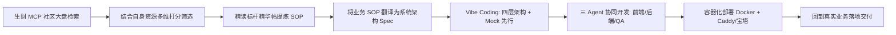
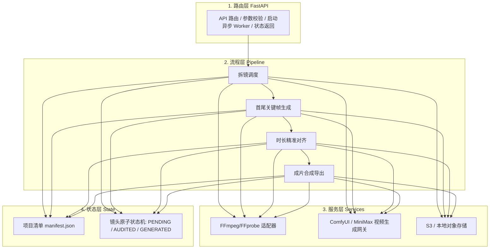

# 【案例精选】海量精华帖产品化：生财 MCP + Codex 架构拆解 SOP（Jason、mar）

> **案例作者**：Jason、mar（人工智能在读博士 / 生财传术师 / AI Agent 航海教练 / 11年软件开发老兵）  
> **项目定位**：从社区爆款内容《AI 同城流量超级术》提炼 SOP，打造全自动+带人工审核的视频生产 SaaS 平台  
> **核心标签**：`生财MCP` `SOP软件化` `FastAPI分层架构` `Mock先行` `防子Agent失控` `全栈部署`  
> **关键洞察**：**AI 编程大幅降低了写代码的门槛，却极大拔高了“定义问题与拆解 SOP”的价值。真正稀缺的不是让 AI 敲代码，而是从海量信息中选定商业方向，并把业务流程翻译成严密的系统架构。**

---

## 1. 核心链路：从“信息输入”到“商业交付”的 7 步跃迁

很多开发者使用 AI 编程的第一步，就是打开对话框输入“帮我做一个网站”。然而，“做什么业务、解决谁的痛点、背后跑什么状态流转”全没想清楚，AI 生成代码再快，也只是快速产出不可用的垃圾堆。

Jason 跑通的完整方法论，是将知识社区中的**非结构化实践精华**，一步步提炼为**高内聚、低耦合的生产级 SaaS 软件**：



---

## 2. 需求挖掘与方向筛选：生财 MCP 的高阶打法

生财 MCP 不仅仅是帖子提醒机器人，更是极具商业价值的**行业需求雷达与灵感数据库**：

### 2.1 蓝海需求统计三维度
通过 MCP 统计过去 1 年、半年与 3 个月内的数据：
1. **持续性**：哪些赛道长期有持续案例产生，而非短期炒作？
2. **增速突变**：哪些方向在最近 3 个月案例数量与讨论度爆发式增长？
3. **交付密度**：哪些方向沉淀了详尽的实操 SOP 与航海交付手册？

### 2.2 六维资源匹配漏斗
统计数据反映的是市场大盘，不能代替个人决策。将数据投喂给 Hermes，结合自身资源加权打分：
- 是否契合自身 AI / 技术底色？
- 能否借力现有的 Agent 与自动化脚本基础设施？
- 是否有真实的线下业务场景支持快速试错？
- 最小验证成本（MVP）是否足够低？
- 能否沉淀为通用工具、Skill 或可规模化复制的 SOP？
- 距离最终成交、交付与收钱是否足够近？

最终，团队锚定了**“AI 赋能本地生活同城流量”**这一离商业变现极近的赛道。

---

## 3. SOP 软件化：把业务动作翻译为系统需求

选定《AI 同城流量超级术》后，不急于写任何代码，而是利用 MCP 深度解析全文，梳理“业务动作 $\to$ 系统动作”的映射矩阵：

| 业务动作（人类操盘手视点） | 系统动作（程序与 Agent 视点） | 核心输入物 | 交付产出物 | 审核门禁 / 容灾策略 |
| :--- | :--- | :--- | :--- | :--- |
| **1. 拆解同城爆款参考视频** | FFmpeg 场景检测与关键帧分段 | 原始短视频 MP4 文件 | 镜头切片列表与分段关键帧 | 本地计算，无需联网调用 |
| **2. 筛选需改造镜头** | 前端镜头清单多选与勾选 | 关键帧预览图 | 待重绘镜头 ID 数组 | **人工审核**：未勾选镜头直接复用原片 |
| **3. 替换为自身品牌/人物** | 提示词引擎 + 图像生成 API | 品牌素材图 + 镜头 Prompt | 替换后的首尾关键帧高清图 | **质量闸门**：生成不达标可单帧人工替换 |
| **4. 动态化与运镜重构** | 视频生成服务（MiniMax/ComfyUI） | 达标关键帧 + 运动强度参数 | 动态视频片段（3~5s） | 异步任务轮询，防止超时阻塞 |
| **5. 还原爆款节奏与拼接** | 音视频自动对齐、时长伸缩、混音 | 原视频音频流 + 新视频切片 | 最终成品 MP4 视频 | 严格按照原视频时间线拼接，原子落盘 |

> [!IMPORTANT]
> **产品收敛原则**：第一版 MVP 切忌贪大求全！切勿试图一次性把“选城、选品、内容生产、自动发布、投流投放、私域转化”全链路自动化。**优先打穿高频、标准化程度最高、机器替代回报最大的“内容供给中心”**。

---

## 4. 系统工程设计：四层分层架构与 Mock 先行

为杜绝大模型写代码时的职责混乱，系统严格划分为四层架构：



### 4.1 防模型幻觉与冗余代码的铁律
开发早期，Codex 极易同时写出功能重叠的多套工具函数。解决方案是在开发文档中提前立下**硬性职责隔离红线**：
1. **路由层**：只管 HTTP 参数验证与任务启动，严禁直接读写视频二进制文件；
2. **流程层**：只管任务状态流转，严禁拼接第三方底层 HTTP 请求；
3. **服务层**：只管外部接口适配，无权决定业务状态；
4. **状态单一可信源**：镜头清单（`manifest.json`）是唯一状态源，所有操作必须幂等；
5. **付费保护机制**：未通过人工审核的关键帧严禁触发视频生成 API；已成功的长任务禁止重复提交。

### 4.2 开发三角色 Agent 分工
- **前端 Agent**：负责纯 HTML5 + 原生 JavaScript + CSS + Jinja2 模板渲染（放弃复杂 npm 构建链，极速迭代）；
- **后端 Agent**：负责 FastAPI 异步流水线、Prompt Engine、供应商适配与状态持久化；
- **测试 QA Agent**：编写 253 项离线 Mock 单元测试用例，不消耗真实 Token/API 额度，全面覆盖断点恢复与异常边界。

---

## 5. 惊险踩坑实录与三大工程铁律

### 坑一：为了省 Token 将复杂任务交给弱模型，导致返工成本暴涨 10 倍
- **事故复盘**：为了节省 Codex 消耗，将涉及多模块、长上下文调度的核心任务交给低成本模型。弱模型无法维持跨文件约束，导致新旧逻辑互相覆盖，最终被迫推倒重来。
- **治理模型分层法**：
  - **Tier 1（极轻/低成本）**：格式清洗、单文件正则替换、简要文档归档；
  - **Tier 2（标准模型）**：单函数实现、独立模块编写、常规 Bug 修复；
  - **Tier 3（顶级大模型，如 Codex/Claude 3.7 Sonnet）**：跨模块架构规划、主控调度、复杂系统调试；
  - **Tier 4（顶级模型 + 人工终审）**：核心安全策略、支付与数据库事务。

### 坑二：多 Agent 协作失控，瞬间裂变出近 100 个子 Agent
- **事故复盘**：给总控 Agent 放权过大且未限制最大递归层级。总控创建子 Agent，子 Agent 遇到复杂任务继续自我复制，瞬间裂变近百个 Agent，并发抢占文件，导致项目死锁瘫痪。
- **多 Agent 防失控纪律**：
  1. **层级熔断**：最大深度限定为 2 层，严禁子 Agent 继续创建子 Agent；
  2. **单一所有者**：每个任务、每个文件只能指定唯一负责 Agent；
  3. **标准契约**：所有 Agent 只能读取同一份经人类审核确认的系统开发文档。

### 坑三：Windows 高并发引发本地整机假死
- **认知纠偏**：调用云端模型的 Codex CLI 并不消耗本地 GPU 算力；真正吃爆本地 CPU、内存与磁盘 I/O 的，是并发进程、测试套件、本地 FFmpeg 视频编码与浏览器渲染。
- **解决策略**：严格限制本地并发数（$\le 2$），将重度耗时的媒体渲染与长轮询任务迁移至 Linux 服务器，定期清理僵尸后台进程。

---

## 6. 自动化测试与生产上线架构

```bash
# 1. 本地启动开发环境（极简依赖）
python run.py  # 或 uvicorn app.main:app --reload

# 2. 运行 253 项全离线 Mock 回归测试
pytest tests/ -v --cov=app

# 3. 生产容器化打包与一键启动
docker-compose up -d --build

# 4. 健康检查探针核验
curl -f http://127.0.0.1:8000/readyz || exit 1
```

- **部署方案**：
  - **方案 A（极简标准）**：外部流量由 Caddy 接管（自动申请 Let's Encrypt 证书），反向代理至 FastAPI 容器；
  - **方案 B（传统运维）**：宝塔面板管理 Nginx 与域名解析，反向代理至应用本地端口。
- **最终生产指标**：单条爆款视频拆解重构耗时由 **10 小时人工制作** 压缩至 **15 分钟人机协同成片**，且全流程状态可恢复、成本高度可控。
