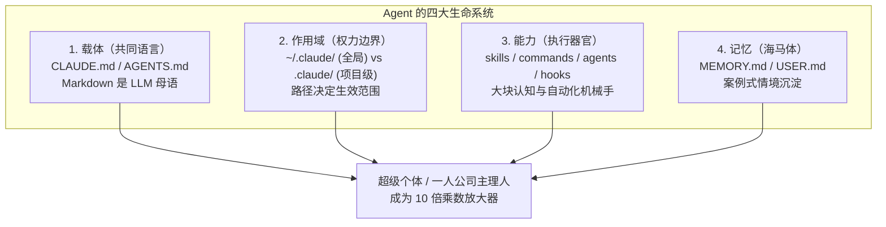

# 【案例精选】一人公司 AI Agent 文件管理白皮书：四框架与安全治理（#周知2.0）

> **案例作者**：#周知2.0（AI 超级个体 / 3 款盈利 AI 产品主理人 / AI 智能体调用 100W+ 次）  
> **面向群体**：独立开发者、超级个体、一人公司（OPC）、AI 自由职业者  
> **核心标签**：`万物皆文件` `四框架决策树` `CLAUDE.md 200行法则` `四件套系统` `PreToolUse拦截`  
> **关键洞察**：**对 AI 员工来说，文件不是配置存放处，文件就是它的身体。AI 员工反复失忆、产出漂移，根因不是模型不聪明，而是缺少承载身份、作用域、能力与记忆的文件底座。**

---

## 1. 核心世界观：文件驱动论（Agent 的身体就是文件）

Linux 系统的基石是 **“Everything is a file（万物皆文件）”**。在 AI Agent 时代，这一工程物理规律再次重演：**“Everything an agent knows is a file（Agent 知道的一切都是文件）”**。

大模型本身是无状态（Stateless）的，在两次会话之间它处于“物理死亡”状态。如果你没有文件系统承载，每次启动它都是一张白纸。你昨天的调试成果、业务规则、踩坑经验如果没写进文件，今天就必须重新解释。

```text
没有文件系统的一人公司日常（每月白白烧掉 13 小时）：
- 症状一：失忆税（每天花 20 分钟重新解释业务背景）
- 症状二：不一致税（每天花 10 分钟纠正不稳定的格式与口吻）
- 症状三：找不到税（每天花 10 分钟在各个对话窗口翻找历史产出）
```



---

## 2. 四大主流框架横评与一人公司选型决策树

| 框架名称 | 研发主体 | 核心哲学与气质 | 最佳适配工作场景 | 典型劣势与暗坑 |
| :--- | :--- | :--- | :--- | :--- |
| **Claude Code (CC)** | Anthropic | **工程纪律**：规划与审查优先，严谨规范 | 复杂终端工程、跨文件重构、全栈开发、富 Skill 生态 | 记忆自动写入需定期审计防污染 |
| **OpenAI Codex** | OpenAI | **安全沙箱**：OS 级安全隔离，无状态执行 | 自动化测试、批量脚本执行、独立任务并行 | 默认无原生长期记忆，依赖 MCP 委托 |
| **OpenClaw** | 开源社区 | **自主与灵魂**：HEARTBEAT 心跳定时调度 | 中文自媒体（小红书/公众号/视频号）无人值守 | 单兵生态强，多人团队协同较弱 |
| **Hermes** | 开源社区 | **常驻与懂你**：16+ 聊天平台原生网关 | 微信/飞书/Telegram 机器人、24h 陪伴式助理 | 偏单机单用户，软约束安全防线偏弱 |

### 一人公司架构选型决策树

```text
你的一人公司核心业务是什么？
├── 偏重内容创作（公众号 / 小红书 / 短视频）
│   └── Claude Code（生态最丰富） 或 OpenClaw（HEARTBEAT.md 定时发布）
├── 偏重工程实施（SaaS 研发 / 脚本自动化 / 工具交付）
│   └── Claude Code（负责规划与审查） + Codex（负责实施与沙箱测试）双工具协同
├── 偏重多平台触达（社群运营 / 客户答疑 / 私域连接）
│   └── Hermes（直连 16+ 平台原生网关，Profile 多角色隔离）
└── 追求 24/7 全自动无人值守
    └── OpenClaw（基于心跳循环调度）
```

> [!TIP]
> **组合范式（Use Multiple）**：一人公司不要试图寻找一个万能框架。主流打法是：**规划审查用 Claude Code，实施构建用 Codex，中文自媒体用 OpenClaw，常驻接入用 Hermes**。得益于 `AGENTS.md`（Linux Foundation）与 `SKILL.md`（Anthropic）两大标准的统一，多框架资产已实现无缝互通。

---

## 3. Agent 标准文件系统拓扑与 Git 凭证隔离

### 3.1 用户级目录结构（`~/.claude/`）
全局生效，住在主用户的 home 目录：
```text
~/.claude/
├── CLAUDE.md              # 全局指令（你的跨项目个人通用偏好）
├── settings.json          # 全局权限、hooks 配置与模型端点
├── skills/                # 全局可复用 Skill 集合
│   └── <skill-name>/SKILL.md
├── commands/              # 全局斜杠快捷命令（如 /review.md）
├── agents/                # 全局专职子 Agent 设定（如 competitor-researcher.md）
├── rules/                 # 全局按文件类型动态加载的规则库
└── projects/<hash>/       # 自动生成的项目记忆目录（严禁手动破坏）
    └── memory/MEMORY.md
```

### 3.2 项目级目录结构（`.claude/`）与凭证安全防线
```text
your-project/
├── .claude/
│   ├── CLAUDE.md          # 项目专有章程（团队共享，进 Git）
│   ├── CLAUDE.local.md    # 个人专属本地偏好（追加模式，严禁进 Git！）
│   └── rules/             # 针对本项目代码类型的微规则
├── .gitignore             # 关键安全防线！
└── src/
```

### 3.3 严格的 `.gitignore` 凭证隔离清单
在开源或团队协同中，必须死守隐私底线：
```gitignore
# 必须严格忽略的敏感文件
.env*
auth.json
*.pem
*.key
**/memory/
.claude/CLAUDE.local.md
.codex/AGENTS.override.md
```

---

## 4. `CLAUDE.md` 的 200 行黄金法则与 Gotcha 演化

### 4.1 为什么必须死守“200 行红线”？
大模型在 Session 中能够高遵从度执行的指令通常在 **150~200 条**。当 `CLAUDE.md` 膨胀到 300~500 行时，AI 的注意力会被大量平庸规则稀释，开始“选择性失聪”，对最关键的安全约束视而不见。
- **治理法则**：超过 200 行的部分，必须拆解至 `.claude/rules/` 目录下，配置 glob 模式（如 `*.py`、`*.tsx`）按需动态载入。

### 4.2 最高 ROI 的 5 类黄金信息
1. **构建 / 测试 / 运行命令**（最高 ROI）：让 AI 启动第一步就能跑起来；
2. **架构映射（Directory $\to$ Responsibility）**：避免 AI 遍历全盘才能定位改动位置；
3. **隐性编码规范**：只写 AI 从代码里看不出来的约定（看得出来的不要写）；
4. **关键 Gotcha（用血泪换来的踩坑记录与后果）**：最值钱的资产！
5. **不做之列（Negative Constraints）**：明确禁止 Agent 擅自越界的事情。

### 4.3 好的 Gotcha vs 烂的规则演化

```markdown
<!-- 烂版：废话连篇，占用宝贵上下文配额，AI 完全不当回事 -->
## 编码规范
- 代码要写得清晰易读
- 命名要有实际意义
- 做好异常处理

<!-- 进阶好版：带后果、带情境、不可被通识猜出的真实 Gotcha -->
## 关键 Gotcha（看不出来的工程暗坑）
- DB 查询必须指定字段 projection：上次全量拉取引发线上 OOM 宕机 2 小时；
- 所有时间戳入库强制采用 UTC：上次时区错位导致自动化 Cron 误发 300 封营销邮件；
- 支付回调必须在 Redis 做分布式幂等锁：上次网络抖动引发用户重复扣款。
```

---

## 5. 能力四件套与 Hook 自动化安全防御

AI 员工的能力由四件套组成，不可混淆职责：

| 件套类型 | 核心本质 | 触发方式 | 最佳适用场景 |
| :--- | :--- | :--- | :--- |
| **skills** | 大块综合认知能力 | AI 依据任务描述自主评估触发 | 复杂任务（写研报、对标文案仿写、做竞品分析） |
| **commands** | 显式斜杠快捷指令 | 人类在终端主动敲击 `/<name>` | 明确、固定、高频短操作（如 `/commit`、`/审稿`） |
| **agents** | 垂直专职子 Agent | Task 工具动态委托派发 | 独立且权限收敛的子任务（如 `competitor-researcher`） |
| **hooks** | **Shell 级物理机械拦截** | 工具调用前后由环境自动执行 | **100% 强制约束，绕过 AI 主观判断（如阻止 rm -rf）** |

### 5.1 PreToolUse Hook：拦截高危命令实战
想要阻止 AI 误执行毁灭性命令，**在 `CLAUDE.md` 里写“千万别删库”是靠不住的（AI 可能会忽略），必须使用 Shell 脚本在底层设卡。**

创建 `~/.claude/hooks/check-dangerous.sh`：
```bash
#!/usr/bin/env bash
# 拦截危险 Shell 命令的 PreToolUse 钩子脚本
INPUT=$(cat)
COMMAND=$(echo "$INPUT" | jq -r '.tool_input.command // empty')

# 拦截的高危模式黑名单
DANGEROUS=(
  "rm -rf /"
  "rm -rf ~"
  "rm -rf *"
  "git reset --hard"
  "git clean -fd"
  ":(){ :|:& };:"
  "mkfs"
  "dd if="
  "> /dev/sda"
)

for pattern in "${DANGEROUS[@]}"; do
  if [[ "$COMMAND" == *"$pattern"* ]]; then
    echo "❌ 危险操作被 Hook 机械拦截: 检测到包含禁止执行的指令 '$pattern'" >&2
    echo "拦截命令全文: $COMMAND" >&2
    # 返回退出码 2，通知 Agent 框架强制中断该工具调用
    exit 2
  fi
done

exit 0
```

赋予执行权限并在 `~/.claude/settings.json` 中激活：
```bash
chmod +x ~/.claude/hooks/check-dangerous.sh
```

```json
{
  "hooks": {
    "PreToolUse": [
      {
        "matcher": "Bash",
        "command": "~/.claude/hooks/check-dangerous.sh"
      }
    ]
  }
}
```

> [!CAUTION]
> **CC 与 Codex 关键机制差异警示**：
> - Claude Code 的 `CLAUDE.local.md` 是**追加**在 `CLAUDE.md` 之后；
> - OpenAI Codex 的 `AGENTS.override.md` 是**全量互斥替换**，一旦存在，原 `AGENTS.md` 将完全失效！
> - Codex 默认读取项目文档上限为 `project_doc_max_bytes = 65536`（64KB），超过将被系统截断。因此精炼文件不仅是心理学要求，更是系统级物理硬约束。
