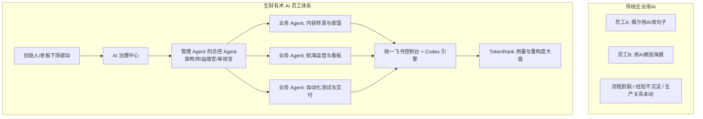

# 【案例精选】企业级 AI 员工体系与 AI 中心建设实战（亦仁）

> **案例作者**：亦仁（生财有术创始人）  
> **企业实践**：生财有术内部全员 AI 员工改造、TokenRank 竞技榜单与 AI 中心工业化落地  
> **核心标签**：`AI员工体系` `管理Agent的Agent` `TokenRank` `技术栈收敛` `生产关系重组` `AI中心实战`  
> **关键洞察**：**AI 工具只是局部提效，Agent 才是重组生产关系。当 Agent 数量规模化爆发后，真正的工程瓶颈不再是创建更多的业务 Agent，而是缺少能够管理、运维与审核 Agent 的治理层 Agent。**

---

## 1. 认知跃迁：从“工具辅助”到“数字员工与组织重组”

绝大多数企业在引入 AI 时，往往停留在“装个 ChatGPT 账号帮员工写邮件、润色文案”的散兵游勇阶段。这种玩法只能带来 5%~10% 的局部边际改善，无法形成质的飞跃。

亦仁带领生财有术团队跑通的，是一场深刻的**组织级生产关系重构**：
- **AI 不是工具，而是数字员工、业务合伙人甚至部门主管**；
- **重塑协作模型**：人类不再是亲自动手写底稿、找资料的初级苦力，而是专注于定义目标（前 20%）与终审裁决（后 20%）；中间密集的调研、撰写、编码、排错、对齐（60%）全部由 AI 员工接管；
- **老板必须亲自下场**：企业一把手如果只在岸上看汇报，AI 改造必然沦为中层应付差事的半吊子工程。只有老板亲自下场写 Spec、调 Agent、重构真实业务流，全员才能真正打破路径依赖。



---

## 2. 核心瓶颈：为什么必须有“管理 Agent 的 Agent”？

当企业内部的 Agent 数量从 3 个增长到 30 个甚至上百个时，组织会遭遇全新的**Agent 规模化危机**：
1. **任务碎片与调用混乱**：业务人员搞不清楚该找哪个 Agent，各个 Agent 的接口与 Prompt 格式互不兼容；
2. **状态漂移与责任真空**：Agent 在长程执行中挂掉、陷入死循环，或者产出质量下滑，没有人实时报警与自愈；
3. **安全合规与假交付**：Agent 误改历史生产数据，或者虚假汇报“任务已完成”，导致业务现场崩溃。

为此，生财 AI 中心确立了全新的**三层治理体系**：

| 治理角色 | 本质定位 | 核心职责与防线 |
| :--- | :--- | :--- |
| **Agent 架构师** | 业务流程重构专家 | 深入一线挖掘高频、可标准化的业务痛点，定义输入输出 Spec，设计 Agent 拓扑 |
| **Agent 运维官** | 系统级管家 Agent | 7x24 小时监控业务 Agent 的健康度、运行延迟、Token 消耗异常与任务死锁 |
| **Agent 审核官** | 质检与安全红线闸门 | 对业务 Agent 的交付物进行离线抽检、合规过滤、敏感词排查与防回退校验 |

> [!IMPORTANT]
> **治理核心律**：规模化之后，**管理 Agent 的 Agent，比写业务代码的 Agent 重要 10 倍**。没有治理层，Agent 越多，企业管理熵增越剧烈。

---

## 3. 技术栈大一统：全面收敛至 Codex + 飞书

在探索早期，团队内部工具极度分散：有人用网页版 ChatGPT，有人用 Cursor，有人用各种第三方 API 客户端，导致 Prompt 资产散落、项目现场无法互通。

亦仁果断推行**全员技术栈大一统**：
- **执行引擎收敛到 Codex**：依托其 OS 级沙箱、原生读写本地文件、执行终端命令与测试套件的硬核工程能力；
- **协同与看板收敛到飞书**：
  - 飞书多维表格作为可视化任务总控台；
  - 飞书文档作为团队知识沉淀库；
  - 飞书群与机器人作为人机交互的即时连接器；
- **统一的好处**：不仅彻底消除了跨工具迁移的摩擦，更让团队内沉淀出的优质 Skill、AGENTS.md 规范与自动化脚本可以**即插即用、全员复用**。

---

## 4. TokenRank：用量竞技与工作流重构度晴雨表

生财有术内部开发并向社群开放了 **TokenRank** 产品（已吸引 1600+ 名圈友打榜）：

```text
       🏆 生财有术 TokenRank 实时英雄榜
┏━━━━┳━━━━━━━━━━━━━━┳━━━━━━━━━━━━┳━━━━━━━━━━━━┓
┃ 排名 ┃ 实操者 / 团队 ┃ 周期 Token  ┃ 工作流重构评估 ┃
┣━━━━╋━━━━━━━━━━━━━━╋━━━━━━━━━━━━╋━━━━━━━━━━━━┫
┃ 01 ┃ 航海先锋队     ┃ 230 亿     ┃ 工业级全闭环  ┃
┃ 02 ┃ 自动化内容工坊 ┃ 120 亿     ┃ 多 Agent 协同 ┃
┃ 03 ┃ OPC 独立开发组 ┃ 85 亿      ┃ 全栈极速交付  ┃
┗━━━━┻━━━━━━━━━━━━━━┻━━━━━━━━━━━━┻━━━━━━━━━━━━┛
```

### 4.1 Token 消耗背后的真实本质
- **Token 消耗量不是虚荣指标，而是工作流是否被真正重构的参照坐标**：
  - 如果一个团队每天只消耗几万 Token，说明他们依然在用传统人工方式肉搏，AI 只是打酱油的拼写检查器；
  - 只有当 Token 消耗量跨越数亿、数十亿量级时，才证明业务中大量的搜索、阅读、提取、改写、代码生成、测试与巡检动作**已经真正从人肉移交给了机器**。
- **隐私保护与本地计算**：TokenRank 仅安全统计本地工具产生的消耗日志，绝不上报用户的业务代码与商业机密，以安全合规为绝对前提。

---

## 5. 标杆业务落地：多平台内容全保真转录 Agent

在知识社群运营中，每天有海量来自直播、音视频、知识星球与微信群的高价值内容。生财 AI 中心打造的转录 Agent 坚持了反直觉的原则：**初始转录必须保留极致细节，严禁过早压缩！**

1. **拒绝过早“智能摘要”**：很多工具一上来就给出 100 字摘要，把语气词、背景故事、具体踩坑数据全当噪音扔掉，导致后续推理完全失真；
2. **全保真结构化沉淀**：先把长达几小时的音视频还原为一字不落的高保真原始文本，标注发言人、情绪节点与关键时间戳；
3. **下游按需蒸馏**：同一份全保真资产，交由不同专职 Agent 分别提炼为：金句卡片、实操 SOP、商业决策分析、FAQ 异议库。

---

## 6. 总结：企业 AI 员工落地的“三大心法”

1. **自上而下，重组生产关系**：企业 AI 化不是采购软件，而是一场从老板到一线的组织变革。给业务重新定岗，让人做人最擅长的，让 Agent 做机器最擅长的。
2. **建立中枢，强化治理防线**：及早组建 AI 中心，规范技术栈，布局架构师、运维官与审核官角色，让 Agent 在安全可控的轨道上狂奔。
3. **指标驱动，沉淀数字复利**：以真实业务结果与 TokenRank 真实消耗为度量尺，逼出真动作，沉淀能打硬仗的 AI 员工队伍。
