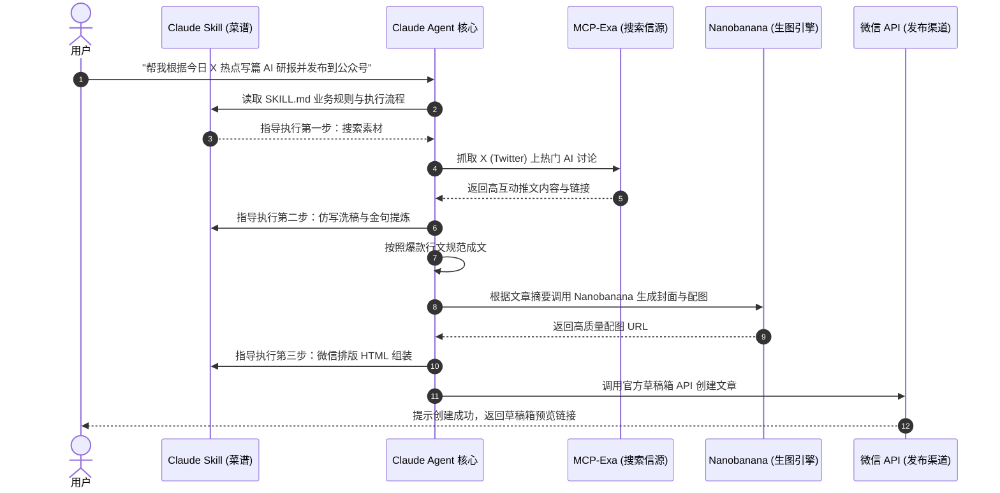

# 【案例精选】Claude Skill 从原理到实战：一句话实现公众号自动撰写、排版、配图与发布（田威）

> **案例档案卡片**
>
> - **案例作者**：田威  
> - **核心成果**：彻底摆脱复杂的自动化节点拖拽，利用 Claude Skill 架构，一句话实现公众号文章全自动检索、撰写、配图、排版与草稿箱发布，效率提升 100 倍  
> - **核心工具链**：`Claude Code` + `Skill Creator` + `MCP-Exa` (全网搜索) + `Nanobanana` (AI 生图) + `微信公众号官方 API` (草稿箱直连)  
> - **国产模型兼容**：配置 DeepSeek V3 兼容 Claude 协议环境变量，免梯子高性价比驱动  
> - **原文参考资料**：[生财有术精华实操长文 (ID: 14588584158212542)](https://scys.com/articleDetail/xq_topic/14588584158212542)  
> - **实战文档参考**：[田威实操飞书文档](https://ai.feishu.cn/docx/BPYRdmZQaoLoRTxqvUPc7E1L...)  
> - **关键洞察**：**“Skill 是菜谱，MCP 是冰箱。”不要试图用繁杂的 Prompt 让 AI 去做死板的数据转换或状态持久化；高自由度指导写入 `SKILL.md`，低自由度执行写入 `scripts/` 脚本，上下文是公共财产，善用渐进式加载保持轻量。**

---

## 一、 认知跃迁：为什么告别 n8n / Coze 复杂连线，转向自然语言 Skill？

为了实现“公众号自动发布”工作流，许多开发者折腾过 n8n，搭建过 Coze。但在实际业务中，配置数十个节点、映射 JSON 参数、调试分支条件，过程非常繁琐且维护成本极高。一旦接口格式微调，整个连线系统极易崩塌。

Anthropic 推出的 **Skill** 功能，标志着自动化从“可视化拖拽时代”正式步入“Agent 自然语言定义时代”：
- **零拖拽连线**：无需手动画节点，只需告诉 AI：“我想要设计一个自动搜索 X 上面的 AI 内容，自动生成文章，并排版，自动上传到公众号的 skill”；
- **自适应调度**：Agent 根据上下文自主判断何时调用搜索、何时调用绘图、何时执行排版；
- **极佳的扩展性**：一个 Skill 文件夹即可完成封装、迁移、版本管理与团队共享。

```mermaid
flowchart LR
    subgraph 传统工作流 (n8n / Coze)
        N1[HTTP 节点] --> N2[JSON 转换节点]
        N2 --> N3[大模型节点]
        N3 --> N4[条件分支判断]
        N4 --> N5[排版发布节点]
        style N1 fill:#f9f,stroke:#333
        style N4 fill:#fbb,stroke:#333
    end

    subgraph Claude Skill 时代
        S1["自然语言指令<br/>'搜索 X 内容并发布公众号'"] --> S2["Skill (菜谱业务逻辑)"]
        S2 <--> S3["MCP 工具 (冰箱取食材)"]
        S2 --> S4["一键草稿箱交付"]
        style S2 fill:#bbf,stroke:#333
        style S3 fill:#dfd,stroke:#333
    end
```

---

## 二、 核心原理：Skill 与 MCP 到底有什么区别？

在 AI 工具生态中，许多人分不清 **MCP (Model Context Protocol)** 与 **Skill (技能)** 的职责边界。

田威老师用了一个极为生动的比喻：
> **“Skill 是菜谱，MCP 是冰箱。”**
> - **MCP (冰箱)**：负责连接外部世界，提供原材料（获取股价数据、连接数据库、调用发信 API、读取外部网页）。
> - **Skill (菜谱)**：负责业务逻辑与专业工艺，指导 AI 怎么把原材料做成一盘色香味俱全的菜（如何分析行情、套用什么写作框架、如何排版、生成什么格式）。

### 2.1 证券研报场景实战拆解

| 步骤 | 谁来负责？ | 为什么这样分工？ |
| :--- | :--- | :--- |
| **第一步：采集数据** | **MCP** | 需要获取今天的最新股价、K线图、新闻资讯（AI 本身没有实时行情，必须靠 MCP 联网去抓） |
| **第二步：研报分析** | **Skill** | 需要分析数据，按《巴菲特价值投资逻辑》写深度点评（AI 拿到了数据但不知道业务分析框架，由 Skill 提供指南） |
| **第三步：文档排版** | **Skill** | 需要按投行标准生成排版精美的 PDF 报告（Skill 给出排版规范与样式约束） |
| **第四步：发送报告** | **MCP** | 需要把报告通过邮件发送给客户与主管（AI 自己发不了真实网络邮件，必须靠 MCP 连接邮件服务器） |



---

## 三、 Skill 的解剖学结构与三大设计原则

一个标准的 Skill 表现为一个文件夹，里面必须包含核心文件 `SKILL.md`，选配脚本和参考文档。

### 3.1 标准目录结构

```text
my-code-reviewer/           <-- 技能文件夹
├── SKILL.md                <-- 【核心】大脑 (写指令和元数据 Frontmatter)
├── scripts/                <-- 【选配】手脚 (放 Python/Bash 脚本，执行死板任务)
│   └── check_style.py      <-- 专门用来检查代码风格或数据转换的脚本
└── references/             <-- 【选配】参考资料 (渐进式加载，按需读取)
    └── api_spec.md         <-- 大部头 API 规范，不挤占公共上下文
```

### 3.2 SKILL.md 的标准组成

`SKILL.md` 由两部分构成：
1. **身份证 (YAML Frontmatter)**：告诉 Claude 什么时候该用这个技能（用于意图识别路由）。
2. **说明书 (Markdown Body)**：具体的执行指令与质量验收要求。

```yaml
---
name: code-reviewer
description: 当用户需要审查 Python 代码质量、寻找 Bug 或优化性能时使用此技能。
---

# Code Reviewer 指南
你是一位资深的 Python 架构师。请按照以下步骤审查代码：
1. **安全性检查**：优先检查 SQL 注入、XSS 等安全隐患。
2. **性能优化**：指出时间复杂度过高的循环或不必要的内存占用。
3. **风格规范**：确保变量命名符合蛇形命名法 (snake_case)。

## 输出格式要求
- 发现的问题清单（标明行号与严重级别）
- 重构优化后的代码片段
- 性能改善预期说明
```

### 3.3 Skill 编写的三大黄金原则

```text
原则一：上下文是公共财产 (The context window is a public good)
默认 Claude 已经具备顶尖常识，拒绝任何科普废话（例如不要写“Python 是一种高级编程语言...”），直接下达硬性动作指令。

原则二：设置合适的“自由度” (Degrees of Freedom)
• 高自由度：用纯文字 Prompt。适合创意写作、语气拟合、金句提炼。
• 低自由度：用 Python/Bash 脚本。适合数学计算、JSON 转换、文件重命名。死板任务坚决写脚本丢进 scripts/，稳准狠且省 Token。

原则三：渐进式加载 (Progressive Disclosure)
遇到几十页的 API 文档或业务词典，切忌一股脑塞入 SKILL.md。
建立 references/ 文件夹，在 SKILL.md 中注明：“如果遇到支付接口调用，请读取 references/payment_api.md”。按需调取，节约内存。
```

---

## 四、 准备工作与国内模型免翻接入

虽然 Skill 支持在 Claude.ai 网页版上传使用，但为了全自动化开发，推荐使用官方命令行工具 **Claude Code**。

### 4.1 安装 Claude Code

```bash
# 全局安装 Claude Code
npm install -g @anthropic-ai/claude-code

# 如果有官方 Anthropic 账号，可直接登录
claude login
```

### 4.2 免科学上网：DeepSeek V3 官方兼容协议配置

即使没有官方 Claude 账号，也可以用 **DeepSeek V3 / Qwen / GLM** 等高性价比国产大模型直接驱动 Claude Code。DeepSeek 官方原生兼容 Anthropic 协议，只需在终端配置三行环境变量即可：

```bash
# 配置 Anthropic 协议反向代理基地址 (指向 DeepSeek)
export ANTHROPIC_BASE_URL="https://api.deepseek.com/anthropic"

# 配置你的 DeepSeek API Key
export ANTHROPIC_AUTH_TOKEN="sk-你的DeepSeek-API-Key"

# 指定模型名称为 deepseek-chat
export ANTHROPIC_MODEL="deepseek-chat"
```

配置完成后，在终端直接运行 `claude`，即可拥有国产最强大脑驱动的命令行智能体，完整支持 Skill 与 MCP 扩展！

---

## 五、 极简实战：一句话用 Skill Creator 创建公众号发布系统

手工编写 Skill 结构依然有门槛。田威分享了最具杀伤力的高阶玩法——**让 AI 自己写 Skill（一句话生万物）**。

### 5.1 第一步：安装官方 Skill Creator

进入 Claude Code 终端后，直接输入以下指令：

```text
“阅读 https://github.com/anthropics/skills 里面的内容，然后帮我安装里面的 skill creator”
```

Claude Code 会自动拉取 Anthropic 官方仓库中的 `skill-creator`，并完成本地环境配置。

### 5.2 第二步：一句话下达业务需求

拥有 `skill-creator` 之后，直接用自然语言描述公众号全自动工作流：

```text
“我想要设计一个自动搜索 X (Twitter) 上面的 AI 内容，自动生成文章，并排版，自动上传到公众号的 skill”
```

`skill-creator` 会自动创建目录、编写 YAML 元数据、规划执行流程、生成自动化调度脚本。

### 5.3 第三步：补齐三项关键外部凭证

要让这套自动化工作流真正闭环运行，需要为 Claude 提供三大能力支撑：

1. **搜索信源支持**：接入 **MCP-Exa**（配置 Exa API Key），让 AI 具备直接检索 X (Twitter) 最新爆款推文的能力；
2. **AI 配图支持**：接入 **Nanobanana** 的 API，根据文章各章节核心含义自动生成匹配插图；
3. **公众号草稿箱直连**：从微信公众平台后台（开发 -> 基本配置）获取两项核心参数：
   - `AppID` (开发者ID)
   - `AppSecret` (开发者密码)
   - 配置服务器 IP 白名单，赋予上传图文消息素材与草稿箱草稿的 API 权限。

```mermaid
flowchart TD
    Prompt["一句话触发指令:<br/>'搜集今日 X 上的 Claude 热门并发布公众号'"] --> Run["Claude Code 启动 wechat-publisher Skill"]
    
    subgraph 外部能力接入 (MCP / API)
        Run --> Exa["MCP-Exa 抓取 X 平台 Top 3 AI 爆帖"]
        Run --> Nana["Nanobanana API 生成 16:9 科技感封面图"]
        Run --> WX["微信公众平台 API (草稿箱直发)"]
    end

    WX --> Result["公众号后台草稿箱生成就绪<br/>(含标题、排版、配图、标签)"]
```

---

## 六、 进阶技巧：Skill 的安装、调试与拓展

### 6.1 Skill 的加载与调试

```bash
# 方式 1：安装官方或社区插件
/plugin marketplace add anthropics/skills

# 方式 2：本地工程加载 (Claude Code 会自动扫描项目目录下的 .claude/skills 或指定路径)
# 一旦放置完成，直接对 Claude 说：“帮我生成今天的公众号文章”，即触发匹配
```

在日常使用中，由于外部网络波动或接口限制，初次运行可能会遇到配图超时或 Token 校验问题。处理原则是：**直接把报错日志回喂给 Claude Code，让它自行调试 `scripts/` 下的 Python 调用代码，直到完全跑通**。

### 6.2 举一反三：更多高价值 Skill 场景

掌握了 Skill 的解剖结构与创建方法后，可以极速衍生到更多业务场景：
- **小红书爆款仿写 Skill**：自动抓取小红书同行笔记，提炼结构后自动改写重构；
- **金融投研研报 Skill**：定时抓取每日盘面与 K 线图，结合价值投资模型自动输出每日复盘；
- **社群精华周报 Skill**：读取微信群导出的一周聊天记录，过滤垃圾闲聊，结构化提取干货问答与金句生成周报。

### 6.3 现成优质 Skill 资源获取渠道

1. **官方技能库 (最为正统)**：`anthropics/skills`（Anthropic 官方维护，代码质量极高，覆盖文档、数据处理等核心场景）；
2. **社区精选精选合集 (Awesome List)**：`travisvn/awesome-claude-skills`（GitHub 上最全的第三方技能合集，涵盖各类自动化场景）。

---

## 七、 核心收获与自检清单

- [x] **明白 Skill 与 MCP 的分工**：MCP 提供数据与网络能力（冰箱），Skill 规范业务逻辑与操作工艺（菜谱）；
- [x] **掌握解剖学结构**：`SKILL.md` (说明与路由) + `scripts/` (确定性精准脚本) + `references/` (按需加载的大文档)；
- [x] **善用国产模型反代**：使用 DeepSeek V3 官方兼容协议，低成本高性能驱动 Claude Code；
- [x] **学会一句话生万物**：安装 `skill-creator`，用自然语言快速搭建公众号、研报、小红书专属自动化生产流水线。
