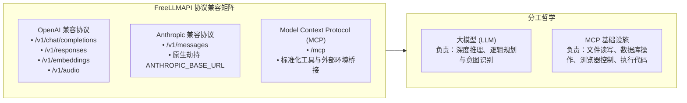

# 【实战对话】FreeLLMAPI 统一大模型总网关架构：CPA 订阅聚合、OpenRouter 深度比价与 BYOK 免费路由、低价推理商横评与独立 Agent 全栈选型指南

> **沉淀人**：极客探索团队  
> **对话与实战来源**：个人与独立开发者统一 AI 模型网关（FreeLLMAPI）架构演进、CLIProxyAPI（CPA）订阅凭证聚合、OpenRouter 5.5% 费率与 BYOK 免费路由实测、低价推理商梯队（DeepInfra / Novita / SiliconFlow / Together / Groq / Cerebras / Cloudflare）横评，以及主流 Agent 开发框架（Vercel AI SDK / Mastra / LangGraph / LlamaIndex / MCP）全景技术选型实录  
> **核心领域**：AI 模型网关架构（Unified AI Model Gateway）、CLIProxyAPI / OAuth 逆向凭证隔离、OpenRouter 费率与 BYOK 路由省钱策略、开源低价推理商成本压降、模型别名与动态降级容灾、Agent 运行时与大模型解耦、OpenAI /responses 与 Anthropic /messages 协议适配、Model Context Protocol (MCP) 基础设施

---

## 📌 背景与核心认知跃迁：从“薅羊毛工具”到“企业级唯一总模型网关”

在个人独立开发、团队协作或出海商业化探索中，许多开发者最初接触 FreeLLMAPI（或类似的反代项目）时，往往仅将其定位为一个“寻找免费可用大模型接口的试用工具”。然而，随着项目深入，面对如下现实矛盾：
1. **上游服务高度碎片化**：手头拥有 ChatGPT Plus / Pro、Claude Code 订阅、OpenAI 官方 API Key、Anthropic 官方 Key、Google Cloud Vertex 额度、以及各类第三方中转站；
2. **客户端多点配置噩梦**：开发工具（Cursor、Claude Code）、聊天前端（OpenWebUI、NextChat）、手机端应用、自动化脚本以及自主研发的 Agent，每个客户端都要配置一遍 Base URL、API Key 与模型映射，任何上游变动都导致所有端点全面瘫痪；
3. **单点故障与封号风险**：单一依赖某家中转或官方直连，一旦遭遇上游限流（HTTP 429）、服务器宕机（HTTP 5xx）、余额耗尽或突发风控封号，正在运行的自动化业务链条将全线崩溃；
4. **成本黑洞与劣质中转陷阱**：直接全量走昂贵官方 API 成本居高不下；而市面上所谓的“0.15 折 / 0.2 倍率”私人黑产中转又充斥着模型掉级（将 Opus 伪装成 Haiku、GPT-4 伪装为 mini）、篡改 Prompt、窃取对话隐私乃至随时卷款跑路的风险。

```{important}
**核心心智模型跃迁**：  
**不要仅把 FreeLLMAPI 当作单纯的“免费模型池”，而应将其升级为整个技术栈中“唯一的全能模型网关（Single Source of Truth, `your-ai.com/v1`）”。**  
客户端永远只需要配置一个地址、一个 Key；FreeLLMAPI 在网关内部完成 **订阅额度消化、低价推理分流、极速实时路由、多模态分发与终极容灾兜底**。
```

---

## 🏗️ FreeLLMAPI 四层总体架构拓扑

构建一个稳定、廉价且全面的模型中枢，关键在于将**调用客户端、网关路由层、上游适配层与模型供给池**进行彻底的解耦。

```{mermaid}
graph TD
    subgraph Clients["全域消费端 (Clients)"]
        C1["代码助手<br/>(Cursor / Claude Code)"]
        C2["Web 控制台<br/>(OpenWebUI / NextChat)"]
        C3["自研智能体<br/>(Mastra / LangGraph)"]
        C4["移动端 / 自动化脚本"]
    end

    subgraph Gateway["★ FreeLLMAPI 总模型网关 ★ (https://api.yourdomain.com/v1)"]
        GW_Auth["统一鉴权与配额 (Virtual Keys / Rate Limit)"]
        GW_Route["智能路由引擎 (模型别名 / 成本探测 / 自动重试 / Fallback)"]
        GW_Proto["协议转换矩阵 (OpenAI /responses, Anthropic /messages, MCP)"]
    end

    subgraph Tier1["第一梯队：个人订阅与 OAuth 额度 (CPA)"]
        CPA["CLIProxyAPI (本地/内网 CPA)"]
        CPA --> T1_Codex["Codex OAuth"]
        CPA --> T1_Claude["Claude Code OAuth"]
        CPA --> T1_Gemini["Gemini CLI OAuth"]
    end

    subgraph Tier2["第二梯队：零成本与边缘免费池"]
        CF["Cloudflare Workers AI<br/>(每日 10k Neurons 免费)"]
        FreeSrc["FreeLLMAPI 内置抓取池"]
    end

    subgraph Tier3["第三梯队：极致性价比开源推理商"]
        DI["DeepInfra<br/>(超低价 + Flex 20% 折扣)"]
        NV["Novita AI<br/>(低价开源 + Batch 50% 折扣)"]
        SF["SiliconFlow (硅基流动)<br/>(全模态: LLM/视频/语音/生图)"]
        TG["Together AI<br/>(模型全 + 高可用标杆)"]
    end

    subgraph Tier4["第四梯队：极速低延迟专用池 (LPU / 晶圆)"]
        GQ["Groq<br/>(500 tokens/s 实时交互)"]
        CB["Cerebras<br/>(晶圆级超高吞吐)"]
    end

    subgraph Tier5["第五梯队：官方直连与 OpenRouter BYOK"]
        BYOK["OpenRouter BYOK 免费路由<br/>(每月 $25,000 标价内 0% 抽成)"]
        BYOK --> OAI["OpenAI 官方 Key"]
        BYOK --> ANT["Anthropic 官方 Key"]
        BYOK --> GOOG["Google AI 官方 Key"]
    end

    subgraph Tier6["第六梯队：超级兜底与长尾池"]
        OR_Pool["★ OpenRouter 官方余额池 ★<br/>(500+ 模型 / 80+ Provider / 5.5% 费率)"]
    end

    subgraph Local["本地离线私有模型池"]
        LOC["Ollama / vLLM / llama.cpp"]
    end

    Clients ==> Gateway
    Gateway --> Tier1
    Gateway --> Tier2
    Gateway --> Tier3
    Gateway --> Tier4
    Gateway --> Tier5
    Gateway --> Tier6
    Gateway --> Local
```

---

## 🚦 多级优先级路由策略与成本压降矩阵

网关的核心威力在于**“按需路由”**。当客户端请求某个具体模型或泛化能力时，网关严格遵循预设的优先级流水线进行动态分发：

### 1. 六级梯队路由流水线

| 梯队优先级 | 目标层级 | 代表 Provider / 技术组件 | 核心作用与经济价值 | 触发条件 / 约束 |
| :--- | :--- | :--- | :--- | :--- |
| **Tier 1 (最高)** | **个人订阅与 CLI 凭证** | CLIProxyAPI (CPA) 代理 Codex、Claude Code、Gemini CLI | **边际成本为 0**（已付月租订阅），充分榨取个人/开发账号可用配额 | 严格限制为个人/内部开发使用，绝不公开转售 |
| **Tier 2** | **零成本免费额度** | Cloudflare Workers AI、FreeLLMAPI 内置免费源、OpenRouter Free 渠道 | **100% 免费**，每日自动清零的额度不用即浪费 | 处理非关键背景任务、粗分类、简单总结与测试 |
| **Tier 3** | **极致性价比开源推理商** | DeepInfra（支持 Flex 20% 折扣）、Novita AI（支持 Batch 50% 折扣）、SiliconFlow、Together AI | **每百万 Token 几分钱至一两毛**，生产级开源模型主力主力跑道 | 常规生产 API、微服务数据挖掘、清洗与批处理 |
| **Tier 4** | **极速低延迟推理池** | Groq（约 500 tokens/s）、Cerebras | **极低的首字延迟（TTFT）与极致流式吞吐** | 实时对话前端、语音交互流、数字人实时驱动对齐 |
| **Tier 5** | **官方直连 / OpenRouter BYOK** | OpenAI、Anthropic、Google 官方 Key 直连或挂载 BYOK | **功能最前沿、输出最稳定、旗舰模型专属** | 高难度架构推演、生产级复杂代码重构、合规审计 |
| **Tier 6 (兜底)** | **OpenRouter 官方余额池** | OpenRouter（500+ 模型、80+ Provider、自动容灾） | **覆盖长尾罕见模型，在上游全部故障时提供终极高可用** | 前置所有 Provider 触发 429、5xx、超时或断网时激活 |

### 2. 模型名与来源完全解耦：抽象别名系统（Model Aliasing）

客户端代码中绝不应硬编码具体的上游模型全称（如 `anthropic/claude-3-5-sonnet-20241022` 或 `deepseek-ai/deepseek-chat`），而应统一使用业务意图别名：

```yaml
# FreeLLMAPI 模型别名与动态路由定义示例 (gateway_config.yaml)
aliases:
  smart:
    description: "最强推理能力，优先保障代码架构、深度逻辑推演"
    routing_pipeline:
      - provider: cpa_claude
        model: "claude-3-7-sonnet"
        timeout_seconds: 15
      - provider: anthropic_byok
        model: "claude-3-7-sonnet"
      - provider: openai_official
        model: "gpt-4.5"
      - provider: openrouter_fallback
        model: "anthropic/claude-3.7-sonnet"

  coding:
    description: "高强度编程生成与 Bug 排查"
    routing_pipeline:
      - provider: cpa_codex
        model: "gpt-5-codex"
      - provider: cpa_claude
        model: "claude-code"
      - provider: deepinfra
        model: "deepseek-ai/DeepSeek-V3"
      - provider: openrouter_fallback
        model: "anthropic/claude-3.5-sonnet"

  fast:
    description: "实时交互、语音对话、数字人驱动快速循环"
    routing_pipeline:
      - provider: groq
        model: "llama-3.3-70b-versatile"
      - provider: cerebras
        model: "llama-3.3-70b"
      - provider: together
        model: "meta-llama/Llama-3.3-70B-Instruct-Turbo"

  cheap:
    description: "海量离线文本清洗、翻译、分块、文档抽取"
    routing_pipeline:
      - provider: novita_batch
        model: "gpt-oss-120b"
      - provider: deepinfra_flex
        model: "deepseek-ai/DeepSeek-V3"
      - provider: cloudflare_free
        model: "@cf/meta/llama-3.3-70b-instruct"

  multimedia:
    description: "生图、生视频、声音克隆多模态统一分发"
    routing_pipeline:
      - provider: siliconflow
        endpoints:
          image: "black-forest-labs/FLUX.1-schnell"
          video: "wanx-2.2-video"
          tts: "fishaudio/fish-speech-1.5"
```

---

## 🔍 OpenRouter 深度计费解剖与省钱三大杠杆

OpenRouter 是整个体系中不可或缺的超级兜底平台，但盲目全量走 OpenRouter 会产生不必要的中间支出。掌握其底层定价与隐形折扣机制是精细化运营的关键。

### 1. OpenRouter 真实定价底层

1. **Token 标价完全透传（Provider Passthrough）**：  
   OpenRouter 官方明确说明，模型推理价格完全按上游各个 Provider 的原始标价扣减，平台本身不加任何模型加价（No Model Markup）。
2. **Standard 平台费率（5.5%）**：  
   OpenRouter 的商业模式主要通过充值 Credits 时征收 **5.5%** 的平台服务费来维持运营。
3. **小额充值惩罚门槛（$0.80 最低手续费）**：  
   每次通过 Stripe 信用卡充值时，设有最低 $0.80 的通道处理费。  
   * **反面典型**：如果每次只充值 $5 或 $10，扣除 $0.80 后实际损耗高达 8%~16%，远超 5.5% 标称费率；
   * **正确姿势**：建议每次充值 $\ge \$50$ 或 $\$100$，稀释固定通道费。

### 2. 省钱第一杠杆：OpenRouter BYOK（Bring Your Own Key）免平台费机制

这是目前利用 OpenRouter 统一路由与容灾能力最极致的免费姿势：

```{mermaid}
sequenceDiagram
    autonumber
    participant App as FreeLLMAPI 网关
    participant OR as OpenRouter (BYOK 路由层)
    participant Upstream as 官方 Provider (OpenAI/Anthropic/Google)

    Note over App,OR: 绑定开发者自有 API Key 到 OpenRouter
    App->>OR: 发起请求 (携带统一 OpenRouter Key)
    OR->>OR: 识别模型归属，检测 BYOK 额度 ($25,000/月 免费额度)
    OR->>Upstream: 透传请求 (使用开发者的自有官方 Key)
    Upstream-->>OR: 返回推理流 (Token 计费直接从官方账户扣减)
    OR-->>App: 返回标准 OpenAI 兼容响应 (平台抽成: $0)
```

* **免费政策规则**：  
  在 Standard 与 Business 计划下，**每月前 $25,000 的“模型标价推理量”（List-Price Inference），OpenRouter 对 BYOK 请求免收任何平台服务费（0% 费率）**；超出 $25,000 后仅按超额部分的 5% 征收。
* **业务价值**：  
  开发者直接将 OpenAI、Anthropic、Google、DeepSeek 等官方 Key 录入 OpenRouter，享受其统一的自动 Fallback、统一 Usage 日志、超时重试与状态监控，而在免费额度内路由层本身成本为 **$0**。

### 3. 省钱第二杠杆：Provider 价格与速度自动排序参数

对于主流开源大模型（如 Llama 3、DeepSeek V3/R1、Qwen 2.5），OpenRouter 上游往往有 5~10 家不同的云厂商同时托管，各家定价存在明显差异。

OpenRouter 提供了原生的排序指令：
* **最低价优先 (`:model:floor` 或 `sort: "price"`)**：  
  自动请求当前提供该模型且费率最低的 Provider。
  ```json
  {
    "model": "deepseek/deepseek-chat:floor",
    "messages": [{"role": "user", "content": "请优化这段 SQL 查询"}]
  }
  ```
* **极致性能优先 (`:model:nitro`)**：  
  自动挑选当前推理延迟最低、吞吐最高的 Provider 节点。

---

## 📊 极致性价比与极速推理商横评全家桶

为了摆脱对单一聚合商的依赖，FreeLLMAPI 应直连由多家垂直优势推理商构成的“弹药库”：

| 推理服务商 | 核心定位与技术标签 | 优势模型梯队 | 价格标杆与特色优惠 | 协议兼容度 | 推荐在 FreeLLMAPI 中的角色 |
| :--- | :--- | :--- | :--- | :--- | :--- |
| **DeepInfra** | ⭐ 极致低价主力商 | DeepSeek V3/R1、Llama 3.3、GPT-OSS-120B | • DeepSeek V4 Flash：入 \$0.09 / 出 \$0.18 (1M)<br>• **Flex 阶梯**：再享 **20% 额外折扣** | 完全兼容 OpenAI | 核心开源主力池、批量数据清洗 |
| **Novita AI** | ⭐ 批处理与开源大算力 | Llama 3.3 70B、GPT-OSS-120B/20B、Qwen | • GPT-OSS-120B：入 \$0.05 / 出 \$0.25 (1M)<br>• **Batch 任务**：享受 **50% 骨折折扣** | 完全兼容 OpenAI | 离线大任务、异步 Batch 管道主力 |
| **SiliconFlow (硅基流动)** | ⭐ 全模态综合基础设施 | LLM（DeepSeek/Qwen/GLM/Kimi/MiniMax）+ 多模态 | • FLUX 绘图、Wan 2.2 视频 (\$0.29/个)<br>• Fish Speech、CosyVoice、IndexTTS 语音克隆 | 兼容 OpenAI + 多模态扩展 | 课程视频生成、微课数字人语音与插图 |
| **Together AI** | ⭐ 稳定度与成熟度标杆 | Qwen 2.5、Llama 3.3、GLM、DeepSeek | • 价格中低，服务稳定性极强<br>• 企业级 SLA 保障，极少出现未知 502 | 完全兼容 OpenAI | 开源模型生产环境稳定梯队 |
| **Groq** | ⚡ 极致实时交互 (LPU) | Llama 3.3 70B、Mixtral、Whisper | • GPT-OSS-120B 约 500 tokens/s<br>• 首字延迟低至数十毫秒 | 完全兼容 OpenAI | 实时语音对讲、数字人实时口型同步 |
| **Cerebras** | ⚡ 晶圆级超高速算力 | Llama 3.3 70B、Llama 3.1 8B | • 注册即送 \$5 体验金，单芯片晶圆架构<br>• 极速吞吐与密集代码生成 | 完全兼容 OpenAI | 编程 Agent 快速闭环循环 |
| **Cloudflare Workers AI** | 🆓 边缘免费流量兜底 | 50+ 开源模型 (Llama、Gemma、Qwen) | • **每天赠送 10,000 Neurons 免费额度**<br>• 超出后 \$0.011 / 1000 Neurons | 完全兼容 OpenAI | 每日固定免费流量吸收、前置网关过滤 |
| **OpenRouter** | 🛡️ 全局超级容灾总兜底 | 500+ 模型、80+ Provider | • 标价原价透传 + 5.5% 平台费<br>• **BYOK 每月 \$25,000 免费额度** | 完全兼容 OpenAI | 长尾罕见模型兜底、全线崩溃最终防线 |

---

## ⚠️ 警惕黑灰产低价中转：安全防线与风控隔离

在各大论坛或社群中，频繁出现“Claude 官方 0.15 折”、“GPT 0.2 倍率”、“Gemini 永久无限并发”的私人中转广告。在架构设计中必须明确其本质危害与隔离原则：

```{caution}
### 黑灰产私人中转的四大致命陷阱：
1. **模型掉级与伪装欺诈（Model Downgrade）**：将昂贵的 `claude-3-5-sonnet` 或 `gpt-4o` 偷偷在后台重定向至便宜的 `haiku` 或开源小模型，甚至修改 System Prompt 伪造身份；
2. **数据窃取与合规穿透（Data Exfiltration）**：私人中转服务往往在 Nginx 或反代层开启完整请求体日志（Full Request Body Logging），导致企业核心源码、商业机密、个人隐私在未加密状态下被转卖；
3. **资金盘跑路与短期封号（Account Purge）**：依赖盗刷信用卡、批量注册学生优惠包或试用金漏洞套利，上游厂商一旦清退封号，充值余额瞬间蒸发；
4. **共享凭证高频并发死锁**：多名用户共用同一组逆向凭证，极易遭遇连环 429 报错与会话串线。
```

**工程安全防御原则**：
* 凡无法确认正规资质的私人中转，在 FreeLLMAPI 中必须标记为：
  ```yaml
  trusted: false
  sensitive_data: false
  priority: 999  # 最低优先级
  ```
* 绝不向其传输任何包含真实代码仓库、API 密钥、个人身份信息或企业业务数据的请求。

---

## 🤖 智能体（Agent）开发主流技术生态与“接模型”解耦哲学

很多开发者容易将“开发智能体（Agent）”与“对接某个大模型 API”混为一谈。实际上，二者处于完全不同的架构层级。

### 1. 两层架构解耦模型

```
┌────────────────────────────────────────────────────────┐
│             应用业务逻辑 (业务流程 / UI / 交付物)          │
└──────────────────────────┬─────────────────────────────┘
                           │
┌──────────────────────────▼─────────────────────────────┐
│  智能体运行框架 (Agent Framework: 循环/记忆/工具/规划)    │
│  • TypeScript: Vercel AI SDK 7 / Mastra                │
│  • Python: LangGraph / LlamaIndex                      │
│  • 官方: OpenAI Agents SDK / Claude Agent SDK          │
└──────────────────────────┬─────────────────────────────┘
                           │ 抽象请求 (model="smart", tools=[...])
┌──────────────────────────▼─────────────────────────────┐
│  ★ 统一模型网关 (FreeLLMAPI: 路由/费控/降级/协议转换)     │
└──────────────────────────┬─────────────────────────────┘
                           │ 真实 Provider 调用
┌──────────────────────────▼─────────────────────────────┐
│  底座供给池 (CPA / OpenRouter / DeepInfra / 官方 API)   │
└────────────────────────────────────────────────────────┘
```

**解耦带来的巨大优势**：  
智能体开发者在编写业务逻辑时，根本不需要关心今天底层调用的是 OpenAI、Anthropic 还是 DeepInfra。同一个研究型 Agent，可以在规划阶段走 Claude，搜索总结走 Gemini Flash，大批量实体抽取走 DeepSeek，最终代码生成走 GPT-Codex，而无需修改一行 Agent 核心逻辑。

---

## 🔌 协议事实标准三件套

为了保证任意客户端与 Agent 框架均能无缝接入，FreeLLMAPI 应逐步构建对**三大行业事实标准协议**的全面兼容：



1. **OpenAI 协议（行业通用基石）**：  
   不仅提供传统的 `/v1/chat/completions`，更应支持面向下一代 Agent 的 `/v1/responses` 规范，实现结构化输出（Structured Outputs）、原生流式工具调用（Tool Calling）与实时音频通道。
2. **Anthropic 协议（`/v1/messages` 原生直连）**：  
   允许 Claude Code 命令行、官方 Anthropic SDK 以及各类 Claude 专属客户端直接将 `ANTHROPIC_BASE_URL` 指向 FreeLLMAPI，无需在客户端做繁琐的协议降级。
3. **MCP（Model Context Protocol）标准化工具网关**：  
   牢记核心公式：**模型负责思考，MCP 负责行动**。通过在 FreeLLMAPI 网关中聚合 MCP Server，使上层 Agent 能以统一规范调用本地文件系统、GitHub、PostgreSQL、浏览器自动化和私有业务系统。

---

## 🛠️ 全栈 Agent 框架深度横评与选型决策指南

根据团队主力开发语言与业务复杂度，目前业界已经沉淀出四条成熟的高产出路线：

| 技术选型路线 | 核心开发框架 | 适用场景与业务形态 | 核心优势 | 潜在短板与挑战 |
| :--- | :--- | :--- | :--- | :--- |
| **TypeScript 全栈路线 A** | **Vercel AI SDK 7** | Next.js / React / Node.js 现代 Web 应用、极速原型验证 | • 每周千万级下载量，生态极度繁荣<br>• 原生内置 Agent、Tool Approval、Durable Agent<br>• 完美的流式渲染与前端组件绑定 | 偏向前端/轻量无状态场景，处理超复杂有向图状态机稍显单薄 |
| **TypeScript 全栈路线 B** | **Mastra** | 独立开发者一站式商业化软件、全栈 AI Native 应用 | • 真正全功能：Agent + Workflow + Memory + MCP + Evals<br>• 单一语言贯穿前端、后台与 Agent 编排<br>• 原生内置多模型智能路由 | 属于新兴崛起框架，社区第三方插件丰富度正在快速追赶 |
| **Python 工业工程路线 A** | **LangGraph** | 长流程规划、多 Agent 协作、企业级高可靠自动化流 | • Stateful 有状态图编排，精准控制循环与分支<br>• 原生支持持久化执行（Durable Execution）与人工介入（Human-in-the-loop） | 学习曲线陡峭，状态机与节点数据类型定义相对冗长 |
| **Python 知识检索路线 B** | **LlamaIndex** | 深度文档阅读、复杂 RAG 问答、企业数据分析抽取 | • RAG 与向量数据管道的事实标准<br>• `AgentWorkflow` 与 `FunctionAgent` 极大简化了知识型 Agent 构建 | 纯逻辑推理编排能力弱于 LangGraph，通常需组合使用 |
| **官方直驱极简路线** | **OpenAI / Claude Agent SDK** | 快速验证单一厂商能力、对轻量功能无跨模型诉求 | • 官方维护，完美适配最新 API 特性与托管沙箱（Claude Managed Agents） | 与特定厂商深度绑定，跨平台迁移或切换低价模型成本高 |

---

## 📋 终极工程落地 SOP 与配置速查清单

### 1. 独立开发者技术栈黄金组合建议

```
┌────────────────────────────────────────────────────────┐
│  前端与交互层: Next.js 15 (App Router) + Tailwind CSS   │
│  智能体运行层: Mastra 或 Vercel AI SDK 7               │
│  数据与持久化: PostgreSQL (Supabase / Neon) + Redis    │
│  外部能力扩展: MCP (Model Context Protocol) Servers    │
│  总模型网关:   FreeLLMAPI (挂载自有域名 api.xxx.com)   │
│  上游资源矩阵: CPA(订阅) + OpenRouter BYOK + DeepInfra   │
└────────────────────────────────────────────────────────┘
```

### 2. 检查与验收全景清单（Checklist）

- [ ] **域名与 SSL 固化**：为 FreeLLMAPI 配置专属子域名（如 `https://api.yourdomain.com`），部署 Cloudflare 泛域名 SSL 证书与防 DDoS 规则；
- [ ] **多租户与虚拟 Key 隔离**：为不同终端（Cursor、Claude Code、生产脚本、家人朋友）分配不同的 Virtual Key，设置独立的月度 Budget 上限与 RPM/TPM 限流；
- [ ] **CPA 凭证隔离**：本地或内网部署 CLIProxyAPI 托管 Codex / Claude Code OAuth 凭证，设置 `public_resale: false` 杜绝违规转售；
- [ ] **OpenRouter BYOK 绑定**：在 OpenRouter 控制台录入官方 Key，激活每月 $25,000 的免佣金路由额度；
- [ ] **低价推理商梯队注册**：注册 DeepInfra、Novita AI、SiliconFlow，获取 API Key 并配置进网关 Tier 3 开源推理池；
- [ ] **极速与免费池挂载**：录入 Groq、Cerebras 与 Cloudflare Workers AI，完成每日免费额度的自动吸收策略；
- [ ] **别名路由与降级演练**：在客户端配置别名 `smart`、`coding`、`fast`、`cheap`，手动模拟上游 429 报错，验证自动 Fallback 是否秒级无缝生效。
