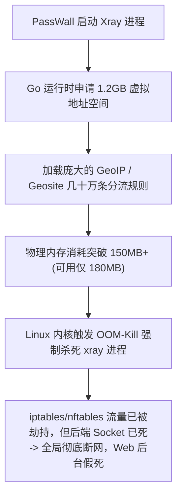

# 案例 27：软路由 PassWall 内存爆仓 OOM 救活、VPS 假被封真断连排错与 ImmortalWrt 出海部署实录

> **记录路由器（AX3000T/256MB）运行 PassWall 遭遇 Linux 内核 OOM-Kill 崩溃秒级救活与 GOMEMLIMIT 调优、VPS 假性被墙排错与零成本救活、以及 ImmortalWrt 跨境出海选型实录。**

---

## 一、 真实踩坑背景：256MB 弱鸡路由器遭遇 OOM 瞬间瘫痪

在尝试将网络节点与出海住宅代理下沉至家庭或办公室路由器时，用户遇到了极其崩溃的现象：
* **硬件环境**：小米路由器 AX3000T v2（高通 IPQ50xx 平台，标称内存 256MB，系统可用仅约 180MB），刷入 iStoreOS 固件；
* **突发现象**：在 PassWall 中配置好节点并点击启动后，**整台路由器的网络瞬间全部中断，网页后台（LuCI）卡死彻底打不开**，手机和电脑全部断网！
* **终端核心报错**：
  ```text
  Out of memory: Killed process 7597 (xray) total-vm:1293136kB, anon-rss:58432kB, file-rss:0kB, shmem-rss:0kB
  oom-kill: constraint=CONSTRAINT_NONE, nodemask=(null), task=xray, pid=7597, uid=0
  ```



---

## 二、 路由器紧急救活与“防爆内存”调优指南

### 1. 秒级恢复网络与后台命令（在 SSH 终端执行）
当路由器陷入死锁时，无需拔电源捅菊花重置，执行以下两条指令，路由器网页与网络即可秒级满血复活：
```bash
/etc/init.d/passwall stop
/etc/init.d/firewall restart
```

### 2. 注入 Go 运行时内存限制（核心硬核调优）
由于 Xray 属于 Go 语言编译程序，默认垃圾回收机制（GC）不会积极释放内存。通过向 procd 守护脚本注入 `GOMEMLIMIT=60MiB`，强制其内存峰值压在 60MB 内：
```bash
# 自动注入 GOMEMLIMIT 环境变量并重载
sed -i '/procd_set_param command/i \	procd_set_param env GOMEMLIMIT=60MiB' /etc/init.d/passwall
/etc/init.d/passwall restart
```

### 3. PassWall 网页后台防爆设置
1. **分流模式切勿选择“中国列表以外”**：该模式会加载数十万条 IP 规则，瞬间撑爆内存。务必改选 **“GFW 列表模式”**（仅占用约 10MB 内存）；
2. **规则自动更新关闭**：关闭 Geosite 与 GeoIP 的每日自动下载更新；
3. **停用冗余无用组件**：
   ```bash
   # 停用与代理无关的后台组件，节省 20~30MB 宝贵 RAM
   /etc/init.d/nfc stop && /etc/init.d/nfc disable 2>/dev/null || true
   /etc/init.d/microsocks stop && /etc/init.d/microsocks disable 2>/dev/null || true
   /etc/init.d/ubihealthd stop && /etc/init.d/ubihealthd disable 2>/dev/null || true
   ```

### 4. 终极架构启示：算力上移至 VPS 容器
**严禁让 256MB 的家用弱路由硬跑住宅链式代理与复杂分流！**
最稳妥的架构是将前置中转、住宅落地代理完全部署在配置充沛的 **VPS 容器（如 4GB 宿主机下的容器 `c2`）**；路由器端仅保留一条最简单的 VLESS 直连，内存常驻不到 15MB，永远告别断网。

---

## 三、 排错案例：VPS“被墙”假警报与零成本救活实录

在另一段长篇排错对话中，用户发现搬瓦工（BandwagonHost）VPS 的 SSH 忽然连接超时，节点全红，一度怀疑 IP 遭到了防火墙（GFW）阻断，正准备花费 8 美元向官方工单申请更换 IP。

### 1. 为什么说“Ping 通就绝对没被封”？
* **GFW 封锁 IP 的底层机制**：国家级防火墙封锁公网 IP 采用的是**BGP 路由黑洞宣告（Null-Routing）**，所有发往该 IP 的 TCP、UDP 以及 **ICMP 数据包**会在骨干网直接被丢弃；
* **铁证检验**：
  ```bash
  # 在本地执行 ping 测试
  ping 198.51.100.150
  ```
  如果本地终端能够持续收到 `64 bytes from ... icmp_seq=1 ttl=52 time=45.2 ms`，丢包率为 0%，**100% 证明该公网 IP 绝对没有被阻断**！花钱换 IP 纯属浪费资金。

### 2. 真正根因与救援步骤
既然 IP 畅通，连不上的原因通常只有两个：**单一 22 端口被敏感扫描阻断**，或者 **SSHD 服务因误操作崩溃退出**。

**零成本 3 分钟救治 SOP**：
1. 打开云厂商后台的 **Web Shell / VNC 救援控制台**（如搬瓦工 KiWiVM Basic Shell）；
2. 查看 SSH 端口监听状态：
   ```bash
   ss -tulpn | grep ssh
   ```
3. 修改 SSH 为高位备用端口（例如 `2222`）：
   ```bash
   sed -i 's/^#*Port 22/Port 2222/' /etc/ssh/sshd_config
   systemctl restart sshd
   ```
4. 防火墙放行新端口：
   ```bash
   ufw allow 2222/tcp || iptables -I INPUT -p tcp --dport 2222 -j ACCEPT
   ```
5. 本地使用 `ssh -p 2222 root@198.51.100.150` 瞬间秒连！无需花费分毫。

---

## 四、 固件选型：OpenWrt vs ImmortalWrt vs iStoreOS

针对跨境出海与 TikTok 运营，各主流软路由固件表现对比如下：

| 固件体系 | 核心定位与优势 | 劣势与踩坑点 | 跨境出海推荐度 |
| :--- | :--- | :--- | :--- |
| **ImmortalWrt** | 专为华人社区定制的分支，原生集成 PassWall、OpenClash 驱动，网络栈内核大幅优化 | 界面偏极客，需一定 OpenWrt 基础 | ⭐⭐⭐⭐⭐ **首选**：驱动全，防环境穿帮首选 |
| **iStoreOS** | 轻 NAS + 路由二合一，拥有小白友好的应用商店 | 基于旧版 22.03 SDK，直接搜不出科学插件，需手动上传 `.run` 包 | ⭐⭐⭐⭐ 适合轻度家用 + 轻 NAS 兼顾 |
| **原版 OpenWrt** | 国际纯净开源，遵循极简社区哲学 | 默认不带任何代理插件，国内软件源经常下载失败，安装繁琐 | ⭐⭐ 适合折腾底层，不推荐生产使用 |

---

## 🔗 权威官方信源与工具链接

* **ImmortalWrt 官方固件下载**：[https://immortalwrt.org/](https://immortalwrt.org/)
* **iStoreOS 官方系统发布页**：[https://www.istoreos.com/](https://www.istoreos.com/)
* **PassWall 官方开源核心仓库**：[https://github.com/xiaorouji/openwrt-passwall](https://github.com/xiaorouji/openwrt-passwall)
* **IP 纯净度检测平台 Scamalytics**：[https://scamalytics.com/](https://scamalytics.com/)
* **IP 类型与运营商属性查询 IPinfo**：[https://ipinfo.io/](https://ipinfo.io/)
