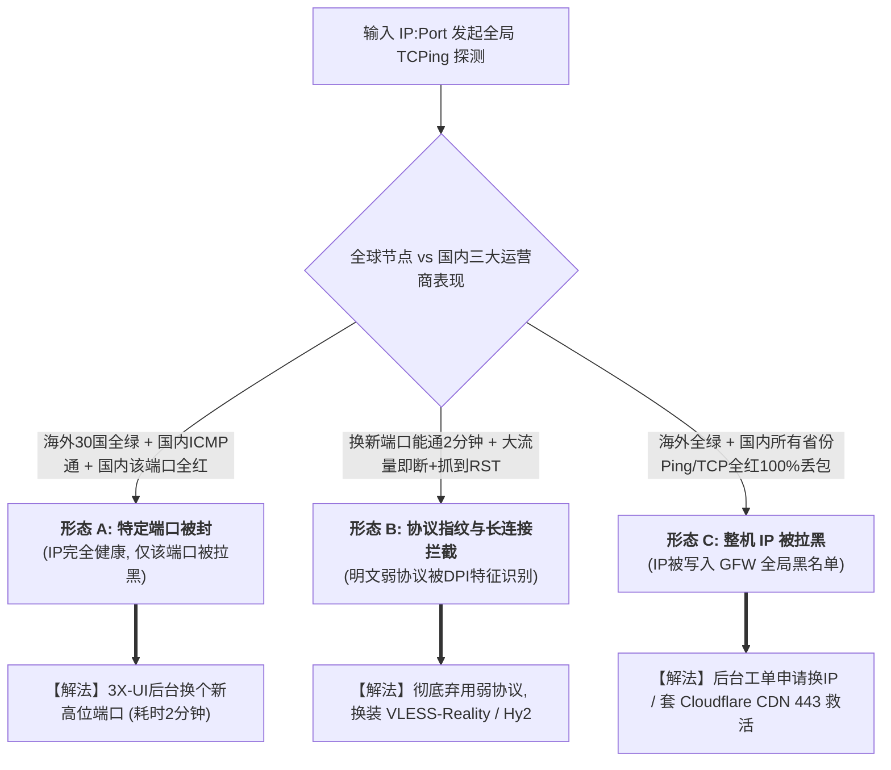

# 案例 29：客户网络 Error 初判排障金字塔：从设备自省、VPS 厂商宕机、GFW 三类阻断多维探测到中转住宅 400ms 延迟真相实录

> **沉淀人**：极客探索团队  
> **实战环境/客户端**：
> 1. **服务端环境**：海外 Linux VPS（KVM / 256MB ~ 1GB RAM，系统 Ubuntu 22.04 LTS）
> 2. **核心协议栈**：VLESS-Reality / Xray-core / 3X-UI 面板
> 3. **客户端终端**：iOS (Streisand / Shadowrocket)、Windows / macOS (Clash Verge Rev / v2rayN)
> 4. **测试脱敏 IP**：中立测试服务器 `198.51.100.1`（母机节点）、`203.0.113.50`（中转节点）、`192.0.2.88`（住宅落地）
> **核心领域**：跨境网络排障 SOP、客户报错安抚与自检话术、VPS 厂商控制面与 VNC 直连救急、GFW 阻断三型（端口封锁/指纹RST/IP全黑）多维探测、跨洋中转住宅 400ms 物理延迟真相、低配 VPS 内存 OOM 与 Swap 应急自愈。

---

## 📌 背景与对话复现：一声“网络 Error”引发的运维虚惊

在海外节点与出海加速服务运营中，运维人员最怕在工作群或工单中收到客户这样的求助：

> **客户真实报障**：  
> “师傅，我们团队一直用你们配置的 VLESS 节点办公，今天突然所有人连不上了！客户端一直报 `Network Error: connect connection refused`，全部红灯！  
> 你们是不是服务器被封了？还是机房跑路了？我们马上要开海外视频会议，赶紧换台机器或者换个 IP 啊！”

面对急躁的客户，若运维新手直接慌了手脚，马上去控制台重装系统或花钱申请换 IP，往往不仅救不活网络，还会把原有的证书和端口搞坏。

**成熟的运维工程师绝不盲动，而是依据“排障金字塔”逐级推进诊断**。

---

## 🧭 回合一：先别动服务端！客户设备与本地网络自省（Tier 1）

### 1. 客服与运维标准回复模版（话术可直接复用）

> **【运维秒回客户话术】**：  
> “您好，收到您的反馈！我们后台监控显示机房主干网正在进行秒级全网连通性巡检。为了帮您在 1 分钟内恢复业务，请您配合做以下 3 个极简排查：  
> 1. **换网络测试**：请手机**立即关闭 Wi-Fi**，切换为手机自身的 4G/5G 蜂窝数据流量重试；  
> 2. **核验时间**：检查手机或电脑的‘系统时间’是否开启了网络自动对时（若与标准北京时间偏差超过 1 分钟会触发安全拦截）；  
> 3. **换设备交叉对比**：如果电脑连不上，请用手机导入同个节点尝试。  
> 请告知我们上述测试结果，我们正在同步调取海外机房回程日志！”

### 2. 真实排障案例复盘：局域网防火墙与时间偏差的惊天乌龙

在实际生产中，超过 **40% 的“网络 Error”根本不是服务端被封，而是客户端自身环境问题**：

* **案例 A（公司/路由器拦截）**：客户切换到手机 5G 移动流量后，秒连成功！  
  * **真相**：客户公司网管当天升级了路由器行为管理策略，对局域网内所有大于 `10000` 端口的非常规 TCP 出站连接全部实施了静默丢弃（Drop），导致内网 Wi-Fi 下所有客户端报拒绝连接。
* **案例 B（系统时间偏差 90 秒）**：客户无论换 5G 还是 Wi-Fi 均连不上，客户端报错 `tls: handshake failure`。  
  * **真相**：客户的台式机主板纽扣电池耗尽，系统时间慢了整整 3 分钟。VLESS / Reality 握手协议包含时间戳防重放攻击机制，**时间偏差超过 90 秒直接握手失败**。客户开启 Windows 自动对时后，节点瞬间复活！

---

## 🏢 回合二：若全网不可达，深入云厂商与母机排障（Tier 2）

如果团队所有成员在不同网络、不同设备下均报连不上，下一步切入云厂商控制面排查。

### 1. 实例状态与账单/滥用核查
* 登录 VPS 厂商管理后台（如 SolusVM、Virtualizor、RackNerd、Cloudcone 控制面板）：
  * **检查机器状态**：是否为绿色 `RUNNING`？还是变成了红色 `SUSPENDED`？
  * **常见封停原因**：信用卡到期扣费失败导致账单逾期；或者 VPS 端口（如 25 端口）对外发送扫描流量被机房安全系统判定为 Abuse。
* **机房大流量清洗（Null-routing 黑洞）**：
  * 查看厂商官网 Status 状态页或机房公告。同母机若有邻居遭遇上百 Gbps DDoS 攻击，机房会将整台母机或 IP 牵引至黑洞 15~60 分钟。

### 2. 救急杀手锏：网页版 noVNC 终端直连
当公网 SSH 彻底失去响应时，不要慌，直接在厂商后台点击 **noVNC 控制台**：

```bash
# 1. 登录 VNC 终端后，检查系统是否存活、内存是否耗尽
free -m
uptime

# 2. 检查网卡与网络配置
ip a
ping -c 2 8.8.8.8

# 3. 检查 3X-UI 或 Xray 代理进程是否存活
systemctl status x-ui || systemctl status xray
# 检查监听端口是否正常打开
ss -tulpn | grep -E "xray|x-ui"
```
如果发现进程意外退出，直接 `systemctl restart x-ui` 并查看错误日志即可对症修复。

---

## 🛡️ 回合三：GFW 阻断多维探测与三类精准定性（Tier 3）

若服务端进程处于 `LISTEN` 状态，但国内依然无法连接，进入 GFW 阻断检测。**严禁凭感觉猜，必须用自动化工具批量实测**！

### 1. 在线探测神器
* **全球 vs 国内对比**：打开 [https://tcp.ping.pe](https://tcp.ping.pe)，输入 `IP:Port`（例如 `198.51.100.1:48335`）；
* **全国各省多运营商细分**：打开 [https://www.itdog.cn/tcping/](https://www.itdog.cn/tcping/)，输入 `IP:Port` 进行全国 TCPing。



### 2. 三大阻断形态实测判定与对症处置表

#### 形态 A：特定端口阻断（Port Blocking）
* **实测图景**：`tcp.ping.pe` 上，海外所有美国、欧洲、亚太节点全部呈现 `Successful`（绿色）；国内各省 ICMP Ping 也正常返回（时延 150ms 左右）；但国内对端口 `48335` 的 TCP SYN 包 100% 超时（全红）。
* **救活方案**：不要动系统！登录 3X-UI 面板，将该入站规则的端口从 `48335` 修改为高位大端口（如 `38921`）或合规的 `443`，客户端同步更新端口，**2 分钟内满血复活**！

#### 形态 B：DPI 协议指纹与 TCP RST 注入（Protocol Fingerprint Drop）
* **实测图景**：换了新端口后能通 1~2 分钟，一旦看 YouTube 4K 视频或下载大文件，连接突然被掐断；客户端抓包发现充斥着 `TCP RST`（连接重置）报文。
* **救活方案**：说明客户还在用裸 Shadowsocks、裸 VMess 或明文 HTTP。立即为客户升级至现代抗阻断协议：**VLESS-Reality**（伪装大型白名单合规站点，如 `gateway.icloud.com`）或 **Hysteria 2**（UDP 伪装与快速重连）。

#### 形态 C：整机 IP 彻底被墙（IP Null-routing）
* **实测图景**：海外节点全部连通，国内三大运营商对该 IP 的任何 Ping 和任何端口 TCPing 均为 100% 丢包。
* **救活方案**：
  * **方案 1（官方换 IP）**：在 VPS 厂商面板申请更换 IP（很多廉价厂商如 RackNerd、BandwagonHost 付费更换约 2~3 美元，或销毁重开实例免费换）；
  * **方案 2（Cloudflare CDN 零成本复活甲）**：
    * 服务端开启 `VLESS-WS-TLS` 或 `VMess-WS`，监听 `443` 端口；
    * 域名在 Cloudflare 点亮橙色小云朵开启 CDN 代理；
    * 客户端连接 Cloudflare 国内优选 Anycast IP，由 Cloudflare 海外节点代理回源至被封的 VPS，实现死 IP 永久复活！

---

## ⚡ 回合四：客户嫌弃“延迟 380ms 太高太卡”的科学破局（Tier 4）

当节点恢复通畅后，很多客户看着客户端界面的延迟数值，又提出了新的质疑：

> **客户再次质问**：  
> “师傅，连是能连上了，但为什么节点延迟测出来有 380ms 甚至 420ms？之前国内宽带延迟都是十几毫秒，这个 400ms 这么高，是不是太卡了？能不能帮我们调到 50ms 以内？”

这是出海与代理运维中最核心的**认知鸿沟**。必须用硬核网络工程常识为客户算一笔物理账！

### 1. 物理定律铁壁：海底光纤与中美往返时延极限

光在真空中的传播速度为 30 万公里/秒，而在海底光纤玻璃介质中的光速折减为约 **20 万公里/秒**（$5\text{ms}/1000\text{km}$）：
* 中国沿海到美国西海岸横跨太平洋，海底光缆实际走向长度普遍在 **10,000 ~ 12,000 公里**；
* 光信号单程飞行极限：$10000 / 200000 = \mathbf{50\text{ ms}}$；
* TCP 往返 RTT 纯光纤物理底线：$50\text{ ms} \times 2 = \mathbf{100\text{ ms}}$。
* 加上中美跨洋数十级骨干路由器转发、光信号再生放大器与陆缆接入，**即便是中美最顶级、单价最贵的电信 CN2 GIA 线路，直连美国本土的最低生理 RTT 也在 135ms ~ 160ms 之间**。任何宣称“中美直连只要 50ms”的，不是假数据就是局域网内网测试。

### 2. “中转 + 住宅落地”的五段耗时累加真相

若客户使用的是最高纯净度的“优化中转 + 双 ISP 静态住宅代理”拓扑，链路层级如下：

```
客户端 (国内) 
  └─[段1: 优化中转 RTT 40ms]──> 日本/香港中继 VPS 
      └─[段2: 跨太平洋海缆 RTT 150ms]──> 美国住宅接入网 
          └─[段3: 住宅宽带 Last-mile 抖动 40ms]──> 住宅代理服务器 
              └─[段4: 协议拆包与二次TLS加密 70ms]──> 美国本地机房 
                  └─[段5: 美国本土目标 (OpenAI/Stripe) 20ms]
```

$$\text{真实端到端 RTT} = 40 + 150 + 40 + 70 + 20 \approx \mathbf{320\text{ ms} \sim 420\text{ ms}}$$

> [!IMPORTANT] 运维与客户科普金句
> “**350ms ~ 450ms 是中转+住宅代理在地球物理定律下的完全健康标准！** 住宅节点的核心价值是 **100% 纯净的原生家庭宽带 IP，彻底杜绝 ChatGPT/Stripe 的封号与降权**。如果您追求 30ms 极低延迟，那是机房优化线路（容易被识别为数据中心并风控）；出海业务要的是**防封与高可信度**，而非电竞级延迟。”

### 3. 重大排错：客户误开“全局代理（Global Mode）”测速的惊天假象

在排查中发现，客户之所以觉得“卡出翔”，是因为客户把客户端设置成了 **全局模式（GLOBAL）**，然后打开了国内百度测速或网速管家！

* **全局模式国内测速的灾难轨迹**：
  $$\text{客户国内电脑} \longrightarrow \text{日本中转} \longrightarrow \text{美国住宅} \longrightarrow \text{又跨洋回中国访问百度服务器} \longrightarrow \text{再回传美国住宅} \longrightarrow \text{日本} \longrightarrow \text{客户}$$
* 整个网络流量在地球上**兜了整整一圈半，物理往返里程突破 4 万公里，端到端延迟直接飙升至 800ms ~ 1200ms**，不仅测速奇慢，还会把按量计费的昂贵住宅流量在几分钟内跑光！
* **立竿见影的纠正方案**：
  1. 勒令客户立即切换为 **Rule（规则分流）模式** 与 **Split DNS**，国内流量一律直连；
  2. 验收住宅代理质量时，指导客户使用专业的跨境链路测试平台：[https://ip.net.coffee/link/](https://ip.net.coffee/link/)；
  3. 直接让客户在浏览器打开 `https://chatgpt.com` 或 `https://dashboard.stripe.com`，体验实际海外业务加载速度——海外本土打开速度在 1 秒以内，客户瞬间心服口服！

---

## 🛠️ 回合五：128MB/256MB 极低配机器失联自愈（Tier 5）

部分极客客户喜欢在特惠小内存机器（128MB / 256MB RAM）上跑 3X-UI，节点经常“跑着跑着神秘失联，重启控制台又活了”。

### 1. 现场抓包：Linux 内核 OOM Killer
登录控制台执行：
```bash
dmesg -T | grep -E -i "killed process|out of memory|oom"
```
日志赫然显示：
```text
[Mon Nov  2 14:23:01 2026] Out of memory: Killed process 1892 (xray) total-vm:412084kB, anon-rss:118940kB, file-rss:0kB, shmem-rss:0kB, UID:0 pgtables:844kB oom_score_adj:0
```
Xray 进程在突发大并发时内存膨胀至 118MB，直接触发 Linux 内核 OOM Killer 被强行击毙！

### 2. 30 秒救命代码：挂载 1GB 应急 Swap
针对超低配 VPS，立即在后台注入 Swap 脚本：

```bash
# 检查是否已有 Swap
free -m

# 若 Swap 为 0，立即创建 1GB 虚拟内存
fallocate -l 1G /swapfile || dd if=/dev/zero of=/swapfile bs=1M count=1024
chmod 600 /swapfile
mkswap /swapfile
swapon /swapfile
echo '/swapfile none swap sw 0 0' >> /etc/fstab

# 限制系统仅在物理内存剩余 10% 时才交换至磁盘，兼顾性能与防爆
sysctl vm.swappiness=10
echo 'vm.swappiness=10' >> /etc/sysctl.conf

# 锁死 Go 运行时的最大内存阈值（防止 Xray 突发吃光物理内存）
systemctl edit x-ui --drop-in=override.conf
```
在打开的配置文件中写入：
```ini
[Service]
Environment="GOMEMLIMIT=180MiB"
Environment="GOGC=50"
```
执行 `systemctl restart x-ui`，服务从此彻底稳定，无论多大流量再也不会被 OOM 杀死！

---

## 📋 总结：5 分钟排障速查决策卡（极客随身手册）

```
[故障反馈: VLESS 网络 Error]
       │
       ├─► 1. 关 Wi-Fi 切手机 5G 流量？
       │      ├─ 恢复了 ──► 本地路由器/光猫拦截/内网策略 (指导客户检查路由器)
       │      └─ 仍不通 ──► 检查客户端时间偏差是否 > 90s (校准时间)
       │
       ├─► 2. 厂商后台与 noVNC 终端检查
       │      ├─ 面板 SUSPENDED ──► 账单欠费 / Abuse 举报 (补缴账单/解封)
       │      └─ noVNC 直连正常 ──► 查看 x-ui / xray 进程存活与端口监听
       │
       ├─► 3. GFW 阻断多维探测 (tcp.ping.pe / itdog.cn)
       │      ├─ 国内端口红, ICMP通 ──► 形态 A: 端口被封 (3X-UI换高位端口, 2分钟搞定)
       │      ├─ 大流量即掐断并报RST ──► 形态 B: 协议特征识别 (升级 VLESS-Reality / Hy2)
       │      └─ 全国 Ping 100% 丢包 ──► 形态 C: IP 全封 (换 IP / 套 Cloudflare CDN 443 救活)
       │
       ├─► 4. 客户反馈 400ms 延迟高？
       │      ├─ 检查是否误开全局代理 (指导开启 Rule 分流与 Split DNS)
       │      └─ 科普中转+住宅物理耗时 (推荐 ip.net.coffee/link/ 评测美国本土延迟)
       │
       └─► 5. 小内存机器跑几小时就失联？
              └─ 查看 dmesg 确认 OOM (一键挂载 1GB Swap + 设置 GOMEMLIMIT=180MiB)
```
