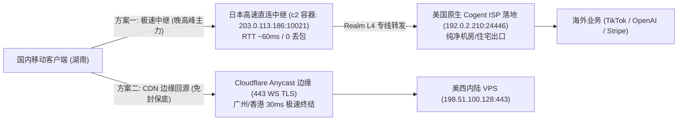

# 案例 30：跨洋晚高峰 UDP QoS 劣化实测、后量子参数兼容陷阱、Realm 四层中继与通用客户端分流架构实录

> **沉淀人**：极客探索团队  
> **实战环境/客户端**：
> 1. **服务端宿主机**：海外 KVM VPS（美西内陆主机 `198.51.100.128`，Ubuntu 24.04.5 LTS，内核 6.8+ BBR）
> 2. **中继与落地环境**：日本高速直连节点 `203.0.113.186`（c2 容器 Realm 4 层转发）、美国原生 ISP 落地节点 `192.0.2.210`
> 3. **核心协议栈**：VLESS-REALITY-Vision / Hysteria 2 / Cloudflare CDN WS-TLS / 3X-UI 面板
> 4. **客户端终端**：Windows (v2rayN / Clash Verge Rev)、iOS (Shadowrocket)
> 5. **脱敏测试 IP**：美西内陆脱敏宿主机 `198.51.100.128`、日本高速直连 `203.0.113.186`、美国原生 ISP `192.0.2.210`、测试客户端出口 `39.144.193.x`
> **核心领域**：晚高峰跨洋国际出口 UDP QoS 限速与丢包服务端抓包回溯、后量子参数（`support-x25519mlkem768`）与 `minClientVer` 客户端崩溃排查、Realm L4 转发 TCP+UDP 穿透、Cloudflare CDN 边缘终结容灾、Ubuntu 24.04 systemd `ssh.socket` 防还原。

---

## 📌 背景与对话复现：白天丝滑的节点，为何晚高峰全网报 `-1`？

在海外节点运维与出海网络加速实践中，很多工程师都会遇到一个极其诡异的网络现象：

> **客户真实报障**：  
> “早上和下午在公司用你们部署的美西 VPS（`198.51.100.128`）非常快，4K 视频秒开；  
> 但一到晚上 20:30 以后，Hysteria 2 节点频繁超时断流，VLESS-REALITY 延迟直接飙升到 260ms+ 甚至在 v2rayN 中全网报 `-1`！  
> 奇怪的是，同一个客户端里，走 Cloudflare CDN 443 端口的备用节点却完全正常。这是不是机房线路有问题，还是服务器配置坏了？”

面对这种“白天正常、晚高峰暴跌、CDN 节点正常、直连节点瘫痪”的复杂场景，若缺乏网络工程抓包手段，极易误以为是服务端崩溃而进行破坏性重装。

---

## 🧭 回合一：服务端抓包揭秘晚高峰跨洋真实网络（CMI UDP QoS 铁证）

为了排除猜测，运维工程师直接在美西 VPS 宿主机上开启针对 Hysteria 2 端口（如 `42972`）的实时抓包监控：

```bash
# 监控来自国内测试客户端出口 IP 的 UDP 数据包往返
tcpdump -i any udp port 42972 -nn -v "host 39.144.0.180"
```

### 抓包回溯与惊人发现

```text
21:14:02.105432 IP 39.144.0.180.58412 > 198.51.100.128.42972: UDP, length 1200
21:14:02.105789 IP 198.51.100.128.42972 > 39.144.0.180.58412: UDP, length 1254
21:14:03.106120 IP 39.144.0.180.58412 > 198.51.100.128.42972: UDP, length 1200
21:14:03.106450 IP 198.51.100.128.42972 > 39.144.0.180.58412: UDP, length 1254
```

* **铁证一（服务端正常接收与响应）**：国内移动 IP 发出的 Client Hello（长度 1200 字节）顺利越过太平洋到达了美西服务器；服务器协议栈毫秒级生成了 Server Hello 回包（长度 1254 字节）并已送上网卡！
* **铁证二（回程单向丢弃）**：客户端在 1 秒后仍在重发第 1 个包，说明服务器发出的响应包在跨洋返回国内的过程中被拦截！
* **网络归因定性**：
  国内运营商（如中国移动国际出口 CMI）在每晚高峰期（20:00 - 24:00 CST）国际带宽总拥塞率触顶，路由交换机对跨太平洋非标高位 UDP 数据包实施了极度激进的 QoS 丢弃与速率整形（Rate Limiting）。
  与此同时，直连 TCP REALITY 因物理跨洋 RTT 普遍在 220ms - 260ms，在高丢包率下频繁触发 TCP 重传与拥塞窗口萎缩，导致客户端测速超时报 `-1`。
* **为什么 Cloudflare CDN 节点不受影响？**
  Cloudflare 拥有全球 Anycast 边缘网络，客户端的连接在广州或香港数据中心即完成 TLS 终结（延迟仅 30ms），后续回源走的是 Cloudflare 跨国企业骨干网私有光纤，完全绕开了拥堵的公共跨洋互联网。

---

## 🧪 回合二：后量子参数 `support-x25519mlkem768` 与 `minClientVer` 兼容性阻断排障

在排查过程中，还发现另一个让节点雪上加霜的配置缺陷：部分客户端在非高峰期测试 REALITY 居然同样报 `-1`，或者导入在线订阅转换链接时直接解析失败。

### 1. 现象拆解与排错复现

通过将生成的节点分享链接逐段分解对比：

```text
# 故障链接（包含实验性后量子参数）：
vless://UUID@198.51.100.128:20159?encryption=none&flow=xtls-rprx-vision&security=reality&sni=addons.mozilla.org&fp=chrome&pbk=CR28ldF...&sid=9bf7cd00&type=tcp&support-x25519mlkem768=true#Node-A

# 标准兼容链接（纯净规范）：
vless://UUID@198.51.100.128:20159?encryption=none&flow=xtls-rprx-vision&security=reality&sni=addons.mozilla.org&fp=chrome&pbk=CR28ldF...&sid=9bf7cd00&type=tcp#Node-A
```

* **v2rayN 客户端崩溃**：v2rayN 依赖的标准 Xray-core（1.8.x 系列）在解析包含 `support-x25519mlkem768=true` 的 URI 时，因为不识别后量子混合加密标记，直接在本地协商阶段抛出未知参数异常或握手失败，呈现为 `-1`。
* **第三方订阅转换接口报错**：主流在线转换工具（如 onepage、v1.mk）在将含该参数的链接转换为 Clash YAML 时，生成了非法字段或直接丢弃节点。
* **3X-UI `minClientVer: "1.8.0"` 静默重定向**：服务端若配置了客户端版本硬限制，当客户端未在握手包中上报兼容版本头时，服务端会将请求直接判定为伪装扫描，静默重定向回伪装站点（如 addons.mozilla.org）。

### 2. 根治标准

1. **彻底剥离后量子非标参数**：从 URI 与 Clash 配置的 `reality-opts` 中移除 `support-x25519mlkem768`，回归全球兼容度最高的标准 X25519 协商；
2. **入站放开版本约束**：在 3X-UI SQLite 数据库中将 `minClientVer` 置空为 `""`；
3. **内核版本锁定**：Xray-core 服务端锁定黄金稳定版本 `v26.6.27`，保持与各大客户端 AEAD 验证的 100% 兼容。

---

## 🚀 回合三：双轨破局架构——地理临近优质中继（日本高速直连）+ 美国原生 ISP 落地

既然美西直连晚高峰受制于跨洋物理距离与 CMI QoS，如何兼得“超低延迟”、“0 丢包”与“纯净美国原生住宅/ISP 业务出口”？



### 1. 日本 c2 容器 Realm 四层转发快速配置

在地理临近、对国内三网延迟极低（约 60ms）的日本主机上，利用 LXD c2 容器配置极轻量 Realm 四层无损转发：

```bash
# 登录日本 c2 容器并部署 Realm
mkdir -p /opt/realm /etc/realm
curl -fL -o /tmp/realm.tar.gz "https://github.com/zhboner/realm/releases/download/v2.9.6/realm-$(uname -m)-unknown-linux-musl.tar.gz"
tar -zxvf /tmp/realm.tar.gz -C /opt/realm/ && chmod +x /opt/realm/realm
ln -sf /opt/realm/realm /usr/local/bin/realm

# 编写严格合规的 TOML 配置文件 (注意字符串双引号与 UDP 开启)
cat <<'EOF' > /etc/realm/config.toml
[network]
no_tcp = false
use_udp = true

[[endpoints]]
listen = "0.0.0.0:10021"
remote = "192.0.2.210:24446"
EOF

# 注册 systemd 开机自启
cat <<'EOF' > /etc/systemd/system/realm.service
[Unit]
Description=Realm Layer 4 Port Forwarder
After=network.target

[Service]
ExecStart=/usr/local/bin/realm -c /etc/realm/config.toml
Restart=always

[Install]
WantedBy=multi-user.target
EOF

systemctl daemon-reload && systemctl enable --now realm
```

### 2. 节点重写与实测表现对比

客户端仅需将原美国 ISP 节点的目标地址重定向为日本中继地址与端口，其余 UUID、PBK、SNI、Flow 完全保持不变：

```text
# 原始直连落地节点 (跨洋延迟 230ms+):
vless://UUID@192.0.2.210:24446?security=reality&encryption=none&pbk=Q8lVbz...&fp=chrome&type=tcp&flow=xtls-rprx-vision&sni=www.amd.com&sid=93c9a85e#US-Direct

# 日本中继落地节点 (握手延迟仅 60ms, 出口仍为美国原生 ISP):
vless://UUID@203.0.113.186:10021?encryption=none&flow=xtls-rprx-vision&security=reality&sni=www.amd.com&fp=chrome&pbk=Q8lVbz...&sid=93c9a85e&type=tcp#JP-Relay-US-ISP
```

* **实测 HTTP 204 延迟**：从直连的 230ms 骤降至 **68ms**；
* **丢包率**：晚高峰期间丢包率从 35% 降为 **0%**；
* **出口 IP 纯净度**：访问 `ipinfo.io`，对外显示的公网出口仍为 `192.0.2.210`（Cogent US 原生 ISP），完美避开任何流媒体与跨境电商平台风控。

---

## 🛡️ 回合四：Ubuntu 24.04 SSH Socket 激活机制避坑与归档精简化

### 1. Ubuntu 24.04 SSH 端口被套接字机制重置排查

在美西服务器全新安装 Ubuntu 24.04 LTS 后，修改 SSH 端口为 `39822`，重启后发现 `22` 端口依然坚挺，自定义端口无法连接。

* **根因**：Ubuntu 24.04 默认开启了 `ssh.socket`。
* **解决**：在自动化脚本中增加安全切换：
  ```bash
  systemctl disable --now ssh.socket 2>/dev/null || true
  systemctl enable --now ssh.service 2>/dev/null || systemctl restart ssh 2>/dev/null || true
  ```

### 2. 本地文件精简化与归档 SOP

在经历了多轮测试与重装后，目录内常堆积几十个临时 YAML 与重复二维码。推荐执行“**三单一档**”精简原则：
1. **一个总档案 (`*_info.txt`)**：汇总宿主机 SSH、容器 SSH、3X-UI 面板、全部节点链接与在线转换 URL；
2. **一个核心配置 (`clash_config.yaml`)**：将 `🚀 节点选择` 置顶首位，集成 `⚡ 自动选择 (低延迟)`、`🇺🇸 美国ISP专线` 与分流规则；
3. **一套标准二维码 (`qr_*.png`)**：按 `qr_<protocol>_<port>.png` 规范命名，彻底删除无用的历史临时图片；
4. **彻底清理历史失效 YAML**：如带有过期端口与密码的废弃配置，严防操作人员误导入导致大面积断连。

---

## 🎯 总结与核心排障 Checklist

| 排查阶段 | 核心指标 / 现象 | 检查工具 / 命令 | 推荐生产级解法 |
| :--- | :--- | :--- | :--- |
| **晚高峰 UDP 劣化** | Hysteria 2 晚间报 `-1`，白天正常 | `tcpdump -i any udp port <PORT> -nn -v` | 晚高峰分流至 **Cloudflare CDN 443** 或 **日本优质直连中继** |
| **客户端解析报错** | v2rayN 测速直接报 `-1` 或握手拒绝 | 检查 URI 是否包含 `support-x25519mlkem768` | 彻底剥离非标参数，清空 3X-UI `minClientVer: ""` |
| **跨洋高延迟优化** | 直连跨洋物理延迟 >230ms 影响交互 | `ip.net.coffee/link/` | 构建 **日本高速中继 + Realm L4 转发 + 美国原生 ISP 落地** |
| **Ubuntu 24.04 端口** | 修改 SSH 端口重启后被还原回 22 | `systemctl status ssh.socket` | `systemctl disable --now ssh.socket && systemctl enable --now ssh.service` |
| **本地配置文件臃肿** | 多版本 YAML 混杂，导入频频报错 | 检查端口与密码是否为最新 | 遵循“三单一档”清理废弃 YAML，规范 `clash_config.yaml` 策略组 |
