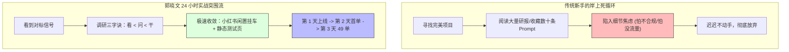
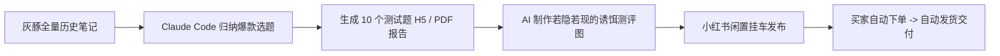

# 【实战复盘】郭晓文：1 天跑通小红书心理测试虚拟项目，免资质闲置挂车与免运维静态测试页

> **案例档案卡片**
>
> - **案例作者**：郭晓文（7 年生财老圈友，16 篇精华帖作者，江湖人称“最懂新手的男人”）  
> - **项目定位**：小红书轻量虚拟商品 · 【趣味心理/情商测试题】  
> - **战绩成果**：发现项目第 2 天出首单，第 3 天累计出单 **49 单**（到手利润约 180~200 元，仅 1 单退款）  
> - **核心标签**：`1天跑通` `看小于问小于干` `小红书个人买卖闲置` `免资质挂车` `Claude Code静态页` `先完成再完美` `万事用AI`  
> - **原文参考资料**：[生财有术精华实操长文 (ID: 55522542455512284)](https://scys.com/articleDetail/xq_topic/55522542455512284)  
> - **线下大会逐字稿**：[航海家线下大会分享逐字稿](https://articles.zsxq.com/id_r6w99jghw6d1.html)  
> - **关键洞察**：**“在岸上看，是学不会游泳的。没有在具体业务上实操，是学不会搞钱也学不会 AI 的。调研的最高境界不是到处问人看研报，而是直接下场‘干’。先完成，后完美；宁可粗糙地上线拿真实反馈，也绝不为了追求虚妄的确定性死在细节里。”**

---

## 一、 破除新手三大心魔：岸上学不会游泳

很多想要借助 AI 开启副业的新人，往往长期卡在以下三大困境中：
1. **手上没有业务场景**：不知道具体能拿 AI 干嘛，日常仅仅把 AI 当作聊天玩具，感受不到生产力价值；
2. **觉得搞钱门槛太高**：市面上看到的项目动辄要资质、要投流、要团队，望而生畏；
3. **过度追求确定性**：总想着把工具、流程、商业模式调研到 100% 完美才敢动手，结果迟迟发不出第一个产品、第一条笔记。

```text
认知的死结：总想找到一个“天花板极高、投入极低、反馈极快、毫无风险”的完美项目。
残酷的现实：完美项目根本不存在。所有赚钱的高手，都是从最不起眼的“粗糙练手项目”起步，边干边积累认知与资源。
```



---

## 二、 调研三字诀：看 < 问 < 干

很多人做项目调研，花一两个月看分析文章、到处找同行打听，最后往往得出“这项目不行”、“红利早过了”的消极结论。

郭晓文提出了极具穿透力的调研三字诀：

```text
看（权重 10%）：看文章、看研报、看朋友圈。信息是二手甚至三手的，容易被幸存者偏差误导。
问（权重 20%）：找同行问。同行往往有所保留，或者彼此认知模型不同，问出来的结论往往无法复制。
干（权重 70%）：直接下场干！自己花 1 天时间把链路粗糙跑一遍，发一条笔记，看平台推不推流、有没有人买。
```

> **干的真正目的不是立即赚大钱，而是以极低的成本完成最具穿透力的商业调研！**

---

## 三、 三个维度极速拆解项目 MVP

当看到小红书上有博主做“心理测试/情商测试”爆单时，郭晓文迅速从三个维度完成了最小可行性产品（MVP）的设计收敛：

### 3.1 维度一：产品形态（极轻量虚拟品）
- **为什么选心理测试？**
  - **交付成本为零**：无物理仓储、无快递物流、一次生成无限次复制；
  - **情绪价值驱动**：用户天然对“了解自己、人际关系、情感走向、职场情商”具备好奇心与宣泄诉求；
  - **退款率极低**：单价 3.9 元，只要结果有一定趣味性和结构感，用户极少为了几块钱申请售后。

### 3.2 维度二：流量入口（爆款图文对标）
- **工具与素材抓取**：
  - 使用灰豚数据等工具，全量下载对标博主的所有历史笔记数据（若无会员可在闲鱼按小时租用，或让 AI 编写轻量抓取脚本）；
  - 将笔记的标题、封面排版、正文文案喂给 Claude Code；
  - 让 AI 归纳出点赞、收藏最高的“第一梯队选题”，并挑出最容易引起用户互动的 10 个测试主题。

### 3.3 维度三：成交与变现路径（小红书个人买卖闲置）
很多新手以为在小红书卖货必须开通专业号、交几千元店铺保证金、甚至办个体工商户营业执照。这是巨大的认知盲区！

```text
小红书“个人买卖闲置”功能红利：
1. 零门槛开通：个人号即可直接发布闲置好物，无需营业执照；
2. 免交保证金：无需冻结数千元店铺押金；
3. 超低费率：交易手续费仅扣除微信支付渠道的 0.6%，几乎全额到手；
4. 自然流量扶持：平台对个人闲置交易有专门的推荐标签与买家信任度。
```

---

## 四、 Claude Code 实战：全自动化落地全流程

在整个落地过程中，郭晓文践行“万事用 AI”，把所有繁琐环节全部交给 Claude Code 协同完成。



### 4.1 10 分钟生成免运维前端测试页

无需购买云服务器与配置后端数据库，直接要求 Claude Code 编写一个单文件 HTML/JS 的静态交互测试页：
- 用户点击选择题目选项；
- 页面前端基于预设分值矩阵自动累加；
- 点击“生成报告”，前端即时渲染出图文并茂的分析结论；
- 将单文件托管于 GitHub Pages、Vercel 或直接导出为 PDF，通过网盘链接或客服消息自动秒发给买家。

### 4.2 制作若隐若现的“诱饵报告图”
为了让小红书笔记的点击率与种草效果拉满，郭晓文利用 AI 制作了一套视觉钩子：
- 封面突出测试痛点（如：“测测你在职场容易被谁拿捏？”、“情商自测：你是个容易内耗的人吗？”）；
- 中间页放前 3 道引人入胜的测试题；
- 最后一页用 AI 生成一张**带有半透明遮罩、若隐若现的详细深度报告图**，配上提示词：“点击下方链接，测测你的专属详细报告”，极大刺激了用户的探索欲与下单冲动。

### 4.3 文件系统自动化与数据回流闭环
- **文件规整**：让 Claude Code 自动归纳素材，图片统一存放在 `images/`，文案汇总在同一份 Markdown 文档中，保持工程干净整洁；
- **数据回流**：定期把小红书创作者中心的笔记曝光、点击率，结合后台实际出单数据喂给 AI，让 AI 分析哪类测试转化最高，动态指导下一周的选题方向。

---

## 五、 真实战绩与业务复盘

整个闭环从启动到出单耗时不到 48 小时：
- **第一天晚上**：完成选题、测试题生成与图片制作，发出第一条测试笔记；
- **第二天中午**：成功出了第一笔订单，验证了从“发帖 -> 挂车 -> 用户付费 -> 自动交付”的全链路；
- **第三天晚上**：周日单日成交 18 单；
- **第四天累计**：成交突破 **50 单**（除去 1 单退款，实际成交 49 单，净利润约 180~200 元）。

```text
业务数据洞察：
1. 转化率：略低于预期（单价低，公域直接购买需要极强的情绪冲动）；
2. 爆文率：高于预期（测试类话题自带用户互动与评论区晒图属性）；
3. 项目价值：极其适合作为普通人从 0 到 1 学习商业、建立 AI 落地体感的“黄金练手项目”。
```

---

## 六、 进阶思考：从练手项目到商业延伸

这个项目天花板不高、缺乏护城河，但它的最大价值在于帮助新手完成从“旁观者”到“实战操盘手”的跃迁。一旦跑通，可顺势向三大方向延伸：

1. **矩阵放大**：
   - 既然单篇笔记与测试题已实现全 AI 自动化生产，可使用多账号矩阵、建立上百个垂类测试专题，测算好投入产出比；
2. **高客单引流与后端变现**：
   - 心理测试具备极强的情绪与心理诉求，可作为低成本获客前端（前端 3.9 元筛选出高意向精准人群），后端导流至私域，销售心理咨询、职业规划、求职辅导等数千元的高客单服务；
3. **B 端交付服务商**：
   - 将跑通的“小红书自动化测品与交付流程”沉淀为方案，帮助线下门店、教育机构、心理咨询工作室搭建类似的内容获客与测评引流系统。

---

## 七、 核心收获与自检清单

- [x] **建立“干中学”思维**：调研三字诀“看 < 问 < 干”，用最小成本跑通闭环获取一手反馈；
- [x] **利用平台免资质红利**：小红书个人买卖闲置功能，免营业执照、免保证金、扣点仅 0.6%；
- [x] **坚持“先完成，后完美”**：拒绝过度工程化，静态 H5 / PDF 快速交付；
- [x] **万事用 AI 探索边界**：把工作与副业中的每个环节尝试丢给 Claude Code，在实践中摸清人机协作边界。
