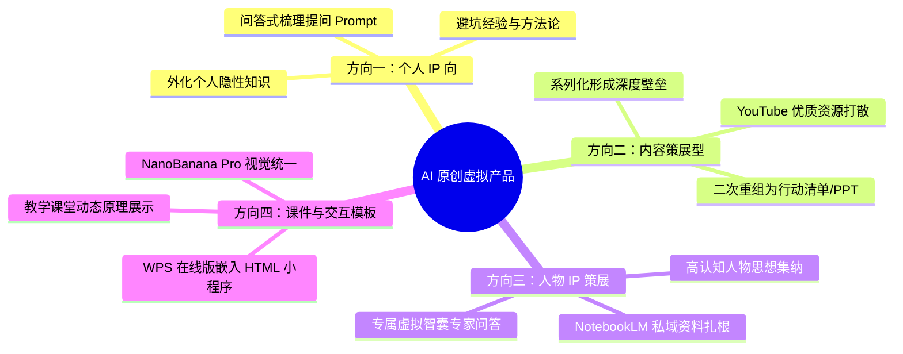

# 【深度拆解】Luke：1.2万字全景梳理 AI 原创小红书虚拟产品四大方向与 NotebookLM/NanoBanana 实战

> **案例档案卡片**
>
> - **案例作者**：Luke（生财航海家）  
> - **核心成果**：耗时一个月打造的 1.2w 字实操长文，系统构建通过 AI 原创小红书虚拟产品的方法论与工具链闭环  
> - **核心标签**：`AI原创虚拟产品` `Gemini 3.0 Pro` `NanoBanana Pro` `NotebookLM` `WPS在线版交互` `Few-shot标题仿写` `One-shot正文框架`  
> - **原文参考资料**：[飞书知识库 1.2w 字完整版](https://my.feishu.cn/wiki/TAsQwq4h3iz0rWkyMWycpNgRnff) 与 [生财有术精华实操长文 (ID: 82811824524821452)](https://scys.com/articleDetail/xq_topic/82811824524821452)  
> - **关键洞察**：**“单纯搬运在存量竞争时代已经彻底失效，你卖 69.9，别人卖 39.9，最终一路内卷到 9.9 毫无利润。AI 时代虚拟产品的胜负手是‘原创性、微 IP 化与结构化策展’。AI 不是一键直出的造纸机，而是干苦力的超级实习生；人机沟通本质是‘打羽毛球’，通过多轮碰撞将粗糙信息萃取为高价值交付物。”**

---

## 一、 认知分水岭：单纯搬运已死，为何必须切入“AI 原创”？

在虚拟产品初期，很多人靠“全网搜集资料包、无脑打包搬运”赚到过快钱。但随着大模型普及与国内信息差收敛，纯搬运模式迅速沦为价格战绞肉机：
- **无核心壁垒**：同质化资源泛滥，别人可以极速盗版仿冒；
- **平台风控收紧**：直接搬运网盘资料极易遭遇小红书平台违规判定或版权投诉；
- **客户感知廉价**：买家花几块钱买回一堆上百 G 无序杂乱的网盘链接，打开即关，缺乏复购与好评。

```mermaid
flowchart LR
    subgraph 纯搬运模式 (死胡同)
        B1["网盘低质搬运"] --> B2["价格战: 69.9 -> 39.9 -> 9.9"]
        B2 --> B3["版权风控封号 + 零客资沉淀"]
        style B2 fill:#fbb,stroke:#333
    end

    subgraph AI 原创策展模式 (复利增长)
        O1["特定人群痛点"] --> O2["AI 赋能: 翻译/提炼/互动化/重构"]
        O2 --> O3["高溢价微 IP 虚拟产品 (39~199 元)"]
        O3 --> O4["用户高交付满意度 -> 私域后端转化"]
        style O3 fill:#dfd,stroke:#333
        style O4 fill:#bbf,stroke:#333
    end
```

借助 **Gemini 3.0 Pro、NanoBanana Pro、NotebookLM** 等新一代工具，创作者无需从 0 到 1 闭门造车，即可将隐性认知、外网优质源打散重构成具有知识产权的全新虚拟资产。

---

## 二、 纠正三大致命认知误区

在上手制作虚拟产品前，必须彻底清除脑海中的三大思想毒瘤：

```text
误区一：盲目追求“宏大知识库”
很多人一上手就想做一个覆盖全行业的巨无霸百科全书。事实是：小红书买家要的不是百科，而是“针对当下痛点的止痛药”。小而美、精准定位特定场景的产品，往往比厚重的大而全文档好卖十倍。

误区二：陷入“纯绝对原创”的心理负担
AI 原创并不意味着每一句话都要从零发明。站在行业巨人与经典著作的肩膀上，利用 AI 进行结构化梳理、汉化重组、提炼实操行动清单，本身就是极具商业价值的“二度原创”。

误区三：坚决反对“一键直出”的幻觉
“一键直出”本身就是伪命题。给一段单薄的 Prompt 让 AI 直接吐出一本电子书，内容必然空洞套话。AI 是副驾和超级实习生，方向盘永远在创作者手中。
```

---

## 三、 AI 原创虚拟产品的四大黄金方向



### 3.1 方向一：个人 IP 向（经验型虚拟产品）
- **核心定义**：针对特定人群的特定问题，提供基于个人亲身积累的系统性解决方案，将“隐性知识”外化（如《门窗避坑指南》《大厂前端跳槽面试 SOP》）。
- **实操方法**：不要直接让 AI 写正文，而是让 AI **扮演访谈者**来引导自己。
- **梳理引导 Prompt**：

```text
我计划制作一份【装修/考研/求职等方向】的实操指南虚拟产品，主要在小红书平台售卖。
请你扮演一名资深产品经理，每次只问我 1 个问题，逐步引导我梳理：
1. 我的核心优势与踩过最具价值的坑；
2. 目标买家最痛的 3 个具体场景与决策顾虑；
3. 本指南的核心目录结构与实操动作清单。
等我回答完毕后再问下一个，全部问完后整理成结构化的大纲草案。
```

### 3.2 方向二：内容策展型虚拟产品（散落内容二次重组）
- **核心逻辑**：将散落在外网（如 YouTube、Reddit、Substack）某确定主题的优质内容重新打散、翻译并做二次重构。
- **拉开同行的胜负手**：单纯做翻译搬运别人也能做；必须在翻译基础上做**深加工交付物**：
  - **提炼 Action Item**：将 1 小时的访谈提炼成一张执行清单；
  - **系列化做 PPT**：单期视频难以形成卖点，但把 **Dan Koe（一人公司先驱）** 的整套 37 个系列视频，全部重构为统一视觉的成套 PPT，即建立了不可替代的交付壁垒。

### 3.3 方向三：人物 IP 策展（思想集纳与 NotebookLM 扎根研究）
- **工具神器：Google NotebookLM**：
  - **核心特性**：扎根于用户上传的私有资料库（支持上传 PDF、YouTube 链接、网页、文档），回答内容严格局限在材料内，杜绝模型幻觉；
  - **制作流程**：
    1. 收集高认知人物（如 Naval Ravikant、Sam Altman、查理·芒格）的所有公开发言、博客、播客文本；
    2. 上传至 NotebookLM，构建专属“思想智囊库”；
    3. 向 NotebookLM 提问：“根据材料，归纳作者关于‘杠杆’的五大底层心法，并转化为当代年轻人副业起步的行动原则”；
    4. 导出为高价值的《认知重塑手册》。

### 3.4 方向四：课件 + PPT + 交互模板赛道（NanoBanana Pro + WPS 在线版）
- **NanoBanana Pro 视觉统一法则**：
  - 传统 AI 生图每页风格极不协调；NanoBanana Pro 具备顶尖的自然语言理解与构图一致性能力；
  - **统一风格 Prompt 模板**：

```text
你是一个专业的 PPT 图片提示词专家。用户会提供一页幻灯片的核心知识点。
请为这一页生成简洁、构图一致的图片生成提示词，要求包含：
1. 画面主体（扁平矢量插画风格，极简商务配色：深蓝 + 橙色点缀）；
2. 留白空间（预留左侧或上方 40% 纯白空间供排版文字）；
3. 杜绝画面中出现任何模糊失真的英文字符与乱码。
```

- **杀手级黑科技：WPS 在线版嵌入 HTML 互动小游戏**：
  - **场景痛点**：中小学教师急需生动有趣的互动课件展示抽象科学原理；
  - **实操步骤**：
    1. 用 DeepSeek / Claude 生成单文件 HTML/JS 教学小动画（如“凸透镜成像光路模拟”或“简易单词消消乐”）；
    2. 复制 HTML 源代码；
    3. 插入到 **WPS 在线版** 文档/表格中，直接可以在文档内进行交互操作！
  - **变现战绩**：有商家在小红书专卖此类教学交互课件，单品销量破 **10,000 单**。

---

## 四、 提示词实战技巧：Few-shot 与 One-shot 的分工之道

很多创作者到处寻找“神秘神仙提示词”，Luke 强调：**忘掉所谓的提示词魔法，AI 已经足够聪明，核心是给对样本与结构。**

| 提示词模式 | 核心原理 | 最适配场景 | 实战注意点 |
| :--- | :--- | :--- | :--- |
| **Few-shot (少样本范例)** | 给 AI 喂 3~5 个精挑细选的高爆款样本，让模型拟合其节奏、断句与情绪张力 | **爆款标题仿写**、短视频前 3 秒黄金开头 | 样本字数不宜过长，重点学习“情绪词 + 冲突点 + 结果呈现”的行文韵律 |
| **One-shot (单样本范例)** | 仅给 AI 喂 1 个结构最严谨、逻辑最深度的顶尖对标全文，强制模型按此框架填入新素材 | **长文正文拆解**、行业深度指南、实操手册 | 坚决不要在长文中给多个样本！多样本会导致 AI 逻辑混乱、风格串味、四不像 |

```text
为什么人机交互是“打羽毛球”？
你发一球（提出明确需求与背景），AI 回一球（给出初稿）；
你指出具体落点缺陷（“第二段太假大空，加入我在装修中关于瓷砖贴砖空鼓的具体检查步骤”），AI 再回一球。
在 3-4 轮来回拉扯中，内容才能进入深度心流与高质量收敛。
```

---

## 五、 工具链协同哲学：业务目标第一，拒绝无意义工作流

做虚拟产品的核心目标是**跑通变现闭环**，而不是为了向别人炫耀自己搭建了多么庞杂的 n8n / Coze 工作流。
- 当一个环节出现卡点时，**优先寻找市场上现成的开箱即用工具**（如现成的 YouTube 字幕下载站、在线音视频剪辑工具）；
- AI 仅在最擅长、最耗人力的环节（翻译、结构化、提炼、排版）介入；
- 保持极轻量的工作流，才能以最敏捷的速度捕捉市场热点。

---

## 六、 核心收获与自检清单

- [x] **坚定反搬运立场**：通过 AI 结构化二度加工与微 IP 包装，摆脱低价内卷；
- [x] **牢记三大反向法则**：反宏大知识库（小而美切痛点）、反纯原创执念（站在巨人肩膀重构）、坚决反一键直出（人机打羽毛球）；
- [x] **掌握四大原创航道**：经验型虚拟品、YouTube 内容策展、NotebookLM 人物思想集纳、WPS 在线互动课件；
- [x] **精准应用 Prompt 范式**：Few-shot 拟合爆款标题节奏，One-shot 锁定正文深度逻辑。
