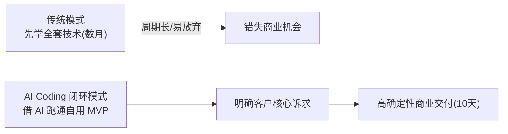
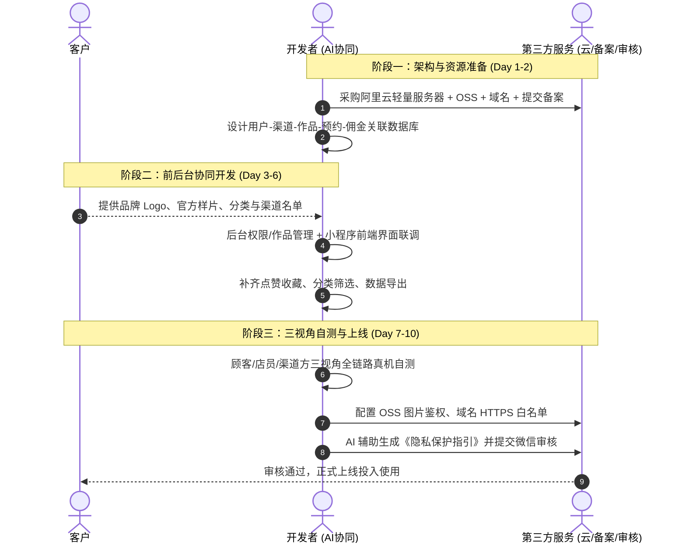

# 4.4 【案例精选】从没做过小程序到 9000 元接单：资深架构师用 AI Coding 10 天交付闭环复盘（Allen）

> **案例作者：** Allen（坐标杭州，16年全栈开发/项目管理经验，企业 AI 落地服务创业者）  
> **商业结果：** 客户小程序定制单报价 9,000 元，约定 14 天工期，10 天提前交付上线  
> **原文参考资料：** [生财有术精华实操帖 (ID: 14425515851255252)](https://scys.com/articleDetail/xq_topic/14425515851255252)  
> **实战案例索引：** [WHENRESET Codex 实战案例库 · 接单与商业化](https://whenreset.com.cn/codex/index.html)

---

## 一、 背景与破局：资深工程师的“零小程序”初战

很多传统开发者或技术人会陷入思维误区：“我必须先把某种技术体系（如微信小程序生态、服务器部署、OSS、备案审核等）全部学透，才有资格接商业项目。”

作者拥有 16 年政企软件开发管理背景，但在接单前**从未开发过微信小程序**。借助 Claude Code 和 Codex，作者先开发了 2 个自用内部小程序跑通技术闭环，随后成功承接了外部付费客户的定制单：
- **项目定位：** 一家肖像美学机构的小程序，主要用于摄影作品展示、客户预约排期与外部合作渠道推广计佣；
- **客户预期：** 14 天内必须上线；
- **商业结算：** 9,000 元项目合同额。

---

## 二、 需求降维：明确边界，拆出 3 条核心闭环

项目能够 10 天提前交付的核心，**不仅在于 AI 写代码的速度，更在于前期严控需求边界**。

在 42 分钟的需求沟通中，作者梳理了客户真正的业务流，将庞杂的设想收敛为三条核心业务链路：

| 角色视角 | 核心业务闭环 | 暂不纳入一期开发的内容（延后做） |
| :--- | :--- | :--- |
| **顾客端** | 浏览精选客片与作品 $\rightarrow$ 查看作品详情 $\rightarrow$ 提交预约表单 $\rightarrow$ 查验预约与订单状态 | 在线复杂支付、储值卡、复杂优惠券 |
| **门店端** | 发布与维护作品分类 $\rightarrow$ 接收预约并跟进 $\rightarrow$ 录入线下消费金额 $\rightarrow$ 统计各渠道客户与应付佣金 | 自动分账打款、复杂考勤排班 |
| **渠道端** | 生成渠道专属小程序码 $\rightarrow$ 扫码绑定客户归属 $\rightarrow$ 实时查看引流人数、消费总额与应结佣金 | 渠道线上自动提现（改在线下定期对账结算） |

> **关键认知：** 客户要做的是“业务数据透明可信，避免微信群频繁对账”，而不是复杂的金融系统。首期上线聚焦在“记录、归属、计算与展示”，大大缩短了开发周期。

---

## 三、 10 天敏捷交付时间线

### 每日关键推进动作拆解

1. **第 1~2 天（骨架与数据关系）：** 迁移过往成熟工程模板，设计关系型数据库。特别理清“用户 - 渠道码 - 消费流水 - 渠道佣金比例”的关联机制，防止后续业务返工。
2. **第 3 天（前后台双轨推进）：** 后台管理（登录、权限、渠道录入）与小程序前台（首页、瀑布流展示、预约详情）同步推进，每写一个接口立即做数据打通验证。
3. **第 4 天（跑通核心链路）：** 顾客提交预约 $\rightarrow$ 门店后台接收处理 $\rightarrow$ 录入消费金额 $\rightarrow$ 渠道实时看到计佣，整条通路打通。
4. **第 5~6 天（细节打磨与健壮性）：** 补全作品点赞、收藏、用户中心、渠道数据一键导出，随手解决样式对齐与接口容错问题。
5. **第 7 天（三视角集中自测）：** 
   - 顾客视角：从扫码、授权、浏览到提交预约走一遍；
   - 门店视角：审核预约、录入测试金额、查看汇总；
   - 渠道方视角：分别扫不同渠道的小程序码，确认数据严格隔离，不会看到竞对渠道的客户。
6. **第 8 天（真机网络与云存储排雷）：** 将本地临时图片迁移至阿里云 OSS，配置外网访问域名、防盗链与上传鉴权，用真实真机反复排查。
7. **第 9 天（合规与隐私协议）：** 利用 AI 基于真实使用场景整理微信权限申请用途（相册读取、位置授权等），生成严谨的《小程序隐私保护指引》，杜绝申请未用权限导致拒审。
8. **第 10 天（审核与正式交付）：** 微信代码提审，一次性过审发布，提前 4 天交付客户。

---

## 四、 项目基础设施与成本核算清单

交付一个真实商业项目，底层需要完整的服务链路支持。以下为本次交付实际发生的基础成本：

| 基础设施 / 服务项 | 规格说明 | 费用（元） | 责任归属 |
| :--- | :--- | :--- | :--- |
| **阿里云轻量服务器** | 基础配置（跑 API 与后台） | 199 / 年 | 开发者代采购并部署 |
| **阿里云 OSS 对象存储** | 摄影类高清作品存储与外网下行 | 约 170 / 年 | 开发者配置并托管 |
| **项目独立域名** | `.cn` / `.com` 备案用域名 | 85 / 年 | 客户持有/开发者配置 |
| **第三方备案协助服务** | 快速初审、管局协助、材料审核 | 约 200 / 次 | 第三方专业机构处理 |
| **微信小程序开发者认证** | 微信官方企业主体认证费 | 300 / 年 | 客户主体直接缴付 |
| **合计直接基础设施成本** | — | **约 954 元** | **合同毛利达 8,000+ 元** |

---

## 五、 AI Coding 协同模式与避坑经验

### 1. AI 扮演的角色与边界

* **可以放心交给 AI 的工作：**
  * 需求结构化：把口语化诉求翻译为数据库字段表与 RESTful API 规范；
  * 原型代码化：利用 ChatGPT 生成第一版 UI，交给 Claude Code/Codex 直出小程序 WXML/WXSS；
  * 报错定位排查：直接把开发者工具报错信息与上下文代码喂给 AI，往往能秒级定位；
  * 事务性文案：撰写符合微信审核要求的隐私协议说明、权限申请理由。
* **绝对不能丢给 AI 的工作：**
  * **商业决策与功能取舍：** 哪些功能这次不做、数据展示权限怎么划分，必须由人把关；
  * **交付验收标准：** 客户的满意度不是看代码行数，而是看业务链路是否顺滑。

### 2. 真实踩坑与新手警示

1. **“电脑上能跑，不等于真机能用”**：  
   微信开发者工具中开启了“不校验合法域名”，在手机真机预览时经常直接白屏或网络错误。上线前必须在真机环境走通所有流程。
2. **多管齐下，绝不能“串行排队”**：  
   如果等所有代码写完才去买域名和备案，备案审核通常需 5~10 个工作日，工期必然超期。必须在**确认需求的第一天立即启动域名购买与第三方备案流程**，让代码开发与证照办理并行。
3. **客户不需要懂技术，但要懂业务**：  
   不要让客户去配置服务器、OSS 或理解接口，技术复杂性由交付方封装；客户只需做好“确认功能范围、准备图片素材、配合提供企业认证资料”三件事。
