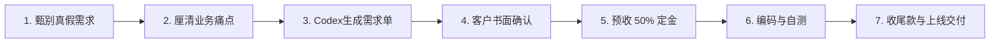

# 4.5 【案例精选】零代码0英语小白用 Codex 接单：小红书截流与月入过万的 7 步交付法（路飞）

> **案例档案卡片**
>
> - **案例作者**：路飞（04 年生人，非计算机专业，英语零基础，无编程经验）  
> - **商业战绩**：2026 年 6 月通过 Codex 接小程序定制单，6 个项目累计到账 **11,288 元**  
> - **核心亮点**：零代码小白跑通变现闭环；小红书评论区精准截流；7 步标准化交付 SOP；需求确认书模板与定金防坑策略  
> - **原文参考资料**：[生财有术精华实操帖 (ID: 14422822844181442)](https://scys.com/articleDetail/xq_topic/14422822844181442)  
> - **实战案例索引**：[WHENRESET Codex 实战案例库 · 接单与商业化](https://whenreset.com.cn/codex/index.html)

---

## 一、 起步与认知顿悟：为什么自嗨产品赚不到钱？

许多新手在接触 AI 编程后最常犯的错误是：“以为自己想出来的点子就是大众刚需”。作者早期踩过两个典型大坑：

1. **木鱼小程序：** 跟着教程敲出页面，界面粗糙，毫无差异化，删掉后连截图都没留下；
2. **去水印小程序：** 自以为身边 3000 人追星群需要存图，熬夜做完上线发群，结果仅几十人点击。因为用户在小红书/微博习惯直接收藏，不愿意多打开一个小程序。

```{mermaid}
flowchart TD
    subgraph 踩坑陷阱["❌ 传统自嗨式开发（高耗能、零产出）"]
        A["凭空想一个点子"] --> B["耗费数周闭门开发"] --> C["上线无人使用/无转化"]
    end

    subgraph 变现正道["✅ 验证驱动型定制接单（低风险、快反馈）"]
        D["去公域流量池找现成痛点"] --> E["先用小红书评论截流验证意向"] --> F["收定金 + 用 Codex 高效定制交付"]
    end
```

> **核心认知跃迁：** 宁可先做一张功能草图找用户验证付费意愿，也绝不要把完整程序全写完才去碰市场。**有真实商业痛点和付款意向的客户，才是变现的第一生产力。**

---

## 二、 获客渠道：小红书精准“评论区截流”话术

作者没有花时间在矩阵式内容起号上，而是采用极简的**评论区截流法**：

### 1. 目标池精准搜索
在小红书搜索“小程序制作”、“AI 做小程序”、“毕业设计小程序”、“个人开发小程序”、“定制小程序多少钱”等高意向关键词。

### 2. 评论区精准截流话术

```text
话术模板一（真实可信人设）：
“我也是非计算机专业的，最近用 AI 做出了几个能正常运行的小程序，包含预约和前后台。有需要做简单展示或工具类的小伙伴可以互相交流，也可以低价帮忙做个体验 Demo 看看效果~”

话术模板二（对标竞品截流）：
“这个需求其实不用找大外包公司花大几万，用轻量云开发两三天就能跑通。如果只是需要给线下门店做个展示和预约，几百到一千块就能搞定，可以帮你出个方案参考。”
```

### 3. 私域转化与打消顾虑
- 关注这类笔记的用户本身就处于强意向阶段，评论会自然吸引私信询盘；
- 引导至微信后，**立即发往期真实体验版小程序二维码（如医院、台球馆展示小程序）**，让客户在自己手机上真实点一点，顾虑瞬间打消。

---

## 三、 6 月份 11,288 元收益矩阵与阶梯报价

作者 6 月份完成的 6 个定制项目明细如下：

| 项目序号 | 项目类型与业务场景 | 成交金额（元） | 交付复杂度与特点 |
| :---: | :--- | :---: | :--- |
| **01** | **《保卫萝卜 4》攻略与资料共享小程序** | 1,100 | 首单破局，将群内杂乱文字攻略结构化，支持分类与关卡查询 |
| **02** | **专科医院展示类小程序** | 1,388 | 纯前端展示 + 医生排班科室展示，免后端极简部署 |
| **03** | **台球 / 连锁门店预约小程序** | 2,000 | 门店环境展示 + 基础包厢时间预约 + 简单后台 |
| **04** | **书店 / 图书陈列展示小程序** | 2,000 | 图书分类检索、新书推荐、读者留言与到店导航 |
| **05** | **汉堡 / 餐饮轻量点单小程序** | 2,300 | 菜品陈列、口味规格选择、线下取餐核销（免在线支付） |
| **06** | **酒吧 / 沉浸式桌游馆综合小程序** | 2,500 | 会员档案、桌位预约、酒水菜单、成长值积分管理 |
| **合计** | **共 6 笔定制项目交付** | **¥ 11,288** | **平均客单约 1,880 元，开发周期约 3~5 天/个** |

### 阶梯报价准则
- **1,000 ~ 1,500 元档（轻量展示型）：** 纯前端页面、图文资讯、门店地址导航、无复杂后台与数据库；
- **2,000 ~ 2,500 元档（全套定制型）：** 定制 UI 视觉、表单提交与短信提醒、云开发数据库、后台管理与数据导出、上线全流程辅导。

---

## 四、 小白接单 7 步标准化交付流程（SOP）



### 1. 第一步：甄别真伪需求
过滤掉只随口问问的白嫖用户，通过询问“**您计划什么时候上线使用？大概预算在哪个区间？**”筛选出具备真实预算的决策人。

### 2. 第二步：让客户用大白话描述痛点
不需要客户懂任何技术，让他用大白话说清楚三件事：“**这个小程序是给谁用的？他们用来干嘛？最后需要看到什么结果？**”

### 3. 第三步：让 Codex 整理为标准《需求确认书》

> **路飞专用需求整理 Prompt**：
> “你是一名资深微信小程序产品经理。以下是我与客户的聊天记录。请将客户口语化的要求整理成一份结构严谨的《微信小程序一期需求确认与开发清单》。
> 必须包含：
> 1. 项目核心目标与服务对象；
> 2. 页面清单（包含首页、详情页、表单页的具体功能点）；
> 3. 后台管理功能清单；
> 4. 【关键】明确列出本期暂不开发、待二期扩展的功能（边界隔离）；
> 5. 验收标准（以何种表现视为交付合格）。”

生成的《需求确认书》核心模板：

```markdown
# 微信小程序一期功能确认书 (项目：XX台球俱乐部)
## 一、功能清单
1. 顾客端：
   - 门店环境轮播展示 (支持高清图片)
   - 包厢列表与实时空闲状态查看
   - 在线提交预约表单 (姓名、手机号、预约时间段、人数)
2. 管理后台：
   - 预约列表查看与状态标记 (已确认 / 已到店 / 已取消)
   - 房态手动修改
   - 预约数据 Excel 一键导出

## 二、明确非本期范围 (二期规划)
- ❌ 暂不包含线上微信自动退款与押金扣除
- ❌ 暂不包含智能门锁与电控硬件接入

## 三、验收标准
- 顾客可在手机真机成功提交预约，后台 5 秒内可见该记录；
- 管理员可在手机后台修改包厢状态并实时反映在前端。
```

### 4. 第四步：客户书面确认
将确认书发给客户，并在微信群内要求客户回复：“**确认无误，首期按此清单执行**”。此举彻底消除了后续“扯皮”隐患。

### 5. 第五步：收取定金（30% ~ 50%）
**没有收到定金，绝不写一行代码**。定金是锁死双方承诺的唯一步骤。

### 6. 第六步：Codex 编码与真机自测
- 借助 Codex 编写代码，每做完一个可用模块必须打 Git Tag 或备份存档；
- 先自己以用户身份跑通所有按钮与流程，严禁直接把未经自测的代码发给客户当小白鼠。

### 7. 第七步：验收收尾款与上线售后
生成微信小程序体验版让客户亲自试用；确认无误后结清尾款；最后协助客户完成小程序后台管理员转让与微信提审发布。

---

## 五、 人机分工：什么是 Codex 能做的，什么是人必须做的？

| 工作环节 | Codex 承担的部分 | 人类必须亲力亲为的部分 |
| :--- | :--- | :--- |
| **需求阶段** | 自动提取聊天记录生成标准需求文档与表结构 | 引导客户说出真需求，**果断砍掉不切实际的虚饰功能** |
| **设计与编码** | 编写全部 WXML、WXSS、JavaScript 逻辑与云函数 | 决定页面色系风格、把控整体视觉与交互流畅度 |
| **测试排障** | 根据报错堆栈自动输出修复代码 | 在真实手机真机上点击测试，核验用户真实体感 |
| **商务与上线** | 生成符合规范的权限申请指引与隐私协议文本 | **谈价格、收定金、催尾款**；协助客户准备营业执照认证 |

---

## 六、 延伸阅读与实战索引

- [4.4 【案例精选】资深架构师用 AI Coding 10 天交付 9000 元小程序（Allen）](04_case_allen_miniapp_customization_9k_10days.md)
- [4.6 【案例精选】零代码基础 25 天变现 5100 元：闲鱼接单与 Figma 偷懒全 SOP（年轻人）](06_case_youngster_ai_coding_monetization_sop.md)
- [生财有术原帖：路飞 Codex 接单月入过万](https://scys.com/articleDetail/xq_topic/14422822844181442)
- [案例聚合导航：whenreset.com.cn/codex](https://whenreset.com.cn/codex/index.html)
