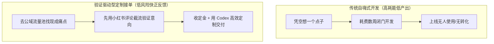
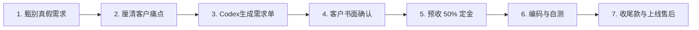

# 4.5 【案例精选】零代码0英语小白用 Codex 接单：小红书截流与月入过万的 7 步交付法（路飞）

> **案例作者：** 路飞（04 年生人，非计算机专业，英语零基础，无编程经验）  
> **商业结果：** 2026 年 6 月通过 Codex 接小程序定制单，6 个项目累计到账 **11,288 元**  
> **原文参考资料：** [生财有术精华实操帖 (ID: 14422822844181442)](https://scys.com/articleDetail/xq_topic/14422822844181442)  
> **实战案例索引：** [WHENRESET Codex 实战案例库 · 接单与商业化](https://whenreset.com.cn/codex/index.html)

---

## 一、 起步与认知顿悟：为什么自嗨产品赚不到钱？

许多新手常犯的错误是：“以为自己想出来的点子就是大众刚需”。作者早期踩过两个典型大坑：

1. **木鱼小程序：** 跟着教程敲出页面，界面粗糙，毫无差异化，无人问津；
2. **去水印小程序：** 自以为身边 3000 人追星群需要存图，熬夜做完上线发群，结果仅几十人点击。因为用户在小红书/微博习惯直接收藏，不愿意多打开一个小程序。



> **核心认知跃迁：** 宁可先做一张功能草图找用户验证付费意愿，也绝不要把完整程序全写完才去碰市场。**有真实商业痛点和付款意向的客户，才是变现的第一生产力。**

---

## 二、 获客渠道：小红书精准“评论区截流”

作者没有花时间在矩阵式内容起号上，而是采用极简的**评论区截流法**：

1. **目标池锁定：** 搜索“小程序制作”、“AI 做小程序”、“毕业设计小程序”、“个人做小程序”等热门笔记；
2. **评论区布局：** 留下真实坦诚的个人信息标签：
   > *“我是 00 后，自学用 AI 做出了小程序，可以先体验演示，也可接轻量定制。”*
3. **转化承接：**
   - 关注该类笔记的用户本身就处于强意向阶段，评论会自然吸引私信询盘；
   - 及时将咨询用户引流至微信私域，发往期真实体验版演示作品打消顾虑；
   - **设备与网络环境注意：** 必须使用稳定设备与独立网络，避免新账号触发平台风控导致询盘流失。

---

## 三、 6 月份 11,288 元收益矩阵与阶梯报价

作者 6 月份完成的 6 个定制项目明细如下：

| 项目序号 | 项目类型与业务场景 | 成交金额（元） | 交付复杂度与特点 |
| :---: | :--- | :---: | :--- |
| **01** | **《保卫萝卜 4》攻略与资料共享小程序** | 1,100 | 首单破局，将群内杂乱文字攻略结构化，支持分类查询 |
| **02** | **专科医院展示类小程序** | 1,388 | 纯前端展示 + 医生排班科室展示，免后端简单部署 |
| **03** | **台球 / 连锁门店预约小程序** | 2,000 | 门店环境展示 + 基础包厢时间预约 + 简单后台 |
| **04** | **书店 / 图书陈列展示小程序** | 2,000 | 图书分类检索、新书推荐、读者留言与到店导航 |
| **05** | **汉堡 / 餐饮轻量点单小程序** | 2,300 | 菜品陈列、口味规格选择、线下取餐核销（免强支付） |
| **06** | **酒吧 / 沉浸式桌游馆综合小程序** | 2,500 | 会员档案、桌位预约、酒水菜单、成长值积分管理 |
| **合计** | **共 6 笔定制项目交付** | **¥ 11,288** | **平均客单约 1,880 元，开发周期约 3~5 天/个** |

### 阶梯报价准则

* **1,000 元档（轻量展示型）：** 仅包含前端页面制作、纯展示或资料阅读、无复杂后台与数据库；
* **2,000 ~ 2,500 元档（全套定制型）：** 包含定制 UI、具体交互逻辑、后台管理系统、云存储/轻量数据库接入、服务器配置与上线辅导。

---

## 四、 小白接单 7 步敏捷标准化交付流程（SOP）



1. **第一步：甄别真伪需求：** 过滤掉只随口问问的白嫖用户，通过询问“预期上线时间与大致预算”筛选出真客户。
2. **第二步：让客户用大白话描述：** 重点搞清“给谁用”、“解决什么麻烦”。
3. **第三步：让 Codex 整理为标准《需求确认书》：**  
   将客户散乱的聊天记录喂给 Codex，让 AI 整理为清晰的模块功能清单、页面交互逻辑与验收标准。
4. **第四步：客户确认后方可动工：** 发给客户核对，直到客户确认“无新增、就按这个做”，杜绝边做边改。
5. **第五步：收取定金（30% ~ 50%）：** 必须收到定金再开工，既锁定双方承诺，又避免烂尾。
6. **第六步：开发与多轮自测：**
   - 借助 Codex 编写代码，每做完一个可用模块必须打 Git Tag 或备份存档；
   - 先自己以用户身份跑通所有按钮与流程，严禁直接把未经自测的代码发给客户当小白鼠。
7. **第七步：验收收尾款与上线售后：** 客户体验版验收满意后支付尾款，再推进代码提审与账号上线。

---

## 五、 接单红绿灯准则：哪些单能接，哪些千万别碰？

```text
🟢 推荐新手优先承接的单型（高确定性、交付快）：
  ✓ 线下门店展示型小程序（环境、地址、特色、联系方式）；
  ✓ 攻略与资料共享型小程序（图文排版、搜索检索）；
  ✓ 基础表单预约型小程序（选时间、留联系方式、后台看预约）；
  ✓ 菜品与商品画册型小程序（只展示不涉及线上分账）；
  ✓ 业务逻辑清晰的轻量管理后台。

🔴 新手绝对不要碰的“深坑单”（容易陷入纠纷、超出能力）：
  ✗ 多商户平台 / 入驻型商城（角色权限与分账逻辑极度复杂）；
  ✗ 复杂分销返佣系统（极易被微信安全策略封号，且风控极难处理）；
  ✗ 强线上支付 / 充值风控（涉及微信支付类目严苛资质审核）；
  ✗ 客户自身业务完全不清晰、随时随地变卦改方向的“无底洞单”。
```

---

## 六、 6 条核心避坑锦囊

1. **向 AI 提问必须交代完整上下文：**  
   不要只说“这里报错了/按钮不能点”，而要清晰告诉 Codex：“*在哪个页面、点击什么按钮、控制台报了什么代码、原本期望实现什么、哪些已实现好的逻辑绝不能被改动*”。
2. **一定要学会 Git 版本管理：**  
   AI 编程时，经常会出现“改好一个功能，弄崩了三个原有功能”。每完成一个阶段性功能，必须 `git commit` 保存正常运行节点，随时支持安全回退。
3. **服务态度要好，但修改边界必须明确：**  
   报价内一般承诺包含“3 次需求对齐、1~2 轮 Bug 修复”。由于客户主观原因导致的“新增页面、推翻重做业务流”，必须明确属于二期增量开发，需加收费用。
4. **不要把时间全部预估为“写代码的时间”：**  
   写代码只需要 3~4 天，但实际交付往往需预留 10 天，因为中间包含素材整理、真机测试反馈、微信审核周期。
