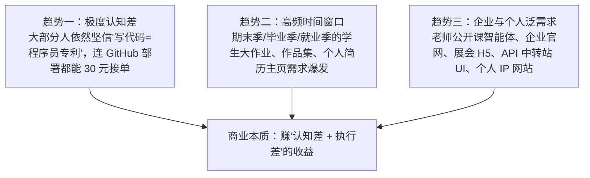
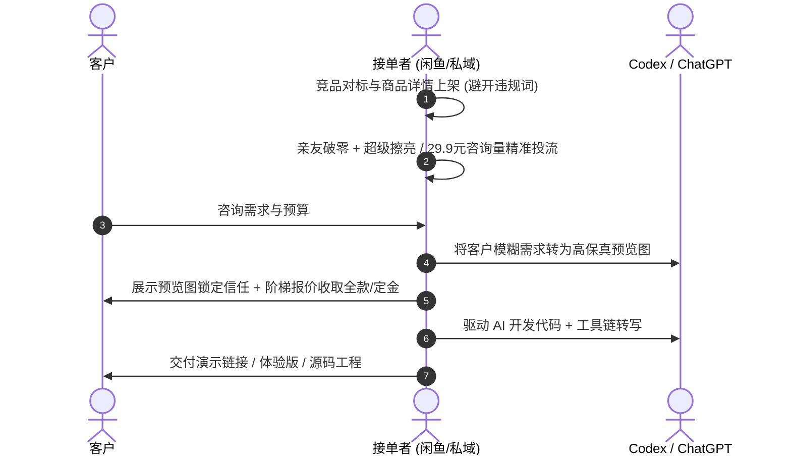
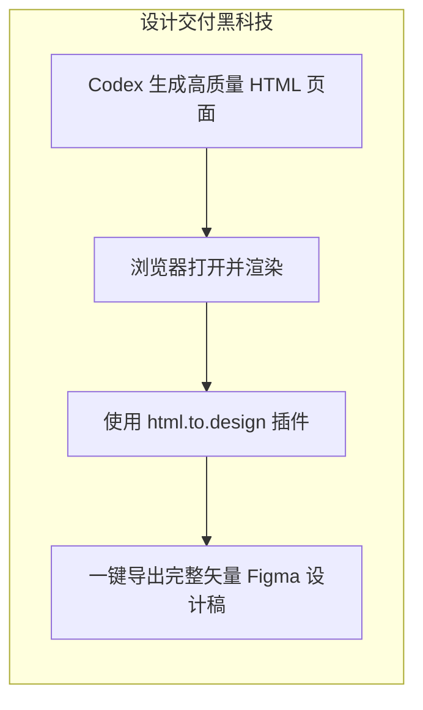

# 4.6 【案例精选】零代码基础 25 天变现 5100 元：闲鱼/小红书获客、Figma偷懒法与部署全 SOP（年轻人）

> **案例作者：** 年轻人（大厂云计算销售转型自由职业，零编程基础、不懂英文）  
> **商业结果：** 25 天内闲鱼接单净收益约 **5,100 元**（投流约 300 元），小红书交付 800 元，上线 4 个个人小程序（2 个开通流量主）  
> **原文参考资料：** [生财有术精华实操帖 (ID: 82255482825284252)](https://scys.com/articleDetail/xq_topic/82255482825284252)  
> **实战案例索引：** [WHENRESET Codex 实战案例库 · 接单与商业化](https://whenreset.com.cn/codex/index.html)

---

## 一、 为什么零代码是黄金窗口期？三大商业趋势

1. **认知差构筑高壁垒：** 国内高频使用深度 AI Coding 的人群仍属少数，大部分非技术人群面对“开发”二字本能退缩。
2. **场景多元可平移：** 无论学生作业、HTML 课件、企业官网、还是 AI 智能体，底层逻辑高度相通——用 AI 对话实现代码，人工负责需求与交付。

---

## 二、 闲鱼获客与接单成交流程（SOP）

闲鱼是目前个人承接轻量 AI 开发单最直接、流量最集中的公域阵地。

### 1. 选品与上架
* **对标搜索：** 搜“网页设计”、“网页制作”、“个人主页定制”等，参考高销量同行设计详情页；
* **商品主图：** 用 Midjourney 或 DALL-E/GPT 直出高级 UI 样机图作为封面；
* **⚠️ 违规红线防范：** **严格避开“作业”、“代做毕业设计”等敏感违禁词**，此类关键词易触发学术不端风控导致下架或限流，改用“个人主页定制 / HTML 页面交互演示”等合规词汇。

### 2. 冷启动与曝光放大
* **初始权重破零：** 上架后找亲友拍 1~2 单并留好评，触发“超级擦亮”；
* **低成本投流获客：** 直接购买平台 29.9 元（保 4~5 人咨询）的小额精准推广套餐，通常转化 1 单即可覆盖全天推广成本。

### 3. 成交杀手锏：预出效果图打消顾虑
当客户犹豫不决时，先让 AI 将其诉求生成一张精美的网页效果草图发送给对方：*“这是我为你初步规划的设计视觉稿”*。这种前置展现能让成交转化率成倍提升。

---

## 三、 高效交付黑科技工具链

### 1. “HTML 逆向转 Figma”偷懒工作流
针对很多客户指定要求“交付 Figma 原型设计稿”的痛点：
* **传统困局：** 零基础小白不会用 Figma 复杂钢笔与排版工具，且直接使用 AI 生成 Figma MCP 的免费额度极少（单账号通常仅几次）；
* **逆向降维方案：**
  1. 先让 Codex 编写出具备高保真质感的标准 HTML/CSS 静态网页；
  2. 在 Chrome 中使用免费插件 **`html.to.design`**，直接输入本地或线上网址；
  3. 插件自动将整个 DOM 树解析为 Figma 原生图层与矢量画板，完美交付客户。

### 2. 开源 Skill 与特效武器库

| 工具 / 资源库 | 核心用途与优势 | 官方 / 开源链接 |
| :--- | :--- | :--- |
| **`guizang-ppt-skill`** | 将内容直接编译为演示级 HTML PPT 与交互网页 | [github.com/op7418/guizang-ppt-skill](https://github.com/op7418/guizang-ppt-skill) |
| **`ui-ux-pro-max-skill`** | 多种高级 UI 设计规范与现代视觉风格直出 | [github.com/nextlevelbuilder/ui-ux-pro-max-skill](https://github.com/nextlevelbuilder/ui-ux-pro-max-skill) |
| **`gsap-skills`** | 制作网页炫酷滑动、翻页、弹性动效与 3D 动画 | [github.com/greensock/gsap-skills](https://github.com/greensock/gsap-skills) |
| **`ECharts 官方示例库`** | 数据可视化大屏与交互图表，可直接借用配置 | [echarts.apache.org/examples](https://echarts.apache.org/examples/zh/index.html) |
| **`sceneai.art`** | 丰富的动态网页高阶提示词库，支持快速复刻 | [sceneai.art](https://sceneai.art/) |

### 3. 两种轻量免费部署方案对比

* **GitHub Pages：**
  * **优势：** 零成本、支持绑定自定义域名、配置极简；
  * **劣势：** 仅限公开仓库，无法隐藏代码，绝对**不可**在前端代码中暴露任何商业 API Key。
* **Cloudflare Pages（强烈推荐）：**
  * **优势：** 全球 CDN Anycast 加速、国内访问快、支持 GitHub 私有仓库自动部署构建（CI/CD）；
  * **安全性：** 可以在 Cloudflare 控制台配置环境变量，后端或代理函数安全隔离 API 密钥。

---

## 四、 5 个真实交付案例实操拆解

### 案例 1：旅行社三页官网（20 分钟极速交付）
* **需求：** 制作 3 页极简旅行社宣传网站；
* **交付方案：** 调用 `guizang-ppt-skill` 提示词，AI 20 分钟直出完整带动画响应式页面。

### 案例 2：个人品牌商城 3D 宇航员交互页
* **需求：** 客户发来抖音爆款 3D 宇航员网页视频，要求复刻同等效果；
* **避坑过程：** 抖音博主评论区的“现成提示词”多为引流假货。直接将视频关键帧发给 Codex 搭建骨架，再让 AI 引入 `gsap` 实现宇航员旋转与商品弹窗交互，顺利验收。

### 案例 3：博物馆展览界面（Figma 格式交付）
* **需求：** 客户提供 4 张截图，指定必须交付 Figma 源文件；
* **交付方案：** 先用 Codex 直出整套 HTML 静态网站，再用 `html.to.design` 一键导入 Figma，组件还原度超 95%。

### 案例 4：网上书城小程序（学生毕业设计）
* **优势特性：** 体验版小程序只需注册普通微信开发者邮箱，**无需进行繁琐的企业认证与域名 ICP 备案**；开通体验者权限后可供 15 人扫码真实使用；
* **后端利器：** 让 Codex 直连腾讯云开发 `cloudbase-cli`，自动拉起云数据库与存储，前端图片不超包大小限制（主包限制 2MB）。

### 案例 5：小麦生长周期教学 AI 对话智能体
* **需求：** 将小麦生长阶段课件做成网页，并结合卡通形象实现与学生的智能语音对话；
* **技术闭环：** 调用火山引擎豆包端到端语音大模型 API（提供免费体验 Token），部署在 Cloudflare Pages 交付给客户公开课展示。

---

## 五、 阶梯加法报价模型与接单红线

不要凭空拍脑袋报一口价，使用**阶梯工作量累加法**：

$$\text{最终报价} = \text{基础单页价} + \text{交互动效加价} + \text{功能模块/后端费用} + \text{加急费} + \text{部署维护费}$$

* **基础价格：** 静态展示页面参考行业底价约 10~20 元/页；
* **交互动效：** 涉及 3D、复杂滚动、图表交互等视难度加收 50~200 元；
* **后端/部署：** 只要涉及数据库持久化、登录认证、上线部署，价格直接跳升至 500~2,500 元。

### 🚨 避坑红线
1. **绝不垫资昂贵 API：** 涉及端到端语音模型、图像生成等高资费接口，坚决要求客户自行注册提供 API Key；
2. **拒绝无边界急单：** 赶在最后一小时交作业、且反复挑剔的急单宁可不接；
3. **永远先测试再交付：** AI 写的代码必须亲自过一遍基础点击与数据响应，切勿直接扔给客户当小白鼠。
