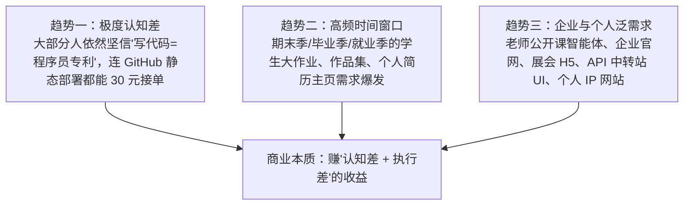

# 4.6 【案例精选】零代码基础 25 天变现 5100 元：闲鱼/小红书获客、Figma偷懒法与部署全 SOP（年轻人）

> **案例档案卡片**
>
> - **案例作者**：年轻人（大厂云计算销售转型自由职业，零编程基础、不懂英文）  
> - **商业战绩**：25 天内闲鱼接单净收益约 **5,100 元**（投流约 300 元），小红书交付 800 元，上线 4 个个人小程序（2 个开通流量主）  
> - **核心亮点**：零代码跑通全栈开发；闲鱼 29.9 元投流打法；`html.to.design` 逆向偷懒神器秒出 Figma；Cloudflare 免费全球部署；阶梯加法报价法  
> - **原文参考资料**：[生财有术精华实操帖 (ID: 82255482825284252)](https://scys.com/articleDetail/xq_topic/82255421451551242)  
> - **实战案例索引**：[WHENRESET Codex 实战案例库 · 接单与商业化](https://whenreset.com.cn/codex/index.html)

---

## 一、 为什么零代码是黄金窗口期？三大商业趋势



1. **认知差构筑高壁垒：** 国内高频使用深度 AI Coding 的人群仍属极少数，绝大部分非技术人群面对“编程”二字本能退缩，光是“我不会代码”这个念头就把 90% 的人挡在门外。
2. **底层相通，技能可极速复用：** 做小程序、做网页、做 H5、做智能体本质上都是相通的。开发者不需要看懂一行代码，只要掌握向 Codex / Claude 发起精准提示的对话技巧，AI 就是你的“全天候牛马程序员”，你只需做好老板式的统筹与交付。

---

## 二、 闲鱼精准获客与 29.9 元投流打法（SOP）

闲鱼是目前承接轻量 AI 需求最直接、流量最集中的公域阵地。

### 1. 标题与详情页关键词优化公式

```text
标题标准公式：
【核心业务词】+【应用场景词】+【交付形式】+【差异化保障】

示范案例：
“网页制作设计 / HTML静态网页 / 个人主页作品集定制 / 大学生期末展示 / 响应式手机电脑自适应 / 快速交付包修改”
```

* **商品主图：** 用 Midjourney 或 DALL-E 直出高级科技感 UI 样机（Mockup）作为首图，视觉吸引力远超普通文字截图；
* **⚠️ 违规红线绝不能碰：** **严格禁止出现“代写作业”、“代做毕业设计”、“论文代劳”等违禁词**，此类词汇会直接触发闲鱼平台风控导致永久封禁！统一改用“大作业参考模板 / HTML 页面交互演示 / 课件制作”等合规表述。

### 2. 冷启动破零与 29.9 元投流闭环

1. **初始权重破零**：商品发布后，找 1~2 位亲友拍下并附上带图真实好评，立刻激活闲鱼推荐机制；
2. **购买精准推广套餐**：直接在后台购买 29.9 元（平台保 4~5 个真实询盘）的精准小额曝光。只要成交 1 单（通常客单价 50~200 元以上），就能直接覆盖全天的投流成本。

---

## 三、 高效交付黑科技武器库

### 1. “HTML 逆向转 Figma”偷懒工作流

很多企业或学生客户指定要求“**必须交付 Figma 原型设计稿源文件**”：
- **传统困境**：零基础小白根本不会用 Figma 复杂的钢笔工具、栅格和自动布局（Auto-layout），且直接用 AI 生成 Figma 的专用插件免费额度极少；
- **逆向降维操作流**：
  1. 先让 Codex 编写出具备高保真现代质感的标准 HTML/CSS 静态网页；
  2. 在 Chrome 浏览器中安装免费插件 **`html.to.design`**；
  3. 打开本地生成的 HTML 页面，点击插件一键抓取；
  4. 插件会自动将整个 DOM 树完美解析为 Figma 原生图层、文字组件与矢量画板，组件还原度高达 95%！
  - *突破额度秘籍*：每个免费账户每月可导入 10 个页面，用完后只需更换一个临时 Google 邮箱注册即可无限循环使用。

### 2. 开源 Skill 与特效武器库

| 工具 / 资源库 | 核心用途与优势 | 官方 / 开源链接 |
| :--- | :--- | :--- |
| **`guizang-ppt-skill`** | 将 Markdown 内容直接编译为演示级 HTML PPT 与动态课件 | [github.com/op7418/guizang-ppt-skill](https://github.com/op7418/guizang-ppt-skill) |
| **`ui-ux-pro-max-skill`** | 顶级 UI 设计规范库，让 AI 直出 Glassmorphism、Neumorphism 风格 | [github.com/nextlevelbuilder/ui-ux-pro-max-skill](https://github.com/nextlevelbuilder/ui-ux-pro-max-skill) |
| **`gsap-skills`** | 网页炫酷平滑滚动、翻页动画、弹性动效与 3D 交互 | [github.com/greensock/gsap-skills](https://github.com/greensock/gsap-skills) |
| **`ECharts 官方示例库`** | 数据可视化大屏与交互图表，可直接借用配置代码 | [echarts.apache.org/examples](https://echarts.apache.org/examples/zh/index.html) |
| **`sceneai.art`** | 丰富的动态网页高阶提示词库，支持快速复刻视觉场景 | [sceneai.art](https://sceneai.art/) |

### 3. 轻量免费部署方案对比：为什么强推 Cloudflare Pages？

| 维度 | GitHub Pages | Cloudflare Pages（强力推荐） |
| :--- | :--- | :--- |
| **访问速度** | 国内部分省份 DNS 污染，偶尔卡顿 | 全球 Anycast CDN 节点，国内访问秒开 |
| **代码私密性** | 免费版仅支持公开仓库（代码裸奔） | **支持 GitHub 私有仓库**（客户代码完全保密） |
| **环境与密钥** | 无法安全配置后端 API Key | 控制台可直接注入环境变量，安全隔离密钥 |
| **域名绑定** | 绑定自定义域名需手动配置 CNAME | 一键托管 DNS，自动签发全免费 SSL 证书 |

---

## 四、 关键避坑与成本控制指南

1. **警惕昂贵 API 陷阱（豆包语音端到端 API）：**
   - 制作交互式 AI 智能体时，豆包语音大模型虽然体验极佳，但由于涉及“语音识别 + 大模型推理 + 语音合成”三合一，Token 消耗极快且计费较高；
   - **接单红线**：若客户定制语音助手，**坚决要求客户自行注册火山引擎并绑定其自有的 API Key**，绝不能由开发者自己垫资。
2. **薅好腾讯云“小程序成长计划”：**
   - 针对学生类小程序，微信单个代码包限制 2MB、单个静态图片不能大于 200KB。可参加腾讯官方「小程序成长计划」，直接**免费领取半年微信云开发环境**，把大型图片素材存入云存储，规避包体积超标问题。
3. **阶梯加法报价公式**：
   $$\text{最终报价} = \text{基础页面费 (10~20元/页)} + \text{复杂动效费 (50~200元)} + \text{后端数据库接入 (500~2000元)} + \text{加急费}$$
   拒绝拍脑袋开价，让客户明确感知到每一项功能的成本，改动需求时顺理成章加价。
