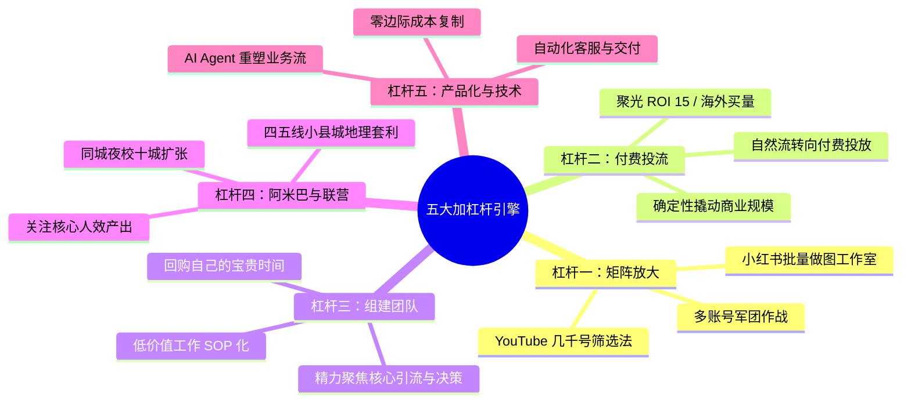

# 4.7 【商业洞察】生财所有项目都值得做两遍：第一遍 MVP 跑通，第二遍五大加杠杆放大（许老师）

> **案例档案卡片**
>
> - **案例作者**：许老师（生财有术投资孵化负责人，生财联合办公空间运营，8 年在线教培操盘老兵）  
> - **核心标签**：`项目做两遍论` `低水平重复陷阱` `加法转乘法思维` `五大加杠杆法则` `矩阵放大` `付费投流` `回购时间` `阿米巴与地理套利`  
> - **原文参考资料**：[生财有术精华商业长文 (ID: 4848155412248448)](https://scys.com/articleDetail/xq_topic/4848155412248448)  
> - **关键洞察**：**“所有的生财项目，但凡能跑通的，都值得做两遍：第一遍是 0-1 的 MVP 验证，考验敏锐嗅觉与闭环能力；第二遍是加杠杆放大，考验在关键环节引入矩阵、投流、团队与产品化技术。如果你一个项目只做第一遍，赚几万块就觉得天花板低而另觅新欢，那你只是在用宝贵的试错成本替会加杠杆的高端玩家探路做嫁衣。”**

---

## 一、 创业者的宿命怪圈：“低水平重复”与加法思维陷阱

在日常面试大量联合办公空间申请者与孵化团队时，许老师发现了一个普遍存在的残酷剧本：
- **圈友 A**：做 AI 代写，在闲鱼开了几个号，每天接单聊单，轻松月入一万。随后觉得“代写天花板太低，每天写单子很烦”，下一步准备丢掉代写，转去从零研究水晶私域；
- **圈友 B**：参加同城夜校航海，一个月跑通变现几千块。随后觉得“一个人搞收益有限，每天做图私聊太枯燥”，看着 AI 很火热，想重新找个新 AI 赛道；
- **共同剧本**：花了几个月付出巨大试错成本，好不容易把流量、销转、交付粗糙跑通，刚拿到一点正反馈，遇到瓶颈便嫌弃项目天花板低，浅尝辄止后彻底放弃，然后**重新跳入下一个从 0 到 1 的泥潭**。

```text
这在商业本质上叫做“低水平重复”！
一直在加法思维里打转：以为“做更多的事情，才能赚更多的钱”。
赚了 1 万想赚 3 万，不是去放大原有的生产链，而是开辟新项目。这种模式永远无法享受时间的复利。
```

```mermaid
flowchart TD
    subgraph 新手的小农加法死胡同 (低水平重复)
        A1["发现项目 A"] --> A2["0-1 跑通赚 1 万"]
        A2 --> A3["遇到琐碎与瓶颈，嫌弃天花板低"]
        A3 --> A4["放弃 A，转去从 0 开始做项目 B"]
        A4 --> A5["年复一年，永远在 0 到 1 试错，从未放大"]
        style A3 fill:#fbb,stroke:#333
    end

    subgraph 高端玩家的指数杠杆飞轮 (项目做两遍)
        B1["第一遍：低成本跑通 0-1 MVP"] --> B2["拿到市场真实微小正反馈"]
        B2 --> B3["第二遍：加杠杆放大 (矩阵/投流/团队/技术)"]
        B3 --> B4["从月入 1 万跃迁至年入千万规模"]
        style B3 fill:#dfd,stroke:#333
        style B4 fill:#bbf,stroke:#333
    end
```

---

## 二、 商业双阶段模型：从 0-1 闭环到 1-10 杠杆

创业是一场严密的能力拼图游戏：

| 阶段 | 核心任务 | 考验的关键能力 | 终极目标 |
| :--- | :--- | :--- | :--- |
| **第一遍：0-1 MVP 验证** | 闭环跑通最小商业链路（搞定第一批真实付费用户） | **嗅觉与灵敏度**：低成本测试、需求辨别、快速交付、抗挫能力 | 验证需求真实性与单位经济学模型可行性 |
| **第二遍：加杠杆放大** | 突破个人物理精力极限，将有效动作规模化复制 | **杠杆构建与组织力**：流量放大、资本投入、组织赋能、系统化构建 | 实现收益与人效的指数级爆发（10X ~ 100X） |

---

## 三、 五大加杠杆维度与实战案例

要在第二阶段把项目放大，最核心的能力是在**关键瓶颈环节加杠杆**。许老师系统拆解了五大经过大规模商业验证的杠杆形式：



### 3.1 杠杆一：矩阵放大（流量侧倍增）
- **底层逻辑**：如果一个账号能引流或带来佣金，就用同样的方式做 10 个、50 个、几百个账号；
- **小红书矩阵军团**：专业矩阵工作室每天用标准 SOP 批量生成图文，不追求单篇爆款，用数量博取概率，对冲封号风控，实现稳定的客资引流；
- **YouTube 几千号实战**：生财航海教练老马操盘 YouTube 时，累计开设**数千个账号**，通过数据筛选最终沉淀出数百个持续产生被动收益的现金流账号。

### 3.2 杠杆二：投流放大（资本杠杆打透平台）
- **底层逻辑**：普通玩家死磕自然流，高端玩家拥抱付费流。自然流依赖玄学推荐，付费投放则具备极高确定性与合规性；
- **聚光投放案例**：联合办公空间入驻的 AI 代写团队，将自然流跑通的成交模型对接小红书聚光付费投放，跑出 **ROI 15** 的惊人利润率；
- **出海百万级买量**：亦仁团队在海外产品孵化中，建立月投放额超过 100 万元的买量团队。只要独立站能跑通 0 到 1000 美金，投流团队即可利用资金杠杆将其极速推至 1 万乃至 10 万美金。

### 3.3 杠杆三：组建团队（雇人本质是“回购时间”）
- **小农思维误区**：害怕固定人力开支、害怕团队管理摩擦，导致创始人长期深陷在客服、打单、剪辑等低价值杂务中；
- **高阶认知**：**雇人的本质不是业务增长，而是回购创始人自己的时间**；
- **北京求职陪跑案例**：一位做求职辅导的圈友原先被杂事淹没，月入 30 万到达天花板。经指导后组建交付团队，将销转、答疑标准化 SOP 移交团队，创始人将 80% 精力全力聚焦在“抖音直播”这一最具杠杆的获客环节，月营收迅速爆发至 **120 万元**。

### 3.4 杠杆四：阿米巴与项目联营（人效与地理套利）
- **人效决策矩阵**：
  - **人均月利润 > 10 万元**：首选自营团队，留存最大超额利润；
  - **人均月利润 2~10 万元**：首选阿米巴合伙人或项目联营，分散重资产刚性风险；
  - **人均利润更低且动作可标准化**：利用**地理套利**，将切片剪辑、客服交付下沉至四五线小县城，大幅压缩用工成本；
- **同城夜校扩张案例**：广州同城夜校项目跑通后，单城市年净利润触及 100 万天花板。通过生财高阶航海阿米巴合作机制，联合十余个城市的本地操盘手同步复制，整个项目盘子实现 **4~5 倍放大**。

### 3.5 杠杆五：产品化与技术杠杆（AI 重构边际成本）
- 过去软件开发定制门槛极高，而如今借助大模型、低代码与自动化工具，技术杠杆的边际成本趋于零；
- **全自动出票案例**：拼多多特价电影票代购过去需要大量真人客服沟通核验，如今全链路重构为 AI 客服自动接单、提取卡密并自动化出票，彻底甩开人工羁绊。

---

## 四、 创业自检清单：你是探路者还是收割者？

在准备放弃手头跑通的项目前，先问自己以下五个问题：

- [ ] **是否测试过多账号矩阵？** 单账号月入 5000，是否尝试过 10 个账号协同运作？
- [ ] **是否测试过付费投流的 ROI？** 付费流是否能跑正，彻底甩脱平台自然流限流焦虑？
- [ ] **是否把自己从低价值劳动中解脱出来？** 你每天是忙着手动打字发货，还是在思考战略获客？
- [ ] **是否尝试过阿米巴与城市/垂类复制？** 这个闭环能否授权给别人去异地扩张分润？
- [ ] **是否利用 AI 与自动化把边际成本压到最低？** 能否用代码或工作流替代重复人工？
