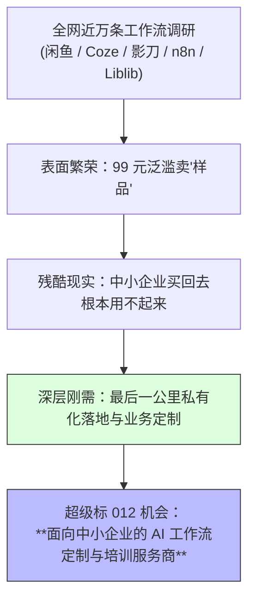
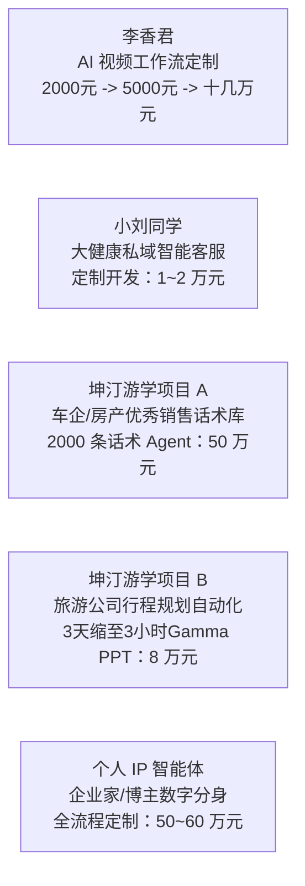
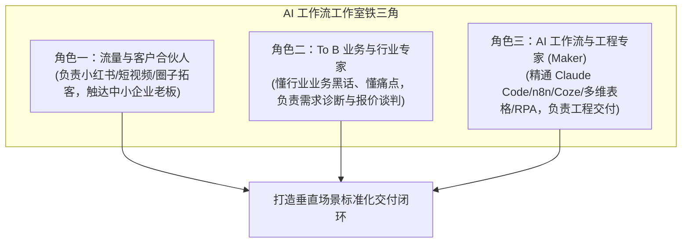

# 4.8 【超级标012】亦仁：AI 工作流与 Agent 定制服务商——中小企业最后一公里的十万级商机

> **案例档案卡片**
>
> - **案例作者**：亦仁（生财有术创始人、星主）  
> - **商业标签**：`超级标012` `AI工作流定制` `智能体定制服务商` `最后一公里落地` `B端高客单` `生财Maker`  
> - **行业全景调研**：生财情报研究部（SCBI）系统摸排近万条跨平台真实工作流场景（闲鱼、Coze、影刀、n8n、LibLib、YouTube 等）  
> - **高客单标杆**：李香君十几万视频工作流交付、大健康私域客服（1~2万）、房产车企话术智能体（50万）、旅游定制线路智能体（8万）、个人 IP 智能体（50~60万）  
> - **原文参考资料**：[生财有术超级标 012 专帖 (ID: 82811541424852542)](https://scys.com/articleDetail/xq_topic/82811541424852542)  
> - **全网场景库参考**：[生财有术近万条工作流与智能体场景飞书库](https://shengcaiyoushu01.feishu.cn/wiki/VBUSwevJNi...)  
> - **关键洞察**：**“在闲鱼、小红书上卖 99 元的工作流，商业本质是在卖一次几千元甚至几万元的 B 端服务机会。通用工作流只是‘样品’，企业客户买回去根本跑不通；因为‘最后一公里’的私有化交付极具门槛。客户买单的永远是确定性的‘降本结果’。中国最懂 AI 玩法的服务商，去赋能中国最会赚钱的企业家，就是当下的超级蓝海。”**

---

## 一、 超级标 012 背景：从 4000 人 n8n 航海到 B 端爆发前夜

在生财有术组织近 4000 人规模的 n8n 工作流航海后，圈友们迅速在具体业务场景跑出成果：
- 有圈友给自己搭建内容工作流，日产突破几十条高质量笔记；
- 有圈友为跨境电商提供 POD 定制出图工作流，单条定价 1000~5000 元，连卖十余个卖家；
- 有圈友的老照片修复工作流在抖音拿到过亿级播放量。

这促使生财情报研究部（SCBI）对全网 AI 工作流与 Agent 商业化现状展开了拉网式摸排。



---

## 二、 全网六大主流平台工作流生态现状图景

| 平台渠道 | 主流交付形态 | 定价与商业模式 | 典型真实场景 |
| :--- | :--- | :--- | :--- |
| **闲鱼 / 淘宝** | 99~299 元轻量虚拟模版，或 150 套 Coze 合集“买回去直接跑” | 低客单薄利多销，高频获客，每日几十单 | 《30 秒出片历史故事》《沉浸式火柴人心理学动画》 |
| **LibLib / 吐司** | Flux / Redux 一键模特换装模型、LoRA 流程 | 算力分成 + 卖模型 + 为电商定制模型（千元级） | “万物可换装”工作流，帮 20 多家服装电商大幅缩减外模成本 |
| **影刀 RPA** | 自动化插件脚本与电商客服辅助自动化 | 脚本下载分成 + 代运营托管月费（数千至上万/月） | “淘宝自动插旗备注”“拼多多自动回复”，替代整组外包客服 |
| **Coze / 扣子** | 爆款智能体（文案大师、论文辅助、多模型对话） | 免费引流 + 私有化深度定制业务 | 自动撰写公众号并同步飞书、视频发生器全流程脚本 |
| **小红书** | “工作流提效”图文与视频，博主晒自动化收益 | 卖课/进群 + 引流私域接单 | “n8n 自动发笔记一人顶团队”，评论区高频追问“求定制” |
| **n8n 全球开发者** | 开源编排，对接海外 API 交付全球订单 | 美金结算，高客单外包（500 ~ 5000 美元/单） | GPT-4 + Suno + Runway 生成 MV、DeepSeek + ElevenLabs 生成冥想音频 |

---

## 三、 B 端定制的巨大鸿沟：为什么企业依然用不起来？

为什么网上有海量免费分享的工作流，绝大部分实体与中小企业仍然没有引入到实际业务中？

```text
企业的三重困境：
1. 不知道：不知道 AI 现在已经能把公众号做到 90% 自动化、不知道行程规划能在 3 小时内完成；
2. 不会做：虽然老板买了课、下了代码，但公司内没有能把 API、网络环境、数据清洗、权限打通的工程落地人员；
3. 最后一公里水土不服：通用模板没有结合企业的私有业务规范（如专属话术库、违禁词风控、ERP 数据库直连）。
```

> **99 元的工作流只是“样品展示”。每一个购买 99 元工作流的老板背后，可能都是年营收百万级、背负几十万人工成本的真实企业。企业拿出几千甚至几万元来裁撤或替代重复岗位，意愿极高！**

---

## 四、 真实高客单案例拆解（1 万至 50 万元）

生财圈友与航海家正在从低客单卖脚本，向高客单系统交付快速进化：



1. **AI 视频定制跃迁（李香君）**：单条工作流从早期的 2000~3000 元逐步升级至 5000 元，针对影视广告公司的企业级交付最高达**十几万元**；
2. **垂直私域客服系统（小刘同学）**：针对大健康产业研发自动解答、资质审核与打标签的前端私域智能客服，客单价稳定在 **1~2 万元**；
3. **房产/汽车销售话术数字化（坤汀游学案例）**：针对标杆大客户，人工深度录制梳理 2000 条顶级金牌销冠话术，注入知识库并搭建全天候 AI 陪练与获客转化系统，**单项目定价 50 万元**；
4. **旅行社行程方案生成（坤汀游学案例）**：传统高级定制行程需人工排期 3~4 天，成本极高。搭建“多维表单 + 智能体路径规划 + Gamma 一键导出 PPT”，耗时缩短至 3 小时，**项目定价 8 万元**；
5. **头部个人 IP 智能体**：头部商业博主投入 50~60 万元自建深度 IP 智能体，实现全网公域留言自动化筛选与私域一对一高情商答疑。

---

## 五、 服务商商业模式构建：生财 Maker 与铁三角团队

通用工作流只能展示能力，真正能做成高客单长久生意的，一定是**深扎垂直行业**的落地服务商。

### 5.1 铁三角工作室组织形态



### 5.2 垂直赛道破局建议
- **服装/服务电商**：深挖“模特批量换装 + 电商主图批量清洗 + 评论区线索挖掘”；
- **知识付费/教育**：深挖“爆款选题 + 多平台分发 + 微信公众号 90% 自动化”；
- **本地生活与重服务**：深挖“多维表单预约 + 智能行程规划 + 私域自动回访与追单”。

### 5.3 启动冷启动心法
如果你还没有任何行业案例，**找身边熟悉的企业老板，主动提出免费为其搭建 1 个小而美的 AI 降本工作流**。一旦跑出一个跑通真实业务的成功标杆，立刻以此为案例文档化、录屏宣发，迅速切入整个垂直细分市场。

---

## 六、 核心收获与自检清单

- [x] **重塑商业定位**：不做低客单廉价模板倒爷，做 B 端高客单最后一公里落地服务商；
- [x] **理解客户痛点**：客户不买技术，买的是“节省几个人力成本”的明确交付结果；
- [x] **跨技术栈融合**：组合大模型（Claude/DeepSeek）、编排工具（n8n/Coze/Dify）、多维表格与 RPA 脚本；
- [x] **深耕垂直场景**：在垂直行业建立深度理解与销冠话术库，构筑真正的商业护城河。
