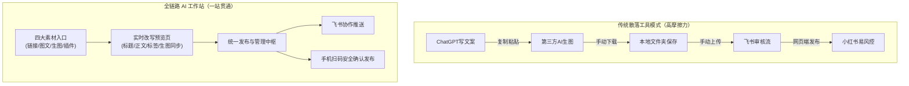
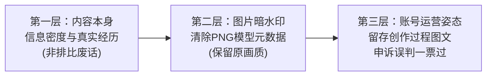

# 5.4 【案例精选】小红书 AI 工作站：采集/改写/生图/发布全闭环与 10 天变现 1w+（尹星河）

> **案例作者：** 尹星河（非技术背景，小红书虚拟电商操盘手、AI 内容创作者）  
> **商业结果：** 用两周时间搭出小红书 AI 工作站，上线 10 余天积分充值破 **10,000+ 元**，消耗百亿 Token，代码量超 17 万行  
> **原文参考资料：** [生财有术精华实操帖 (ID: 45544522158542448)](https://scys.com/articleDetail/xq_topic/45544522158542448)  
> **实战案例索引：** [WHENRESET Codex 实战案例库 · 内容与 IP](https://whenreset.com.cn/codex/index.html)  
> **开源图片暗水印消除库：** [wiltodelta/remove-ai-watermarks](https://github.com/wiltodelta/remove-ai-watermarks)

---

## 一、 为什么单点 AI 工具解决不了小红书内容生产？

市面上写文案有 ChatGPT / Claude，做图有 GPT-image-2，团队协作有飞书，浏览器有各种插件。单点能力都不差，但创作者仍然感到极其疲惫：
- **核心痛点：工具很多，流程是散的。**
- 写文案一截、做图一截、存草稿一截、团队审核一截、最终发布又是一截。
- 创作者每天在十几个窗口之间反复复制、粘贴、下载、上传、切状态，哪怕单点提效 30%，整体效率依然上不去。

> **核心设计哲学：** 所有内容入口，都汇入 AI 改写页；所有生成结果，都落入发布列表统一调度；所有大模型，都调用各环节当前最顶尖的选型。

---

## 二、 工作站产品架构与三大核心能力

### 1. 内容怎么“进来”：四大全场景素材入口
1. **粘贴小红书链接：** 复制爆款笔记链接，系统后台自动抓取标题、正文、图片，直接拆解并送入改写页，支持批量开多页并行改写；
2. **本地批量图片上传：** 把设计好的组图拖拽上传（最多 18 张），AI 自动“看图配文”，秒级产出标题、结构化正文与标签；
3. **独立 AI 生图工作区：** 接入支持高保真中文渲染的生图引擎（GPT-image-2 等），支持 1K/2K/4K 分辨率与风格模板，满意后一键直接推入改写页，省去下载再上传；
4. **浏览器采集插件 / 手机快捷指令：** 电脑端在小红书网页右键一键抓取；手机端轻敲背面即可同步素材至工作站或飞书多维表格。

### 2. 内容怎么“加工”：AI 改写与提示词分层
* **实时分屏预览：** 左侧编辑参数与正文，右侧 1:1 实时渲染小红书 App 端手机视觉效果；
* **提示词分层解耦：** 标题、正文、配图三套 Prompt 独立隔离，互不干扰；内置“链接深度改写”与“看图从零配文”多套模板自由切换；
* **单图微调与批量生成：** 对某张图不满意，可单独发起重绘或上传参考图调教风格；支持同一套素材一次并发生成 10 个差异化版本。

### 3. 内容怎么“出去”：合规规避封号的双轨发布
* **飞书多维表格同步：** 一键推送到飞书多维表格，方便团队审核、批量归档；
* **手机扫码确认发布：** 生成专用二维码，手机小红书扫码进入发布页，**刻意保留“手机端人工点击确认发布”的最后一步**，彻底规避被小红书风控判定为“无人托管全自动营销号”的封禁风险。

---

## 三、 破解小红书“AI 味”与平台识别的三层策略

1. **第一层：内容层面的“真实感”：**  
   所谓 AI 味，本质是内容空洞。标题夸张、正文全是排比空话、图片漂亮却脱离现实。只要素材是真实的、商业观点是自己验证过的，AI 负责提效表达，平台并不会打压。
2. **第二层：图片文件的底层元数据（暗水印）：**  
   部分生图引擎会在 PNG 文件底层嵌入模型来源的 Metadata。工作站在图片保存时，集成开源项目 [remove-ai-watermarks](https://github.com/wiltodelta/remove-ai-watermarks)，在保证像素无损的前提下抹除 AI 标识，实测大幅降低平台的 AI 标签标记率。
3. **第三层：账号申诉有据可依：**  
   如偶遇误判，利用 Canva/稿定设计排版图层留存创作记录，向平台提交“制作时间、真实创作步骤、素材来源”，申诉通过率极高。

---

## 四、 非程序员用 Codex + Claude 协同研发实战心法

### 1. 团队分工模型：避免把 AI 当成“许愿池”
* **Claude 充当需求把关者与架构师：** 负责苏格拉底式追问——“功能给谁用？失败场景是什么？哪些原有路径不能破坏？”
* **Codex 充当高执行力工程师：** 负责任务拆解（task.md）、编写代码并执行自动化浏览器测试；
* **人负责商业与体验验收：** 不看一行代码，专注用真实用户路径做破坏性走查。

### 2. 核心研发避坑规则
1. **外置项目记忆（文档化驱动）：**  
   AI 无法跨越长对话的记忆遗忘。项目维护了 285 个 Markdown 文档（`requirements.md`, `task.md`, `context.md`），让 AI 每次进入新任务都有明确边界；
2. **两次失败必须升级根因分析：**  
   同一个 Bug 如果 Codex 修改两次仍未解决，**严禁让它继续在代码死路上打补丁**，必须立刻将错误日志与上下文交给 Claude 做架构级根因诊断；
3. **模型供应商主备双通道容灾：**  
   做真实付费产品不能只看 API 单价。主供应商高并发卡顿时，代码层必须实现“主备通道毫秒级无感切换”，保障用户端绝不报错转圈。

---

## 五、 商业化变现与商业启示

* **卖工作流，不要单独卖小工具：**  
   国内用户对孤立小工具比价严重。尹星河将工作站接在自身的“小红书电商培训与陪跑业务”体系后，工作站为学员提效，学员反馈反哺工具迭代，形成了牢固的信任与复购护城河；
* **俞军价值公式的实践：**  
   $$\text{用户价值} = \text{新体验} - \text{旧体验} - \text{替换成本}$$
   用户不是为“AI 生成”按钮付钱，而是为**“不用在 10 个窗口之间来回切、不用自己配置复杂生图环境、直接拿结果”**买单。
