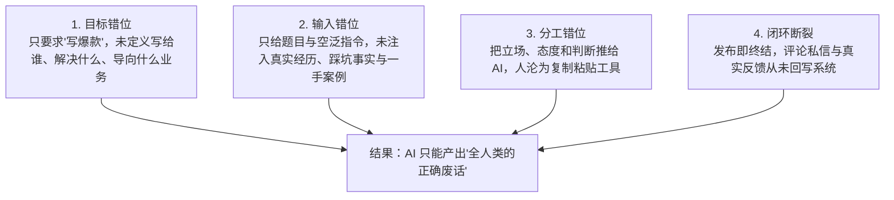
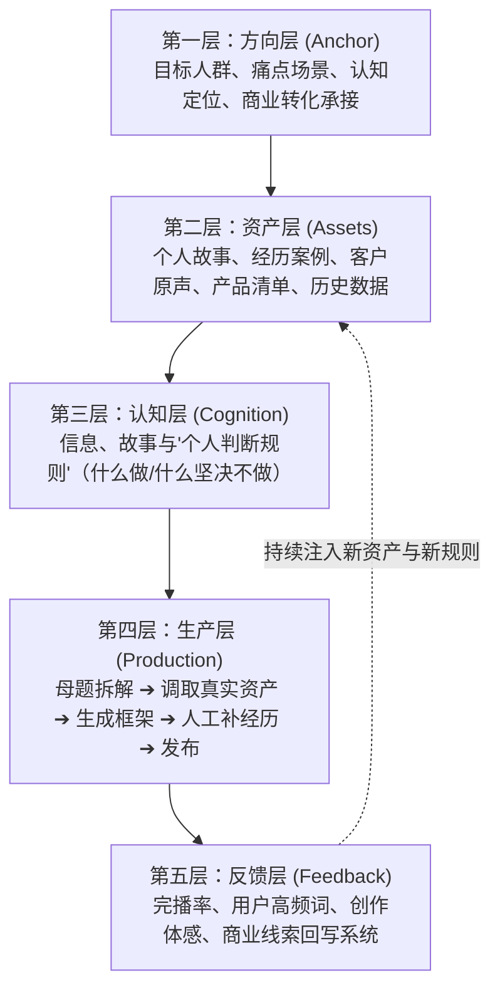
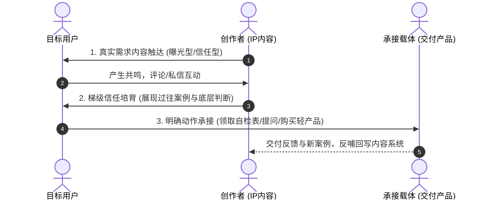

# 5.5 【案例精选】15000字深度拆解：用 Codex + Obsidian 搭建个人 IP 内容系统与 7 天实操 SOP（亦恒）

> **案例作者：** 亦恒（图书电商赛道创业者、AI+IP 体系探索者）  
> **商业结果：** 依托 Codex + Obsidian 知识库跑通个人 IP 商业变现，单项目变现超 **10 万元**，知识库内容全网播放超 **100 万次**  
> **原文参考资料：** [生财有术精华实操长文 (ID: 55522452885812484)](https://scys.com/articleDetail/xq_topic/55522452885812484)  
> **前期变现复盘：** [AI+IP 首个10万结果复盘 (ID: 22811428254242421)](https://scys.com/articleDetail/xq_topic/22811428254242421)  
> **实战案例索引：** [WHENRESET Codex 实战案例库 · 内容与 IP](https://whenreset.com.cn/codex/index.html)

---

## 一、 认知颠覆：为什么用了 AI 之后，内容生产反而更乱？

AI 让写文章变得极其便宜，几分钟就能出一篇结构完整的文章。但大多数创作者用了一段时间后，都会产生强烈的挫败感：**AI 生成的内容越来越多，但自己真正看得上、愿意公开发布的内容却越来越少。**

```text
💡 人味检验法：
把文章顶部的作者名字盖掉，看同行能不能直接拿去发？
如果答案是“能”——它可能是一篇逻辑合格的信息，但绝不是你的个人 IP 内容。
```

这种“哪里都对，唯独不像我”的困境，根源在于创作者陷入了**四重错位**：



> **核心判断：** 个人 IP 真正值钱的，不是公共知识，而是**“你经历过什么、你为什么坚持这个立场、你在哪次失败后修正了判断、面对抉择你做出了什么取舍”**。AI 负责放大效率，IP 负责建立信任，系统负责产生复利。

---

## 二、 个人 IP 内容系统的五层架构模型

一套成熟的内容系统不取决于用了多复杂的工具，而在于是否具备**稳定的输入、可重复的生产、以及结果的回流闭环**：



1. **方向层：** 明确 AI 为谁写。写给小白和写给成熟团队，选题与论证深度完全不同；
2. **资产层：** 将散落在聊天记录、项目复盘、线下录音里的经验“打捞”出来，建立你的专属资产库；
3. **认知层：** 知识库不是资料越多越好。只有经过本人确认的**立场与判断规则**，才准许进入系统；
4. **生产层：** 流程不是“AI 先写人再改”，而是 AI 基于素材库提供选题选项，**人负责拍板与注入真实经历**；
5. **反馈层：** 发布后的评论关键词反向催生下一轮系列选题，形成滚雪球飞轮。

---

## 三、 四大素材“资产化”实操路径

逐字稿不是资产，书籍摘抄也不是资产。只有能被后续选题和业务持续调用的，才叫资产：

| 素材输入形式 | 传统粗糙做法 | 资产化标准加工路径 | 最终沉淀的个人资产 |
| :--- | :--- | :--- | :--- |
| **线下录音 / 访谈** | 转写大篇文字或生成简单摘要 | 剥离口语废话 $\rightarrow$ 提取真实故事 $\rightarrow$ 提炼底层判断与排错步骤 | 经验卡、SOP 流程、课程新模块、冲突型选题 |
| **精读书籍（如《真需求》）** | 摘抄好词好句、全书大纲 | 区分作者原意与自身业务 $\rightarrow$ 转化为原子方法卡与业务诊断工具 | 产品自检表、私域问诊问题、商业诊断工作流 |
| **学习文档 / 报告** | 存入收藏夹吃灰 | 提取可复用方法论 $\rightarrow$ 结合自身案例重构 | 交付工具模板、认知卡片 |
| **发布数据与评论** | 爆了开心，没爆沮丧 | 提取评论区高频提问词 $\rightarrow$ 捕捉未被满足的痛点假设 | 下一轮母题系列、产品自检清单、高意向客户标签 |

---

## 四、 从内容系统走向 IP 商业变现的三步跨越

许多人内容更新很勤奋，但无法沉淀商业价值。内容是业务的放大器，但内容本身不等于业务：



1. **第一步：锁定真实需求：** 不做脱离业务的纯泛流量。问自己：这条内容吸引来的人，是否愿意为我的解决方案付费？
2. **第二步：设计信任梯度：** 
   - 曝光型内容：让新读者建立第一印象；
   - 信任型内容：用自身踩坑与交付细节证明专业度；
   - 转化型内容：给出清晰行动指引与边界。
3. **第三步：设计下一步承接动作：** 用户看完觉得好，下一步去哪？关注专栏、领取 SOP 自检表、参与问诊、或购买具体服务，必须给用户明确的阶梯。

---

## 五、 7 天跑通最小可用内容系统（MVP 实操 SOP）

不要试图在第 1 天搭建一个庞大繁琐的系统，遵循“先跑通极简闭环，再做自动化”原则：

```text
第 1 天【定边界】：确定 1 个精准人群 + 1 个痛点问题 + 1 个主攻平台（产出：目标卡）
第 2 天【立档案】：写一页《IP 说明书》，明确“我是谁、服务谁、可信依据与表达底线”
第 3 天【备原料】：打捞 5 份包含真实经历的碎片素材（录音/项目记录/对话）
第 4 天【做资产】：选择其中 1 份，让 Codex 加工为标准《内容资产卡》（严禁 AI 虚构）
第 5 天【定选题】：基于资产卡让 AI 生成多个角度，人工最终拍板选定 1 个选题与提纲
第 6 天【人机写】：Codex 搭骨架，人工填充真实细节与情感，完成审核并在全网正式发布 1 篇
第 7 天【做复盘】：收集首发数据与评论高频词，形成 1 张《复盘资产卡》写回知识库
```

> **结语心法：** 先发出第 1 篇，再优化系统。没有真实内容产出的系统，只是一个漂亮的空壳。
