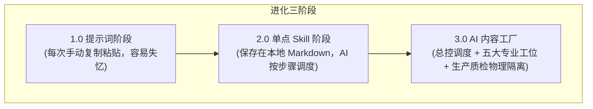
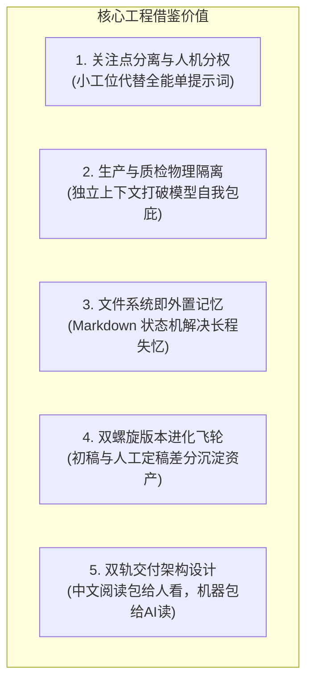

# 5.6 【案例精选】日更 1092 天：五大引擎与七罪标题的开源 AI 内容工厂全解（朝暮拾花）

> **案例作者：** 朝暮拾花（坐标广东惠州，教培行业执行校长，连续日更 1092 天）  
> **生产成果：** 朋友圈日更从“每天苦熬半小时”提速至“两小时跑完 7 篇”；新号文章单篇稳定千观、热点篇破万观；系统迭代 400 余次并全部开源  
> **原文参考资料：** [生财有术精华实操长文 (ID: 14422115288858152)](https://scys.com/articleDetail/xq_topic/14422115288858152)  
> **配套开源包资源：** [AI 内容工厂公开版源码包下载](https://chat.yourdomain.cn/uploads/c4c4b1e2-b3ba-4ed4-872b-e5754368c0e5_AI.zip)  
> **实战案例索引：** [WHENRESET Codex 实战案例库 · 内容与 IP](https://whenreset.com.cn/codex/index.html)

---

## 一、 从“作坊式提示词”到“工业化内容工厂”的进化跃迁

很多创作者陷入“疯狂囤积提示词”的死胡同。一万多字的复杂 Prompt，改一个词后面全部串味；换个模型，上下文一长便陷入失忆。

```text
提示词的宿命：活在单次对话里，窗口关闭即归零。
Skill 与内容工厂的价值：活在本地文件系统里，成为自动化可编排的装配产线。
```



> **核心设计铁律：同一个 AI 不能既当运动员，又当裁判员。**  
> 如果让生成正文的同一个上下文立刻质检自己，它本能会为刚刚写出的句子找借口。必须切断上下文，使用**全新、未参与撰写的独立 Agent** 负责去 AI 味和终审质检。

---

## 二、 内容工厂主产线与五大引擎运转机制

整座工厂由 **1 个总控 + 5 个专业工位 + 1 套标题系统** 紧密串联而成：


| 引擎工位 | 核心职责 | 输入与输出物 | 关键规则与机制 |
| :--- | :--- | :--- | :--- |
| **00 总控调度** | 环境自检、阶段调度、状态跟踪 | 启动配置 $\rightarrow$ `00-任务状态.md` | 用户确认核心目标，按步骤唤醒工位 |
| **01 淘金引擎** | 杂乱素材结构化清洗 | 原始语音/笔记 $\rightarrow$ `02-素材包.md` | 剥离口语废话，缺少素材标“待补充”，严禁瞎编 |
| **02 布局引擎** | 拆解单篇，智能查重 | 素材包 $\rightarrow$ `03-拆篇计划.md` | 检索最近已发文章，避免同一观点短期车轱辘话 |
| **03 铸文引擎** | 结合人格内核与对标生成初稿 | 拆篇计划 + 人格内核 $\rightarrow$ `05-初稿.md` | 噬文系统深度拆解爆文情绪曲线；**本阶段绝不自审** |
| **七罪标题系统** | 标题生成与吸引力把关 | 初稿主题 $\rightarrow$ 候选标题库 | 命中人性欲望，必须通过“停留”与“正文接得住”双质检 |
| **04 鉴文引擎** | 独立去除机器痕迹 | 初稿 $\rightarrow$ `07-鉴文报告.md` + 修正稿 | 独立上下文执行；扫描 22 类 AI 特征与人设违禁词 |
| **05 淬文引擎** | 32 项发布合规终审 | 修正稿 $\rightarrow$ `10-发布稿.md` | 真实性证据核验、隐私脱敏、格式与平台红线审查 |

---

## 三、 七罪标题系统：点击率与完读率的底层引擎

用户在信息流里留给创作者的时间只有 **3 秒甚至 1 秒**。标题的作用不是总结正文，而是触发点击冲动。

### 1. 第一层：开幕雷击七要素
* **金钱：** 赚、亏、省的具体数字（如：*“200 块海鲜自助”*）；
* **异常：** 违背常规常理的反差（如：*“放下筷子那一刻，朋友问我是不是有病”*）；
* **捷径：** 暗示存在更省力的解法；
* **窥探：** 未公开的内幕与真实复盘；
* **冲突/暴力：** 观念碰撞、认知打脸；
* **终结/破灭：** 机会流失、幻想破灭的紧迫感；
* **安全底线提醒：** 坚决不碰负面民族/宏大议题，守住平台合规底线。

### 2. 第二层：人性七宗罪驱动按钮
* **贪婪：** 聚焦收益、资产复利与潜在损失（*“为什么有人三年只拿工资，有人留下资产？”*）；
* **傲慢：** 挑战读者的既有经验（*“你以为在进步，其实只是熟练地重复”*）；
* **嫉妒：** 拉近同等起点的参照物（*“跟你同一年入行的人，为什么开始挑项目了？”*）；
* **愤怒：** 揭示不公与替老实人鸣不平；
* **懒惰（精神倦怠）：** 指向拖延与回避核心困难的本质；
* **暴食 / 色欲：** 严格限定于美食、健康、健身或情感穿搭赛道，禁止无底线低俗擦边。

---

## 四、 真实成稿对比：“人味是说出来的，不是改出来的”

以下为朝暮日更真实案例：同一主题（适可而止的处世哲学），AI 直出版与工厂成稿的剧烈反差：

### ❌ AI 直出版（冰冷机器味）：
> **标题：** 《放下筷子的那一刻，我读懂了人生的 15 个真相》  
> 1. 学会取舍：人生不是拥有越多越好……  
> 2. 懂得知足：知足不是不思进取……  
> 3. 适可而止：吃饭如此，工作如此，生活亦如此……  
> *(整整 15 条整齐划一的排比对仗，结论空泛，毫无生活体温)*

### ✅ 工厂成稿（饱满活人感）：
> **标题：** **《200块海鲜自助，我放下筷子那一刻，朋友问我是不是有病》**  
> *朝暮观察：什么都想占满的人，往往什么都留不住。*  
> 昨天去吃了一顿一直想吃的高档海鲜自助，200 一位。小龙虾、波龙、鲍鱼，现场全抓新鲜的。  
> 打了一小桶，涮了点火锅，吃到七八分饱，我放下筷子不吃了。  
> 朋友看我：“你是不是有病？才吃这点你就停了？”  
> 以前我肯定扶墙进、扶墙出，不撑到吐觉得亏。但昨天坐在那突然想通了：我花 200 块买的是一顿舒服的午饭，还是一肚子难受？  
> 多吃撑进肚里的垃圾，和留在盘里的垃圾有区别吗？浅尝辄止，下午做事一身轻松，这不是更赚吗？  
> 最近很多人学 AI 也一样，看到工具就想学，看到局就想去，把盘子塞得满满当当，最后真正该吃的那口反而没消化……

---

## 五、 新手避坑七大生存准则

1. **拒绝开局直接写全文：** 档案未立、对标未拆，直接给主题让 AI 自由发挥，产出的必然是公共废话；
2. **重心向原料倾斜：** 一篇高质内容的决定权重，**对标素材占 60%，任务描述占 30%，提示词技巧仅占 10%**；
3. **切忌在人格档案里伪饰：** 财务状况与时间约束必须写真实，否则 AI 给出的策略全不可落地；
4. **对标深挖评论区：** 爆款的真正抓手往往藏在读者高频讨论的痛点评论里；
5. **严禁题文割裂的标题党：** 标题要引人停步，但正文必须稳稳接住，否则必遭取关反噬；
6. **不迷信“一键降 AI 率工具”：** 机器改出的无病句伪原创读之索然无味，人味来自真实的口述输入；
7. **每篇沉淀资产：** 写作即沉淀，发现新的机器套话立即加入禁词表，让工厂持续迭代生长。

---

## 六、 开源工程包全景拆解：文件结构与核心职责

配套开源的源码压缩包解压后为 **`AI内容工厂公开版`**，整体工程架构展现了极高的工业级标准：

```text
AI内容工厂公开版/
├── 00-先看这里.md               # 快速入门：两套交付定位、三类启动命令、隐私底线说明
├── README.md                    # 全局工程规范：三条铁律、状态机、鉴文八层、自动化边界
├── CLAUDE.md / AGENTS.md        # Claude Code 与 Codex 自动化接管总控的入口配置文件
├── 00-总控/
│   └── 内容工厂总控/
│       ├── SKILL.md             # 核心调度中枢：环境检测、首次问卷、10大状态机运转
│       └── agents/openai.yaml   # OpenAI 标准 Agent 规范定义
├── 01-配置模板/                 # 7 套核心配置文件（系统状态与个性化隔离）
│   ├── 用户配置.md               # 平台选型、本地工作目录、字数限制、默认承接 CTA
│   ├── 启动自检.md               # 7个Skill/权限/环境状态检查清单（已配置/未配置/受限等）
│   ├── 内容定位.md               # 活人读者画像、核心痛点、认知心智与变现承接目标
│   ├── 写作人格内核.md           # 500字内高浓度人设立场（我为谁写/我怎么说话/我讨厌什么腔调）
│   ├── 脱敏与违规词.md           # 姓名/机构/金额脱敏表、用户机器味禁词表、平台违禁词表
│   ├── 任务状态.md               # 单任务状态跟踪模板（主状态、产物路径、工位检查点）
│   └── 工厂运行状态.md           # 全局多任务索引器（当前任务与历史队列调度）
├── 02-引擎/                     # 五大专业工位（关注点分离，各司其职）
│   ├── 01-淘金引擎/SKILL.md      # 素材提炼器：剥离口语停顿，提炼事实/观点/金句，区分个人与外部原料
│   ├── 02-布局引擎/SKILL.md      # 架构排期器：拆解文章数、栏目排期、历史发文智能查重去重
│   ├── 03-铸文引擎/SKILL.md      # 初稿写手：核对任务卡、融入人格内核与对标基因，严禁本阶段自检
│   ├── 04-鉴文引擎/SKILL.md      # 独立去AI味质检器：22条特征硬扫、6类形式指纹、人味保护、用户终审
│   └── 05-淬文引擎/SKILL.md      # 发布终审卫士：32项发布合规终审（事实、隐私、边界、格式）
├── 03-系统附件/
│   └── 噬文系统.md               # 对标反编译利器：7维拆解（作者身份/读者痛点/结构/语言/情绪过山车）
├── 04-赠品/
│   ├── 01-双螺旋进化引擎/SKILL.md # 资产复利核心：累计5篇后对比初稿与定稿差异，自动进化人格内核
│   └── 流量模式切换说明.md       # 泛流量/流量主号的对标策略与情绪抓手切换指南
├── 05-人格档案系统/             # 深度人设立场提炼包
│   ├── 写作人格内核提炼系统.md   # 500字提炼问答流（两类入口：已有档案 vs 现场采访）
│   ├── 国际版私人AI顾问.txt      # 适用于 GPT/Claude 等长上下文模型的全量档案采集 Prompt
│   └── 第一/二/三步提示词.txt     # 针对国内短上下文模型“防失忆”的三阶段分步采集 Prompt
├── 06-标题系统/
│   └── 七罪引擎.md               # 标题工业化生产：开幕雷击七要素 + 六大公式 + 七宗罪 + 双重检查
├── 07-五分钟演示/               # 零门槛沙盒演示套件（使用虚构原料验证安装与全链路跑通）
│   ├── 00-演示说明.md、01-示例原料.md、02-演示配置.md、03-预期结果.md
└── 08-给AI安装的机器包/         # 标准化机器可读结构
    ├── 00-先读我.md              # 机器包第一入口
    ├── skills/                  # 7 个标准 Skill 目录（支持 Claude Code / Codex 原生安装）
    └── content-factory-runtime/ # 7 个 Skill 共享的配置模板与附件运行时目录
```

### 核心模块具体做了什么？

1. **`00-总控/内容工厂总控/SKILL.md`（调度中枢）：**
   - **核心职责：** 它不是写手，而是调度员。它负责判断环境（完整模式/标准模式/手动模式）、引导 11 项首次配置，并按合法状态机调度各个子工位；
   - **状态机设计：** 严格定义了 `未开始` $\rightarrow$ `已淘金` $\rightarrow$ `待拆篇确认` $\rightarrow$ `已布局` $\rightarrow$ `已铸文` $\rightarrow$ `待标题确认` $\rightarrow$ `待改写确认` $\rightarrow$ `待用户终审` $\rightarrow$ `已鉴文` $\rightarrow$ `待风险确认` $\rightarrow$ `已淬文` 10 种停顿状态，断点随时可续传。
2. **`02-引擎/01-淘金引擎/SKILL.md`（清洗提炼）：**
   - **核心职责：** 拒绝“把杂乱录音直接当文章写”。它将口述、聊天、热点材料进行结构化降噪，打捞出亲身事件、核心判断、金句，并严厉约束：**“原料里没有的事实标为待补充，严禁替用户捏造经历”**。
3. **`02-引擎/02-布局引擎/SKILL.md`（拆篇与去重）：**
   - **核心职责：** 决定一堆素材能出几篇、优先级如何。最具特色的是**历史查重机制**：自动扫描近 3 个月已发布的文章库，若素材核心观点与近期旧文撞车，自动予以合并或剔除，防止创作者陷入“车轱辘话”。
4. **`02-引擎/03-铸文引擎/SKILL.md`（初稿装配）：**
   - **核心职责：** 吸收人格内核（语气、开头习惯、句长分布）与对标文章的情绪曲线（来自噬文系统），生成初稿骨架。
   - **铁律约束：** 动笔前强制展示任务卡（钉子、读者、证据）；**本工位严禁进行自我质量审查**，杜绝自己给自己放水。
5. **`02-引擎/04-鉴文引擎/SKILL.md`（8层深度鉴文）：**
   - **核心职责：** 高达 542 行的高强度审查逻辑。包含 **22 条 AI 写作特征硬扫描**（堵住所有反驳、匀速排比、给概念起名字的仪式、情绪曲线太光滑、“不是X而是Y”高密度等）与 **6 类形式指纹**（破折号过多、大段加粗、装饰性符号、机器人对话残留等）；
   - **保护机制：** 创新性设立了“人味怪词与口头禅保护区”与“真实金句保护区”，改写时给出精准前后对照，由人工最终读出声确认。
6. **`02-引擎/05-淬文引擎/SKILL.md`（32项终审卫士）：**
   - **核心职责：** 发布前终审门禁。逐一核查 32 项指标（事实是否有原料依据、外部观点是否冒充自身观点、脱敏是否彻底、是否触碰平台虚假收入违规红线、字数与排版规范），通过方可生成 `10-发布稿.md`。
7. **`03-系统附件/噬文系统.md`（对标解构器）：**
   - **核心职责：** 拒绝低级“洗稿”。从“作者身份、活人读者、行文结构、语言风味、禁用词库、信息来源、情绪过山车”7 个维度抽干爆款文章的底层逻辑，只学框架不抄文字。
8. **`04-赠品/01-双螺旋进化引擎/SKILL.md`（资产复利飞轮）：**
   - **核心职责：** 每累计 5 篇内容后触发。它将“原始素材、铸文初稿、人工改稿、最终发布稿”进行差异比对，提取用户反复删减的词作为新禁词，提炼用户反复补充的句式作为人格规则，**让整套系统随着使用越用越聪明、越用越像你本人**。

---

## 七、 开发者与创作者能从这套开源工程中借鉴什么？

这套系统的价值不仅在于“写文章”，更在于它提供了一套极其优异的**单人复杂业务 Agent 编排工程学样本**：



### 1. 告别万字大 Prompt，拥抱“微工位装配流水线”
* **行业教训：** 把“写大纲、查资料、写正文、起标题、去机器味、查敏感词”全部写进一个几万字的 Prompt 里，模型在注意力机制衰减下必定前后矛盾；
* **借鉴做法：** 将流水线切分为 5 个单功能模块（淘金、布局、铸文、鉴文、淬文），输入输出严格通过文件落盘。每个工位只做一件事，哪怕其中一个环节出错，也只需回滚单一步骤，不会导致整盘崩溃。

### 2. “生产与质检物理隔离”的质检工程学
* **认知突破：** 同一个上下文中的大模型，天然具有“认知防御倾向”，无法有效挑出自己刚写出的套话；
* **借鉴做法：** 鉴文引擎强制要求**新开会话或唤醒独立 Agent**，不给它看之前的推导过程，只给它看初稿和检测清单。以冷酷的“局外人视角”逐条扫描 22 类 AI 痕迹，这极大保证了内容质检的客观度与尖锐度。

### 3. 用本地 Markdown 文件系统作为 Agent 的“外置记忆”
* **解决失忆痛点：** 模型上下文有限，窗口重置便遗忘背景；
* **借鉴做法：** 利用 `00-任务状态.md` 记录 10 种合法状态机进展，利用 `写作人格内核.md` 和 `脱敏与违规词.md` 作为外部配置挂载。AI Agent 每次被唤醒，只需读取当前阶段依赖的 2~3 个 Markdown 文件，不仅上下文耗费极低（极省 Token），而且支持多人多任务随时断点重跑。

### 4. “双螺旋进化”：从一次性消费走向复利沉淀
* **变现与资产化：** 大多数 AI 辅助写作都是一次性劳动，写完即丢；
* **借鉴做法：** 永远把“AI 直出初稿”与“人工最终发布稿”分开备份。通过定期的 Diff 差分比对（双螺旋进化引擎），找出人反复做出的修改，反哺到禁词库与人设内核中。这为所有从事“数字花园”、“第二大脑”和“一人公司自动化”的极客提供了可复制的标准闭环。

### 5. 双轨交付的极客工程美学
* **体验平衡：** 开发者常陷入“要么代码太机器化普通人看不懂，要么纯文本缺乏工程调度标准”的极端；
* **借鉴做法：** 朝暮采用了“中文阅读包（为人设计，层级清晰便于理解与配置）”与“08-机器安装包（为 AI 设计，符合 OpenAI/Claude Code 原生 Skill 规范）”的双轨架构。既保障了小白在聊天框里按部就班操作，又让极客可以在本地通过 CLI 工具一键拉起流水线，展现了极高的产品化修养。
