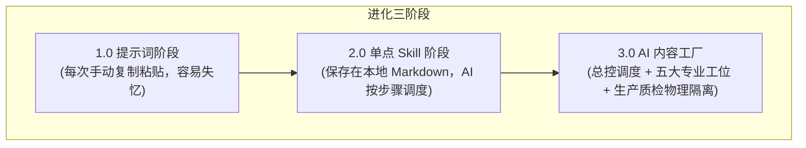

# 5.6 【案例精选】日更 1092 天：五大引擎与七罪标题的开源 AI 内容工厂全解（朝暮拾花）

> **案例作者：** 朝暮拾花（坐标广东惠州，教培行业执行校长，连续日更 1092 天）  
> **生产成果：** 朋友圈日更从“每天苦熬半小时”提速至“两小时跑完 7 篇”；新号文章单篇稳定千观、热点篇破万观；系统迭代 400 余次并全部开源  
> **原文参考资料：** [生财有术精华实操长文 (ID: 14422115288858152)](https://scys.com/articleDetail/xq_topic/14422115288858152)  
> **配套开源包资源：** [AI 内容工厂公开版源码包下载](https://chat.tg-cc755.cn/uploads/c4c4b1e2-b3ba-4ed4-872b-e5754368c0e5_AI.zip)  
> **实战案例索引：** [WHENRESET Codex 实战案例库 · 内容与 IP](https://whenreset.com.cn/codex/index.html)

---

## 一、 从“作坊式提示词”到“工业化内容工厂”的进化跃迁

很多创作者陷入“疯狂囤积提示词”的死胡同。一万多字的复杂 Prompt，改一个词后面全部串味；换个模型，上下文一长便陷入失忆。

```text
提示词的宿命：活在单次对话里，窗口关闭即归零。
Skill 与内容工厂的价值：活在本地文件系统里，成为自动化可编排的装配产线。
```



> **核心设计铁律：同一个 AI 不能既当运动员，又当裁判员。**  
> 如果让生成正文的同一个上下文立刻质检自己，它本能会为刚刚写出的句子找借口。必须切断上下文，使用**全新、未参与撰写的独立 Agent** 负责去 AI 味和终审质检。

---

## 二、 内容工厂主产线与五大引擎运转机制

整座工厂由 **1 个总控 + 5 个专业工位 + 1 套标题引擎** 紧密串联而成：


| 引擎工位 | 核心职责 | 输入与输出物 | 关键规则与机制 |
| :--- | :--- | :--- | :--- |
| **00 总控调度** | 环境自检、阶段调度、状态跟踪 | 启动配置 $\rightarrow$ `00-任务状态.md` | 用户确认核心目标，按步骤唤醒工位 |
| **01 淘金引擎** | 杂乱素材结构化清洗 | 原始语音/笔记 $\rightarrow$ `02-素材包.md` | 剥离口语废话，缺少素材标“待补充”，严禁瞎编 |
| **02 布局引擎** | 拆解单篇，智能查重 | 素材包 $\rightarrow$ `03-拆篇计划.md` | 检索最近已发文章，避免同一观点短期车轱辘话 |
| **03 铸文引擎** | 结合人格内核与对标生成初稿 | 拆篇计划 + 人格内核 $\rightarrow$ `05-初稿.md` | 噬文系统深度拆解爆文情绪曲线；**本阶段绝不自审** |
| **七罪标题系统** | 标题生成与吸引力把关 | 初稿主题 $\rightarrow$ 候选标题库 | 命中人性欲望，必须通过“停留”与“正文接得住”双质检 |
| **04 鉴文引擎** | 独立去除机器痕迹 | 初稿 $\rightarrow$ `07-鉴文报告.md` + 修正稿 | 独立上下文执行；扫描 22 类 AI 特征与人设违禁词 |
| **05 淬文引擎** | 32 项发布合规终审 | 修正稿 $\rightarrow$ `10-发布稿.md` | 真实性证据核验、隐私脱敏、格式与平台红线审查 |

---

## 三、 七罪标题系统：点击率与完读率的底层引擎

用户在信息流里留给创作者的时间只有 **3 秒甚至 1 秒**。标题的作用不是总结正文，而是触发点击冲动。

### 1. 第一层：开幕雷击七要素
* **金钱：** 赚、亏、省的具体数字（如：*“200 块海鲜自助”*）；
* **异常：** 违背常规常理的反差（如：*“放下筷子那一刻，朋友问我是不是有病”*）；
* **捷径：** 暗示存在更省力的解法；
* **窥探：** 未公开的内幕与真实复盘；
* **冲突/暴力：** 观念碰撞、认知打脸；
* **终结/破灭：** 机会流失、幻想破灭的紧迫感；
* **安全底线提醒：** 坚决不碰负面民族/宏大议题，守住平台合规底线。

### 2. 第二层：人性七宗罪驱动按钮
* **贪婪：** 聚焦收益、资产复利与潜在损失（*“为什么有人三年只拿工资，有人留下资产？”*）；
* **傲慢：** 挑战读者的既有经验（*“你以为在进步，其实只是熟练地重复”*）；
* **嫉妒：** 拉近同等起点的参照物（*“跟你同一年入行的人，为什么开始挑项目了？”*）；
* **愤怒：** 揭示不公与替老实人鸣不平；
* **懒惰（精神倦怠）：** 指向拖延与回避核心困难的本质；
* **暴食 / 色欲：** 严格限定于美食、健康、健身或情感穿搭赛道，禁止无底线低俗擦边。

---

## 四、 真实成稿对比：“人味是说出来的，不是改出来的”

以下为朝暮日更真实案例：同一主题（适可而止的处世哲学），AI 直出版与工厂成稿的剧烈反差：

### ❌ AI 直出版（冰冷机器味）：
> **标题：** 《放下筷子的那一刻，我读懂了人生的 15 个真相》  
> 1. 学会取舍：人生不是拥有越多越好……  
> 2. 懂得知足：知足不是不思进取……  
> 3. 适可而止：吃饭如此，工作如此，生活亦如此……  
> *(整整 15 条整齐划一的排比对仗，结论空泛，毫无生活体温)*

### ✅ 工厂成稿（饱满活人感）：
> **标题：** **《200块海鲜自助，我放下筷子那一刻，朋友问我是不是有病》**  
> *朝暮观察：什么都想占满的人，往往什么都留不住。*  
> 昨天去吃了一顿一直想吃的高档海鲜自助，200 一位。小龙虾、波龙、鲍鱼，现场全抓新鲜的。  
> 打了一小桶，涮了点火锅，吃到七八分饱，我放下筷子不吃了。  
> 朋友看我：“你是不是有病？才吃这点你就停了？”  
> 以前我肯定扶墙进、扶墙出，不撑到吐觉得亏。但昨天坐在那突然想通了：我花 200 块买的是一顿舒服的午饭，还是一肚子难受？  
> 多吃撑进肚里的垃圾，和留在盘里的垃圾有区别吗？浅尝辄止，下午做事一身轻松，这不是更赚吗？  
> 最近很多人学 AI 也一样，看到工具就想学，看到局就想去，把盘子塞得满满当当，最后真正该吃的那口反而没消化……

---

## 五、 新手避坑七大生存准则

1. **拒绝开局直接写全文：** 档案未立、对标未拆，直接给主题让 AI 自由发挥，产出的必然是公共废话；
2. **重心向原料倾斜：** 一篇高质内容的决定权重，**对标素材占 60%，任务描述占 30%，提示词技巧仅占 10%**；
3. **切忌在人格档案里伪饰：** 财务状况与时间约束必须写真实，否则 AI 给出的策略全不可落地；
4. **对标深挖评论区：** 爆款的真正抓手往往藏在读者高频讨论的痛点评论里；
5. **严禁题文割裂的标题党：** 标题要引人停步，但正文必须稳稳接住，否则必遭取关反噬；
6. **不迷信“一键降 AI 率工具”：** 机器改出的无病句伪原创读之索然无味，人味来自真实的口述输入；
7. **每篇沉淀资产：** 写作即沉淀，发现新的机器套话立即加入禁词表，让工厂持续迭代生长。
