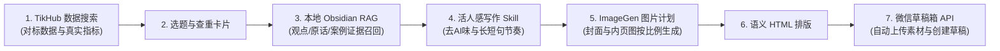
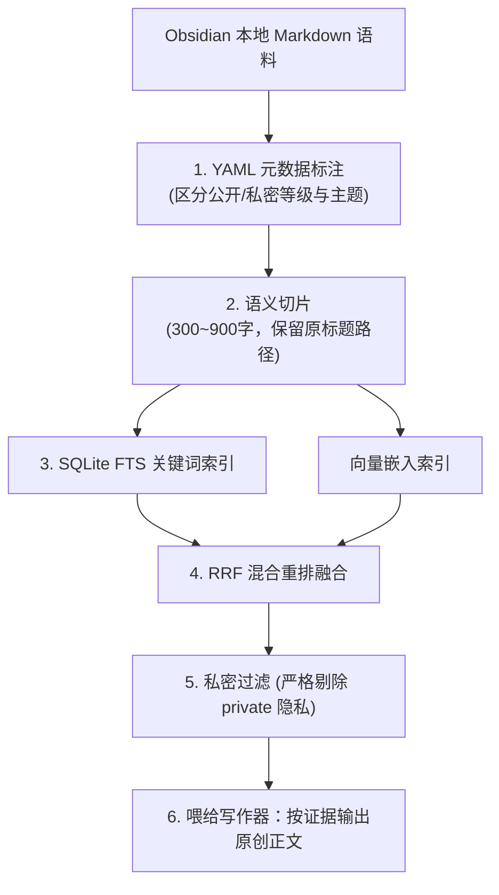

# 5.7 【案例精选】公众号 99% 自动化：从 TikHub 检索到本地 RAG 与官方草稿箱直连（根源）

> **案例作者：** 根源（资深内容探索者、AI 自动化工作流架构者）  
> **工程成果：** 历经数月打磨，打通“搜索对标数据 $\rightarrow$ 选题排重 $\rightarrow$ 本地 Obsidian RAG 检索 $\rightarrow$ AI 写作 $\rightarrow$ ImageGen 配图 $\rightarrow$ 模板排版 $\rightarrow$ 微信公众号草稿箱”端到端 99% 自动化  
> **原文参考资料：** [生财有术精华实操长文 (ID: 45544148552844858)](https://scys.com/articleDetail/xq_topic/45544148552844858)  
> **数据接口服务：** [TikHub 开放平台](https://user.tikhub.io/)  
> **活人感写作参考：** [卡兹克内容写作规则库 (khazix-writer)](https://github.com/Khazix)  
> **实战案例索引：** [WHENRESET Codex 实战案例库 · 内容与 IP](https://whenreset.com.cn/codex/index.html)

---

## 一、 公众号自动化的核心痛点与解构

“一键生成公众号文章并自动发布”是很多人的设想，但实际落地往往卡在各种边缘技术陷阱中：
1. **内容来源虚假：** AI 凭空捏造案例与个人经历，读者读之毫无信任感；
2. **排版失真难看：** 复制到后台后字体、行距、色块完全错乱；
3. **接口鉴权繁琐：** 微信公众号对接口调用有严苛的 IP 白名单和凭证管理机制。



> **自动化核心准则：未经人工确认，绝不自动发布。** 系统全自动负责至“送达微信公众号草稿箱”，创作者只需在手机端打开订阅号助手终审点亮发送。

---

## 二、 数据搜索与真实证据链：TikHub 适配器设计

不靠 AI 盲目猜测选题，而是先获取真实世界中被验证过的爆款数据：

* **传统爬虫 vs 专业 API：** 采用纯浏览器模拟抓取公众号数据，不仅容易被验证码拦截，且极难获取准确的阅读量、在看量与评论区数据；
* **接入 TikHub 数据适配层：** 注册获取 API Key，由 Codex 实现通用的 `SearchProvider` 适配器：
  ```typescript
  export type SearchItem = {
    source: string;
    sourceId: string;
    url: string;
    title: string;
    publishedAt?: string;
    metrics: { views?: number; likes?: number; comments?: number };
  };
  ```
* **证据等级分级机制：**  
  - 拥有原链接且指标完整度 $\ge 2$：标记为“可比较真实数据”；  
  - 缺失指标时严禁使用 AI 虚构分数冒充热度，直接标为“数据待补”。

---

## 三、 本地 Obsidian RAG：拒绝整库丢给 AI

真正可控的本地知识检索（RAG）必须是精准片段召回，而不是将整个知识库一次性硬塞给大模型：



1. **元数据权限隔离：** 客户咨询、私人日记标记为 `visibility: private`，公开发布文章标记为 `visibility: publishable`，杜绝隐私外泄；
2. **混合检索（FTS + 向量）：** 关键词检索保障精准专有名词命中，向量检索补充语义相近的表达；
3. **事实缺口追问：** 提示词严格约束——未在知识库中找到事实证据的数字与经历，**标记为缺口，严禁 AI 擅自补写**。

---

## 四、 活人感写作 Skill 与视觉图片工程化

### 1. 吸收卡兹克（khazix-writer）方法论的写作原则
* **新事实驱动：** 每一节段落必须带来新动作、新区别或新后果，不把同一个道理换五种说法反复车轱辘；
* **清理机器指纹：** 剔除“首先、其次、最后”机械三段式、满篇黑体强调、虚浮金句和宣传口号；
* **手机端阅读节奏：** 重点判断单独成行，短句与长句错落分布，杜绝连续大块视觉压迫感。

### 2. 规范化 ImageGen 配图计划
* **拒绝无规则随机生图：** 在写完正文后，先生成 `image-plan.json`，明确封面（`ratio: 2.35:1`）与内页插图（`ratio: 16:9`）的必须出现元素与禁止元素；
* **通道约束：** 规范调用 Codex 内置生图功能，禁止在未授权情况下随意调用外部第三方昂贵扣费接口。

---

## 五、 直连微信公众号官方草稿箱与 IP 白名单攻防

自动送入公众号后台草稿箱，需要打通微信公众平台的开发接口：

| 配置关键项 | 获取位置与规范 | 安全注意事项 |
| :--- | :--- | :--- |
| **AppID** | 微信公众平台 $\rightarrow$ 设置与开发 $\rightarrow$ 基本配置 | 公开标识，配置于 `.env` |
| **AppSecret** | 微信公众平台 $\rightarrow$ 基本配置 $\rightarrow$ 开发者密码 | 核心机密，**严禁提交至 Git 仓库** |
| **IP 白名单** | 微信公众平台 $\rightarrow$ 基本配置 $\rightarrow$ IP 白名单 | 必须将发包服务器公网 IP 录入方可调用接口 |

### 针对家庭浮动 IP 的三种工程化应对方案
1. **固定公网 IP 云服务器部署（最推荐）：** 将工作台后端部署于轻量云服务器上，一次性将固定服务器公网 IP 加入微信白名单，稳定长期运行；
2. **无服务器云函数（Serverless）：** 结合固定代理出口调用；
3. **集中批量处理模式：** 如果本地运行且为动态宽带 IP，采用“集中批处理”，每周挑选固定时间将本周 7 篇稿件一并生成并批量推送进草稿箱，一个月仅需更新一至两次白名单。
