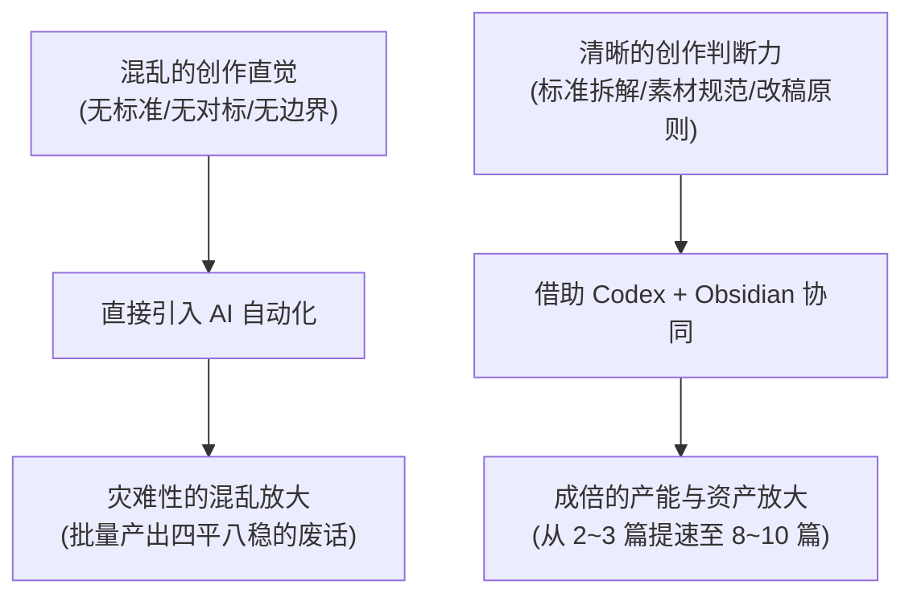
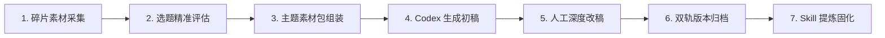

# 5.8 【案例精选】Codex × Obsidian 内容系统：满意稿日产翻倍至 8~10 篇的沉淀法则（七天假）

> **案例作者：** 七天假（资深产品经理、内容创业者）  
> **生产成果：** 用约 2 个月时间，将个人内容创作流程工程化重构，状态顺畅时，满意稿日产量从过去的 **2~3 篇提升至 8~10 篇**  
> **原文参考资料：** [生财有术精华实操帖 (ID: 45548814854181858)](https://scys.com/articleDetail/xq_topic/45548814854181858)  
> **实战案例索引：** [WHENRESET Codex 实战案例库 · 内容与 IP](https://whenreset.com.cn/codex/index.html)

---

## 一、 核心洞察：工具只会放大原有的混乱

很多创作者误以为引入 Codex 或复杂插件后，产能就会凭空暴涨。但现实往往是：**如果创作者自己缺乏对好内容的判断力，AI 只会帮你以极快的速度制造更多垃圾内容。**

> **核心原则：** 内容自动化的起点，是先拆出自己原本的创作判断，再把**找资料、结构梳理、候选筛选**等重复繁琐动作交给 AI；核心的品味、取舍与情感共鸣，永远由人牢牢握在手中。

---

## 二、 Codex × Obsidian 七步内容流水线

七天假将原本感性的写作行为，重构为可复用的 7 个标准工序：

1. **第一步：碎片素材采集（输入端）：**  
   在 Obsidian 中随时捕获日常闪念、用户原声、竞品截图与行业动态，保留原始链接与上下文，不追求一次性成文。
2. **第二步：选题价值评估：**  
   根据目标受众画像（她正为什么发愁）与自身业务交付目标，从素材池中筛选出值得被公开讨论的选题。
3. **第三步：素材包组装：**  
   在动笔前，让 Codex 先把相关的 3~5 条事实、数据、对标结构汇总为一个轻量“素材包”，确认论据充实后再动笔。
4. **第四步：Codex 骨架与初稿生成：**  
   AI 负责搭建段落框架、连接论点与案例，快速产出一版具备 60~70 分可用度的基础草稿。
5. **第五步：人工深度改稿（注入灵魂）：**  
   创作者通读初稿，删掉机器假大空套话，注入自己的口吻、观点转折与真实情绪。
6. **第六步：双轨版本归档（关键动作）：**  
   **将“AI 生成的初稿”与“人工最终定稿”分别独立归档保存在 Obsidian 中。**  
   这样系统能明确对比人改动了哪些地方、删除了哪些词，让创作者的真实偏好成为下一次微调的输入原料。
7. **第七步：稳定流程固化为 Skill：**  
   当一条流水线在手工状态下跑过 10 次以上且稳定可用时，才将其编写为固定的 `.md` 规则文件或 Skill，由 Codex 定期执行。

---

## 三、 突破日产瓶颈的三大底层心法

1. **前一步失败即暂停，拒绝拿空数据强行生成：**  
   如果素材库中缺少事实证据，宁可停下来去补充调研，也决不能让 AI 凭空捏造数字充数；
2. **产能提升建立在改稿能力上：**  
   从 2~3 篇提速到 8~10 篇，关键在于 AI 替你扛下了“找资料、打骨架、拟候选标题”这 80% 的耗时体力活，使你能将全部精力聚焦在“挑刺、润色、点睛”的最后 20% 高价值环节；
3. **以变应变，锚定核心价值：**  
   > *“业务在变，平台在变，但我一直在做同一件事：把自己的经验、产品和判断，持续变成别人愿意看的内容。”*
