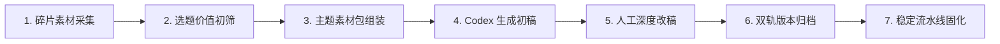

# 5.8 【案例精选】Codex × Obsidian 内容系统：满意稿日产翻倍至 8~10 篇的沉淀法则（七天假）

> **案例档案卡片**
>
> - **案例作者**：七天假（资深产品经理、个人 IP 内容创作者）  
> - **生产成果**：历经约 2 个月工程化重构，在保持个人表达风格与高满意度的前提下，内容日产量从过去的 **2~3 篇提速至 8~10 篇**  
> - **核心理念**：“内容自动化的起点是先拆出自己原来的创作判断，再把重复动作交给 AI；否则工具只会以极快速度放大混乱。”  
> - **原文参考资料**：[生财有术精华实操帖 (ID: 45548814854181858)](https://scys.com/articleDetail/xq_topic/45548814854181858)  
> - **实战案例索引**：[WHENRESET Codex 实战案例库 · 内容与 IP](https://whenreset.com.cn/codex/index.html)

---

## 一、 核心洞察：工具只会成倍放大原有的混乱

很多创作者误以为只要装上 Codex、配齐各种 Obsidian 插件，内容产能就会神奇暴涨。现实往往极其残酷：**如果你原本就不清楚什么是好内容、缺乏对选题的敏感度，AI 只会帮你以每天几十万字的速度制造更多毫无灵魂的垃圾。**

```{mermaid}
flowchart TD
    Chaos["混乱的创作直觉<br/>(无标准 / 无对标 / 无底线)"] --> Tool["直接引入 AI 自动化"] --> Amplified["灾难性的混乱放大<br/>(批量产出四平八稳的正确废话)"]

    Clarity["清晰的创作判断力<br/>(标准拆解 / 素材规范 / 改稿原则)"] --> Skill["借助 Codex + Obsidian 协同"] --> Multiplied["成倍的产能与复利放大<br/>(从 2~3 篇提速至 8~10 篇)"]
```

### 创作职责的“人机再分工”

| 传统感性创作（人是全流程瓶颈） | Codex × Obsidian 流水线（人是总指挥） | 职责归属 |
| :--- | :--- | :--- |
| 到处翻网页、找对标素材、截图（耗时 40%） | 结构化爬取、标签分类、摘要提取 | **完全外包给 AI** |
| 构思段落起承转合、列提纲骨架（耗时 30%） | 依据指定对标结构快速组装初稿草案 | **AI 搭建骨架** |
| 选定今日切入点、赋予情绪与真实案例（耗时 15%） | 决定今天打哪个人群痛点、注入自己的亲身经历 | **人类牢牢把关** |
| 删掉机械假大空套话、润色金句点睛（耗时 15%） | 通读初稿并进行破坏性修改，赋予活人体温 | **人类独家专享** |

---

## 二、 Codex × Obsidian 七步内容流水线



### 1. 碎片素材捕获（输入池）
在 Obsidian 中建立 `01-Inbox/`，随时捕捉用户留言、小红书评论、阅读批注与灵感碎片。每一条素材必须记录来源 URL、时间与关联主题。

### 2. 选题价值初筛
每天早晨花 20 分钟从素材池中挑选出 8~10 个值得公开讨论的切入点，明确“**这篇文章到底替目标读者解决了什么纠结**”。

### 3. 主题素材包组装
让 Codex 先把相关的 3~5 条事实、数据、对标爆款结构汇总为一个轻量“素材包”，**确认论据充实后再动笔**。

### 4. Codex 生成 60 分初稿
AI 负责把零散的事实串联成通顺流畅的草稿，快速完成初稿打底。

### 5. 人工深度改稿（注入灵魂）
创作者不从零打字，而是像主编一样审阅改稿：删掉排比假大空话、调换段落节奏、加入自己当年踩过的坑与心理挣扎。

### 6. 双轨版本归档（Diff 学习法）
**将“AI 生成的初稿”与“人工最终定稿”分别独立归档保存在 Obsidian 中**：
```text
vault/
├── drafts/
│   └── 2026-07-28-ai-draft-01.md    # AI 初始交付草案
└── published/
    └── 2026-07-28-final-edit-01.md  # 人工最终修改定稿
```
每周末让 Codex 对比两组文件的 `git diff`，分析：“*人类作者删除了哪些高频词？把哪些被动的表述改成了第一人称口语？*” 从而反向优化下周的 System Prompt。

### 7. 稳定流程固化为规则
当某种特定类型的文章（如案例拆解文、行业快评）稳定跑通 10 次以上，才将其规则沉淀为专有 Skill，交付给 Codex 自动运行。

---

## 三、 突破日产瓶颈的三大底层心法

1. **前一步失败即暂停，拒绝拿空数据强行生成**：
   - 如果素材库中缺少事实证据，宁可停下来去补充调研，也决不能让 AI 凭空捏造数字充数；空数据生成的所谓“爆款”没有任何商业信任度。
2. **产能提升建立在改稿能力上**：
   - 满意稿能从 2~3 篇跃升至 8~10 篇，关键在于创作者从“痛苦码字的打字员”转型为“运筹帷幄的主编”。
3. **以变应变，锚定核心价值**：
   > “平台算法在变，热点在变，但商业的本质永远不变：**把自己的真实经历、产品能力和专业判断，持续变成用户愿意看、愿意信、愿意买单的高价值内容。**”
