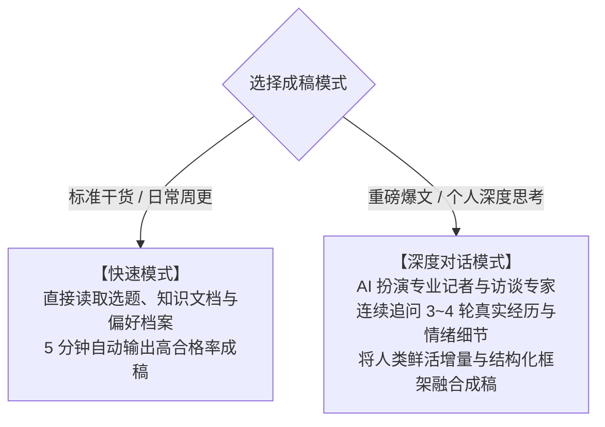

# 5.8 【案例精选】用 Claude Code 搭建自动化 AI 内容生产系统：从 Coze 爆款采集到大脑与偏好沉淀全闭环（七天假）

> **案例档案卡片**
>
> - **案例作者**：七天假（互联网资深产品经理，操盘过百万日活直播产品；裸辞创业小红书博主，半年变现超 20 万元，最高月入破 10 万元）  
> - **系统成果**：耗时 3 个月打磨的 1.4w 字自动化 AI 内容生产工程体系，写出 10w+ 小眼睛小红书爆款笔记与 2w+ 微信公众号长文  
> - **核心工具栈**：`Claude Code` (大脑核心) + `Coze 工作流 API` (爆款采集) + `Obsidian / 本地 Markdown` (三层资产池) + `launchd / Crontab` (定时调度)  
> - **核心标签**：`Claude Code` `三层架构` `Coze工作流API` `CLAUDE.md大脑文件` `写作偏好档案` `爆款公式萃取` `朋友圈Skill` `素材自进化`  
> - **原文参考资料**：[生财有术 1.4w 字万字实操长文 (ID: 55522542455512284)](https://scys.com/articleDetail/xq_topic/55522542455512284) 与 [生财有术精华实操帖 (ID: 45548814854181858)](https://scys.com/articleDetail/xq_topic/45548814854181858)  
> - **关键洞察**：**“这不是一个帮你批量生产垃圾内容的投机工具。如果你认真做内容但产出卡在‘耗时长’与‘AI 写出来没有你的灵魂味道’上，这套三层架构正是为你设计的。自动化不是一键直出，而是把大脑（定位与红线）、流水线（Skill与工作流）与素材库彻底解耦。AI 越写越像你，靠的是持续的素材投喂与改稿偏好自演进。”**

---

## 一、 先看成品：三层架构设计哲学

许多人尝试用 AI 写内容，往往在聊天框里写一段一万字的复杂 Prompt，结果聊几句就遗忘，生成的内容四平八稳、全是 AI 味的正确废话。

七天假老师设计的系统彻底抛弃了单次会话模式，采用**三层解耦架构**：

```mermaid
flowchart TD
    subgraph 第一层：AI 大脑层 (CLAUDE.md)
        M1["定位与人设背景<br/>(凭什么听你的)"]
        M2["核心用户画像<br/>(生活画面+原话痛点)"]
        M3["产品与变现体系<br/>(价格/定位/核心卖点)"]
        M4["指令速查表 & 行为红线<br/>(绝对不可越界)"]
    end

    subgraph 第二层：流水线层 (Skill 与自动化脚本)
        S1["xhs_collector: Coze API 爆款采集"]
        S2["topic_generator: 爆款库选题生成"]
        S3["formula_extractor: 标题/开头公式提炼"]
        S4["note_generator: 双轨模式成稿"]
        S5["moments_generator: 朋友圈文案生成"]
    end

    subgraph 第三层：素材与沉淀层 (本地文件资产)
        D1["01-内容生产 (爆款参考库 / 选题池 / 草稿箱)"]
        D2["02-产品服务库 (知识体系 / 销售话术 / 交付手册)"]
        D3["03-素材库 (用户洞察 / 个人金句 / 写作偏好档案.md)"]
        D4["04-输入箱 (未加工的原始资料堆放池)"]
    end

    M1 & M2 & M3 & M4 --> S1 & S2 & S3 & S4 & S5
    S1 & S2 & S3 & S4 & S5 <--> D1 & D2 & D3 & D4
```

- **第一层：AI 大脑层 (`CLAUDE.md`)**：Claude Code 启动时必读的全局上下文，固化创作者人设、用户画像、产品线、指令速查与行为红线；
- **第二层：流水线层 (Skill 集合)**：分工明确的作业手，负责抓取爆款、提炼选题、生成笔记与发朋友圈；
- **第三层：素材层 (本地资产池)**：系统越用越聪明的底座，包含知识库、真实案例、用户痛点原话与改稿偏好记录。

---

## 二、 完整搭建手册（7 步实操闭环）

### 第一步：建文件夹结构（10 分钟）

在本地项目根目录下创建标准的层级目录：

```text
my-content-factory/
├── CLAUDE.md                  <-- 【AI大脑】人设、画像、产品、指令与红线
├── 01-内容生产/
│   ├── 爆款参考库/            <-- Coze 自动采集的同行爆款笔记与评论
│   ├── 选题池/                <-- AI 结合知识库与爆款生成的待写选题
│   ├── 草稿箱/                <-- 正在生成的初稿
│   └── 已发布归档/            <-- 终审发布的成稿与发布日期
├── 02-产品服务库/
│   └── 运营知识体系/          <-- 结构化提炼后的方法论文档
├── 03-素材库/
│   ├── 用户洞察库/
│   │   ├── 学员案例库/        <-- 真实客户反馈与咨询案例
│   │   └── 个人观点与金句/    <-- 深度写作对话中沉淀的原创思考
│   └── 写作偏好档案.md        <-- 【核心】AI 风格微调记录簿
└── 04-输入箱/                 <-- 零散资料、PDF、聊天记录原始投喂池
```

---

### 第二步：编写 AI 大脑文件 (`CLAUDE.md`)

这是系统最核心的底座。一个合格的 `CLAUDE.md` 包含六大板块：

#### ① 你的定位与背景
不要写空话（如“资深博主”），必须能回答**“凭什么听你的”**：

```text
梳理定位引导 Prompt（直接发给 AI 对话）：
我需要梳理个人定位与背景，写入 CLAUDE.md。请你逐个问我以下问题，等我回答后再问下一个：
1. 你的主业是什么？在这个行业做了几年？
2. 你拿到过什么最有说服力的结果？（带具体数字，如'半年变现20w'、'操盘百万日活'）
3. 跟同行比，你最与众不同的核心优势是哪 2-3 条？凭什么读者要听你的？
全部问完后，整理为包含：身份、经历+数字结果、核心优势、一句话定位的规范格式。
```

#### ② 目标用户画像（深入到“用户原话”与“生活画面”）
拒绝抽象标签（如“30-40岁男性”），必须刻画真实生活状态与痛点原话：

```text
画像 A：实体小老板型（占比 70%）
• 场景还原：35 岁左右，在本地开门窗或装修店 5-8 年。手下有几号人，生意靠老客户和线下客流撑着。这几年客流严重下滑，看到同行在小红书发获客案例心里极度焦虑，但每天被工地、催款、报价塞满，根本没精力钻研平台算法。
• 核心需求：不是“学小红书运营”，而是“让我的门店多来真实成交客户”。
• 痛点与原话：
  - “发了笔记但一个客户都没来，不知道问题出在哪”（咨询原话）
  - “花几千块找人代运营被坑了，钱白花了”（评论区原话）
  - “你们这些通用方法适合我们门窗五金行业吗？”（私信原话）
• 决策顾虑与情绪变化：被割过韭菜不信任 -> 极度焦虑渴望有懂行的人指导 -> 购买后期望掌控感。
```

```text
梳理用户画像引导 Prompt：
请扮演资深业务顾问，通过以下 4 步引导我梳理 CLAUDE.md 用户画像，每次只问 1 题：
1. 基础信息：你的产品价位？客户通常从哪里找到你？
2. 客户故事：印象最深的一个买家是谁？来找你前踩过什么坑、最急迫的事是什么？成交后反馈是什么？
3. 真实声音：请提取 3-5 条同类爆帖评论区里用户的抱怨、问价与吐槽原话发给你；
4. 输出整理：根据以上内容，生成包含：画像名称与占比、生活场景还原、痛点与用户原话、决策顾虑、情绪变化脉络的档案。
```

#### ③ 产品服务体系
明确各产品的定价、核心卖点一句话、服务流程以及递进承接关系，供 AI 适时在正文埋钩子。

#### ④ 内容风格要求
在 `CLAUDE.md` 中声明：`内容风格与行文偏好参照 @03-素材库/写作偏好档案.md`。

#### ⑤ 指令速查表
防止模型混淆或出现调用幻觉：

| 你说什么（触发词） | 调用哪个 Skill | 干什么 |
| :--- | :--- | :--- |
| **“搜集今天的爆款”** | `xhs_collector` | 按关键词采集小红书热门笔记并存入参考库 |
| **“生成今日选题”** | `topic_generator` | 基于爆款库与知识体系生成 8-10 个精准选题 |
| **“写这篇笔记”** | `note_generator` | 启动快速或深度双轨写作模式成稿 |
| **“发个朋友圈”** | `moments_generator` | 根据素材库生成短平快朋友圈文案 |

#### ⑥ AI 行为红线
明确不可触碰的高压线：

```text
铁律（绝对禁止）：
1. 禁止移动、重命名、删除任何已存在的文件，未经确认严禁覆写；
2. 内容文件只归档不物理删除，草稿一律不得清空；
3. 禁止自动提交 Git 代码，必须等待明确人工指令。

内容红线：
1. 严禁捏造虚假客户案例与夸大营收数据；
2. 严禁贬低同行或竞品；
3. 严禁使用“总而言之”“在这个快节奏的时代”“本质上”等假大空 AI 词汇；
4. 正文杜绝直接出现“广告”“合作”等引流敏感词。
```

---

### 第三步：搭建小红书爆款采集工作流（Coze API）

通过 Coze 开放平台搭建自动化采集管道，彻底解放手动刷小红书的繁琐劳动。

#### 3.1 两个 Coze 核心工作流
1. **工作流①：按关键词搜索笔记**：输入关键词列表，返回热度最高的前 20 篇笔记链接；
2. **工作流②：提取笔记正文与评论详情**：
   - 接口地址：`https://api.coze.cn/v1/workflow/run`
   - 请求方式：`POST`
   - 请求头：`Authorization: Bearer {API Token}`

```json
// 工作流② 输入参数 (Payload)
{
  "url": "https://www.xiaohongshu.com/explore/69d79e180000000021011933",
  "cookie": "webId=...; xsec_token=..."
}
```

```json
// 返回结构示例 (响应截取)
{
  "code": 0,
  "msg": "",
  "data": "{\"fields\":{\"作者\":\"胖子奶爸陪娃长大\",\"标题\":\"我拒绝了更好的初中，只为每天多陪孩子\",\"内容\":\"我选择了一套通勤时间仅增加10分钟的学区房...\",\"点赞数\":\"4\",\"收藏数\":\"3\"},\"comments\":[{\"content\":\"可以在学校门口买啊，虽然房子老点[笑哭R]\",\"like_count\":\"1\"}]}"
}
```

#### 3.2 自动化脚本与配置
在 `xhs_collector` 技能目录下生成配置文件：
- `config.json`：存放 Coze Token、工作流 ID 与 Cookie；
- `keywords.json`：预设 10 个行业垂直关键词；
- **Cookie 维护**：小红书 Cookie 大约 1~2 周过期，过期报错后更新配置文件即可。

#### 3.3 定时自动运行（Mac / Windows）
对 Claude Code 发送指令配置定时守护：

```text
帮我配置一个定时任务，每天凌晨 0 点自动运行小红书采集脚本：
• 脚本路径：xhs_collector/automation.py
• Mac 使用 launchd，Windows 使用任务计划程序
• 运行日志保存到项目 logs/ 文件夹，按日期命名，记录错误排查信息
```

---

### 第四步：用爆款库生成选题

核心逻辑：**不要凭空捏造选题，所有爆款都是已被市场验证过的人性共鸣点**。

发给 Claude Code 的选题生成指令：

```text
扫描 01-内容生产/爆款参考库/ 下最近采集的笔记，结合 02-产品服务库/运营知识体系/ 与 03-素材库/用户洞察库/：
1. 过滤掉泛流量娱乐选题，只筛选对标我目标用户画像的痛点；
2. 生成 8-10 个选题，每个选题包含：
   - 暂定标题（带情绪或反常识认知）
   - 切入的核心痛点（标注对应哪个用户画像）
   - 建议调用的知识库要点与真实案例
   - 对标爆款笔记参考链接
3. 存入 01-内容生产/选题池/YYYY-MM-DD-选题清单.md
```

---

### 第五步：提炼爆款公式（标题与开头抓人法则）

AI 写不出好内容，是因为它不知道为什么爆。让 AI 扫描爆款库提炼结构公式：

```text
标题三段式黄金公式：
【身份认同/刺痛现状】+【反常识观点/出乎意料的动作】+【具体数字/超预期结果】
示例：“装修5年亏掉30万才懂：千万别先选瓷砖颜色，盯紧这3处水电交底直接省下2万”

前 50 字黄金抓人公式：
1. 开篇第一句：直接还原一个尴尬、焦虑的具象生活现场（无废话寒暄）；
2. 第二句：道破同行不愿讲的行业潜规则；
3. 第三句：亮明身份与解决方案立场。
```

---

### 第六步：内容生成双轨制（快速模式 vs 深度对话模式）

根据内容规格与时间精力，自由切换生产模式：



#### 深度模式提问示例：
1. “在这个案例中，客户当时说的那句最让你意外的话是什么？”
2. “你当时做出这个决策的临界点是什么？如果重来一次你会怎么做？”
3. 人类通过语音输入回答 2-3 句话，AI 负责吸收这层最宝贵的“活人感”，注入文章血肉。

---

### 第七步：让 AI 越写越像你——写作偏好档案系统

这是整套系统区别于普通 AI 的精髓所在。建立 `03-素材库/写作偏好档案.md`：

```markdown
# 写作偏好档案 (动态追加)

## 语气与表达
- 喜欢短句，一句话尽量不超过 20 个字；
- 避免使用“首先、其次、再者、最后”这类教科书连接词，改用“先看...再看...另外...”；
- 习惯用“老铁”“咱们”“这玩意儿”等自然口语；
- 核心观点必须在前 2 行内直接砸出，禁止铺垫三段大道理才入正题。

## 格式排版
- 小红书正文多用空行隔开，单段不超过 3 行文字；
- 重点数字加粗显示；
- 结尾钩子必须引导评论区留言提问，严禁强行推销。
```

> **改稿反馈法则**：每当手动修改完一篇初稿后，命令 Claude：“对比我修改前后的差异，提炼出 2 条关于我的写作风格偏好，追加到 `写作偏好档案.md` 中。” 系统由此形成正向自进化闭环！

---

## 三、 素材持续投喂机制：让系统越来越聪明

### 1. 04-输入箱批量知识沉淀
把散落的 Word、PDF、客户聊天记录丢进 `04-输入箱/`，运行以下指令：

```text
逐个读取 04-输入箱/ 内资料，提炼结构化知识文档（标题、要点、结论）；
按主题归档至 02-产品服务库/运营知识体系/；
若已有同主题文件则做增量合并；若观点冲突标注出来提醒我确认，禁止无脑覆写。
```

### 2. 深度对话原创金句自动回溯归档
在深度写作完成后，触发自动归档：

```text
深度模式成稿后，自动执行回溯：
提取本轮对话中我口述回答的原创观点、客户真实故事与金句；
分别归档至 03-素材库/用户洞察库/个人观点与金句/ 与 学员案例库/，按日期命名。
```

---

## 四、 衍生扩展：高情商人设的朋友圈文案 Skill (`moments_generator`)

公域靠小红书获客，私域靠朋友圈沉淀。朋友圈要求更短、更随意、杜绝说教感。

配置 `moments_generator` 技能核心要求：

```yaml
---
name: moments_generator
description: 根据日常零散思考或人设库生成适合微信朋友圈的高情商文案。
---
```

```text
朋友圈文案生成规范：
1. 两种模式：
   - 有想法模式：输入零散碎碎念，输出 100 字情绪拉满版与 250 字深度复盘版各 1 份；
   - 无灵感模式：从用户洞察与金句库中挑出 3 个方向供我选择后再成稿；
2. 写作红线：
   - 单条只讲 1 个点，字数在 50~300 字之间；
   - 严禁出现分点列表（那是公众号小红书写法，不是朋友圈）；
   - 严禁说教感与假大空鸡汤；
   - 观点要有跳跃与留白感；
3. 采用归档：当我说“发这条”时，自动将选中的文案追加到技能目录下的 adopted.md，后续生成自动读取校准语感。
```

---

## 五、 全流程闭环图景与自检清单

七天假老师指出，内容写完发出去不是终点，真正的全流程系统正在向后续三阶段扩展：
- **数据自动监控**：追踪小红书阅读、互动、客资转化率，沉淀入库；
- **月末复盘智能体**：自动归纳本月最抗打的标题公式与痛点画像；
- **私域转化助攻**：将客户引流至私域后，AI 读取成交 SOP 与客户痛点库，辅助撰写高情商成交回复建议。

### 系统落地自检清单

- [x] **架构解耦**：大脑层（`CLAUDE.md`）、流水线层（Skill）与素材层（4大目录）物理隔离；
- [x] **画像入魂**：用户画像写到生活画面与评论区真实原话级别；
- [x] **自动化采集**：Coze 工作流直连小红书，自动更新爆款池；
- [x] **双轨成稿**：快速模式保证日常产能，深度对话模式萃取灵魂；
- [x] **偏好闭环**：动态维护 `写作偏好档案.md`，实现 AI 越写越像自己的正反馈。
