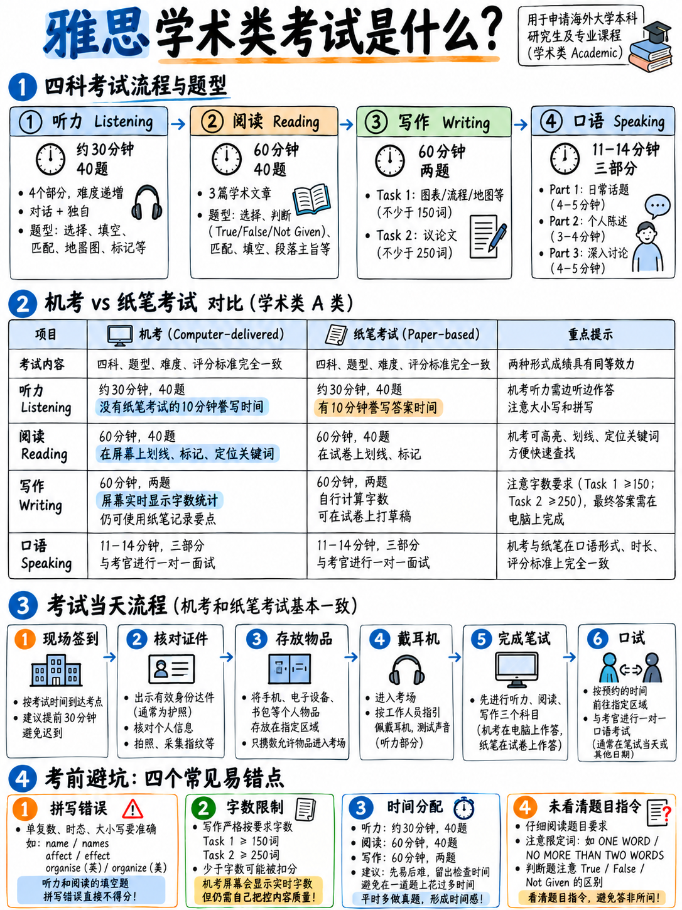

# 01. 什么是雅思学术类考试？底层机制、机考变革与四科全景 (What the Test Is)



## 1.1 一句话讲透本质 (One-Sentence Summary)

雅思（IELTS，全称国际英语语言测试系统）是一门针对听说读写四项语言技能的标准化学术语言测试。考生在听力（Listening）、阅读（Reading）、写作（Writing）和口语（Speaking）四科各获得一个 0 至 9 分的分数，四项分数的算术平均值经过 0.5 档的规则修约后，构成你的总成绩（Overall Band Score）`[7]`。雅思考试**不存在“及格”或“不及格”的划线**，由你所申请的海外高校、移民局或行业认证机构自主设定其准入门槛。

**雅思学术类（IELTS Academic，简称 A 类）**主要面向申请海外本科、研究生项目以及从事特定专业资格认证（如执业医师、护士等）的考生。它与培训类雅思（IELTS General Training，简称 G 类）**仅在两处存在差异**：阅读文章选段和写作 Task 1。而在听力和口语两门科目上，A 类与 G 类的**考卷、录音、题型与评分标准完全一致**——官方指南将听力视为雅思统一题型 `[1]`，且口语与写作评分细则的标题明确标为“Scoring criteria for Academic and General Training tests” `[8]` `[9]`。

这一考制设计对备考材料的挑选具有决定性指导意义：标有“General Training”的听力和口语练习资料完全可用；但阅读和写作 Task 1 必须严格使用标注“Academic”的专属材料。

---

## 1.2 考试整体架构与时长 (The Shape of the Test)

雅思考试总时长为 **2 小时 45 分钟** `[1]`。

```
   ┌──────────────────────────────────────────────────────────────────────┐
   │  同场连续进行（ONE SITTING）—— 三科之间无任何休息间隔  [1]            │
   │                                                                      │
   │  听力 (LISTENING)     约 30 分钟   4 个 Part × 10 题 = 共 40 题      │
   │                                   录音仅播放一次 (heard ONCE only)   │
   │        │                                                             │
   │        ▼                                                             │
   │  阅读 (READING)       60 分钟      3 篇文章，全篇 2150–2750 词，      │
   │                                   共 40 题，无额外答题卡誊写时间     │
   │        │                                                             │
   │        ▼                                                             │
   │  写作 (WRITING)       60 分钟      Task 1 ≥ 150 词 (建议耗时约 20 分) │
   │                                   Task 2 ≥ 250 词 (建议耗时约 40 分) │
   └──────────────────────────────────────────────────────────────────────┘

   ┌──────────────────────────────────────────────────────────────────────┐
   │  口语 (SPEAKING)     11–14 分钟   与一名专业考官面对面或视频通话，    │
   │                                   分为 3 个 Part，全程音频录音       │
   │                                                                      │
   │  安排在笔考当天，或考前、考后一周内的任意时间点进行。  [1]            │
   └──────────────────────────────────────────────────────────────────────┘
```

*注：以上全部数据与时长均来自官方规程 `[1]` `[2]` `[3]` `[4]` `[5]` `[6]`。*

:::{note}
官方考生指南明确指出，口语考试“可能安排在笔试科目当天，亦可能安排在笔试前一周或后一周的任意时间” `[1]`。**考生通常无法完全自主指定理想时间。** 因此，在制定复习计划时，必须确保自己在考前最早的可能日期就已具备应试状态，切勿将口语复习押在最后几天。
:::

---

## 1.3 核心考制巨变：雅思全面转向机考 (The All-Computer Shift)

**2026 年 3 月 5 日**，雅思考试三大主办方（British Council、IDP: IELTS Australia 与 Cambridge University Press & Assessment）发布了具有里程碑意义的官方公告 `[14]`：

> “自 2026 年中起，我们将不再提供雅思纸笔考试模式。”  
> (*"from mid-2026, we will no longer offer IELTS as a paper-based test"*)

> “所有雅思考试将全面转为计算机机考交付。”  
> (*"All IELTS tests will be delivered on computer."*)

2026 版《考生指南》（*Guide for Test Takers*）明确指出：“你将在考点专属桌位上的计算机终端完成雅思考试” `[1]`。

考方保留了一项特殊的过渡性方案：**雅思机考（纸笔写作模式，Writing on Paper）**在“特定选定市场”开放——听力、阅读和口语在电脑屏幕前进行，写作题目显示在屏幕上，但考场发放官方答题纸（Answer Sheet）和黑色水笔供考生手写答卷 `[15]`。官方在 2025 年 11 月进行的大规模实地测试（Field Trial）表明，两种写作模式的得分具有严格的可比性 `[15]`。

| 考试模式 | 标准雅思机考 (Standard CD-IELTS) | 机考·纸笔写作模式 (Writing on Paper) | 雅思在线考试 (IELTS Online) |
|---|---|---|---|
| **考试地点** | 官方实体考点 `[1]` | 官方实体考点（部分指定考场）`[15]` | 考生家中 / 独立私密空间 `[1]` |
| **写作交付形式** | 键盘在屏幕直接键入 | 纸质官方答题卡手写作答 `[15]` | 键盘在屏幕直接键入 |
| **UKVI 签证认可** | **支持**（仅限纯数字化模式）`[14]` | **不支持**（UKVI SELT 明确排除）`[15]` | 不支持（仅限学术类普通申请）`[1]` |
| **出分时效** | 考后 **1–5 天** `[1]` | 考后 **1–5 天** `[1]` | 考后 **6–8 天** `[1]` |
| **口语形式** | 考官现场面对面或考点内高清视频通话 `[1]` | 考官现场面对面或考点内高清视频通话 `[1]` | 在线远程视频通话 `[1]` |

### 这一变革对备战日常带来的五大颠覆性影响

:::{important}
**全面机考时代的备考铁律——每一条都直接重塑你的日常做题习惯：**

1. **听力考试不再有 10 分钟转写答题卡时间**：纸笔时代考生有整整 10 分钟把草稿答案抄到答题卡上。机考时代录音播放时必须**同步把答案敲入屏幕输入框**，录音结束后系统仅给 2 分钟做最后检查。任何教你“听的时候记缩写，最后 10 分钟再拼出来”的教材，都在教授已经失效的历史考制。详见：{doc}`../70-references/02-outdated-advice-red-flags`。
2. **写作字数由系统实时自动统计**：屏幕下方有实时字数统计计数器（Word Count），考生不再需要数行数估算字数。但系统**绝对不会提供任何拼写检查或语法纠错功能（No Spell-check）**。
3. **阅读必须建立屏幕划线与定位肌肉记忆**：机考界面支持文本高亮（Highlight）和添加边栏便签（Notes），但无法像纸笔卷子那样在边白处肆意涂画。日常刷题必须使用电脑屏幕与鼠标，彻底告别纸质刷题。
4. **英文打字速度直接制约写作得分**：在 60 分钟内完成 400 词以上的构思与定稿，相当于每分钟至少要输出 7 个最终成稿单词。打字缓慢的考生会白白损失 10–15 分钟的审题、谋篇与通读纠错时间。如果你的英文打字速度低于 20 wpm（每分钟单词数），每天练习 20 分钟打字软件是边际效益最高、提分最快的写作训练手段。详见：{doc}`../60-toolkit/07-free-tools-and-self-testing`。
5. **考场依然提供草稿纸和铅笔**：在电脑前作答时，考场仍会提供草稿纸和笔。务必将其用于听力 Part 4 密集信息记笔记，以及口语 Part 2 的 1 分钟框架速记。
:::

---

## 1.4 考场当天全流程实战拆解 (Test-Day Sequence)

1. **提前到达考点，携带报考时使用的同一有效身份证件**：考官在口语考试开始时亦会严格比对该证件 `[13]`。
2. **签到检录、现场拍照、生物信息采集与存包**：手机、手表及所有个人电子设备一律不得带入考场。
3. **进入机房就座**：佩戴高保真耳机，调节音量并检查键盘鼠标，领取草稿纸与铅笔。
4. **第一科：听力（Listening）**——时长约 30 分钟。录音仅播放一次，题目间隙利用屏幕预览，听到答案立即敲入，最后给 2 分钟检查 `[1]` `[2]`。
5. **第二科：阅读（Reading）**——时长整 60 分钟。左右分屏（左侧文章，右侧题目）。屏幕上方有倒计时时钟，考试结束系统强制交卷，无语音提醒。
6. **第三科：写作（Writing）**——时长整 60 分钟。两篇必写作文，建议 Task 1 预留 20 分钟，Task 2 预留 40 分钟。
7. **第四科：口语（Speaking）**——时长 11–14 分钟，由认证考官一对一考核，共分三个阶段：
   - **Part 1 简介与日常问答（4–5 分钟）**：身份核验后，围绕居住环境、学业/工作、兴趣爱好等展开日常交流 `[1]`。
   - **Part 2 个人长陈述（3–4 分钟）**：抽取任务卡（Task Card），**1 分钟纸笔准备，连续作答至多 2 分钟**，考官随后提出 1–2 个收尾简短追问 `[1]`。
   - **Part 3 双向深入讨论（4–5 分钟）**：围绕 Part 2 主题延伸展开更高维度的抽象与社会议题思辨 `[1]`。
8. **成绩公布**：标准机考通常在考后 **1–5 个工作日**即可在线查询电子成绩单（eTRF）`[1]`。

:::{tip}
**口语考官的串场话术是高度标准化的既定脚本。** 官方公开的考官培训范本显示，考官必须严格念读固定框架：“Now, in this first part, I'd like to ask you some more questions about yourself, OK?” 以及 Part 2 的 “Remember you have one to two minutes for this, so don't worry if I stop you. I'll tell you when the time is up.” `[13]`。在 Part 2 讲到 2 分钟被考官举手打断是**完全正常且不扣分的官方规定动作**，切勿慌张失措。
:::

---

## 1.5 四科分数的本质来源与提分难度不对称性 (Where Scores Come From)

| 科目 | 卷面原始分产生方式 | 批改机制 | 仅凭应试技巧能否大幅拉升？ |
|---|---|---|---|
| **听力 (Listening)** | 40 道题，每答对 1 题计 1 分 `[2]` | 对照客观标准答案比对 | **能，提分空间极大。** 初学者大部分失分并非听不懂，而是拼写错误、单复数疏漏、格式违规或信息错位。 |
| **阅读 (Reading)** | 40 道题，每答对 1 题计 1 分 `[3]` | 对照客观标准答案比对 | **能，提分空间极大。** 本质上是做题时间规划、定位抓词与题型解题规则的问题。 |
| **写作 (Writing)** | Task 1 与 Task 2，Task 2 分值占三分之二权重 `[10]` | 官方培训考官依据四大评分量表独立评分 `[8]` | **部分可行。** 任务完成度（TA/TR）与连贯性（CC）高度契合应试结构与框架；而词汇丰富度（LR）和语法准确度（GRA）受制于考生的真实语言积淀。 |
| **口语 (Speaking)** | Part 1 至 Part 3，考察“全场各环节的整体平均表现” `[9]` | 官方考官依据四大口语量表全场打分 `[9]` | **部分可行。** 流利度（FC）与发音节奏（P）通过意群与句型强化能在短期内显著改善；高级词汇（LR）无法速成。 |

这种“客观题靠题型技巧，主观题保评分底线”的分数结构不对称性，构成了整套高效备战战略的底层支柱。详见：{doc}`04-priority-triage`。

---

## 1.6 初学者代价最高的四大认知误区 (Costly Beginner Mistakes)

:::{danger}
**1. 把备考当作“泛泛学英语”，忽视考试的技术属性。**  
一名考生花 4 周系统钻研雅思题型破局点，其提分效果远超花 8 周泛读外刊或死背英文字典的人。雅思是一场题型极其固定、设错套路高度规整的标准化测试。首要任务是掌握规则与破解反套路。

**2. 押注并死记硬背作文模板范文。**  
官方写作评分量表明确将 **Band 0** 判给“有确凿证据表明考生作答完全属于死记硬背（totally memorised）”的情况 `[8]`；同时，词汇维度 Band 4 亦明文惩罚“不当套用成串记忆短语或程式化机械套话（memorised phrases, formulaic language）” `[8]`。请彻底摒弃空洞大词模板，全面转向弹性语法骨架（Sentence Frames）。详见：{doc}`05-glossary-and-question-banks`。

**3. 在听力和阅读中因拼写与格式违规白白失分。**  
官方规程强调“每一正确答案得 1 分” `[2]`——拼写错误一个字母、超过字数要求即判 0 分。初学者往往因此丢掉 4–8 道题，这在换算后足以直接拉低整整一个 Band（1.0 分）。详见：{doc}`../60-toolkit/03-spelling-numbers-and-answer-rules`。

**4. 在口语考场上因害怕犯语法错误而陷入长时间沉默。**  
官方流利度与连贯性（FC）量表明文惩罚“为了搜索单词而导致的停顿卡顿” `[11]`。考官对考场的沉默极为敏感。一句带有一处微小语法瑕疵但顺畅表达的句子，得分远高于思索 5 秒钟后憋出的一句语法零瑕疵句子。详见：{doc}`../20-speaking/05-fluency-engine`。
:::

---

## 1.7 雅思考试究竟“不考察”什么？ (What IELTS Does NOT Test)

搞清楚雅思不考什么，能帮你省去数周无意义的精力消耗：

- **不考察个人知识库与观点的正误**：写作 Task 2 的论据明确允许取自“考生本人的亲身经历与日常认知” `[10]`。考官绝不会根据你的立场观点是否“正确”来打分，只考查你论证观点的逻辑严密性与语言组织能力。
- **不考察英音或美音口音的高低优劣**：口语高分档 Band 8 评分标准写道：“Accent has minimal effect on intelligibility” `[9]`——评分的核心标准是**可理解度（Intelligibility）**，绝非是否拥有纯正伦敦腔或美东口音。
- **口语不考快速即兴辩才**：考生完全可以向考官请求重复问题（"Could you please repeat that?"），也可以用逻辑垫话公开呈现思考过程。
- **6.0 分绝不要求语法零失误**：Band 6 语法范围与准确性（GRA）标准明确指出：“Errors in grammar and punctuation occur, but rarely impede communication” `[8]`。只要错误不阻碍理解，就能稳拿 6 分。
- **绝不鼓励堆砌晦涩生僻长难词**：Band 6 词汇资源（LR）写道：“The meaning is generally clear in spite of a rather restricted range” `[8]`。在有限的词汇区间内做到精准恰当表达，足以拿到 6.0 分。

---

**上一章：** {doc}`../index` | **下一章学习指南：** {doc}`02-question-type-inventory`
