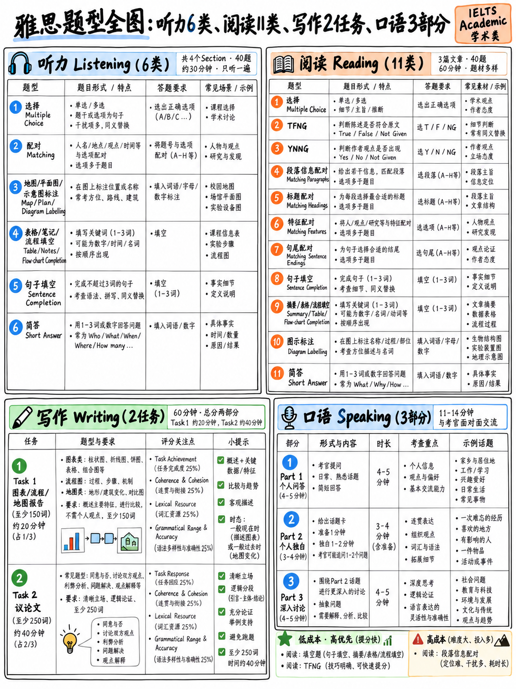

# 02. 雅思考试全部题型权威清单与备考定位 (Question-Type Inventory)

本章是整套通关体系的**全景核心速查基准表**。阅读模块（40 模块）和听力模块（50 模块）的所有解题战术与练习计划，均严格以此清单为底层坐标系。

---

## 2.1 听力科目：6 大官方题型与 4 大场景拆解 (Listening Inventory)

官方技术参数：**全卷共 4 个部分（Parts），每部分 10 道题目，合计 40 题。总时长约 30 分钟，录音仅播放一次（Recordings heard ONCE only）** `[2]` `[6]`。

### 听力 4 大板块场景与初学者难度梯队

| 试卷板块 | 官方场景定义说明 (Official Setting) | 发言人数 | 初学者实战难度 |
|---|---|---|---|
| **Part 1** | “日常生活社交场景下的双人对话，例如租房中介处的交谈” `[1]` | 2 人 | **全卷最易（送分盘）**。核心考查姓名拼写、数字、电话、日期、时间与价格。 |
| **Part 2** | “日常生活社交场景下的独白，例如关于当地公共设施或景点的介绍” `[1]` | 1 人 | **中等偏易**。常考生活向导，多涉及地图导航（Map）或活动选项匹配。 |
| **Part 3** | “教育或培训学术背景下的多人群体讨论（至多四人），例如导师与学生探讨课题作业” `[1]` | 2–4 人 | **高难度（分水岭）**。多人声音频繁切换，伴随观点交锋、让步、反驳与打断。 |
| **Part 4** | “学术专业主题的独白长演讲，例如大学专题公开课” `[1]` | 1 人 | **最高难度**。信息密度极大、学术语汇丰富，无第二发言人停顿或重复信息。 |

考场录音涵盖的国际主流英语口音包括：“英国音（British）、澳大利亚音（Australian）、新西兰音（New Zealand）以及北美音（North American）” `[1]` `[2]`。

### 听力 6 大官方题型矩阵

| 序号 | 官方题型标准名称 | 社群通用缩写 | 考生需输出的答案形式 | 典型分布板块 |
|---|---|---|---|---|
| **L1** | 选择题 (Multiple choice) | **MCQ**（单选）/ **MCMA**（多选） | 从给出的备选项中挑选正解 | Part 1–4 |
| **L2** | 配对题 (Matching) | **MAT** | 将题目清单项与选项列表进行配对 | Part 2, 3 |
| **L3** | 平面图/地图/流程图标签标号 (Plan, map, diagram labelling) | **MAP / DL** | 根据录音将字母标签或方位词填入对应图示中 | Part 2 |
| **L4** | 表格/笔记/表单/流程图填空 (Form, note, table, flow-chart completion) | **FC / NC / TC / FCC** | 在字数限制内，准确默写听到的原词 | Part 1, 2, 4 |
| **L5** | 句子填空 (Sentence completion) | **SC** | 提取听力关键原词，补全题干句子缺失信息 | Part 2, 3, 4 |
| **L6** | 简答题 (Short-answer questions) | **SAQ** | 根据录音问题提问，提取原词作简要回答 | Part 1, 2 |

:::{note}
**题型 L4、L5 与 L6 考查的是完全相同的底层语言技术**：在连续语音流中抓取核心实词，并在严格的字数限制下（如“NO MORE THAN TWO WORDS AND/OR A NUMBER”）将其 100% 正确拼写出来。这一类“填空型抓词抄录”占据了整张听力考卷**将近 50% 的分值（约 20 题）**。对于基础薄弱的初学者而言，这是整个雅思考试中边际成本最低、最能在短期内被训练到接近满分的板块。详见：{doc}`../50-listening/02-completion-tasks`。
:::

---

## 2.2 学术类阅读：11 大官方题型与优先级评级 (Academic Reading Inventory)

官方技术参数：**全卷共 3 个 Section（Passages），每个 Section 对应一篇长篇学术说明或论证文章。三篇文章总词数在 2,150 至 2,750 词之间，共 40 道题，答题时间整 60 分钟，绝无额外誊写时间** `[3]` `[6]`。

官方对选材属性的明文规定 `[6]`：文章选自“面向非专业受众编撰的书籍、学术期刊、知名杂志、报纸及权威网络资料”；文体兼具“叙述性（Narrative）、描述性（Descriptive）或论说与学术思辨性（Discursive/Argumentative）”；“至少有一篇文章包含严谨复杂的逻辑论证”；“所有专业技术术语均在文末附有通俗词典释义”。

### 11 大阅读题型深度盘点与投入产出比矩阵

| 题型编号 | 官方题型标准名称 | 社群缩写 | 题目顺序是否与原文顺次对应？ | 单题得分时间成本 | 备考战略等级 (Triage) |
|---|---|---|---|---|---|
| **R1** | 选择题 (Multiple choice) | **MCQ / MCMA** | 通常按顺序出现 | 中等 | **A 级** |
| **R2** | 信息正误判断 (True / False / Not Given) | **TFNG** | **严格顺次对应** | 掌握规则后极低 | **S 级（王牌题型）** |
| **R3** | 作者观点判断 (Yes / No / Not Given) | **YNNG** | **严格顺次对应** | 掌握规则后极低 | **S 级（王牌题型）** |
| **R4** | 段落信息配对 (Matching information) | **MI** | **绝对乱序** | **极其高昂** | **C 级（战略放弃/留后猜题）** |
| **R5** | 段落大意/标题配对 (Matching headings) | **MH** | **乱序（段落级别）** | 偏高 | **B 级** |
| **R6** | 特征/人名观点配对 (Matching features) | **MF** | 题干乱序，人名在文中有序 | 中等 | **A 级** |
| **R7** | 句子首尾配对 (Matching sentence endings) | **MSE** | 通常顺次对应 | 中等 | **A 级** |
| **R8** | 句子填空 (Sentence completion) | **SC** | **严格顺次对应** | **极低（原文原词摘抄）** | **S 级（送分必争）** |
| **R9** | 摘要/笔记/表格/流程填空 (Summary, note, table completion) | **SUC / NC / TC / FCC** | 绝大多数按顺序 | **极低（原文原词摘抄）** | **S 级（送分必争）** |
| **R10** | 图解标号填空 (Diagram label completion) | **DLC** | 通常高度局部化集中 | 极低 | **S 级（送分必争）** |
| **R11** | 简答题 (Short-answer questions) | **SAQ** | **严格顺次对应** | **极低（原文原词摘抄）** | **S 级（送分必争）** |

上表中的“单题成本”与“战略评级”基于两个不可逆的客观事实：
1. **题目是否顺次对应原文（Order follows text）**：顺次对应的题型允许考生线性通读文章，不走回头路；乱序题型则迫使考生为一道题反复通读整篇文章。
2. **答案是否属于“原文直接摘抄原词”**：原词摘抄题型完全排除了考生个人拼写错误与词汇改写的风险。详细论证见：{doc}`04-priority-triage`。

:::{important}
**R4 段落信息配对（Matching Information, MI）是雅思学术类阅读中单位耗时最高、性价比最差的题型。**  
它要求考生判断某句话的信息具体落在哪个自然段中；题目在全文中完全打乱顺序，且同一个段落可能被多次重复选用（“NB You may use any letter more than once”）。若想做对，考生往往必须针对每一道小题扫描全文。如果你的考试时间紧张，**必须将这类题型挪至每个 Passages 的最后完成，或者直接利用首末段常识进行战略性猜题**。详见：{doc}`../40-reading/04-matching-tasks`。
:::

---

## 2.3 写作科目：两大任务深度对比 (Writing Tasks)

| 对比维度 | 学术类 Task 1 (小作文) | Task 2 (大作文) |
|---|---|---|
| **题干输入形式** | “图表、表格、饼图、折线图或工艺流程/地图” `[1]` | “针对某个观点、争论或社会问题的命题陈述” `[1]` |
| **最低字数下限** | **至少 150 词 (at least 150 words)** `[1]` `[10]` | **至少 250 词 (at least 250 words)** `[1]` `[10]` |
| **官方建议耗时** | 约 20 分钟 `[1]` | 约 40 分钟 `[1]` |
| **四大评分维度** | 任务完成度 (Task Achievement, TA) 连贯与衔接 (Coherence & Cohesion, CC) 词汇丰富度 (Lexical Resource, LR) 语法多样性及准确性 (Grammatical Range & Accuracy, GRA) `[10]` | **任务回应度 (Task Response, TR)** 连贯与衔接 (Coherence & Cohesion, CC) 词汇丰富度 (Lexical Resource, LR) 语法多样性及准确性 (Grammatical Range & Accuracy, GRA) `[10]` |
| **分数计权比重** | 占写作总成绩约三分之一 (1/3) | **“Task 2 在整体评分中所占权重明显高于 Task 1”**（约占 2/3）`[10]` `[12]` |
| **官方考查性质** | “给定输入信息且输出高度可预测……属于信息转述类任务” `[10]` | “围绕给定题目确立、拓展并论证自身的学术立场” `[10]` |

:::{tip}
重点研读官方对学术类 Task 1 的定性用词：**“a largely predictable output”（输出具有高度可预测性）** `[10]`。雅思官方自身已向考生坦陈该题型具有极强的规律性与结构固化度。对于基础较弱的考生而言，尽管 Task 1 权重低于 Task 2，但它却是写作部分边际提分成本最低的环节。详见：{doc}`../30-writing/02-task-1-academic`。
:::

官方针对两篇作文的硬性违规扣分警示：“考生文章若出现以下情况将被严厉扣分：a) 部分或全篇抄袭；b) 未以完整、连贯的句子成文（例如在文中使用项目符号清单列表 Bullet points，或以简写笔记形态作答，均属严重不合格）” `[10]`。

### 学术类 Task 1 核心图表子类型分类表

虽然官方未列出细分分类表，但基于其“graph, table, chart, map or other visual input”的定义，我们提炼出贯穿整个写作模块的 8 类子题型：

| 图表子类型 | 核心主导时态 | 官方要求的“关键特征 (Key Features)”在本科目的实战所指 |
|---|---|---|
| **动态折线图 (Line graph over time)** | 一般过去时（或预测时态）+ 比较级 | 整体走势、峰值转折点、交叉重合点 |
| **静态柱状图 (Bar chart at one point)** | 一般现在时或一般过去时 | 排名高低、极值差距、分类大小对照 |
| **动态柱状图 (Bar chart over time)** | 一般过去时 + 比较句型 | 各类别自身的发展趋势 + 类别间排名的变动 |
| **数据表格 (Table)** | 一般现在时或一般过去时 | 各行与各列的最高值、最低值与异常跃升值 |
| **单个/多个饼图 (Pie chart(s))** | 过去时或现在时，占比表达句型 | 主次占比、份额变化、份额重新洗牌 |
| **生产流程图 (Process diagram)** | **一般现在时被动语态** | 阶段步骤数量、起点、终点、物质输入与产出 |
| **变迁地图 (Map comparison)** | **过去时被动语态 + 现在完成时** | 设施的新增、拆除、位置搬迁、面积扩张 |
| **组合图 (Mixed charts)** | 依据具体图表而定的混合时态 | 一段描述一图，重点指出两图之间的一处逻辑联系 |

---

## 2.4 口语科目：3 大环节与综合评分架构 (Speaking Structure)

| 阶段 | 官方规范名称 | 官方规定耗时 | 考场实操流程与考察内容 | 适用评分标准 |
|---|---|---|---|---|
| **Part 1** | 个人简介与日常问答 (Introduction and interview) | 4–5 分钟 `[1]` | 考官核验身份证件，随后就“家庭、学业、职业、家乡及日常兴趣”等轻松话题提问 `[1]` | 四大维度综合考量 `[9]` |
| **Part 2** | 个人长篇陈述 (Individual long turn) | 3–4 分钟 `[1]` | 抽取任务卡（Task Card）；**提供纸笔进行 1 分钟构思准备**，连续作答 **1.5 至 2 分钟**，考官进行 1–2 个简短收尾追问 `[1]` `[13]` | 四大维度综合考量 |
| **Part 3** | 双向深入探讨 (Two-way discussion) | 4–5 分钟 `[1]` | 围绕 Part 2 主题展开更高抽象层级的学术思辨与社会观点论证 `[1]` | 四大维度综合考量 |

口语四大评分维度 `[9]` `[11]`：**流利性与连贯性 (Fluency and Coherence, FC)**、**词汇多样性 (Lexical Resource, LR)**、**语法多样性及准确性 (Grammatical Range and Accuracy, GRA)**、**发音 (Pronunciation, P)**。官方明确指出：“考生的口语得分取决于其在全场所有环节中的整体平均综合水准” `[9]`。

:::{note}
**口语考试绝对不会针对 Part 1、Part 2、Part 3 分别单独打分。** 考官使用同一套四维评分标准对整场表现进行全局裁定 `[9]`。这意味着：即使你在 Part 2 中偶有卡顿或未讲满 2 分钟，只要在 Part 3 展现出有深度的连贯论述，完全能够弥补前面的不足；考官关注的是考生的整体语言运用范式，而非数错扣分。
:::

---

## 2.5 雅思全体系缩略语权威速查辞典 (Abbreviation Glossary)

雅思官方不像托福等考试那样公开发布所有题型的缩写，但在全球名师教研、学术出版物与考鸭备考社群中，已形成一套通用的标准缩写体系。掌握这套缩略语能让你无障碍阅读任何权威资料：

AC
: 雅思学术类（IELTS Academic，即 A 类）。在早期官方文档中有时标注为“Category A” `[1]`。

GT
: 雅思培训类（IELTS General Training，即 G 类）。主要用于工签及传统移民申请。

UKVI
: 英国签证及移民类雅思（IELTS for UK Visas and Immigration）。考卷内容、题型与评分标准与普通雅思完全相同，但考场视频监控等级更高，满足英国签证安全英语水平测试（SELT）要求 `[1]`。

IOL
: 雅思在线考试（IELTS Online）。在考生个人家中通过远程监考完成，仅限学术类 `[1]`。

CD-IELTS / on computer
: 计算机机考模式（Computer-delivered IELTS）。自 2026 年中起成为雅思考试的绝对唯一主流模式 `[14]`。

WoP
: 纸笔写作机考模式（Writing on Paper）。除写作手写在纸质答题卡上之外，听读均在电脑前完成 `[15]`。

OSR
: 单科重考（One Skill Retake）。考生可在原考后 60 天内，针对听说读写四科中的任意一门弱项申请单科重考一次 `[16]`。

TRF / eTRF
: 成绩单（Test Report Form）。纸质成绩单或官方电子成绩单凭据 `[1]`。

TFNG / YNNG
: 真实/错误/未提及（True-False-Not Given）与 赞同/反对/未提及（Yes-No-Not Given）阅读判断题。

MH / MI / MF / MSE
: 标题配对（Matching Headings）/ 信息配对（Matching Information）/ 特征配对（Matching Features）/ 句子首尾配对（Matching Sentence Endings）。

SC / SUC / NC / TC / FCC / DLC / SAQ
: 句子填空 / 摘要填空 / 笔记填空 / 表格填空 / 流程图填空 / 图解标签填空 / 简答题。

T1 / T2
: 写作 Task 1（小作文）与 Task 2（大作文）。

TA / TR / CC / LR / GRA
: 写作四大评分维度：Task Achievement（Task 1 任务完成度）/ Task Response（Task 2 任务回应度）/ Coherence and Cohesion（连贯与衔接）/ Lexical Resource（词汇丰富度）/ Grammatical Range and Accuracy（语法多样性与准确性）`[10]`。

FC / P
: 口语独有维度：Fluency and Coherence（流利性与连贯性）/ Pronunciation（发音）`[11]`。

Cue Card
: 口语 Part 2 任务卡。官方规范术语为“Task Card” `[13]`，民间通常俗称为“口语题卡（Cue card）”。

Band / Half Band
: 成绩档位与半档。雅思按 0–9 分的整数档（如 6.0、7.0）或半档（如 6.5、7.5）呈现成绩 `[2]`。

---

## 2.6 算术检验与宏观战略底牌 (Arithmetic Check)

我们最后进行一次简单的算术盘点：
- 听力：4 个 Part × 10 题 = **40 题** `[2]`
- 阅读：3 篇文章 = **40 题** `[3]`
- 写作：2 篇作文 `[1]`
- 口语：3 个环节 `[1]`

**全卷共有 80 道由客观参考答案唯一裁决的题目。**  
这 80 道题目直接决定了你四项单科成绩中的整整两项——换言之，**你的总成绩中整整 50% 的分值，完全来自于客观、无考官主观偏见、且没有倒扣分的题目！**

牢牢记住这个关键数字。在你规划未来数周的时间与精力投向时，这 80 道题永远是你最具确定性的王牌底盘。

---

**上一章：** {doc}`01-what-the-test-is` | **下一章学习指南：** {doc}`03-how-scoring-works`
