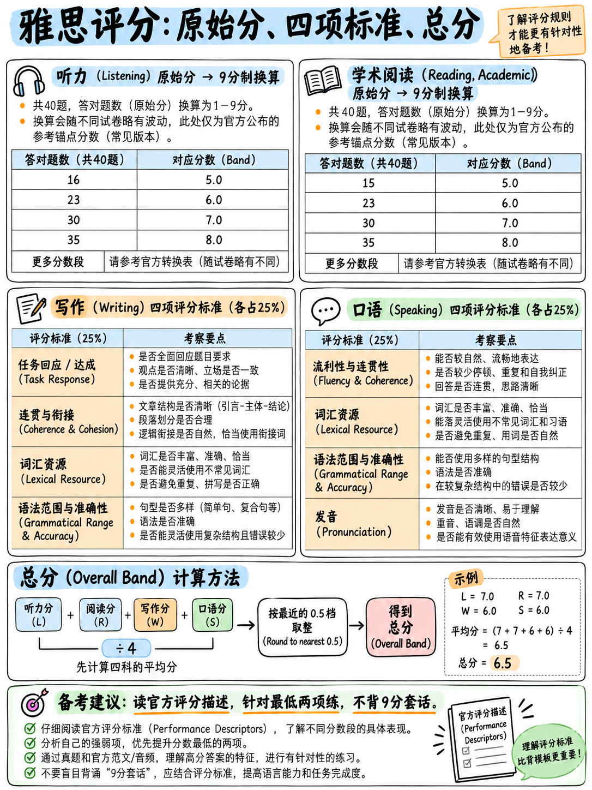

# 03. 雅思评分机制深度揭秘：算分公式、原始分换算与避坑铁律 (How Scoring Works)



大多数考生在备考中浪费的数周时间，根源都在于没有真正吃透本章的规则。仔细研读本章，你将清晰地明白哪些无效用功必须立即停止。

---

## 3.1 官方 9 分制能力描述表 (The 9-Band Scale)

本表直接引自 2026 版《考生指南》（*Guide for Test Takers*）`[1]` 以及雅思官方评分说明页面 `[7]`：

| 分数档位 (Band) | 水平称号 (Level) | 官方权威能力描述原文 (Official Description) |
|---|---|---|
| **9 分** | 专家水准 (Expert) | "Has fully operational command of the language. Use of English is appropriate, accurate, and fluent, and shows complete understanding."（能够极其完全、熟练地掌控该语言。英语运用得体、精准、极其流利，展现出透彻的理解力。） |
| **8 分** | 优秀水准 (Very good) | "Has fully operational command of the language with only occasional unsystematic inaccuracies and inappropriate usage. May misunderstand some things in unfamiliar situations. They handle complex and detailed argumentation well."（能够极其熟练地掌控语言，仅偶有非系统性的微小不准确或偶见用词不当。在不熟悉的场景下偶有微小误解。能极好地处理复杂且详尽的论辩论证。） |
| **7 分** | 良好水准 (Good) | "Has operational command of the language, though with occasional inaccuracies, inappropriate usage, and misunderstandings in some situations. Generally handle complex language well and understand detailed reasoning."（具备有效驾驭语言的能力，尽管在部分场景下存在偶尔的不准确、用词不当或误解。总体上能良好应对复杂语言，并理解详尽复杂的论证推理。） |
| **6 分** | 合格水准 (Competent) | "Has an effective command of the language despite some inaccuracies, inappropriate usage, and misunderstandings. Can use and understand reasonably complex language, particularly in familiar situations."（**尽管存在一些不准确、用词不当和误解，仍能有效运用该语言。** 能够使用并理解较为复杂的语言，尤其在熟悉的日常与学术情境中。） |
| **5 分** | 基础水准 (Modest) | "Has a partial command of the language and copes with overall meaning in most situations, although they are likely to make many mistakes. Should be able to handle basic communication in their own field."（掌握了部分语言能力，在多数场景中能应对大意，尽管可能会犯大量错误。应能在自身熟悉的专业领域内进行基础交流沟通。） |
| **4 分** | 有限水准 (Limited) | "Basic competence is limited to familiar situations. Frequently show problems in understanding and expression."（基础能力仅局限于极其熟悉的情境。在理解和表达上频繁出现障碍和问题。） |
| **3 分** | 极有限水准 (Extremely limited) | "Conveys and understands only general meaning in very familiar situations. Frequent breakdowns in communication."（仅能在极度熟悉的情境下传达和理解粗略大意。沟通交流中频繁发生中断。） |
| **2 分** | 断续水准 (Intermittent) | "No real communication is possible except for the most basic information using isolated words or short formulae in familiar situations and to meet immediate needs."（除在熟悉情境下使用个别孤立词汇或机械短句满足最迫切的基本需求外，无法进行实质性的有效沟通。） |
| **1 分** | 非使用者 (Non-user) | "Essentially has no ability to use the language beyond possibly a few isolated words."（除了可能认识极个别孤立单词外，实质上不具备使用该语言的能力。） |
| **0 分** | 未参加测试 / 严重违规 | "No assessable information provided."（未提供任何可供评分的语言信息，或全篇死记硬背范文。） |

:::{important}
**请务必反复品味官方对 6 分（Band 6）的定性措辞**：  
**"despite some inaccuracies, inappropriate usage, and misunderstandings"**（尽管存在一些不准确、用词不当和误解）。  
官方在白纸黑字的评分量表中已明确认可：**6 分本身就是一个包含语法瑕疵、用词偏差与局部误解的档位！**  
如果你的目标分是 6.0 分或 6.5 分，考场上切忌为了追求“语法绝对完美、用词绝对高级”而反复纠结停顿。你的首要任务是**保证清晰传意（Clear）、论述连贯（Coherent）且持续输出（Continuous）**。
:::

---

## 3.2 欧洲语言共同参考框架 (CEFR) 对应关系

根据雅思官方于 2023 年 11 月 17 日发布的权威换算指南 `[20]`，雅思与 CEFR（Common European Framework of Reference for Languages）的对应基准如下：

| 雅思分值 (IELTS) | CEFR 语言能力等级 | 常见申请对应标准说明 |
|---|---|---|
| **5.5 – 6.5 分** | **B2 (独立使用者 · 高级中等)** | 全球绝大多数海外本科、研究生院的基础录取门槛；英国工作签证常规要求。 |
| **7.0 – 8.0 分** | **C1 (熟练使用者 · 高级水准)** | 顶尖名校（如牛津、剑桥、常春藤等）及法律、医学、传媒等强文科专业的录取门槛。 |
| **~ 9.0 分** | **C2 (精通使用者 · 母语级水准)** | 极高学术研究与同声传译层级。 |

雅思官方指出，CEFR 并非认证体系，各机构需自行对标。在英国签证及移民局（UKVI）政策中，B1 等级设定为听说读写四项单项均不低于 4.0 分；B2 签证门槛设定为听说读写四项单项均不低于 5.5 分 `[20]`。

---

## 3.3 听力与阅读：卷面原始分换算九分制规律 (Raw to Band)

听力和学术类阅读各为 **40 道题，每答对 1 题计 1 分原始分（Raw mark）** `[2]` `[3]`。**雅思考试在任何科目、任何题型中均绝不实行倒扣分制度（No negative marking）**。

:::{important}
**考场绝对铁律：听力和阅读绝对不要留下任何一道空格！永远不要！**  
在客观题中，答错与空白的得分完全一致——均为 0 分。但只要写上答案，你就有可能得分。对于 4 选 1 的单选题，哪怕完全纯靠盲猜，4 道题也能在统计期望上为你白赚 1 分原始分。
:::

雅思官方仅公布各主要整数分段的**官方平均原始分锚点（Official Anchor Points）**，并郑重警示：由于各场次试卷难度存在微小波动，具体场次的实际换算切分线会有微调 `[7]`：

| 目标 Band | 听力所需卷面原始分 (/40) `[7]` | 学术类阅读所需卷面原始分 (/40) `[7]` |
|---|---|---|
| **Band 5.0** | 16 题 | 15 题 |
| **Band 6.0** | 23 题 | 23 题 |
| **Band 7.0** | 30 题 | 30 题 |
| **Band 8.0** | 35 题 | 35 题 |

```
   学术类阅读 / 听力 —— 官方核心锚点与难度台阶图解 [7]

   0        10        16/15       23        30     35    40
   ├─────────┼──────────┼──────────┼─────────┼──────┼─────┤
                        Band 5    Band 6   Band 7  Band 8

   这些数字在实战中的战略含义：
     • 从 5 分跃升到 6 分：你需要多做对整整 7 道题。
     • 从 6 分跃升到 7 分：你同样需要再多做对整整 7 道题。
     • 这意味着：平均每多答对 3.5 道题 ≈ 单科提升 0.5 个 Band。
     • 单科提升 0.5 分，相当于为你四科平均总分贡献了 0.125 分；
       两科各多对 3–4 题，往往就是总分 6.0 与 6.5 之间决定性的进位差距！
```

:::{warning}
**警惕网络民间 0–40 题全量换算表：**  
雅思官方从未公开发布过精确到每一题的“全量 0–40 原始分换算表”。网络上流传的诸如“11–12 题对应 4.0，13–15 题对应 4.5”等详细表格，全部属于培训机构根据部分模拟题自行拟合的民间经验值，不同来源之间在边界分数上互有矛盾。在制定备考计划时，请严格以上述官方四大权威锚点（16/15、23、30、35）为科学准绳。
:::

### 实战科学安全答题目标表 (Practical Targets)

为抵御试卷难度微调与考场意外发挥失常，本课程在官方平均锚点之上**主动预留 1 题的安全冗余**：

| 申请所需总分目标 | 建议听力安全做对题数 | 建议学术类阅读安全做对题数 | 零基础初学者 3–4 周冲刺可行性评估 |
|---|---|---|---|
| **5.5 分** | **20 / 40 题** | **19 / 40 题** | **极高，轻松可达** |
| **6.0 分** | **24 / 40 题** | **24 / 40 题** | **很高，聚焦基础与技巧即可达成** |
| **6.5 分** | **27 / 40 题** | **27 / 40 题** | **完全可行，需配合每日高频刷题与复盘** |
| **7.0 分** | **31 / 40 题** | **31 / 40 题** | **具一定挑战，需要良好的英语阅读基本功** |

---

## 3.4 写作与口语：四大评分维度深度剖析 (The Four Criteria)

写作与口语均由经过剑桥严格认证的专业考官依据公开的标准量表进行主观评审。**在两门科目中，各自的四大评分维度权重完全均等（各占 25%）** `[7]`，单科成绩为四大维度得分的纯算术平均。

### 写作四大评分标准详解 `[8]` `[10]`

| 评分维度缩写 | Task 1 考查标准 | Task 2 考查标准 | 官方考核核心定义与实操指引 |
|---|---|---|---|
| **TA / TR** | 任务完成度 (Task Achievement) | 任务回应度 (Task Response) | **Task 1**：“是否全面、得体、准确且切题地达成了题目要求，在至少 150 词的篇幅内呈现关键特征与总览（Overview）”；**Task 2**：“是否全面回应了题干的所有提问，核心论点是否得到充分延伸拓展与充分论据支撑” `[10]`。 |
| **CC** | 连贯与衔接 (Coherence and Cohesion) | 同左 | “信息的逻辑组织顺序、段落划分的合理性（Appropriate paragraphing）、代词指代与同义替换的灵活度、衔接词（Discourse markers）使用的自然与恰当程度” `[10]`。 |
| **LR** | 词汇丰富度 (Lexical Resource) | 同左 | “常用与学术词汇的广度、用词的精准性与搭配（Collocation）、单词拼写（Spelling）错误与词形变换（Word formation）错误的密度及其对交流理解造成的阻碍程度” `[10]`。 |
| **GRA** | 语法多样性及准确性 (Grammatical Range & Accuracy) | 同左 | “句型结构的多样性与得体度、简单句/并列句与复杂从句的准确率、标点符号（Punctuation）使用的准确与得当性” `[10]`。 |

初学者极易忽视的两大关键阅卷机制：
1. **拼写错误全部算在词汇维度（LR）中扣分，并不存在独立的拼写项** `[10]`。一篇文章若出现大量拼写马虎，将直接抹杀你整整四分之一的分数。
2. **标点符号错误直接计入语法维度（GRA）** `[10]`。写长句漏打逗号、逗号连接两个独立完整句（Run-on sentences）等不良习惯，即使动词时态完全正确，也会直接拉低你的语法分。

### 口语四大评分标准详解 `[9]` `[11]`

| 评分维度 | 官方标准定义 | 官方核心考查指标与采分点 |
|---|---|---|
| **流利性与连贯性 (FC)** | “以正常的语速、连续性及轻松度进行交流的能力，以及将观点与语言有效串联为连贯语音流的能力” `[11]` | “语速理想，不可过慢”；“语流不应被频繁的假开头（False starts）、倒流重复、无意义的词句重复，以及**为了搜索单词而导致的停顿卡顿**过度打断” `[11]`。 |
| **词汇多样性 (LR)** | “考生掌握并可自如调用的词汇储备范围” `[11]` | “词汇运用的丰富性”；用词在指称意义、文体（正式/非正式）及搭配上的恰当度；**“转述释义能力（The ability to use paraphrase，即遇到生词时用其他常见词绕道解释清楚的能力）”** `[11]`。 |
| **语法多样性及准确性 (GRA)** | 句法形式的覆盖广度与精准运用 `[11]` | 广度：“口语长句的驾驭能力”、“状语与定语从句等从属结构的得体运用”、“复杂动词短语的驾驭度”；准确度：“语法错误的密度”以及“错误对沟通造成的实质阻碍程度” `[11]`。 |
| **发音 (Pronunciation)** | “准确且持久地运用一系列语音学特征来传递有意义信息的能力” `[11]` | **“将连续话语切分为有意义的意群单元（Chunks）的能力”**；“节奏与重音计时的恰当运用、连读与弱读”；“利用重音与语调强化语义”；“单词与单音素层面的发音准确度”；“考官理解考生所需付出的精力大小”；“口音对可理解度的综合影响” `[11]`。 |

:::{important}
**官方口语评分细则中含金量最高的三大采分启示：**

1. **“用已知词转述释义（Paraphrase）”是官方明文列出的加分指标** `[11]`：考场上卡在一个专业词汇上时，绝不要愣住沉默。大声解释出来：“I don't know the exact word for it, but it's a machine used for making coffee automatically.” 这是官方认可的**加分救场动作**，绝非失误！
2. **“划分意群（Chunking）的能力”在发音考查指标中高居第一位** `[11]`，排名甚至先于单个元音辅音的准确性。在合适的地方停顿、打出节奏，其提分价值远胜于死磕完美英音。详见：{doc}`../10-pronunciation/05-chunking-and-sentence-stress`。
3. **“无意义的机械重复（Functionless repetitions）”严重损害流利度** `[11]`：不断重复“I think, I think, I think...”会直接拉低 FC。但是，针对**观点内容本身**的自然思考迟疑是完全被允许的：Band 8 明确写道“迟疑偶可用于组织词汇或语法，但绝大部分迟疑应与构思观点内容相关” `[9]`。考场上多对“想法”思索，不要卡在“词汇”上。
:::

---

## 3.5 发音评分量表的结构红利 (The Pronunciation Ladder)

仔细研读官方口语评分标准 `[9]`，你会发现一个极为有趣的结构特征：**官方仅在双数分档（Band 2、4、6、8、9）详细书写了完整的描述词**。而奇数档位（5 分与 7 分）完全是依附于双数档进行相对定义的：

- **Band 7 发音**：“具备 Band 6 的所有全部正面特征，以及 Band 8 的部分（但非全部）正面特征。” `[9]`
- **Band 5 发音**：“具备 Band 4 的所有全部正面特征，以及 Band 6 的部分（但非全部）正面特征。” `[9]`

```
   官方发音阶梯层级对比图解 [9]

   Band 8   "整场对话易于理解。口音对可理解度几乎无影响。"
            (Accent has minimal effect on intelligibility)       ← 成本极高

   Band 7   = 具备 6 分全部优点 + 具备 8 分部分优点

   Band 6   "考官基本无需费力即可轻松理解整场表达。"
            (Can generally be understood throughout WITHOUT MUCH EFFORT)
            "意群切分总体得体。" (Chunking is generally appropriate)
            "能有效运用部分语调与重音，但未能整场持续保持。"
            "个别单词或音素存在发音失误，但仅偶发性导致歧义。"   ← 核心突破目标！

   Band 5   = 具备 4 分全部优点 + 具备 6 分部分优点

   Band 4   "理解考生表达需要考官付出一定努力，存在无法理解的话段。"
```

**拿下发音 6 分（Band 6）的核心要求仅有三条**：基本的意群划分自然、能打出一定的单词重音与语调、个别发音失误不严重妨碍理解 `[9]`。  
标准中**完全没有要求必须正确发出每一个细微音标，更没有要求你放弃中式口音**。这就是为什么本课程在第 10 模块中，优先将训练精力放在意群停顿与单词重音上，而非死磕个别生僻音标。

---

## 3.6 总分算术平均公式与规则修约 (Overall Calculation)

官方严格算分准则 `[7]`：**雅思总成绩是听、说、读、写四科单项分的纯算术平均值，四舍五入修约至最近的半档（0.5 分）**。
- 若平均值小数位为 **.25**，**向上进位**至最近的半档（即进至 .5 分）；
- 若平均值小数位为 **.75**，**向上进位**至下一个整档分（即进至 1.0 分）。

官方三大标准范例解析 `[7]`：

| 考生编号 | 听力 (L) | 阅读 (R) | 写作 (W) | 口语 (S) | 四科算术平均 | 最终官方总成绩 (Overall) |
|---|---|---|---|---|---|---|
| **考生 A** | 6.5 | 6.5 | 5.0 | 7.0 | 25.0 ÷ 4 = **6.25** | **6.5 分**（.25 进位至 .5） |
| **考生 B** | 4.0 | 3.5 | 4.0 | 4.0 | 15.5 ÷ 4 = **3.875** | **4.0 分**（修约至最近整分） |
| **考生 C** | 6.5 | 6.5 | 5.5 | 6.0 | 24.5 ÷ 4 = **6.125** | **6.0 分**（未达 .25，舍去至 .0） |

### 由此推导出的极速目标公式 (The Golden Shortcut)

由于总成绩是四科总和除以 4，能够修约进位至某个目标分的最低算术平均值是 `目标分 − 0.25`。因此，四科总分必须满足的硬性数学公式为：

$$
\text{四科单项成绩之和} \ge 4 \times \text{目标分} - 1
$$

我们用官方三大范例进行严密代入验证：
- 考生 A：6.5 + 6.5 + 5.0 + 7.0 = **25.0**。目标 6.5 分阈值为 $4 \times 6.5 - 1 = 25.0$。满足条件，总分得 6.5！
- 考生 B：4.0 + 3.5 + 4.0 + 4.0 = **15.5**。目标 4.0 分阈值为 $4 \times 4.0 - 1 = 15.0$。满足条件，总分得 4.0！
- 考生 C：6.5 + 6.5 + 5.5 + 6.0 = **24.5**。目标 6.5 分阈值为 25.0。未达标（差 0.5 分），总分遗憾止步 6.0！

### 各目标总分四科总和速查表

| 你的目标总分 | 四科单项成绩总和必须至少达到 | 典型四科科学拿分组合示例 (L / R / W / S) |
|---|---|---|
| **5.0 分** | **19.0 分** | 5.0 + 5.0 + 4.5 + 4.5 = 19.0 |
| **5.5 分** | **21.0 分** | 6.0 + 6.0 + 4.5 + 4.5 = 21.0 |
| **6.0 分** | **23.0 分** | 6.5 + 6.5 + 5.0 + 5.0 = 23.0 |
| **6.5 分** | **25.0 分** | **7.0 + 7.0 + 5.5 + 5.5 = 25.0**（初学者王牌通关组合） |
| **7.0 分** | **27.0 分** | 7.5 + 7.5 + 6.0 + 6.0 = 27.0 |
| **7.5 分** | **29.0 分** | 8.0 + 8.0 + 6.5 + 6.5 = 29.0 |

:::{tip}
**上文中的“考生 C”是现实中绝大多数中国考生痛失 6.5 分的缩影。**  
听力和阅读稳拿 6.5，口语拿到 6.0，仅仅因为写作只有 5.5，导致总和停留在 24.5，平均分 6.125 被无情打回 6.0 分。只要写作或者任意一门多拿 0.5 分（使总和达到 25.0），总成绩瞬间跃升至 6.5！这种 0.5 分的临界跨越，正是**单科重考（One Skill Retake, OSR）**的核心用武之地 `[16]`。详见：{doc}`06-choose-your-target`。
:::

---

## 3.7 考官实操阅卷与给分机制 (Behind the Scenes)

- **写作科目独立双评分**：Task 1 和 Task 2 是两个独立打分的模块 `[10]`。即使你的 Task 1 发挥失常，也绝不会让阅卷考官带着主观偏见去评判你的 Task 2。
- **口语考官全局评定**：考官全程录音 `[1]`，整场考试结束后，考官依据你在三个 Part 中的整体表现综合作出四项判定 `[9]`。
- **“严格天花板”给分机制（Strict-Ceiling Marking）**：官方评分规则明确要求，考生的试卷必须**完全契合某分档描述的所有正面特征（Fully fit the positive features）** `[8]`。如果 6 分标准的四个特征中你遗漏了其中一项，考官便无法为你评定 6 分。这导致**最薄弱的维度会直接拖垮你的单项总成绩**，因此修补最短的那块短板永远是最高性价比的提分手段。
- **量表黑体字“负面特征锁死分段”**：评分标准中的黑体字代表会直接封死得分上限的负面特征 `[8]`。在 3–5 分段中，黑体字明确包括：*不恰当套用记忆套话（Inappropriate use of memorised phrases）*、*段落划分缺失或不当（Paragraphing may be inadequate）*、*篇幅明显不足（Length may be insufficient）*、*标点错误百出（Punctuation may be faulty）*。避免触碰这些负面红线是保底 6 分的第一要务。

---

## 3.8 作文字数不足到底如何扣分？ (The Word Count Reality)

雅思官方评分细则中**并不存在“每少写 10 个词倒扣 0.5 分”这种民间臆测的机械惩罚公式**。2023 年 5 月更新版评分细则通过更具弹性的机制来处理篇幅问题 `[8]`：

- **唯一硬性机械规则**：作答篇幅在 **20 词或以下**的试卷，四大评分维度统一直接判定为 **Band 1**。
- **Band 3 词汇维度定性**：“词汇资源极其匮乏（**这可能是由于文章字数严重不足所致**）”。
- **Band 3 语法维度定性**：“**篇幅可能不足以提供证明其句型驾驭能力的充分证据。**”
- **Band 0 的判定范围**：仅限于缺考、完全未动笔、通篇使用非英语语言，或者“**有确凿证据证明考生的回答全篇属于死记硬背范文**”。

字数不足的真正危害在于：**它剥夺了考官为你判定高分所需的“语言证据（Evidence）”**。官方公开的 5.5 分范文批注印证了这一点：考官写道“本篇答卷未达到 Task 2 规定的 250 词最低字数要求，因此论点尚有进一步展开拓展的空间” `[12]`——考官视其为“未提供足够证据”而非生硬扣分。

以下是官方公布的四篇带考官详细评语的真实考生试卷实际字数统计 `[12]`：

| 官方范文样本 | 实际获评成绩 | 实际字数 (Word Count) | 官方最低要求 |
|---|---|---|---|
| 学术类 Task 1 样本 2 | **4.0 分** | 119 词 | 150 词 |
| 学术类 Task 1 样本 1 | **6.0 分** | 229 词 | 150 词 |
| Task 2 大作文样本 1 | **5.5 分** | 201 词 | 250 词 |
| Task 2 大作文样本 2 | **7.5 分** | 375 词 | 250 词 |

两篇字数不足的答卷得分均低于 6 分；而字数超过最低要求的答卷均稳获 6 分及以上。这充分印证了评分量表的底层逻辑：**充实的篇幅是提供语言能力的载体。**

**考场实战字数建议黄金区间：**
- **Task 1**：建议写在 **170 至 200 词**之间；
- **Task 2**：建议写在 **270 至 310 词**之间。

这个区间既能为考官提供足够丰富的高分评判依据，又不会因过度冗长而挤占宝贵的考后通读纠错时间。

---

**上一章：** {doc}`02-question-type-inventory` | **下一章学习指南：** {doc}`04-priority-triage`
