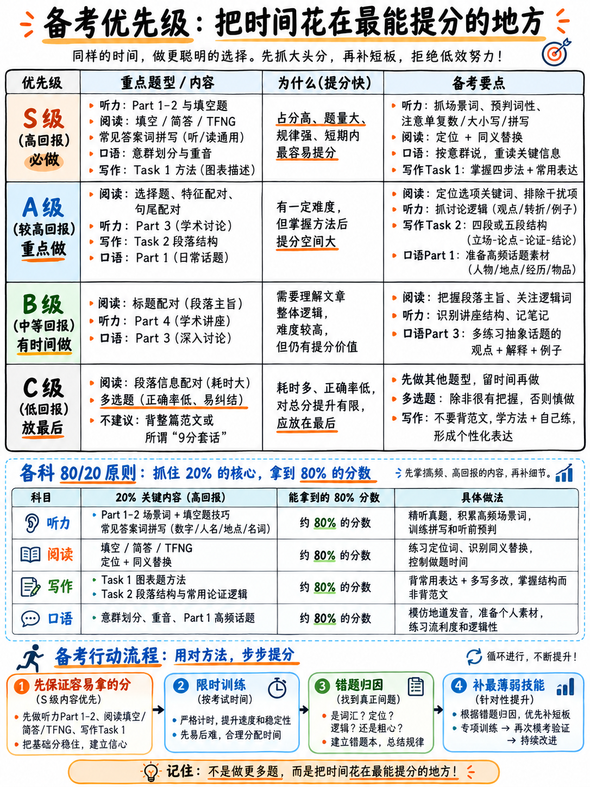

# 04. 备考精力优先级分级与时间投入模型 (Priority Triage)



本章是整套通关手册的**战略决策核心**。后续所有具体练习模块的战术动作，皆由本章的精力投入模型推导而来。

---

## 4.1 备战战略推导：四大底层事实 (The Strategic Argument)

有四个白纸黑字的官方事实，彻底锁死了我们的备考精力布局：

1. **总成绩是四科单项的无加权纯算术平均** `[7]`。无论一门科目多么艰深，它在总分里永远只占且必须占整整 **25%** 的权重。
2. **在这四门科目中，有整整两门是完全依照客观参考答案采分的**——听力 40 题与阅读 40 题，答对一题拿一分，**没有任何倒扣分** `[2]` `[3]`。这两门科目的得分是纯粹的数学计数，不存在任何主观印象波动。
3. **其余两门主观科目（写作与口语）要求考生的表现必须“完全契合（Fully fit）”对应的描述特征** `[8]`。你无法在缺乏 7 分词汇储备的前提下侥幸拿到词汇维度的 7 分，而词汇广度的自然沉淀是外语学习中最耗费时间的漫长过程。
4. **听力 Part 1–2 以及客观题中的所有填空类题型，本质上考查的是“信息转录（Transcription）”而非宏观深层理解**——只要你能听出或看出一个词并把它拼写正确即可 `[2]` `[3]`。初学者完全可以在读不懂全篇复杂背景的情况下，稳稳斩获这些采分点。

由此得出核心战略结论：  
**你总成绩中整整 50% 的分值（听力与阅读）完全向应试技术与题型技巧开放；而另外 50% 的分值（写作与口语）则受制于考生的真实语言底子。**  
一场高效的冲刺备考，必须把绝大部分复习时间死死砸在能够迅速换算成分数的前半部分，而在后半部分则采取严防死守、保底达标的防御策略。

```
   初学者 4 周冲刺黄金精力分配模型 (WHERE YOUR HOURS SHOULD GO)
   (本课程教研实战推导方案，非官方强制规定)

   听力核心技巧 + 填空听写抓词训练   ████████████████████  25%
   阅读定位技术 + 严格控时模考训练   ████████████████████  25%
   发音节奏 (意群/重音) + 口语流利度 ██████████████        18%
   写作 Task 1 (高度可预测的图表骨架) ██████████            13%
   写作 Task 2 (四段式弹性论证框架)   ████████              10%
   高频拼写 / 数字日期 / 答题格式规则 ████                   5%
   生僻孤立单词的机械死记硬背         ███                    4%
                                                            ────
                                                            100%
```

**为什么死记硬背生僻词仅分得 4% 的精力？**  
这是本体系中最反直觉但最科学的一项决策。原因在于：在 6 分档位，官方词汇标准明确只要求“尽管词汇储备相对受限，但表达大意总体清晰”（"The meaning is generally clear in spite of a rather restricted range"）`[8]`。依靠词汇量从 6.5 冲刺到 7.5 需要几个月甚至几年的英文阅读沉淀，而在为期数周的速成备战中，把宝贵的时间拿来疯狂刷背厚厚的单词书是效率最低的自杀式打法。

---

## 4.2 提分杠杆优先级梯队 (The Triage Tier List)

### 🥇 Tier S（王炸主力 · 每日必练 · 单位提分杠杆最高）

| 备考训练模块 | 为何被列为 Tier S 级核心资产 |
|---|---|
| **听力 Part 1 + Part 2** (占据 40 题中的 20 题) | 围绕日常生活场景展开（如租房、活动登记等）`[1]`。考查核心全是人名、数字、电话、日期、地址与基本名词，本质就是语音听写，极易练到 18–20 题全对。 |
| **听力三大填空题型 (L4, L5, L6)** | 贯穿全卷四大部分，占据听力半壁江山。核心考查关键词捕获与拼写，可直接套用标准化解题流程。 |
| **阅读填空与简答题 (R8, R9, R10, R11)** | 答案**100% 取自原文原词**！零同义转述风险、零个人拼写错误风险，题目顺序严格顺原文展开，性价比全卷第一。 |
| **阅读 TFNG / YNNG (R2, R3)** | 题目顺序严格顺原文；选项只有三个；掌握逻辑公式后无需读懂全句即可做出判断，全卷稳定贡献 5–8 分。 |
| **听力高频 150 个核心答案词拼写** | 拼写失误扣分完全与英语理解能力无关。集中攻克这 150 词，等于给听力白捡 0.5–1.0 分。详见：{doc}`../60-toolkit/03-spelling-numbers-and-answer-rules`。 |
| **口语意群切分 (Chunking) 与单词重音** | 官方发音量表第一考核指标 `[11]`，6 分发音分水岭的关键条件 `[9]`。只需两周的刻意停顿跟读训练即可形成肌肉记忆。 |
| **写作 Task 1 核心图表框架** | 官方明文定性为“高度可预测的输出（a largely predictable output）” `[10]`。全卷唯一具有固定套路和语言框架的作文题，短期见效极快。 |

---

### 🥈 Tier A（攻坚提分 · 掌握套路 · 稳健保底）

| 备考训练模块 | 攻坚逻辑与提分价值 |
|---|---|
| **阅读 单选题、特征配对、句尾配对 (R1, R6, R7)** | 题干顺序基本契合原文，解题步骤规整，耗时适中，是稳住阅读 6.5–7.0 的核心中坚。 |
| **听力 Part 3 (学术研讨)** | 难度虽高，但其中往往仅有 4 题属于复杂观点推断，其余 6 题依然是单选或配对排除法，掌握信号词能稳拿及格分。 |
| **写作 Task 2 逻辑骨架 (非内容)** | 连贯与衔接（CC）是写作中技巧提升最快的维度：官方白纸黑字考核段落划分与主旨句呈现 `[10]`，四段式框架能直接锁定 6 分 CC。 |
| **口语 Part 1 核心日常话题** | 题库高度透明，围绕个人背景展开。这是整场考试中唯一可以真实、合法进行提前演练的话题集。 |
| **核心语法八大句型** | Band 6 语法标准要求展现简单句与复合句的混合运用 `[8]`——掌握本课程提炼的 8 大句型即可充分满足要求。详见：{doc}`../60-toolkit/02-grammar-minimum`。 |

---

### 🥉 Tier B（稳步达标 · 避免硬刚 · 不求过度优化）

| 备考训练模块 | 实战应对策略 |
|---|---|
| **阅读 标题配对 (Matching Headings, R5)** | 乱序题型，单位分值耗时偏高，但由于往往以整组 5–7 题的形式成块出现，不可全篇放弃。使用本课程研发的低成本首尾句排查法过关。 |
| **听力 Part 4 学术讲座** | 高密度独白，中途无重复。使用“笔记空格预判法”抓取核心重音名词，接受丢掉 2–3 题的现实。 |
| **口语 Part 3 深度抽象思辨** | 话题跨度极广。考场重在流利表达与观点展开，考官考查的是语言连贯性而非你的思想哲学深度。 |
| **写作 Task 2 八大场景高频话题词** | 掌握一组复用率极高的话题核心搭配，见好就收。详见：{doc}`../60-toolkit/01-core-vocabulary`。 |

---

### ⛔ Tier C（战略避坑 · 绝不死磕 · 猜题跳过）

| 避坑内容 | 深度解构：为何必须果断割席？ |
|---|---|
| **阅读 段落信息配对 (Matching Information, R4)** | **全卷性价比最差的题型**。乱序、选项可复用、要求每题通篇地毯式搜寻。每分钟拿分率极低。必须留到每篇文章最后做，找不到的果断猜题。 |
| **阅读“多选多”难题 (Choose TWO/THREE)** | 题干与选项文字量巨大，稍有不慎漏掉条件即丢分，做题耗时严重超标。 |
| **死记硬背厚字典、偏门习语、所谓“Band 9 满分神仙句”** | 官方写作量表 Band 4 明文严惩“机械套用死背短语与程式化套话” `[8]`。生搬硬套是考官最为反感的自杀行为。 |
| **死抠个别辨别不出的冷僻单音标** | 官方 6 分发音标准完全容忍“个别单词或音素的发音失误” `[9]`。只要不造成严重词义混淆即可，不必追求发音完美无瑕。 |
| **死记硬背整本评分标准中的 9 分细则** | 聚焦搞懂自己最弱两门科目的 6 分与 7 分核心边界线，彻底无视 9 分标准。 |

---

## 4.3 四科提分瓶颈真因诊断 (The Bottleneck Matrix)

面对成绩停滞不前，初学者往往把原因归咎于错误的方向：

| 科目 | 初学者自认为的“病因” | 考场上真正导致丢分的凶手 | 科学靶向药方 |
|---|---|---|---|
| **听力** | “他们说话语速太快，我根本跟不上。” | 一道题没听出来后**产生慌乱，导致在录音中彻底迷失当前位置**；听到词却拼错或漏写单复数。 | 训练“快速止损与重新锚定”技术 + 抓牢 150 个高频拼写词。详见：{doc}`../50-listening/01-scoring-and-section-tactics` |
| **阅读** | “文章里生词实在太多了。” | **时间失控**——60 分钟内要阅读近 2750 词并完成 40 题 `[3]`，考生常在一道难题上死磕 5 分钟。 | 执行严格的“单篇 17 / 37 / 57 分钟强制时间截断法”。详见：{doc}`../40-reading/01-scoring-and-section-tactics` |
| **写作** | “我的词汇量太小，写不出高级大词。” | **完全没有规范分段**、Task 1 漏写总结概括段（Overview）、Task 2 立场自相矛盾或篇幅严重未达标。 | 结构先于一切，优先攻克段落骨架与首段立场。详见：{doc}`../30-writing/01-how-writing-is-scored` |
| **口语** | “我的中式口音太难听了。” | **为了搜寻生僻词陷入长时间卡顿沉默**；Part 1 像挤牙膏只答几个字；Part 2 讲满 1 分钟就无话可说。 | 掌握流利度垫话句型 + 4 点结构化破题卡片法。详见：{doc}`../20-speaking/05-fluency-engine` |

---

## 4.4 四科通关核心 80/20 法则 (The 80/20 Rules)

- **听力 (Listening)**：**在录音播放的同时把答案敲入空格**，绝对不要因为前面错过了一道题而影响对下一道题的警觉。
- **阅读 (Reading)**：优先按文章顺序解决那些**答案直接是原文原词**的题型；把通篇找段落的配对题坚决压到最后。
- **写作 (Writing)**：规范的四个段落、首段明确亮出鲜明立场、字数坚决达标。仅凭这三点，就足以让你的连贯性（CC）稳稳拿到 6.0 分 `[8]`。
- **口语 (Speaking)**：以自然的意群单位持续输出，打准单词重音；遇词卡壳时立即在嘴边用已知词大声释义，转述本身就是官方明文肯定的采分点 `[11]`。

---

## 4.5 极速备考（少于 7 天）极速止血方案 (Emergency Protocol)

如果你的考试已迫在眉睫，请完全抛弃所有长远计划，严格按以下顺序执行止血训练：

1. **通读拼写与答题格式铁律**（耗时 90 分钟）：{doc}`../60-toolkit/03-spelling-numbers-and-answer-rules`
2. **刷透听力填空题与 4 套完整模拟卷**（耗时 4 小时）：{doc}`../50-listening/02-completion-tasks`
3. **掌握阅读 TFNG 与填空题秒杀法则**（耗时 4 小时）：{doc}`../40-reading/02-true-false-not-given` 与 {doc}`../40-reading/03-completion-and-short-answer`
4. **精通写作 Task 1 图表句型并手写 3 篇**（耗时 3 小时）：{doc}`../30-writing/02-task-1-academic`
5. **掌握 Task 2 四段论证架构并成文 2 篇**（耗时 3 小时）：{doc}`../30-writing/04-task-2-essay-types`
6. **掌握口语流利度垫话并录制 10 篇 Part 2**（耗时 3 小时）：{doc}`../20-speaking/05-fluency-engine`
7. **研读考场当天必带与突发应对清单**（耗时 30 分钟）：{doc}`../60-toolkit/06-exam-day-checklist`

72 小时极限冲刺详细时刻表详见：{doc}`../60-toolkit/05-study-plans`。

---

**上一章：** {doc}`03-how-scoring-works` | **下一章学习指南：** {doc}`05-glossary-and-question-banks`
