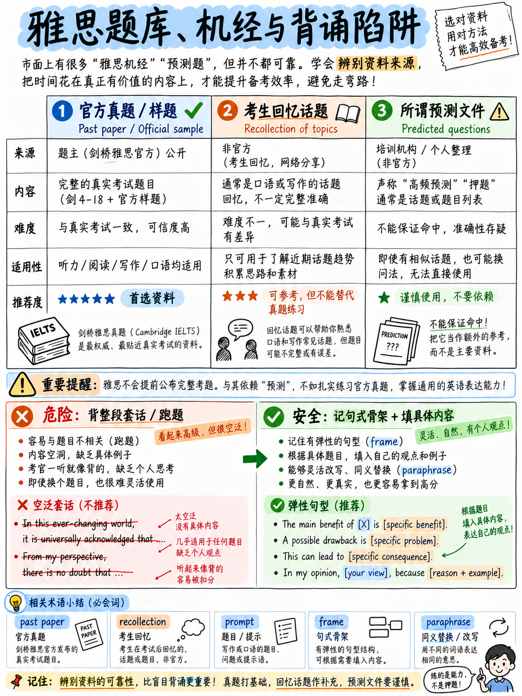

# 05. 核心术语表与真题题库科学使用指南 (Glossary & Question Banks)

初学者往往在各种所谓“内部题库”与“考前押题”上白白浪费数周宝贵时光，甚至因盲信死记模板而导致全科成绩直接归零。本章将为你还原最真实的官方规则与资料甄别逻辑。

---

## 5.1 所谓“雅思题库”的三大本质区分 (The Three "Question Banks")

市面上所有被称为“题库”的资料，本质上分属三种完全不同的事物：

| 资料类型 | 它的本质真实属性 | 雅思考试中是否存在？ | 对备考是否有实质价值？ |
|---|---|---|---|
| **官方退役真题 (Past Papers)** | 由官方主办方解密公布的真实历史试卷 | **存在，但数量有限。** 包括官方公开样题 `[25]`、《剑桥雅思真题集》（Cambridge IELTS 4–20 册，由剑桥大学出版社出版），以及官方机考模考系统。 | **极高。** 这是全网唯一具备 100% 官方难度信度与命题逻辑的黄金训练资源。 |
| **考生考后回忆库（民间俗称“机经”）** | 考生在走出考场后，根据记忆在论坛或社交媒体上复述的话题要点 | **非官方客观存在。** 在教师网站和考生论坛中有着长期的民间搜集整理 `[22]` `[23]` `[24]` `[26]`。 | **对口语和写作：具备参考价值；** **对听力和阅读：几乎毫无价值（见下文分析）。** |
| **商业“押题预测包 / 绝密题库”** | 机构或个人收费售卖的文档，声称百分之百覆盖你考试当天的真题 | **绝不存在。** 雅思官方严正声明从未向公众公布过口语题库 `[22]`，且机考试卷组合完全处于动态加密随机抽取中。 | **毫无价值。** 任何承诺“保过/保题”的宣传均属商业噱头，盲信会导致考场严重误判。 |

:::{important}
**为什么回忆机经对口语和写作有参考价值，而对听力和阅读几乎一文不值？**

口语 Part 1 和 Part 2 围绕一个有限且轮换相对缓慢的题库池展开——家庭、学业、工作、日常爱好、敬佩的人、重要物品等；写作 Task 2 同样围绕教育、科技、环境、政府支出等几个经典的母题领域打转。提前知晓**话题领域（Topic Areas）**确实大有裨益，因为你可以提前储备相关的逻辑素材与实词搭配。

但听力和阅读则完全不同！两科选材直接源于海量专业学术期刊、科普杂志、专著及新闻报道 `[6]`，全球活跃卷库规模庞大且随时更新。听说“上周某考场出了一篇关于南极冰川的阅读”，对你没有任何实际指导意义。**切勿花钱购买任何听力或阅读“预测包”，唯一的正道是认认真真刷透官方退役真题。**
:::

---

## 5.2 死记硬背模板的巨大杀伤力（官方白纸黑字依据）

这是全课程最严厉的警示。你在绝大多数低质自媒体和过时教材中看到的“万能高分作文模板”，在现行雅思评分体系中属于**高危自杀行为**。

### 官方公开评分细则的明文判罚条款

**写作评分标准细则（Writing Band Descriptors）** `[8]`：

> **Band 0（直接判定 0 分）**：  
> “仅适用于考生未出席、完全未作答、全篇使用非英语语言，或者**有确凿证据证明考生的回答全篇属于死记硬背范文（where there is proof that a candidate's answer has been totally memorised）**。”

> **Band 4 词汇维度（LR）**：  
> “**不恰当地使用成串记忆短语（例如：死记硬背的套句、公式化套话，或照搬题干材料输入内容）**。”  
> (*"inappropriate use of lexical chunks, e.g. memorised phrases, formulaic language and/or language from the input material"*)

> **Band 3 词汇维度（LR）**：  
> “**可能过度依赖题干材料或死记硬背的语言。**” (*"Possible over-dependence on input material or memorised language."*)

> **Band 2 词汇维度（LR）**：  
> “词汇资源极度匮乏，除个别**死记硬背的短语（memorised phrases）**外，几乎没有可识别的连贯表达。”

> **Band 3 语法维度（GRA）**：  
> “语法和标点错误占据主导地位（**但在死记硬背的短语或抄录材料中除外**）。”

> **Band 1 任务完成度（TA）**：  
> “**抄录自题目的任何词句必须直接剔除核减。**” (*"Any copied rubric must be discounted."*)

**口语评分标准细则（Speaking Band Descriptors）** `[9]`：

> **Band 3 语法维度（GRA）**：  
> “语法错误极多，**但在明显属于死记硬背的话段中除外**。”

> **Band 2 词汇维度（LR）**：  
> “词汇资源极其有限。**表达仅由孤立词汇或死记硬背的话段构成。**”

**官方核心评价标准总览（Key Assessment Criteria）** `[10]`：

> “考生答卷在以下情况下将被严肃惩处：a) **部分或全部涉嫌抄袭（plagiarised）**；b) 未以完整连贯文本撰写。”

### 深入看懂官方评分规则背后的“天花板机制”

在官方评分量表中，**“死记硬背（Memorised language）”这个词只在 0、1、2、3、4 分的描述中出现**——5 分及以上完全绝迹！在考官眼中，套话模板是**低水平考生的典型病理特征**。一名受过严格学术训练的考官在识别出记忆套话时，绝不仅仅是“跳过不读”，而是会将其视为考生缺乏真实词汇驾驭力的铁证。

更糟糕的是，雅思实行的是“严格天花板判定”：考生文章必须“完全符合对应分段的所有正面特征” `[8]`。一个显眼的模板套话直接构成量表中的**负面限制特征（Negative feature）**，它会**直接将你的词汇得分封死在 4 分上限**！在四大维度等权重的情况下，一个维度的 4 分足以彻底毁掉你的总分。

:::{danger}
**考场绝对不可动用、见光即死的高危陈词滥调黑名单：**  
这些套话充斥在各大免费模板中，也正因如此，考官批阅过成千上万份，一眼就能识别：

- *"In this ever-changing / fast-paced modern world..."*（在这个瞬息万变的现代世界里……）
- *"It is a double-edged sword."*（这是一把双刃剑。）
- *"Since the dawn of civilisation / time immemorial..."*（自文明发轫/远古时代以来……）
- *"There are both merits and demerits to this issue."*（关于这个问题利弊并存。）
- *"Last but not least..."*（最后但同样重要的一点是……）
- *"To embark on / delve into this topic..."*（为了深入探讨这一主题……）
- *"I am of the firm belief / staunch opinion that..."*（我坚定地认为……）
- *"It goes without saying that..."*（不言而喻的是……）
- *"Every coin has two sides."*（事物都有两面性。）

这些句子本质上没有任何实质信息，它们只是在空耗字数，完全无法提供官方评分标准所渴望的“具体、延伸且有充分支撑（relevant, extended and supported）”的论点 `[8]`。
:::

### 破局之道：采用合规提分的“弹性句型框架 (Sentence Frames)”

真正合规且能稳拿高分的武器是**弹性句型骨架（Sentence Frames）**：它只提供纯粹的**逻辑语法连接骨架**，把所有实词和论据空间彻底留空，现场根据具体考题从容填充。

| 危险的死记硬背模板（严厉惩处） | 规范的弹性语法骨架（官方合规加分） |
|---|---|
| *"In this ever-changing modern world, technology plays a vital role in our daily lives."*（空洞套话） | *"Over the last twenty years, [online banking] has changed how [most people manage money]."*（用实词填空） |
| *"There are both advantages and disadvantages to this issue."*（毫无信息的废话） | *"The main benefit of [X] is [具体核心收益]; the main cost is [具体核心代价]."*（逻辑严密精准） |
| *"In conclusion, I firmly believe that the advantages outweigh the disadvantages."*（假大空） | *"On balance, [X] does more good than harm, because [你正文实际论证的核心理由]."*（呼应前文论据） |

为什么弹性骨架完全安全？因为骨架贡献的是**句式语法（Grammar）**，直接在 GRA 维度拿“句型多样性”的得分 `[10]`；而具体的论点词汇完全是你现场生成的，考官在 LR 和 TR 维度能够如实核验你真实的语言能力。一个规范的骨架仅占成文的 10%–15%，而危险的模板往往占到 60%–80%，正是后者触发了官方的扣分红线。

:::{tip}
**作文防套话自检“一句话法则”：**  
写完作文后，检查你的每一个句子。如果某句话在换成一个风马牛不相及的完全不同的题目后，**依然一字不改读得通顺**，那就证明这是一句空话。整篇文章中如果出现超过两句这样的句子，你写的就是危险模板，必须果断删改！
:::

---

## 5.3 权威备考资料可信度与推荐级别 (Practice Material Hierarchy)

| 资料来源 | 内容属性 | 官方权威度评级 | 官方获取成本 |
|---|---|---|---|
| **官方全题型权威样题库** `[25]` | 听读全题型官方纯正试卷、标准参考答案与录音原文文本 | **最高 (Highest)** | 完全免费 |
| **官方学术类写作真实试卷及考官详细批注** `[12]` | 覆盖 4.0、5.5、6.0、7.5 分的 4 篇真实考生手迹及考官逐字评析 | **最高 (Highest)** | 完全免费 |
| **官方口语全套完整样题及全场实录文本** `[13]` | 官方 Part 1/2/3 考官标准话术脚本与真实考生完整答录 | **最高 (Highest)** | 完全免费 |
| **官方写作与口语现行评分量表** `[8]` `[9]` | 考官阅卷执法的根本大法 | **最高 (Highest)** | 完全免费 |
| **官方在线机考真实模考系统** `[25]` | 1:1 还原机考真实界面（分屏阅读、划线标注、自动计时与交卷） | **最高 (Highest)** | 完全免费 |
| **《剑桥雅思官方真题集》（Cambridge IELTS 10–20 册）** | 剑桥大学官方出版社发行的退役实战真题 | **高 (High)** | 付费正版书籍 |
| **British Council 与 IDP 官方免费备考专区** | 官方日常测试、教学指引与技巧网络研讨会 | **高 (High)** | 完全免费 |
| **经验丰富的前考官与资深名师独立教学网**（如 IELTS Liz `[22]`）| 解题思路剖析、题型拆解技巧、话题范围归纳 | **中高 (Medium-High)** 技巧层面；**中等** 预测层面 | 完全免费 |
| **民间论坛与社群话题整理** `[23]` `[24]` | 考生回忆的话题热词与近期讨论 | **中等 (Medium)** 仅供练习素材参考 | 完全免费 |
| **短视频与论坛兜售的所谓“Band 9 满分范文”** | 绝大多数作者不明，充斥大量被官方严打的陈词滥调与生造词 | **极低 (Low)**，极易误导考生 | 鱼龙混杂 |

:::{warning}
**警惕 AI 生成的所谓“雅思 9 分满分范文”：**  
近年来市面上泛滥的很多所谓“雅思满分范文”实为通用大模型直接生成。这类文章表面流利工整、长句林立，但通篇充斥着诸如 *"In today's rapidly evolving world"*、*"a paramount significance"* 等空洞套语，恰恰落入官方 Band 4 词汇量表的惩罚区间 `[8]`。请将官方公开的四篇带考官真实评语的试卷 `[12]` 作为你衡量好坏的唯一标尺。
:::

---

## 5.4 雅思考试核心术语大辞典 (Terminology Glossary)

### 官方规范核心术语 (Official Terms)

Band score
: 雅思成绩档位。采用 1 至 9 分的分制体系，以整分（Whole band）或半档（Half band，如 5.5、7.0）形式发放 `[2]`。

Overall band score
: 雅思总成绩。由听、说、读、写四科单项分取纯算术平均后，依照 .25/.75 进位规则修约得出 `[7]`。

Test Report Form (TRF) / eTRF
: 成绩报告单。考生收到的官方成绩凭证，涵盖纸质版（TRF）与加密电子版（eTRF）`[1]`。

Band descriptors
: 评分量表。官方公开的供考官给写作和口语打分的权威细则表 `[8]` `[9]`。

Key assessment criteria
: 核心评估指标。官方针对每个评分维度的具体内涵做出的权威解读文本 `[10]` `[11]`。

Task card
: 任务卡。口语 Part 2 中发给考生的印刷纸质卡片，包含主题与 3–4 个作答要点。民间常俗称“Cue Card” `[13]`。

Rounding-off questions
: 收尾简短追问。口语 Part 2 考生陈述结束后，考官提出用于平稳过渡到 Part 3 的 1–2 个简短问题 `[13]`。

Examiner frame
: 考官既定话术脚本。考官在考场上念读的串场指导语，全球统一固化 `[13]`。

One Skill Retake (OSR)
: 雅思单科重考机制。考生在机考出分后 60 天内，可针对听说读写四科中的任意一门申请单项重考一次 `[16]`。

Access arrangements
: 特殊考试安排。针对残障、视听障碍或特定健康状况考生的专属关照，须**在考前至少 6 周**提出申请 `[1]`。

Writing on Paper (WoP)
: 纸笔写作机考模式。除写作手写在纸质答题纸上外，其余环节均在电脑端完成 `[15]`。

IELTS Online (IOL)
: 雅思在线考试。仅限学术类，在考生家中远程监考进行，出分需 6–8 天 `[1]`。

### 社群高频备考俗称 (Community Terms)

Cue card
: 即官方 Task card（口语任务卡）。

Completion types（填空类题型）
: 答案需要从听力录音或阅读原文中摘录原词填入空格的题型家族。

Distractor（干扰项 / 混淆信息）
: 录音或阅读中极具欺骗性的错误选项，或在录音中先说出随后被说话者自我纠正的信息。听力 Part 1 几乎题题皆有。

Paraphrase（同义转述 / 改写）
: 用不同的词汇或句法重新表达同一含义。在口语中是词汇维度的加分点 `[11]`，在阅读和写作中是高分的核心支柱。

Overview / Overall statement（全局总览概括句）
: 学术类写作 Task 1 必不可少的宏观总结。Band 6 明确要求“尝试给出宏观总览”，Band 7 要求“呈现清晰的宏观总览” `[8]`。

Keyword spotting（机械定位关键词）
: 仅靠题干中的原词去原文中搜索。在基础填空题中有效，但在 TFNG 和配对题中是导致错选的最主要祸根。

Fossilised error（石化错误 / 顽固错误）
: 考生由于长期不正确的使用习惯而形成的潜意识语法或发音错误，自己完全听不出来。需要通过错题复盘机制彻底纠正。

Band 7 vocabulary（所谓“7 分词汇”）
: 培训机构创造的商业宣传语。官方从未针对任何分数档发布过所谓的“专用词汇表”。

:::{note}
**甄别资料时切忌混淆考试种类：**  
“IELTS Life Skills（生活技能类）”、“IELTS General Training（培训类）”、“PTE Academic（培生学术英语）”、“TOEFL iBT（托福）”以及“Duolingo English Test（多邻国）”各自拥有完全不同的题型设计与评分底层逻辑。切勿混用备考资料。针对阅读与写作 Task 1，请认准 **Academic** 专属标志。
:::

---

**上一章：** {doc}`04-priority-triage` | **下一章学习指南：** {doc}`06-choose-your-target`
