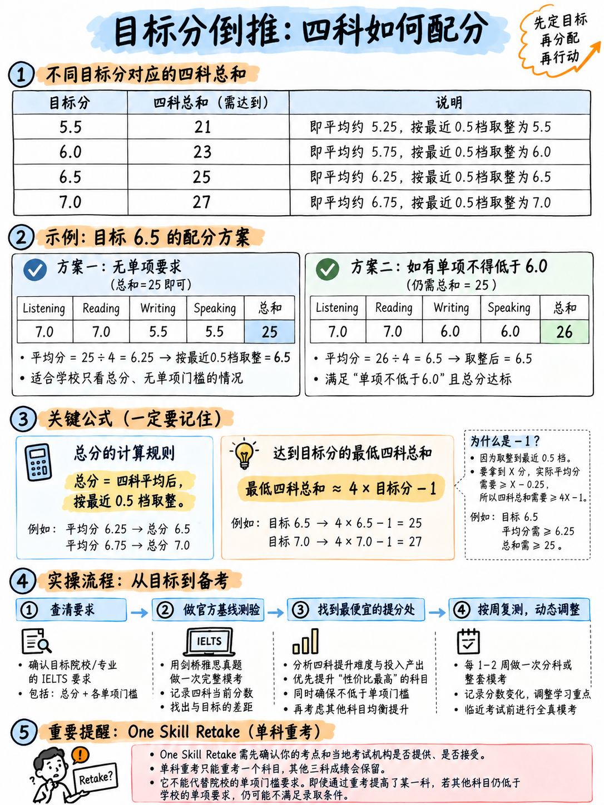

# 06. 科学制定你的目标分与四科组合策略 (Choose Your Target Band)

在翻开任何一本练习册或背诵任何一个单词之前，请先用 20 分钟做完本章的战略推演。这一步将彻底决定你未来全部复习动作的投入产出比。

---

## 6.1 第一步：核实你真正需要的硬性指标 (Find Your Exact Number)

有两个分数指标至关重要，而多数初学者往往只看了第一个：

1. **总成绩要求（Overall Band）**：申请机构要求的总分。
2. **单项小分底线要求（Per-skill Minimum）**：绝大多数全球知名高校、专业注册机构（如医师、护理协会）及签证移民部门都会设定单项硬指标——例如“总分 6.5，且单项不得低于 6.0”（*6.5 overall with no band below 6.0*）。

:::{danger}
**单项小分限制将彻底颠覆你的战略排兵布阵！**  
如果你的目标是“总分 6.5，且无单项要求”，你完全可以主动战术性放低写作（拿 5.5 分保底），依靠听力和阅读（各冲 7.0 分）轻松将总分拉到 6.5；  
但如果目标是“总分 6.5，单项不低于 6.0”，那么“牺牲写作保听读”的杠杆策略就必须调整，你必须至少分配额外的 10–15 小时将写作的结构与审题强化到 6.0 分的安全线之上。  
请务必直接查阅目标院校官网研究生院/本科招生处公布的最新原文，切勿盲信第三方论坛的二手转述。官方声明指出：“各机构要求互不相同，务必以你所申请组织的官方发布为准” `[16]`。
:::

同时务必确认报考类型为**雅思学术类（IELTS Academic）**，而非培训类（GT）或生活技能类。如果涉及英国签证移民，请注意 UKVI SELT 官方规定“仅支持纯数字化机考模式” `[14]`，且**纸笔写作模式（Writing on Paper）不支持 UKVI 申请** `[15]`。

---

## 6.2 第二步：执行四科总和逆向算术推演 (The Arithmetic Play)

根据 {doc}`03-how-scoring-works` 中严格推导出的数学定理：你的听说读写四科成绩之和必须满足：

$$
\text{四科单项分之和} \ge 4 \times \text{目标总分} - 1
$$

### 各总分档位及最推荐初学者的四科拿分组合

| 目标总分 | 四科总分最低门槛 | 初学者最高性价比拿分组合 (听力 L / 阅读 R / 写作 W / 口语 S) | 算术验证与战略合理性 |
|---|---|---|---|
| **5.5 分** | **21.0 分** | **5.5 / 5.5 / 5.0 / 5.0** = 21.0 ✓ | 基础达标，轻松拿下 |
| **6.0 分** | **23.0 分** | **6.5 / 6.0 / 5.0 / 5.5** = 23.0 ✓ | 听力突出，双主观题保底 |
| **6.5 分 (无小分限制)** | **25.0 分** | **7.0 / 7.0 / 5.5 / 5.5** = **25.0 ✓** | **黄金王牌组合**：客观题各冲 7 分，主观题 5.5 稳过 |
| **6.5 分 (单项 ≥ 6.0)** | **25.0 分 (且各项 ≥ 6)** | **7.0 / 7.0 / 6.0 / 6.0** = 26.0 ✓ | 写作和口语需补齐结构短板 |
| **7.0 分 (无小分限制)** | **27.0 分** | **7.5 / 7.5 / 6.0 / 6.0** = 27.0 ✓ | 听读强势冲高，主观题稳住 6 分 |
| **7.0 分 (单项 ≥ 7.0)** | **27.0 分 (且各项 ≥ 7)** | **7.0 / 7.0 / 7.0 / 7.0** = 28.0 ✓ | 无投机空间，需全面扎实的综合功底 |

请重点审视 **6.5 分** 这一行：  
**7.0 (听) + 7.0 (读) + 5.5 (写) + 5.5 (说) = 25.0，平均分 6.25 官方规则自动进位为 6.5 分！**  
对于初学者而言，这是一个在一个月内完全可以真实落地的科学路径。因为两个 7.0 分来自于客观标准答案（各做对 30 题，允许错 10 题），而两个 5.5 分是任何受过基本结构训练、字数达标且表达切题的考生自然而然就能获得的保底分数。这比盲目追求 6.5 / 6.5 / 6.5 / 6.5 的平均主义打法，至少节约了 60% 以上的无谓消耗。

:::{important}
**这就是雅思考试的核心效率博弈：**  
因为总分是无加权的纯算术平均，你在阅读中低成本买到的 0.5 分，与你在写作中历经千辛万苦磨出来的 0.5 分，在总成绩里的含金量完全平等！因此，一定要“在便宜的地方大量进货”——全力推高听力和阅读，对写作和口语筑牢防守底线。  
**唯一例外**：存在单科小分限制。此时底线被迫抬高，必须定向进行短板攻坚。
:::

---

## 6.3 第三步：第一天真题摸底与真实提分速度认知 (Honest Diagnostic)

在动笔学习具体技巧的第 1 天，请准备好秒表，完成以下自我基准摸底：

1. **客观题摸底**：在官方样题系统或《剑桥雅思》中，严格按照真实考试时间完成一套听力（30分钟）和一套学术类阅读（60分钟）`[25]`。根据官方锚点换算初始分数：16 题 ≈ 5.0，23 题 ≈ 6.0，30 题 ≈ 7.0，35 题 ≈ 8.0 `[7]`。
2. **写作摸底**：40 分钟独立完成一篇 Task 2 大作文，中途不查阅词典、不借鉴范文。写完后对照官方公布的 4.0、5.5、6.0 和 7.5 四篇真实考卷及考官评析 `[12]` 进行横向对标定位。
3. **口语摸底**：抽取官方样题中的 Part 2 任务卡（如“Describe something you own which is very important to you”）`[13]`，计时准备 1 分钟，录音作答 2 分钟。回放录音，对照 Band 6 发音和流利度量表 `[9]` 审视自身的停顿卡顿。

记录下你的初始四科分数，你与目标之间的真实鸿沟一目了然。

### 各科目在 4 周集训内的真实提分天花板预估

本表基于客观题目与主观题目的阅卷机理推导，为你呈现真实的提分周期预期：

| 科目 | 4 周每日系统高强度备考下的现实提分幅度 | 为什么提分速度呈现这种分布？ |
|---|---|---|
| **听力 (Listening)** | **+ 1.0 至 + 1.5 个 Band** | 初始失分大部分来自于答题格式、拼写马虎以及录音跟丢位置——这些全是纯技术问题，两周内即可大幅改善。 |
| **阅读 (Reading)** | **+ 1.0 至 + 1.5 个 Band** | 初始失分主要源于时间失控与题型策略失误；掌握时间截断与原词摘抄定位后分数立竿见影。 |
| **口语 (Speaking)** | **+ 0.5 至 + 1.0 个 Band** | 流利度（FC）的垫话训练与发音意群切分（P）见效极快；但词汇广度（LR）在短期内提升有限。 |
| **写作 (Writing)** | **+ 0.5 个 Band** | 连贯与衔接（CC）和任务完成度（TR）能通过框架迅速修补；但词汇与语法基础很难在四周内发生根本性蜕变。 |

如果你的目标分与初始模考成绩之间的缺口远大于上述合理幅度，请坦诚面对现实：要么延长备战周期，要么合理降低本次的预期目标。在第一天保持理性与诚实，价值千金。

---

## 6.4 第四步：将单科重考 (One Skill Retake) 纳入整体战略规划

**单科重考（One Skill Retake, OSR）**允许考生只针对四门单项中的某一门薄弱科目单独重考一次。其官方核心规则如下 `[16]`：

- **60 天窗口期**：必须在**原全科考试日起 60 天之内**完成单科重考。
- **仅限一次**：每次全科考试**仅可申请一次**单科重考。
- **四科任选**：听说读写四科中任意一科均可重考。
- **先决条件**：原考试必须是在支持 OSR 的官方考点完成的**雅思机考**。
- **成绩单发放**：重考后考方发放**一份全新的成绩单（TRF）**，上面包含新考的单科成绩与另外三科原成绩；考生**可自由选择使用原始成绩单或新成绩单**。
- **出分极速**：重考后通常 **3–5 个工作日**出分。
- **纸笔写作要求**：若原考试选择的是 Writing on Paper 模式，写作单科重考同样必须采用纸笔手写模式 `[15]`。

:::{tip}
**将 OSR 作为主动的战略杠杆，而非被动的补救措施！**  
知晓有一次单科重考机会，能从根本上优化你的冲刺方案：第一轮你可以把 80% 的精力完全聚焦在听力与阅读上，写作和口语只需保证基本盘；甚至可以在尚未完全准备充分时提前出战全科，获取一份真实的官方成绩单。  
回顾官方范例中的**考生 C**（听 6.5，读 6.5，口 6.0，写 5.5，总分 6.0）`[7]`——他距离 6.5 分仅差总分 0.5 分！利用 OSR，他不需要重新经历 2 小时 45 分钟的四科炼狱，只需在随后的 60 天内孤军奋战攻克写作一门，将 5.5 提升至 6.0 或 6.5，即可直接换取 6.5 分的崭新成绩单！

**考前两大确认动作**：在报名全科之前，务必提前确认所在考点支持 OSR，并向目标院校确认其认可 OSR 成绩单。
:::

---

## 6.5 实战方案：零基础 4 周冲刺 6.5 分全流程时间表

- **终极目标**：**总成绩 6.5 分（无小分硬性限制）**
- **初始模考**：听力 4.5，阅读 4.5，写作 4.5，口语 4.5（四科总和 18.0，距离 25.0 缺口 7.0 分）

| 科目 | 初始分 | 核心战术行动 | 预定终点 | 投入总学时 |
|---|---|---|---|---|
| **听力** | 4.5 | 每日专攻填空类题型，Part 1 & 2 刷至接近满分，死磕 150 高频拼写词 | **6.5–7.0** | 25 小时 |
| **阅读** | 4.5 | 严格题型优先级（原词摘抄填空优先），严守 17/37/57 分钟时间红线，吃透 TFNG 逻辑 | **6.5–7.0** | 25 小时 |
| **写作** | 4.5 | 掌握 Task 1 核心图表句型并完成 10 篇实战；掌握 Task 2 四段框架并完成 6 篇 | **5.5** | 18 小时 |
| **口语** | 4.5 | 每日意群跟读切分与单词重音；掌握流利度垫话；录制 20 个 Part 2 任务卡 | **5.5** | 16 小时 |
| **基础规范** | — | 拼写纠错、数字日期格式规则、建立错题归因分析本 | — | 6 小时 |
| **全盘总计** | | | **四科总和 25.0–26.0** | **共 90 小时** |

90 小时意味着在 30 天内平均每天投入约 3 小时。如果你的总备考时间更紧张，必须优先压缩写作 Task 2 和口语 Part 3 的时间，坚决捍卫听力与阅读的训练时段——这是纯粹的数学规律，而非个人偏好。

---

## 6.6 考生现状决策矩阵 (Decision Matrix)

| 你的当前处境与需求 | 最佳战略行动指南 |
|---|---|
| **需要 6.0–6.5 总分，无单项小分限制，备考仅 4 周** | 坚决执行上述 90 小时模型：听读全力冲 7.0，写说守住 5.5。 |
| **需要 6.5 总分，且“单科不得低于 6.0”** | 从总时间中匀出 10 小时给写作。写作 6.0 核心在于段落划分、Task 1 概括总览（Overview）与 Task 2 明确立场——纯结构技巧即可达成。 |
| **需要 7.0 总分，且“单科不得低于 7.0”** | **绝不要妄想数周速成。** 你需要数月以上的扎实积累，主攻高级学术词汇与高精度复杂句法。请推迟考试。 |
| **目标仅需 5.5 总分** | 仅凭听力与阅读的定位技巧即可在 2 周内轻松达成，执行两周极速方案。 |
| **临考只剩不到 10 天** | 立即启动 {doc}`../60-toolkit/05-study-plans` 中的 72 小时极限止血方案，或考虑付费转考。 |
| **已经考过一次，仅因一门主观单科被拖累** | 在 60 天内报名 OSR 单科重考，全部精力单挑攻克这一科。 |
| **目前对自己的真实英语水平毫无概念** | **今天立刻执行 §6.3 模考。** 在拿到四个基准数字之前，任何复习计划都只是无头苍蝇般的空想。 |

---

**上一章：** {doc}`05-glossary-and-question-banks` | **下一章学习指南：** {doc}`../10-pronunciation/01-start-here-sound-system`
