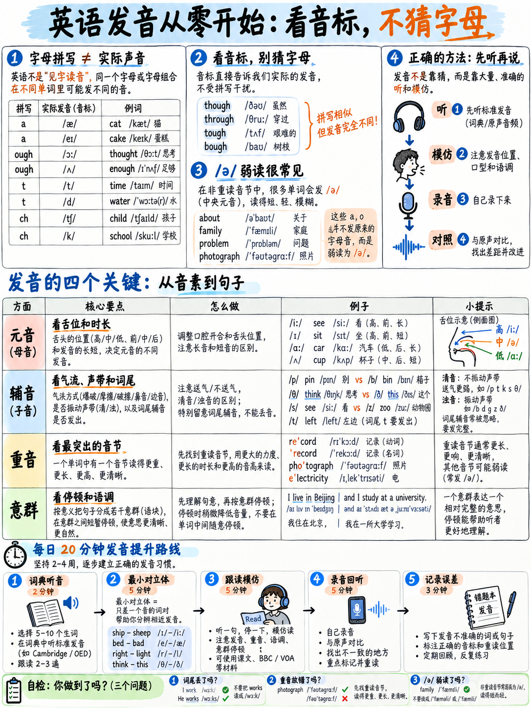

# 01. 发音从零起步：英语语音系统与考官打分心理 (Sound System from Zero)



> **模块定位**：本模块假设你**没有任何系统的语音学基础**。哪怕你从未系统学过国际音标（IPA），只要你从本章顶端开始逐字研读并开口跟练，就能在最短时间内搭建起符合雅思口语评分标准的英语发音底层操作系统。

---

## 1.1 为什么发音模块必须排在口语实战之前？

在雅思官方口语评分量表（Band Descriptors）中，考官根据四大维度给出独立分数（各项权重严格均为 25%）`[7]` `[9]`：
1. **流利度与连贯性 (Fluency and Coherence, FC)**
2. **词汇多样性 (Lexical Resource, LR)**
3. **语法多样性及准确性 (Grammatical Range and Accuracy, GRA)**
4. **发音 (Pronunciation, PR)**

许多初学者误以为发音只占 25% 的分数，甚至抱着“只要词汇高级、语法复杂，发音差一点无所谓”的侥幸心理。然而在考官真实的打分心理中，**发音是具有极强“溢出效应（Spillover Effect）”的底层杠杆**，它会直接蚕食另外三大维度的得分，甚至波及听力客观题：

* **词汇分（LR）的毁灭性连带扣分**：如果你掌握了一个 C1 级别的高级词汇（例如 *phenomenon* 或 *hierarchy*），但因为重音错位或辅音念错，导致考官在考场数秒内**未能辨识出这个词**，考官只会将其判定为无效杂音或错误词汇，你的词汇库（Lexical Resource）根本无法计入该词的功劳。
* **流利度（FC）的隐形杀手**：如果你对单词的实际读音缺乏肌肉记忆，每说一句话都要在大脑中停顿拼读。官方评分量表将“因搜索单词或发音而产生的非自然停顿”列为 Band 4/5 的典型失分指标（*pausing during which the test taker searches for words* `[11]`）。
* **听力客观题（Listening）的连锁失分**：听力与发音本质上是同一枚硬币的正反面。如果你在脑海中把 *leave* 记成短音，那么在听力填空题听到录音中的 *leave* 时，你就极大概率会在答题卡上拼写成 *live*，白白丢掉宝贵的卷面分。

因此，攻克发音不是为了追求虚荣的“伦敦腔”或“纽约腔”，而是以最小的单位时间投入，**为听力、口语词汇、口语流利度三项建立起坚固的安全护城河**。

---

## 1.2 考官打分心理：考官到底在听什么？

雅思考官在打发音分时，脑海中遵循的核心原则是：**“倾听负担（Listening Effort）与可理解度（Intelligibility）”** `[11]`。

```{mermaid}
graph TD
    A["考官打分心理雷达"] --> B["倾听负担 (Listening Effort)"]
    A --> C["重音与等时节奏 (Stress-Timing)"]
    A --> D["意义传达 (Intelligibility)"]
    
    B -->|负担沉重 / 费力猜测| B1["Band 4 - 5<br/>• 吞尾音导致时态单复数尽失<br/>• 机械平直汉字念法<br/>• 致命音位混淆"]
    B -->|偶有瑕疵 / 轻松听懂| B2["Band 6 - 7<br/>• 意群切分自然<br/>• 核心单词重音准确<br/>• 虽带母语口音但不影响理解"]
    
    C --> C1["强弱交替: 强读实词 vs 弱读虚词(Schwa /ə/)"]
    D --> D1["绝不把 rice 念成 lice, 绝不丢掉 walked 的 /t/"]
```

考官每天要面对数十位来自不同母语背景的考生。他们受过的专业培训**绝不偏袒任何特定国家口音**（英音、美音、澳音、中式英语口音在官方标准中一律平等对待 `[1]`, `[11]`）。考官扣分的唯一依据是：**你的发音习惯是否阻碍了信息的顺畅传递？**

* **Band 4-5 危险区**：考官需要皱起眉头、高度集中注意力去“解码”你到底在说哪个词；句中每一个音节都像敲木鱼一样平均用力，没有强弱高低之分；时态标志词的尾音全部丢失。
* **Band 6 安全线**：即便带有明显的中国母语口音，但考官**无需费力（without undue effort）**即可听懂绝大部分句子；具备基本的意群停顿，关键单词重音准确 `[9]`。
* **Band 7+ 冲刺区**：能够熟练运用弱读、连读、重音对比来主动**辅助逻辑表情达意**（enhancing meaning）`[11]`。

---

## 1.3 破局核心铁律：拼写绝不等于发音 (Spelling ≠ Sound)

中国考生在英语发音上遇到的最大心理障碍，是将汉语拼音“见字读音、字音一一对应”的思维套用在英语上。

必须建立的核心认知是：**英语的 26 个字母与英语实际的 44 个音位之间，不是一对一的映射关系！** 同一组字母在不同单词中有截然不同的发音，而同一个发音可以用五花八门的字母组合拼写。

### 案例 1：极其荒谬的 `ough` 组合
同一组字母 `ough`，在以下 6 个常用词中代表了 6 种完全风马牛不相及的读音：

| 单词 | 听起来近似 | IPA 国际音标 | 读音类型 |
|---|---|---|---|
| th**ough** | "th-oh" | /ðəʊ/ | 双元音 /əʊ/ |
| thr**ough** | "thr-oo" | /θruː/ | 长元音 /uː/ |
| t**ough** | "t-uff" | /tʌf/ | 短元音 /ʌ/ + 辅音 /f/ |
| c**ough** | "c-off" | /kɒf/ | 短元音 /ɒ/ + 辅音 /f/ |
| b**ough** | "b-ow" | /baʊ/ | 双元音 /aʊ/ |
| th**ough**t | "th-ort" | /θɔːt/ | 长元音 /ɔː/ + 辅音 /t/ |

### 案例 2：同一个长元音 /iː/ 的 6 种拼写面孔
再看长元音 /iː/（类似汉语“衣”，但口腔更紧绷且延展），它可以被写成：
* s**ee**（双 e）
* s**ea**（ea 组合）
* **ce**d**e**（e-辅音-e）
* p**eo**ple（eo 组合）
* k**ey**（ey 组合）
* mach**i**ne（单个字母 i）

:::{important}
**战略铁律：绝不能靠看英文拼写去猜发音！**  
你必须将这 **44 个独立声音** 从拼写中剥离出来，学会识别词典里的 IPA 国际音标。系统掌握这套音标系统仅需约 **3 个小时** 的专注训练，但这 3 小时将终身免疫所有“生造发音”和“中式音译错音”。
:::

---

## 1.4 英语 44 个核心音位全景图 (The 44 Phonemes)

国际通用的英语语音体系（以英国文化协会 British Council 现行权威体系为准 `[21]`）由 **44 个音位** 构成：**12 个单元音、8 个双元音、24 个辅音**。

音标在词典中始终书写在斜杠之内，例如 `/kæt/` 代表 *cat*。单词重音用左上角的高位垂直短线标记：`/ˈwɔːtə/` 代表 *water*，表示重音落在第一个音节上。

### 1. 单元音：7 个短元音 (Short Vowels)
短元音短促有力，绝不拖泥带水：

| 国际音标 (IPA) | 核心基准词 (Keyword) | 常见同音词与拼写拓展 | 中国考生常见误区对照 |
|---|---|---|---|
| **/ɪ/** | s**i**t | th**i**s, f**i**sh, g**i**ve, b**ui**ld | 容易念成饱满的汉语“衣”；其实舌位更低、嘴唇更放松 |
| **/e/** | b**e**d | s**ai**d, h**ea**d, m**a**ny, fr**ie**nd | 张嘴度约一指宽，不要和 /æ/ 混淆 |
| **/æ/** | c**a**t | m**a**n, b**a**d, h**a**ve, pl**a**n | “大蝴蝶音”，张嘴约两指宽，下颌明显下沉，声音在口腔前部 |
| **/ʌ/** | c**u**p | l**o**ve, s**o**me, d**oe**s, bl**oo**d | “短啊音”，短促有力，舌后部轻微抬起 |
| **/ɒ/** | h**o**t (英音) | wh**a**t, w**a**nt, cl**o**ck, b**e**cause | 嘴唇微圆，下巴下拉，短促后元音 |
| **/ʊ/** | b**oo**k | p**u**t, c**ou**ld, w**o**man, f**u**ll | 轻松短“呜”，嘴唇切勿用力向前噘起 |
| **/ə/** | **a**bout | t**ea**ch**er**, w**a**t**er**, s**u**pport, p**en**cil | **全英语最核心弱元音（Schwa）！** 嘴唇口腔完全放松 |

### 2. 单元音：5 个长元音 (Long Vowels)
长音符号 `/ː/` 表示**声音必须充分延展与保持**，不可一触即收：

| 国际音标 (IPA) | 核心基准词 (Keyword) | 常见同音词与拼写拓展 | 动作要领 |
|---|---|---|---|
| **/iː/** | s**ee** | **ea**t, th**e**se, p**eo**ple, mach**i**ne | 嘴角向两侧用力拉开（微笑状），声带长振动 |
| **/ɑː/** | c**ar** | f**a**th**er**, st**ar**t, h**ear**t, l**au**gh (英) | 口腔充分打开如医生检查咽喉，声音深沉圆润 |
| **/ɔː/** | f**our** | l**aw**, b**ough**t, m**or**e, w**a**ter | 双唇收圆向前突出，长音饱满延展 |
| **/uː/** | t**oo** | f**oo**d, bl**ue**, thr**ough**, y**ou** | 双唇用力收圆成紧致小孔，舌后部高抬 |
| **/ɜː/** | b**ir**d | w**or**k, l**ear**n, h**er**, n**ur**se | 舌身平放中间，长音持续中性发出 |

### 3. 双元音：8 个滑动双元音 (Diphthongs)
双元音由**两个元音平滑滑移组合而成**。口型绝不能固定不动，必须由前一个元音的口型**顺滑滑动到后一个元音的口型**，前重后轻：

| 国际音标 (IPA) | 核心基准词 (Keyword) | 滑动轨迹剖析 | 常见词汇示例 |
|---|---|---|---|
| **/eɪ/** | d**ay** | /e/ → /ɪ/（“诶-衣”） | m**a**ke, tr**ai**n, **eigh**t, th**ey** |
| **/aɪ/** | m**y** | /a/ → /ɪ/（“阿-衣”） | t**i**me, l**igh**t, b**uy**, h**eigh**t |
| **/ɔɪ/** | b**oy** | /ɔ/ → /ɪ/（“奥-衣”） | n**oi**se, ch**oi**ce, enj**oy** |
| **/əʊ/** | g**o** | /ə/ → /ʊ/（“呃-呜”） | h**o**me, kn**ow**, b**oa**t, th**ough** |
| **/aʊ/** | n**ow** | /a/ → /ʊ/（“阿-呜”） | h**ou**se, **ou**t, d**ow**n, all**ow** |
| **/ɪə/** | h**ere** | /ɪ/ → /ə/（“衣-呃”） | n**ear**, id**ea**, s**er**ious, r**eal**ly |
| **/eə/** | h**air** | /e/ → /ə/（“诶-呃”） | th**ere**, c**are**, w**ear**, v**ar**ious |
| **/ʊə/** | t**our** | /ʊ/ → /ə/（“呜-呃”） | p**ure**, s**ure**, **Eu**rope（现代英音常与 /ɔː/ 合流） |

### 4. 24 个辅音：8 对清浊互锁 + 8 个独立单兵

英语 24 个辅音中，最神奇的规律在于**其中 16 个辅音是两两严格成对的（清辅音 vs 浊辅音）**：

```
                    24 个辅音的“清浊配对镜像图”

     清辅音 (Voiceless, 声带不震动)      浊辅音 (Voiced, 声带强烈震动)
            /p/   pen             ◄───配对───►      /b/   bad
            /t/   tea             ◄───配对───►      /d/   dog
            /k/   cat             ◄───配对───►      /ɡ/   go
            /f/   five            ◄───配对───►      /v/   very
            /θ/   think           ◄───配对───►      /ð/   this
            /s/   see             ◄───配对───►      /z/   zoo
            /ʃ/   she             ◄───配对───►      /ʒ/   television
            /tʃ/  chair           ◄───配对───►      /dʒ/  job

   【发音解剖真相】：
   上面每一对音的发音部位（唇、齿、舌位、阻气方式）100% 完全一样！
   它们之间唯一的物理区别：【喉头声带是否产生蜂鸣振动】。
   实测体验：把手指轻轻按在喉结两侧，持续发 "ssssss"，然后切换成 "zzzzzz"。
   你会在发 "zzzzzz" 的那一瞬间感受到喉部的强烈嗡嗡蜂鸣。
   只要顿悟这一点，你在 5 分钟内就能同时掌握这 16 个辅音的口型机制！
```

剩余的 8 个不成对辅音包括：
* 3 个鼻辅音（全为浊辅音，气流从鼻腔流出）：`/m/` (**m**an), `/n/` (**n**o), `/ŋ/` (si**ng**)
* 1 个声门擦音（清辅音，气流呼出）：`/h/` (**h**ot)
* 2 个流音（舌侧音与卷舌/齿龈近音）：`/l/` (**l**eg), `/r/` (**r**ed)
* 2 个半元音（摩擦极微，滑向后续元音）：`/w/` (**w**e), `/j/` (**y**es)

---

## 1.5 英语中灵魂级的元音：中央弱元音 Schwa /ə/

如果整门课程你只能记住一个发音符号，请务必死死焊牢这个倒写的 e：**/ə/**，学术界称之为 **Schwa（弱读中央元音）**。

### 为什么说 Schwa 是英语节奏的心脏？
中文是**音节计时语言（Syllable-timed Language）**。在汉语普通话中，每一个汉字（音节）几乎占用完全相同的时长和声调权重，字正腔圆，平铺直叙。

而英语是**重音计时语言（Stress-timed Language）**。一句话所耗费的时间，不取决于它有多少个单词或音节，而取决于它有多少个**重读音节（Stressed Syllables）**！为了保持重音节拍的等时性，**英语会自动把所有非重读音节的元音全部强行压缩、坍塌成最省力的 /ə/**！

| 单词 | 中国考生常见字正腔圆误读 | 母语者真实标准发音 | 节奏重弱对比机制剖析 |
|---|---|---|---|
| **teacher** | "梯-扯" (tiː - tʃɜː) | /ˈtiːtʃə/ | 首音节重读高昂，尾音节彻底弱化为轻飘飘的 /ə/ |
| **about** | "阿-鲍特" (eɪ - baʊt) | /əˈbaʊt/ | 首音节几乎不张嘴，仅发出微弱声响 /ə/，重心猛击 BOUT |
| **computer** | "康-盘-特" (kɒm - pjuː - tɜː) | /kəmˈpjuːtə/ | 首尾两端均弱化为 /ə/，仅中间 PYOO 耸立 |
| **banana** | "巴-拿-拿" (bɑː - nɑː - nɑː) | /bəˈnɑːnə/ | 只有中间音节饱满，两头完全坍塌成 /ə/ |
| **support** | "撒-颇特" (sʌ - pɔːt) | /səˈpɔːt/ | 前缀非重读直接变成轻微叹气声 /sə/ |
| **problem** | "普罗-布勒姆" (prɒb - lem) | /ˈprɒbləm/ | 尾音节绝对不是饱满的 lem，而是极轻的 /ləm/ |
| **difficult** | "低-菲-考特" (dɪ - fɪ - kʌlt) | /ˈdɪfɪkəlt/ | 尾音节弱化坍塌为 /kəlt/ |
| **government** | "搞-温-门特" (ɡʌ - vɜːn - ment) | /ˈɡʌvənmənt/ | 连续两个非重读音节全部弱化为 /ə/ |

:::{important}
**官方评分标准与 Schwa 的生死关联：**  
官方口语 Band 6 评分细则白纸黑字写明：发音节奏不得出现“因缺乏重音等时性节奏而受损（rhythm is not affected by a lack of stress-timing）”`[9]`。  
如果你把英语的每一个音节都像念中文古诗一样饱满大声地念出来，你在考官听来就是**“典型的机器人铁板平直语调”**，节奏分直接被锁死在 Band 5！  
**学会发好 Schwa /ə/，就是掌握英语地道节奏的第一道大门！**
:::

---

## 1.6 查词典与语音输入的工业级标准动作

别再把发音停留在“自我猜测”阶段。掌握正确的词典验证流，能一劳永逸切断错误读音的积累：

1. **选用权威在线学习词典**：首选**剑桥高阶英语词典（Cambridge Dictionary）**或**牛津学习词典（Oxford Learner's Dictionaries）**。这类词典具备两项黄金标配：**标准 IPA 音标**与**真人发音音频**。
2. **眼看音标 + 重音符，耳听两遍音频**：查词时首先盯住高位重音符 `ˈ`（如 `/kəmˈpjuːtə/` 中 `ˈ` 标注在 p 之前，说明从 pyu 开始重读）。连续按播放键听两遍，重点捕捉哪个音节被重读拉长，哪个音节被缩成了 /ə/。
3. **大声跟读三遍，再放入短句输出**：不要只在心里默读。肌肉记忆需要声带与下颌的物理运动。把单词大声念出三遍，随即放进一个最简单的五词短句中说出来。
4. **英音 vs 美音：随意选，但必须保持内在一致性**：雅思官方明确表示，听力录音涵盖英、美、加、澳、新西兰等多种主流英语口音 `[1]`；口语考试考官绝不歧视任何一种标准口音。你喜欢美音的发卷舌 /r/，或者喜欢英音的不卷舌，两者皆可拿到 Band 9。**唯一要求是自我体系不要随意混乱跳跃。**

:::{tip}
**在精读与做题时顺带训练，效率翻倍：**  
永远不要单独找一个下午去死背词汇手册的发音。当你在做学术类阅读真题遇到生词时，随手查出它的 IPA 音标大声念一遍。你等于在同一次操作中完成了词义记忆、语法语境输入和发音肌肉定型！
:::

---

## 1.7 每日 20 分钟高杠杆发音训练 SOP

发音属于**运动神经与肌肉记忆（Motor Learning）**的范畴。每周突击 3 小时发音没有任何效果；而**每天坚持 20 分钟、连续坚持 3 周**，就能彻底重塑你的口腔运动定势：

| 训练时长 | 训练任务与动作分解 | 对应专项章节与工具 |
|---|---|---|
| **前 3 分钟** | **音位最小对立体热身**：大声朗读 10 组易混淆成对词（如 *rice/lice*, *seat/sit*） | {doc}`02-consonants` 与 {doc}`03-vowels-and-diphthongs` |
| **中 5 分钟** | **单词重音击掌训练**：挑选 20 个雅思学术高频词，在重读音节处用力拍手击掌 | {doc}`04-word-stress` |
| **核心 7 分钟** | **影子跟读 (Shadowing)**：截取官方听力音频 30 秒，对照文本同步跟读，模仿强弱与断句 | {doc}`05-chunking-and-sentence-stress` |
| **后 5 分钟** | **录音复盘**：针对口语 Part 1/2 任一话题录制 60 秒音频，回听一遍揪出吞音与平调 | {doc}`../60-toolkit/07-free-tools-and-self-testing` |

---

## 1.8 极速自诊测试：你的核心发音短板究竟在哪里？

你根本不需要把 44 个音标全部重新练一遍！真正拉低你分数的，永远是那些**你反复出错、且会彻底篡改词义**的少数顽疾。

现在，**请掏出手机打开录音机，以你平时的正常语速大声朗读下面这段自测段落**：

> *"Three thirsty athletes thought they would share a bowl of rice and a very thin vegetable soup. The world's best full-time workers rarely live long lives, which is sad, but it is a fact. I would like to ask whether she will choose the cheaper ticket or the more expensive one, because the price has risen sharply since March."*

录音完毕后，回听自己的录音，逐项对照以下自查清单：

| 关键听测靶点 | 你是否出现以下典型中式失分现象？ | 若中招，立即跳转专项突破 |
|---|---|---|
| **咬舌音 /θ/ 与 /ð/**<br>(*three, thirsty, thought, they, the*) | 舌尖没有伸出牙齿，念成了 /s/, /z/, /t/ 或 /d/（如把 *three* 念成 "free" 或 "tree"）？ | 查阅 {doc}`02-consonants` §2.3 |
| **卷舌与舌侧音 /r/ 与 /l/**<br>(*rice, rarely, live, long, world*) | 把 *rice* 念成了 *lice*？把 *rarely* 念得含糊不清无法辨识？ | 查阅 {doc}`02-consonants` §2.4 |
| **唇齿音 /v/ 与双唇音 /w/**<br>(*very, vegetable, would, workers, whether*) | 念 *very* 时上牙没有咬下唇，而是嘴唇撅起念成类似拼音 "w" 的声音？ | 查阅 {doc}`02-consonants` §2.5 |
| **长短元音 /iː/ 与 /ɪ/**<br>(*three, live, cheaper, since*) | 把 *live* 念得和 *leave* 一样长？元音长短完全没有拉开张力？ | 查阅 {doc}`03-vowels-and-diphthongs` §3.2 |
| **擦音与破擦音 /ʃ/ 与 /tʃ/**<br>(*share, she, choose, cheaper, sharply*) | 把 *share* 和 *chair* 混为一谈？破擦阻气不明显？ | 查阅 {doc}`02-consonants` §2.6 |
| **词尾辅音与复数时态尾音**<br>(*athletes, thought, best, risen, asked*) | 结尾辅音全部“吃掉”或吞音？把 *best* 念成 "beh"？ | 查阅 {doc}`02-consonants` §2.7 |
| **多音节学术词重音**<br>(*full-time, vegetable, expensive, rarely*) | 把 *vegetable* 念成四个平调音节？重音落错位置？ | 查阅 {doc}`04-word-stress` |
| **整段语流韵律**<br>(整段话整体听感) | 听起来像和尚念经、字字等长、没有任何轻重缓急与起伏？ | 查阅 {doc}`04-word-stress` 与 {doc}`05-chunking-and-sentence-stress` |

:::{important}
在上述清单中，**挑出你出错最严重的 3 个项目**。写在笔记本的第一页，**这三项就是你未来三周备战发音的核心大纲！** 攻克它们，你的发音表现就能立刻迈上一个全新的台阶。
:::

---

**上一章：** {doc}`../00-foundations/06-choose-your-target` | **下一章学习指南：** {doc}`02-consonants`
