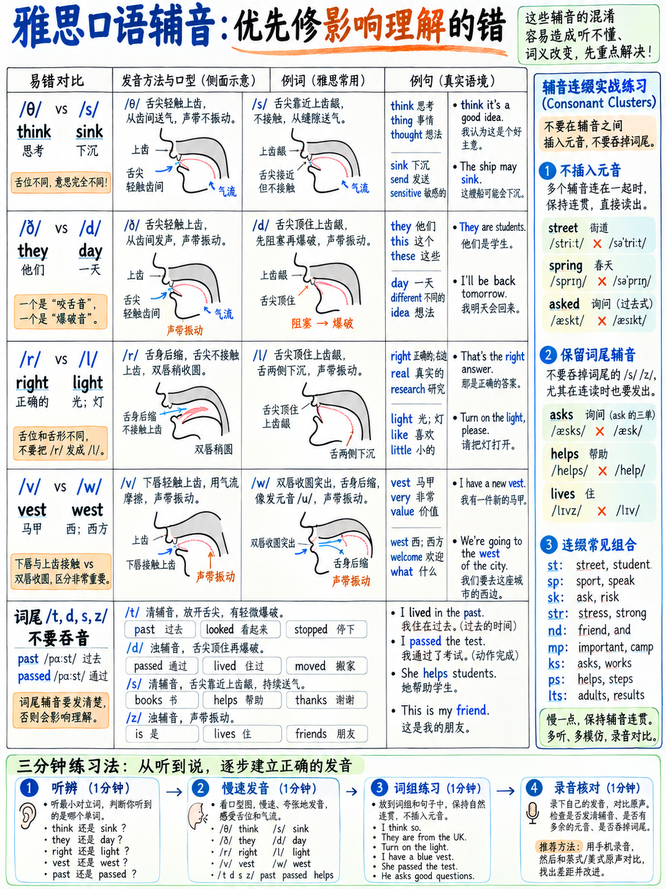

# 02. 核心辅音攻坚：中式发音易错音与齿龈音纠正 (Consonants)



> **核心导读**：英语共有 24 个辅音。但在备战雅思时，你**完全不需要把 24 个辅音从头到尾平均分配时间**！你的核心目标是精准狙击那些**一旦念错就会直接篡改词义、颠覆语法时态、让考官瞬间产生误解**的高破坏性辅音。本章按照“考场破坏力”降序排列，直击中式发音常见痛点。

---

## 2.1 科学纠音四步法 (The 4-Step Practice Protocol)

针对本章出现的每一个易错辅音，严格遵循以下四步训练法。每个音每天专注练习 5 分钟，连续练习 3 天即可形成稳固的肌肉记忆：

1. **定口型 (Position)**：对着镜子仔细阅读发音器官解剖指令（牙齿、舌尖、嘴唇的物理接触点）。闭上嘴做 5 次无声的口型准备动作，确保接触部位准确无误。
2. **单音孤立爆破 (Isolate)**：抛开单词，单独发该辅音，并持续保持 3 秒。例如持续发 `/ffffff/` 或 `/θθθθθθ/`，感受气流受阻与声带状态。
3. **最小对立体辨析 (Minimal Pairs)**：大声朗读下文给出的成对对比词（*Minimal Pairs*：两个词仅有这一个音素不同，例如 *rice* 与 *lice*）。极度夸大两者的差异。如果你的录音能让别人清晰区分这两个词，说明该发音已攻克。
4. **高负荷靶向句冲刺 (Loaded Sentence)**：用慢速将包含该音的高频句读三遍，第四遍以正常交流语速自然读出。

:::{tip}
**手机录音是检验发音的唯一客观法宝：**  
人类大脑在实时说话时会带有“听觉脑补滤镜”，你以为自己发出了标准咬舌音，但回听录音往往发现根本没有伸舌头！练习步骤 3 和步骤 4 时务必用手机录音回放，这是快速纠音的核心捷径。
:::

---

## 2.2 辅音破坏力与提分优先级天梯榜

| 优先级梯队 | 辅音 / 语音现象 | 核心失分危害 (Why it matters most) | 典型受害群体 |
|---|---|---|---|
| **Tier 1 (最致命)** | **词尾辅音脱落 (Dropping Final Consonants)** | 直接摧毁过去时态与复数标记（如把 *walked* 念成 *walk*，考官直接扣语法准确分） | 中国大陆、越南、泰国考生 |
| **Tier 2 (极高频)** | **/θ/ 与 /ð/** (*think / this*) | 极高频出现于冠词、代词、介词和核心词汇中，读错会导致每句话反复失真 | 几乎所有非母语考生 |
| **Tier 3 (改词义)** | **/r/ 与 /l/** | 颠覆单词含义：*rice / lice*（大米/虱子）、*correct / collect* | 中、日、韩考生 |
| **Tier 4 (典型中式)** | **/v/ 与 /w/** | 混淆 *vest / west*，把 *very* 念成拼音 "wei-rui" | 中国北方及南亚考生 |
| **Tier 5 (混淆对)** | **/b/ 与 /v/** | 混淆 *boat / vote*，将上齿咬下唇混淆为双唇闭合 | 中国部分方言区及西语考生 |
| **Tier 6 (舌位混淆)** | **/ʃ/, /tʃ/, /dʒ/, /ʒ/** | 混淆 *ship / chip*, *share / chair*，爆破与摩擦区分不清 | 中国考生及阿拉伯语考生 |
| **Tier 7 (阻气不严)** | **/ŋ/** (*sing*) 与 **/n/** (*sin*) | 前鼻音与后鼻音混淆，或在词尾生硬加念重浊音 /g/ | 多数非母语考生 |
| **Tier 8 (连缀塌陷)** | **辅音丛连缀 (Consonant Clusters)** | *strengths*, *asked*, *texts* 中间断音或强塞无辜元音 | 汉藏语系考生 |

---

## 2.3 极高频杀手：咬舌音 /θ/ 与 /ð/ ("th" 发音)

这是英语中最具辨识度的特征音。两个音的发音器官和口型完全一致，仅仅在于**声带是否振动**。

```
                  咬舌音物理发音机制图解

        ┌────────────────────────────────────────────────────────┐
        │  【口型与动作要领】：                                   │
        │  1. 舌尖轻微探出上下齿之间，或者舌尖轻触上齿边缘底端。  │
        │  2. 气流从舌尖与门牙之间的狭窄缝隙中平缓摩擦呼出。      │
        │  3. 绝对不要用上下牙将舌头死死咬死，气流必须能够流出！  │
        └────────────────────────────────────────────────────────┘

        清辅音 /θ/ ：声带完全不振动，纯纯的气流摩擦声。
                     常见词：think, three, both, healthy, third

        浊辅音 /ð/ ：声带剧烈嗡鸣振动，伴随齿间轻微麻痒感。
                     常见词：this, that, they, mother, breathe
```

### 最小对立体精准突破：清辅音 /θ/

| /θ/ 标准音 | 对比音 /s/（汉语拼音 s） | 对比音 /t/（齿龈爆破音） | 对比音 /f/（上齿咬下唇） |
|---|---|---|---|
| **think** /θɪŋk/ | sink /sɪŋk/ | tink /tɪŋk/ | fink /fɪŋk/ |
| **thin** /θɪn/ | sin /sɪn/ | tin /tɪn/ | fin /fɪn/ |
| **thick** /θɪk/ | sick /sɪk/ | tick /tɪk/ | — |
| **mouth** /maʊθ/ | mouse /maʊs/ | mout /maʊt/ | — |
| **path** /pɑːθ/ | pass /pɑːs/ | pat /pæt/ | — |
| **thought** /θɔːt/ | sought /sɔːt/ | taught /tɔːt/ | fought /fɔːt/ |
| **three** /θriː/ | — | tree /triː/ | free /friː/ |
| **both** /bəʊθ/ | boss /bɒs/ | bought /bɔːt/ | — |

### 最小对立体精准突破：浊辅音 /ð/

| /ð/ 标准音 | 对比音 /d/（齿龈爆破） | 对比音 /z/（舌齿近距摩擦） |
|---|---|---|
| **they** /ðeɪ/ | day /deɪ/ | — |
| **then** /ðen/ | den /den/ | zen /zen/ |
| **there** /ðeə/ | dare /deə/ | — |
| **breathe** /briːð/ | breed /briːd/ | breeze /briːz/ |
| **mother** /ˈmʌðə/ | mudder /ˈmʌdə/ | — |
| **other** /ˈʌðə/ | udder /ˈʌdə/ | — |
| **worthy** /ˈwɜːði/ | wordy /ˈwɜːdi/ | — |

### 高负荷实战练习句
1. *Three thousand athletes thought the thirty-third theory was worth nothing.*  
   （三千名运动员认为第三十三种理论毫无价值。）
2. *They thought that other mothers would rather gather there than bother with this.*  
   （他们以为其他母亲宁愿在那儿聚会，也不愿为此烦恼。）
3. *Both brothers breathe through their mouths, which is neither healthy nor worthwhile.*  
   （两兄弟都用嘴呼吸，这既不健康也不合算。）

:::{note}
**为什么 /θ/ 和 /ð/ 值得你花大力气彻底解决？**  
原因在于其**超高频的使用率**。英语中最常见的单词群——*the, this, that, these, those, they, them, there, then, than, with, other, another, both, three, thing, think, through, together*——全部包含这两个音素。  
如果在 1 分钟的口语答题里，你把这些词全部错念成 /s/, /z/, /t/ 或 /d/，听觉失真发生几十次，官方 Band 6 中“发音错误仅偶发导致理解不清（mispronunciations cause only occasional lack of clarity `[9]`）”的红线就会被瞬间击穿！
:::

---

## 2.4 舌位之争：卷舌/齿龈近音 /r/ 与 舌侧音 /l/

中国考生（尤其是南方方言区考生）常常在 /r/ 和 /l/ 之间界限模糊，最典型的惨案是将 *rice*（米饭）读成 *lice*（头虱）。

```
                    /r/ 与 /l/ 的物理舌位对立检验

    /r/ 音（发音时舌尖绝对不碰任何部位）：
    舌尖轻微向后向上卷起或向后缩，悬浮在口腔中间，【舌头绝对不接触上颚或牙齿】！
    双唇微圆。声带振动，发出类似小狗低沉咆哮前的启动声。
    注意：英语的 /r/ 不是颤音（不打舌颤），也不是汉语拼音日（r）那样的强烈硬擦音。

    /l/ 音（发音时舌尖必须死死顶住）：
    舌尖用力顶住【上门牙背后的齿龈凸起部位（Alveolar Ridge）】！
    舌身两侧向下塌陷，气流伴随声带振动从舌头两侧平缓溢出。

    【一秒自检黄金法则】：
    发 /l/ 时舌尖必须【碰住】上颚！如果发音过程中你的舌头悬空，就是错发。
    发 /r/ 时舌尖必须【悬空】！如果你的舌尖碰到了任何牙齿或上颚，就是错发。
```

### 最小对立体精准对比

| /r/ 音（舌悬空） | /l/ 音（舌顶上颚） | 中文含义对比 |
|---|---|---|
| **rice** /raɪs/ | **lice** /laɪs/ | 大米 vs 虱子 |
| **right** /raɪt/ | **light** /laɪt/ | 正确/右 vs 光线/轻 |
| **road** /rəʊd/ | **load** /ləʊd/ | 道路 vs 负荷 |
| **pray** /preɪ/ | **play** /pleɪ/ | 祈祷 vs 玩耍 |
| **crowd** /kraʊd/ | **cloud** /klaʊd/ | 人群 vs 云朵 |
| **correct** /kəˈrekt/ | **collect** /kəˈlekt/ | 正确的 vs 收集 |
| **arrive** /əˈraɪv/ | **alive** /əˈlaɪv/ | 到达 vs 活着的 |
| **fry** /fraɪ/ | **fly** /flaɪ/ | 油炸 vs 飞行 |
| **grass** /ɡrɑːs/ | **glass** /ɡlɑːs/ | 草地 vs 玻璃 |
| **berry** /ˈberi/ | **belly** /ˈbeli/ | 浆果 vs 腹部 |

### 高负荷实战练习句
1. *Really rural areas rarely rely on regular railway lines.*  
   （真正的乡村地区很少依赖常规铁路干线。）
2. *The lorry driver really loved the long, lonely road to the library.*  
   （卡车司机真心热爱这条通往图书馆的漫长而孤独的公路。）

:::{warning}
**英音与美音中 /r/ 的卷舌差异：**  
在标准英国公认发音（RP）中，**/r/ 只有在元音之前才发音**（如 *red*, *arrive*）。在词尾或辅音前的 r 是不发卷舌音的：*car* 念作 /kɑː/，*water* 念作 /ˈwɔːtə/。而在美音中，所有的 r 都要卷舌发音。  
雅思考官完全接受美音的全面卷舌，也完全接受英音的非元音前不卷舌。**核心是保持全篇一致，切忌一个句子前半截学美音卷舌、后半截又突变英音。**
:::

---

## 2.5 唇与齿的角力：/v/ 与 /w/，以及 /b/ 与 /v/

中国许多北方考生由于母语普通话中没有唇齿浊擦音 /v/，极易把 *very* 读成拼音的 "wei-ri"；而在部分南方省份或方言区，考生容易把 /v/ 发成双唇闭合的 /b/。

```
                  唇齿音与双唇音的运动轨迹区分

    /v/ 唇齿擦音：【上门牙轻咬下嘴唇内侧边缘】！
                 气流从唇齿缝隙挤压而出，同时声带剧烈振动发出嗡鸣（类似手机马达震动）。
                 绝对不可将上下双唇合拢！

    /w/ 唇化半元音：【牙齿完全不参与】！
                 双唇收圆并向前用力撅出（如亲吻口型），随即快速向四周滑开。

    /b/ 双唇爆破音：【上下嘴唇完全紧闭】！
                 气流在唇后蓄积，随后双唇瞬间向外爆破弹开。
```

### 最小对立体精准对比

| /v/（齿咬唇） | /w/（双唇撅起圆口） | | /b/（双唇紧闭爆破） | /v/（齿咬唇） |
|---|---|---|---|---|
| **vest** /vest/ | west /west/ | | **boat** /bəʊt/ | vote /vəʊt/ |
| **vine** /vaɪn/ | wine /waɪn/ | | **berry** /ˈberi/ | very /ˈveri/ |
| **veil** /veɪl/ | whale /weɪl/ | | **ban** /bæn/ | van /væn/ |
| **verse** /vɜːs/ | worse /wɜːs/ | | **bat** /bæt/ | vat /væt/ |
| **vary** /ˈveəri/ | wary /ˈweəri/ | | **best** /best/ | vest /vest/ |
| **vet** /vet/ | wet /wet/ | | **bowel** /ˈbaʊəl/ | vowel /ˈvaʊəl/ |

### 高负荷实战练习句
1. *We were very worried when eleven visitors arrived at the western village in a van.*  
   （当十一位访客乘着一辆面包车抵达西部村庄时，我们非常担忧。）
2. *Victor voted for the best vacant seat, but Bob believed the view was very valuable.*  
   （维克多投票选择了最好的空位，但鲍勃认为这片视野极具价值。）

---

## 2.6 摩擦与破擦之争：/ʃ/, /tʃ/, /dʒ/, /ʒ/ 爆破群

这一组辅音被语音学称为“齿龈后音群”。核心分水岭在于：**是单纯的气流摩擦持续喷出，还是先彻底阻断气流然后再剧烈爆发？**

* **/ʃ/**（对应拼音类似 "sh"，但嘴唇更圆前凸）：持续摩擦音，无阻断。如 *ship, she, nation*。
* **/tʃ/**（对应 "ch"）：**破擦音**。舌尖先用力顶住上齿龈阻断气流（如同 /t/ 的预备动作），然后突然释放摩擦！如 *chip, chair, watch, picture*。
* **/dʒ/**（对应 "j"）：**/tʃ/ 的浊音版**。先阻流再释放，伴随强烈的声带震动。如 *job, age, bridge, generally*。
* **/ʒ/**：**/ʃ/ 的浊音版**。持续摩擦伴随声带震动，非常少见但高频出现在词中。如 *television, measure, usually, vision*。

### 最小对立体精准对比

| /ʃ/（纯摩擦） | /tʃ/（先阻断后摩擦） | /dʒ/（浊破擦） |
|---|---|---|
| **ship** /ʃɪp/ | **chip** /tʃɪp/ | — |
| **share** /ʃeə/ | **chair** /tʃeə/ | — |
| **wash** /wɒʃ/ | **watch** /wɒtʃ/ | — |
| **sheep** /ʃiːp/ | **cheap** /tʃiːp/ | **jeep** /dʒiːp/ |
| **shoes** /ʃuːz/ | **choose** /tʃuːz/ | **juice** /dʒuːs/ |
| **shin** /ʃɪn/ | **chin** /tʃɪn/ | **gin** /dʒɪn/ |
| **mash** /mæʃ/ | **match** /mætʃ/ | **Madge** /mædʒ/ |

### 高负荷实战练习句
> *She chose a cheap chair and washed the sheets, which she usually changes each Tuesday.*  
> （她挑选了一把便宜的椅子并清洗了床单，她通常每周二都会换洗床单。）

---

## 2.7 词尾辅音脱落：中式发音杀伤力最大的死穴

汉语普通话的音节结构绝大多数以元音结尾，或者以鼻音 /n/, /ŋ/ 结尾（如“天”、“光”），**完全没有任何爆破辅音作尾音（No Codas）**。受此母语习惯的负迁移影响，中国考生在说英语时，会下意识地做两件致命动作：
1. **彻底吞掉词尾辅音**（把 *walked* 读成 "wo"，把 *need* 读成 "nee"）；
2. **在词尾辅音后面强塞一个毫无意义的弱元音“呃”**（把 *desk* 读成 "des-ke"，把 *and* 读成 "an-de"）。

:::{danger}
**在英语中，词尾辅音承载着 80% 的核心语法标记！**  
如果你把 *walked* 的尾音吃掉，考官听到的就是动词现在原形 *walk*；在口语 Part 2 描述过去故事时，考官会直接判定你“全程语法时态混乱”，GRA 分数断崖式跌入 Band 5！
:::

| 易错词汇对比 | 尾音物理差异 | 雅思考试的生死后果 (Why IELTS cares) |
|---|---|---|
| **walk** vs **walked** | 结尾多出一个清脆的短音 **/t/** | **核心时态标志**：写作 Task 1 图表与口语 Part 2 全篇依赖过去时态 |
| **book** vs **books** | 结尾多出清辅音 **/s/** | **可数名词单复数**：客观题听力若漏写 s 直接判错 0 分 |
| **he live** vs **he lives** | 结尾多出浊辅音 **/z/** | **第三人称单数主谓一致**：考官最敏感的语法底线 |
| **ride** vs **right** | 结尾为浊音 **/d/** vs 清音 **/t/** | 彻底篡改单词含义（骑车 vs 正确/右） |
| **need / needs / needed** | 原形 / 浊音 /z/ / 多出一整个音节 /ɪd/ | 三种完全不同的语法功能与时态形态 |

---

### 规则一：动词过去式 `-ed` 的三定律（绝无例外）

很多考生以为所有动词过去式都要念出独立的“得”音节。**这是完全错误的！只有在 /t/ 和 /d/ 结尾后，`-ed` 才会增加一个音节！**

| 动词末尾原本的声音类型 | `-ed` 的唯一法定读音 | 是否增加额外音节？ | 实战权威例词 |
|---|---|---|---|
| 以音标 **/t/** 或 **/d/** 结尾 | 读作 **/ɪd/** | **是，增加 1 个新音节** | wan**ted**, nee**ded**, star**ted**, deci**ded**, visi**ted** |
| 以其他**清辅音**结尾<br>(/p/, /f/, /k/, /s/, /ʃ/, /tʃ/, /θ/) | 读作短促的清辅音 **/t/** | **否，绝不增加音节** | wal**ked**, hel**ped**, wa**shed**, wat**ched**, lau**ghed**, pass**ed**, develo**ped** |
| 以其他**浊辅音**或**元音**结尾 | 读作弱浊辅音 **/d/** | **否，绝不增加音节** | play**ed**, liv**ed**, chan**ged**, call**ed**, open**ed**, learn**ed** |

### 规则二：复数与第三人称单数 `-s / -es` 的三定律（绝无例外）

| 单词末尾原本的声音类型 | `-s / -es` 的唯一法定读音 | 是否增加额外音节？ | 实战权威例词 |
|---|---|---|---|
| 以咝音结尾<br>(/s/, /z/, /ʃ/, /ʒ/, /tʃ/, /dʒ/) | 读作 **/ɪz/** | **是，增加 1 个新音节** | wa**shes**, wat**ches**, choo**ses**, pla**ces**, chan**ges** |
| 以其他**清辅音**结尾 | 读作清辅音 **/s/** | **否，绝不增加音节** | boo**ks**, sto**ps**, ca**ts**, lau**ghs** |
| 以其他**浊辅音**或**元音**结尾 | 读作弱浊音 **/z/** | **否，绝不增加音节** | jo**bs**, han**ds**, ca**rs**, play**s**, tree**s** |

### 专项挑战靶句：
> *He walked, helped and washed, then he wanted and needed and decided; finally he played, lived and changed.*  
> （他步行、帮助并清洗，接着他想要、需要并决定；最终他玩耍、生活并改变。）

请用手指敲击桌面数音节：*walked* 只有 1 个音节（walk-t），*wanted* 才有 2 个音节（wan-tid）！

---

## 2.8 辅音丛连缀攻坚 (Consonant Clusters)

英语允许在一个音节的开头连续堆叠多达 3 个辅音（如 *str-*），在词尾连续堆叠多达 4 个辅音（如 *-ngths*）。而汉语每个字只有“声母+韵母”。

中国考生在遇到连续辅音时，常犯两种典型错误：
1. **加音**：在辅音之间生硬插塞元音（把 *strong* 念成 "si-te-long"）；
2. **缺斤少两**：遇到复杂辅音丛直接丢弃中间的音（把 *strengths* 念成 "strend"，把 *asked* 念成 "ask"）。

### 辅音丛梯级递进拼读法（绝不插塞元音）：
```
    练习核心要领：不要急于求成！从慢速物理机械分解开始逐个贴合：
    s ... t ... r ... o ... ng
    st ... r ... ong
    str ... ong
    strong          ◄── 感受从 s 到 t 再到 r 的无缝滑移，严禁发出任何“丝、特”元音！
```

| 辅音丛类型 | 雅思高频必练词汇库 | 训练痛点与防错警示 |
|---|---|---|
| **/str/** | strong, street, structure, instruct, strategy | 不要念成 "si-te-r..."，s 与 t 紧密贴合 |
| **/spr/ /spl/** | spring, spread, split, splendid | 清辅音在 s 后轻微失去强送气（变浊感） |
| **/θr/** | three, through, threat, throw | 先咬住舌尖发 /θ/，舌尖快速后缩卷入 /r/ |
| **/sks/ /sts/** | asks, tasks, risks, costs, tests, texts, guests | 词尾连续爆破，气流保持紧凑摩擦 |
| **/kt/ /kts/** | fact, facts, product, products, aspect, aspects | 舌根顶住软腭做 /k/ 的阻气，再弹出 /ts/ |
| **/ŋθs/** | strengths, lengths | **全英语最难辅音连缀！**鼻后音直接转咬舌再转清咝音 |
| **/lv/ /lvd/** | solve, solved, involved, twelve | 舌尖抵住上齿龈发 /l/，下唇迅速接咬发 /vd/ |
| **/nts/ /nds/** | students, parents, friends, hands, trends | 写作与口语出现率最高，尾音切莫丢失 |

### 高负荷实战练习句
1. *The students' parents asked about the costs and risks of the tests and texts.*  
   （学生家长们询问了各项测试与文本教材的成本和风险。）
2. *Her strengths involved twelve different aspects of the products.*  
   （她的长处涵盖了这些产品的十二个不同方面。）

---

## 2.9 每日 3 分钟辅音定型训练清单

每天晨读或备考前，抽出 3 分钟完成以下动作：
- [ ] 按照第一章自诊测试中挑出的**前两项最薄弱辅音**，各选取 5 组最小对立体，横向交叉大声对比朗读；
- [ ] 挑选两个包含高难度辅音丛的单词（如 *strengths*, *asked*），用慢速递进拼读法各读 5 遍；
- [ ] 大声朗读本章中对应的 2 个高负荷实战练习句，录音并回听；
- [ ] 检查录音：时态尾音 `-ed` 和名词复数 `-s` 是否清晰交代？咬舌音舌尖是否真实伸出？

---

**上一章：** {doc}`01-start-here-sound-system` | **下一章学习指南：** {doc}`03-vowels-and-diphthongs`
