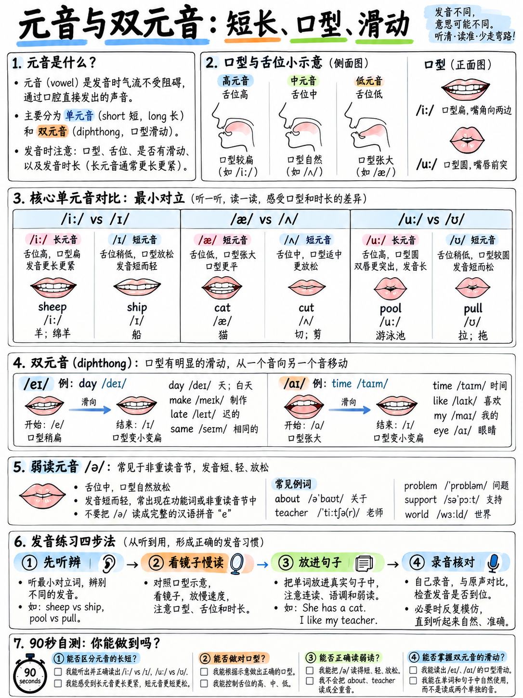

# 03. 元音与双元音：饱满度、长短音对比与口型规范 (Vowels and Diphthongs)



> **核心导读**：辅音决定了考官能否**听懂具体词汇**，而元音则直接决定了你整段口语的**韵律与音质（Vocal Quality & Rhythm）**。雅思官方 Band 6 发音评分指标中明确提及的“重音等时性（stress-timing）”与“弱读连贯性”，其底层支撑就是元音的张弛、长短与弱化。

---

## 3.1 掌控英语元音的三大物理维度

在汉语普通话中，拼音韵母（如 a, o, e, i, u, ü）的音长相对均衡，口腔肌肉多处于放松状态。然而，英语元音体系由以下**三个截然不同的物理维度**共同定义：

1. **下颌开合度与舌位 (Mouth Position & Tongue Height)**：口腔下颌打开的程度（从闭合到大张）以及舌隆起部位（前、中、后）。
2. **时长的物理延展性 (Vocal Length & Tension)**：长元音与短元音绝不仅仅是“发音长短”的差异，更是**肌肉紧张度（Tense vs. Lax）**的剧烈对比。长音符号 `/ː/` 代表发音器官的张力与时长的物理延展。
3. **双元音的动态滑动 (Movement / Glide)**：双元音不是两个静态元音的拼贴，而是**从起始口型向目标口型平滑、持续地物理滑移**。

```
                   英语元音舌位与口腔截面全景图

                前元音 (Front)         中元音 (Centre)         后元音 (Back)
          ┌─────────────────────────────────────────────────────────────┐
   闭口   │   /iː/ see (长、紧)                              /uː/ too (长、紧)
  (Close) │     /ɪ/ sit (短、松)                            /ʊ/ book (短、松)
          │                               /ə/ about (核心弱元音)
   半开   │    /e/ bed (一指宽)            /ɜː/ bird (长中音)   /ɔː/ four (圆唇长音)
   (Mid)  │                                /ʌ/ cup (短促)
          │     /æ/ cat (大开口两指)                         /ɒ/ hot (英音圆唇短音)
   全开   │                                                 /ɑː/ car (深沉后长音)
  (Open)  └─────────────────────────────────────────────────────────────┘

   【下颌阶梯下沉极速感知练习】：
   保持舌尖轻抵下齿背，按顺序缓慢念出：/iː/ → /ɪ/ → /e/ → /æ/
   对照词汇：see (/iː/) → sit (/ɪ/) → set (/e/) → sat (/æ/)
   感受你的下巴伴随四个单词像下楼梯一样，逐级向下沉降四次！
```

---

## 3.2 致命重灾区：/iː/ 与 /ɪ/ 的张弛长短对决

这是中国考生乃至非母语考生失分最惨重、听力丢分最隐蔽的一组元音对立。

* **/iː/（长元音，紧绷感）**：嘴角向两侧尽力拉开，呈极度微笑状，舌前部向硬腭高高抬起，声带伴随肌肉张力发出持续饱满的“长衣”音。
* **/ɪ/（短元音，松弛感）**：嘴角自然放松，下颌比发 /iː/ 时下垂约半指宽度，舌位略微后缩，短促、轻松地发出一个介于“衣”和“呃”之间的松弛短音。

| /iː/（长音、肌肉紧绷微笑） | /ɪ/（短音、肌肉放松下沉） | 词义截然对立对比 | 听力考场陷阱提示 |
|---|---|---|---|
| **seat** /siːt/ | **sit** /sɪt/ | 座位 (名) vs 坐下 (动) | 听力填空题极易混淆 |
| **feel** /fiːl/ | **fill** /fɪl/ | 感觉 vs 填满 | 混淆会导致句意完全走样 |
| **leave** /liːv/ | **live** /lɪv/ | 离开 vs 居住/生活 | **雅思听力最高频失分重灾区！** |
| **sheep** /ʃiːp/ | **ship** /ʃɪp/ | 绵羊 vs 轮船 | 考官辨识度极高 |
| **beat** /biːt/ | **bit** /bɪt/ | 击打 vs 一点点 | 语意完全偏离 |
| **green** /ɡriːn/ | **grin** /ɡrɪn/ | 绿色 vs 咧嘴笑 | 词性与含义差异 |
| **reach** /riːtʃ/ | **rich** /rɪtʃ/ | 达到 vs 富有 | 极高频学术词汇 |
| **heat** /hiːt/ | **hit** /hɪt/ | 热量 vs 命中/打击 | 科学与日常高频词 |
| **each** /iːtʃ/ | **itch** /ɪtʃ/ | 每个 vs 发痒 | 语法代词 vs 动词 |
| **week** /wiːk/ | **wick** /wɪk/ | 星期 vs 烛芯 | 听力时间词核心考点 |

### 高负荷实战练习句
> *He will leave this evening to live in the city, and he feels he will fill three weeks with it.*  
> （他将于今晚离开并前往那座城市居住，他觉得这会填满他整整三周的时间。）

:::{important}
**长短音辨析对雅思听力客观题的致命影响：**  
在雅思听力 Section 1 个人信息填空或 Section 3 学术讨论中，如果录音中出现 *"I will leave the campus next Monday"*, 而你脑海中由于分不清长短音，在机考输入框中键入了 *"live"*, 机器阅卷系统会立刻判定拼写错误，扣除整整 1 分！  
搞清 /iː/ 与 /ɪ/ 不仅仅是为了口语，更是为了守住听力的客观分基本盘！
:::

---

## 3.3 其他高破坏性单元音对比组

### 1. /æ/（梅花大蝴蝶音）vs /e/（床音）
* **/æ/**：下颌完全下拉，张嘴可容纳食指与中指两个指关节，舌前部下压，声音在大开口腔中产生共鸣。
* **/e/**：张嘴度仅容纳一个指尖，嘴角适度放松，发音短脆。

| /æ/（大开口两指） | /e/（适度开口一指） | 词义对立提示 |
|---|---|---|
| **bad** /bæd/ | **bed** /bed/ | 坏的 vs 床 |
| **man** /mæn/ | **men** /men/ | 单数男人 vs 复数男人（写作严重失分点） |
| **sad** /sæd/ | **said** /sed/ | 悲伤的 vs 说（过去式） |
| **had** /hæd/ | **head** /hed/ | 有（过去式） vs 头部 |
| **pan** /pæn/ | **pen** /pen/ | 平底锅 vs 钢笔 |
| **and** /ænd/ | **end** /end/ | 连词“和” vs 结束 |
| **band** /bænd/ | **bend** /bend/ | 乐队 vs 弯曲 |

---

### 2. /ʌ/（短啊音）vs /ɒ/（英音短圆唇）vs /ɑː/（深沉长啊音）

很多中国考生会将 *cup, cop, carp* 统一念成汉语的“卡”。这三个音在口腔深浅和唇形上有本质区别：

| /ʌ/（短促，舌中微抬，不圆唇） | /ɒ/（短促，下巴下拉，双唇收圆） | /ɑː/（长音，喉部大开，深沉延展） |
|---|---|---|
| **cup** /kʌp/ (杯子) | **cop** /kɒp/ (警察) | **carp** /kɑːp/ (鲤鱼) |
| **hut** /hʌt/ (小屋) | **hot** /hɒt/ (热) | **heart** /hɑːt/ (心脏) |
| **bun** /bʌn/ (小面包) | **bond** /bɒnd/ (纽带/债券) | **barn** /bɑːn/ (谷仓) |
| **much** /mʌtʃ/ (许多) | **mock** /mɒk/ (嘲弄/模拟) | **march** /mɑːtʃ/ (游行/行进) |
| **cut** /kʌt/ (切割) | **cot** /kɒt/ (折叠床) | **cart** /kɑːt/ (手推车) |
| **luck** /lʌk/ (幸运) | **lock** /lɒk/ (锁) | **lark** /lɑːk/ (百灵鸟) |

---

### 3. /uː/（长乌音，紧缩圆唇）vs /ʊ/（短乌音，放松微圆）

| /uː/（嘴唇用力缩成紧致小孔，长音） | /ʊ/（嘴唇微圆完全放松，短促音） |
|---|---|
| **pool** /puːl/ (水池) | **pull** /pʊl/ (拉扯) |
| **fool** /fuːl/ (傻瓜) | **full** /fʊl/ (充满的) |
| **Luke** /luːk/ (人名卢克) | **look** /lʊk/ (看) |
| **suit** /suːt/ (西装/适合) | **soot** /sʊt/ (烟灰) |
| **food** /fuːd/ (食物) | **foot** /fʊt/ (脚) |

---

### 4. 孤独的长中元音 /ɜː/ (卷舌/平舌核心长音)

**/ɜː/** 是许多初学者的发音真空地带。在英音中，它是一个完全不卷舌的长弱音延展；在美音中则伴随舌身卷起。口型呈中性放松，长长地稳住发音。

> *The nurse learned the first word she heard about her work on Thursday.*  
> （这位护士在周四听到了关于她工作内容的第一个词，并记住了它。）

**雅思高频核心 /ɜː/ 词汇库**：  
*bird, word, work, world, worse, worth, first, third, learn, earn, early, heard, her, nurse, Thursday, turn, burn, church, purpose, service, person, certain, further, research, perfect* (形容词), *university* (第二音节)。

---

## 3.4 8 个双元音：嘴形必须发生物理滑移 (Diphthongs)

中国考生的典型通病是把双元音“拍扁”成单个静态元音（例如把 /əʊ/ 念成汉语拼音单一平直的 "o"，把 /eɪ/ 念成汉语单一的 "e"）。

双元音的本质就是**“口型滑梯”**：从第一个元音的口型出发，顺滑滑移到第二个元音的口型，**前长后短、前重后轻**！

| 音标 | 滑移轨迹机制 | 慢速拆解体会口诀 | 雅思核心学术词汇库 |
|---|---|---|---|
| **/eɪ/** | 从 /e/ 滑向 /ɪ/ | “诶——衣” | d**ay**, m**a**ke, l**a**te, tr**ai**n, **eigh**t, th**ey**, n**a**me, s**a**me, pl**a**ce, **A**pril |
| **/aɪ/** | 从 /a/ 滑向 /ɪ/ | “啊——衣” | m**y**, t**i**me, l**igh**t, f**i**ve, r**igh**t, b**uy**, l**i**ke, wh**i**le, m**igh**t, **a**pply |
| **/ɔɪ/** | 从 /ɔ/ 滑向 /ɪ/ | “奥——衣” | b**oy**, n**oi**se, ch**oi**ce, enj**oy**, p**oi**nt, **a**void, empl**oy** |
| **/əʊ/** | 从 /ə/ 滑向 /ʊ/ | “呃——呜” | g**o**, h**o**me, kn**ow**, n**o**, m**o**st, sh**ow**, **o**ver, b**o**th, **al**though, s**o**cial |
| **/aʊ/** | 从 /a/ 滑向 /ʊ/ | “啊——呜” | n**ow**, h**ow**, h**ou**se, **ou**t, d**ow**n, **a**bout, **al**low, f**ou**nd, **a**mount |
| **/ɪə/** | 从 /ɪ/ 滑向 /ə/ | “衣——呃” | h**ere**, n**ear**, y**ear**, cl**ear**, id**ea**, s**er**ious, r**eal**ly, **a**ppear, c**a**reer |
| **/eə/** | 从 /e/ 滑向 /ə/ | “诶——呃” | h**air**, th**ere**, c**are**, wh**ere**, sh**are**, v**ar**ious, **a**ware, comp**a**re |
| **/ʊə/** | 从 /ʊ/ 滑向 /ə/ | “呜——呃” | t**our**, p**ure**, s**ure**, **Eu**rope, d**ur**ing, c**ur**ious |

### 双元音高负荷练习句
1. *I know my own home, and I hope those old boats go slowly over the ocean.* (/əʊ/)  
   （我清楚自己的家园，我也希望那些旧船在海洋上缓缓航行。）
2. *They say the same place takes eight days to make safe again.* (/eɪ/)  
   （他们说同一个地方需要整整八天才能重新变得安全。）
3. *How now — the loud crowd found out about the amount of ground outside.* (/aʊ/)  
   （现在如何——吵闹的人群查明了外面场地的面积。）

:::{warning}
**最具杀伤力的 /əʊ/ 陷阱：**  
在标准英国与国际英语中，*no, know, go, so, home, most, both, though, whole, social, over, open, control, approach* 中的双元音，**起始口型必须是中性放松的 Schwa /ə/，绝对不能是噘起圆嘴唇的拼音 "o"！**  
如果把 *go* 念成类似汉语“钩”或“锅”，考官能瞬间识破你的母语口音。每天对着镜子用“呃—呜”口型练习 3 分钟 /əʊ/，你整个口语的气质都会发生质的飞跃。
:::

---

## 3.5 弱读式 (Weak Forms)：在语流中坍塌的元音

在连贯口语表达中，语法虚词（介词、冠词、连词、助动词、代词）**绝不能按照单个查词典时的饱满重读发音来读**！它们会彻底缩减、坍塌成最省力的弱读式（绝大多数元音坍塌为 Schwa /ə/）。

这不是马虎偷懒，而是地道英语语音的**核心法定规则**！官方评分细则 Band 7/8 明确奖励“熟练且灵活地运用连贯语流特征与弱读弱化（flexible use of features of connected speech `[9]`）”。

| 语法虚词 | 独立强读式 (单字字典音) | 日常连贯语流中的法定弱读式 (Weak Form) | 连贯实战语境示范 |
|---|---|---|---|
| **a** | /eɪ/ | **/ə/** | a **book** → /ə ˈbʊk/ |
| **the** | /ðiː/ | **/ðə/** (辅音前), **/ðɪ/** (元音前) | the **car** → /ðə ˈkɑː/ ; the **apple** → /ðɪ ˈæpl/ |
| **to** | /tuː/ | **/tə/** | to **go** → /tə ˈɡəʊ/ |
| **of** | /ɒv/ | **/əv/**, 甚至弱化为 **/ə/** | cup of **tea** → /ˈkʌp ə ˈtiː/ |
| **for** | /fɔː/ | **/fə/** | for a **week** → /fər ə ˈwiːk/ |
| **from** | /frɒm/ | **/frəm/** | from **London** → /frəm ˈlʌndən/ |
| **and** | /ænd/ | **/ən/**, 极快时仅保留鼻音 **/n/** | fish and **chips** → /ˈfɪʃ ən ˈtʃɪps/ |
| **can** (肯定句) | /kæn/ | **/kən/** (注意：否定句 *can't* /kɑːnt/ 必须重读！) | I can **do** it → /aɪ kən ˈduː ɪt/ |
| **was** | /wɒz/ | **/wəz/** | He was **late** → /hi wəz ˈleɪt/ |
| **are** | /ɑː/ | **/ə/** | We are **ready** → /wi ə ˈredi/ |
| **have** (助动词) | /hæv/ | **/həv/**, **/əv/** | They have **gone** → /ðeɪ əv ˈɡɒn/ |
| **that** (连词) | /ðæt/ | **/ðət/** | I know that **he** is... → /aɪ nəʊ ðət hi ɪz/ |
| **as** | /æz/ | **/əz/** | as soon as **possible** → /əz ˈsuːn əz ˈpɒsəbl/ |
| **at** | /æt/ | **/ət/** | look at **it** → /ˈlʊk ət ɪt/ |
| **some** | /sʌm/ | **/səm/** | some **people** → /səm ˈpiːpl/ |
| **them** | /ðem/ | **/ðəm/**, 甚至省略为 **/əm/** | tell them **all** → /ˈtel ðəm ˈɔːl/ |

### 连贯语流连环弱读靶句：
* *a **cup** of **tea*** → /ə ˈkʌp ə ˈtiː/ （绝不要念成 "A - CAP - OF - TEE"）
* *I'd **like** to **go** to the **park*** → /aɪd ˈlaɪk tə ˈɡəʊ tə ðə ˈpɑːk/
* ***lots** of **them** are **here** for a **week*** → /ˈlɒts ə ðəm ə ˈhɪə fər ə ˈwiːk/

:::{tip}
**听力速度过快的千古谜题终于解开：**  
许多考生在刷听力题时抱怨：“录音语速太快了，完全跟不上！”  
**录音其实根本没有加速，而是录音里的语法虚词全部发生了弱读和坍塌！** 当你的大脑还在期待听到清晰饱满的 *"I would like TO go TO THE park"* 时，母语者早已经用极为轻巧的弱读一闪而过了。  
一旦你能在自己的口语中主动发出弱读式，你的耳朵就能在听力考试中秒速捕捉这些被弱化的信号！
:::

---

## 3.6 90 秒元音周度自测巡检表

请用手机录下你朗读以下段落的音频，并对照巡检表打勾自查：

> *"I think it will be easy to leave the city in May, but my sister said she would rather walk to work than look for a bus. The world is full of people who choose a short course over a long one, although both cost about the same amount of money. Her career now involves researching various areas of social behaviour, which she finds genuinely enjoyable."*

| 巡检维度 | 靶标词汇 | 考官合格标杆自查标准 | 是否过关 |
|---|---|---|---|
| **长短音 /iː/ vs /ɪ/** | *easy, leave, city, think, it, will* | *leave* 明显比 *city* 中的两个元音更长、肌肉更紧绷微笑 | [ ] |
| **双元音 /eɪ/** | *May, same* vs *said* | *May* 口型明显滑移；*said* 读短元音 /sed/ 而非双元音 | [ ] |
| **后元音区分** | *walk, work, world* | *walk* 为圆唇 /ɔː/；*work* 和 *world* 为长中音 /ɜː/ | [ ] |
| **乌音张弛** | *full, choose, look, bus* | *full / look* 松弛短促；*choose* 紧圆长音；*bus* 短促 /ʌ/ | [ ] |
| **双元音 /əʊ/** | *both, over, social, although* | 起始发音绝对不是拼音 "o"，而是 Schwa 启动并滑向 /ʊ/ | [ ] |
| **滑动双元音** | *career, various, areas* | 喉部与口型有清晰的滑移，不念成单音 | [ ] |
| **弱读式坍塌** | *about, amount, money, behaviour* | 非重读音节全部轻快弱化为 Schwa /ə/ | [ ] |

---

**上一章：** {doc}`02-consonants` | **下一章学习指南：** {doc}`04-word-stress`
